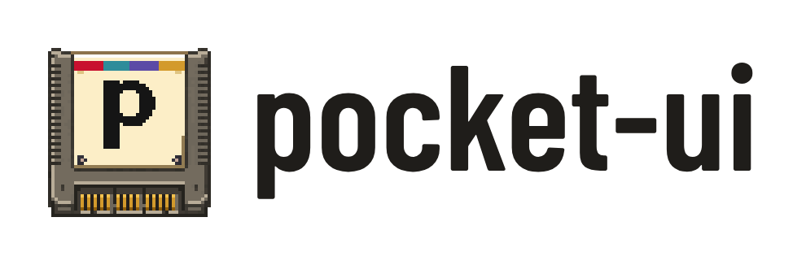
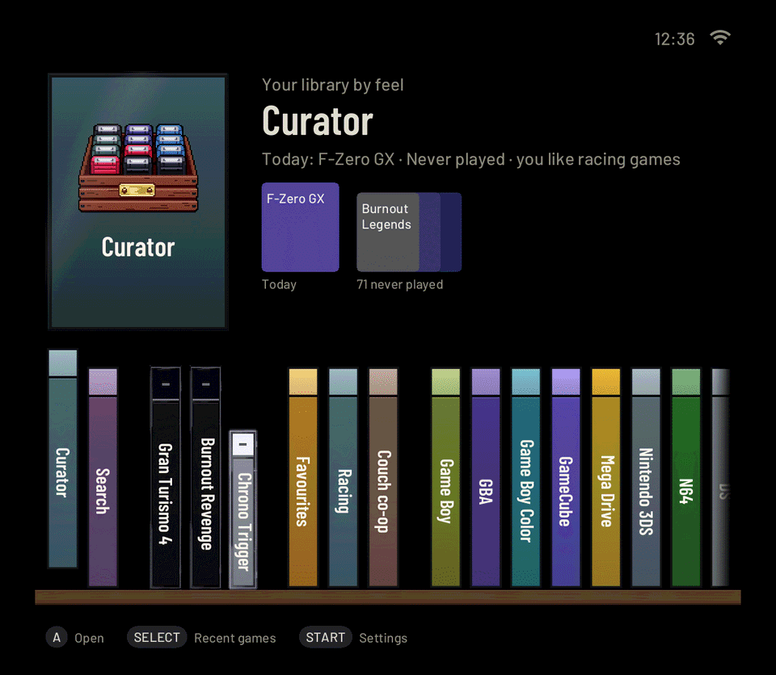
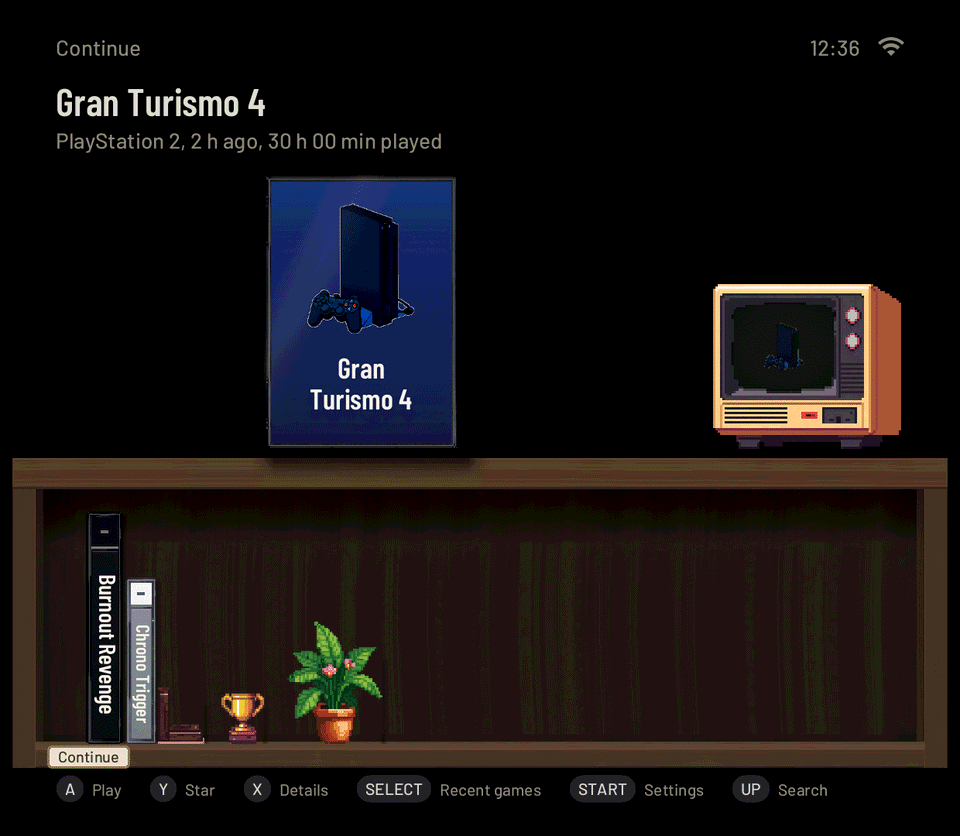
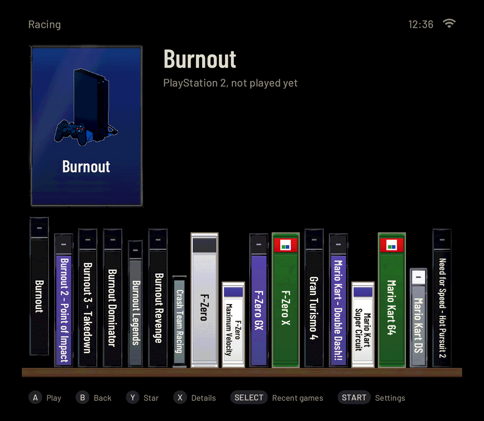
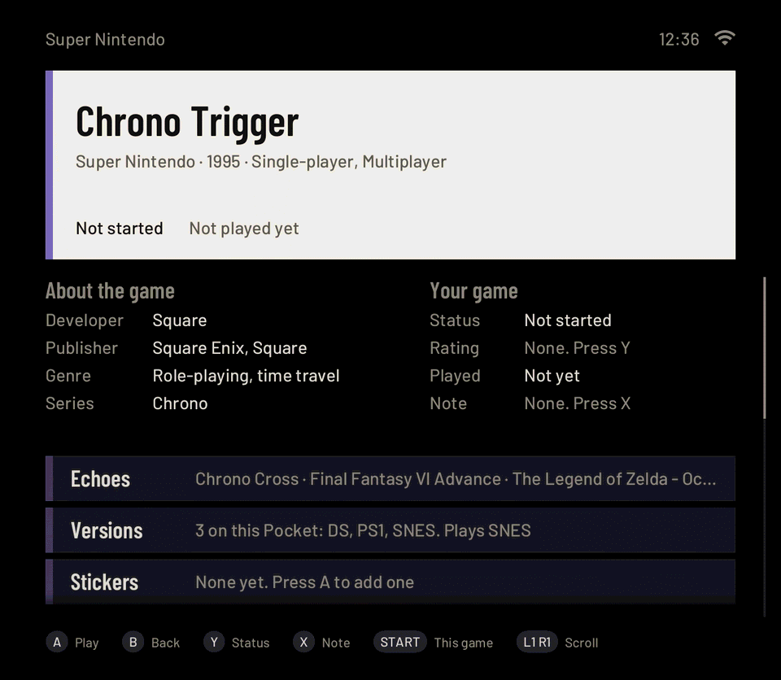
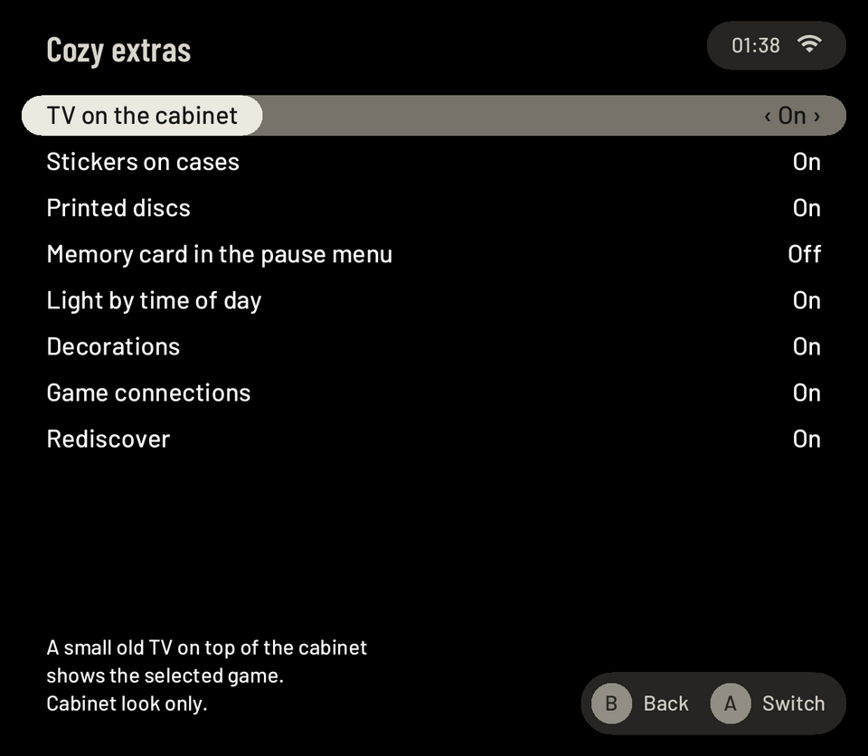
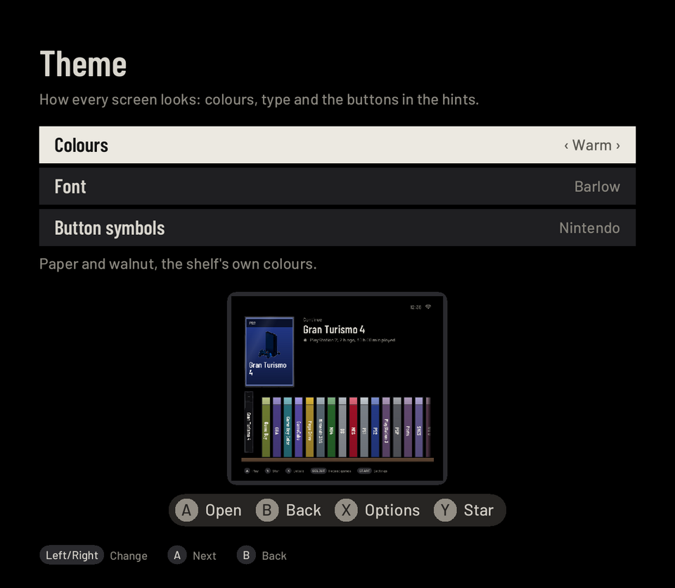

<h1 align="center">
  <picture>
    <source media="(prefers-color-scheme: dark)" srcset="docs/media/logo-on-dark.png">
    
  </picture>
</h1>

**Your whole game collection on one calm shelf, and your handheld ready in a blink.**

pocket-ui is a controller-first home screen and game player for the **Retroid Pocket Mini V2**, running on
[ROCKNIX](https://rocknix.org). Press A and you are playing, right where you left off. Every system, from Game Boy to
PlayStation 2, gets the same small pause menu with save slots, pictures and a step back in time. Games show up with
box art, their own card and facts, and a Curator that knows what you own and what you have not touched yet.

Version **0.1.8** is out as a public alpha: [download it](../../releases/tag/v0.1.8),
[watch the trailer](https://pocketui.xyz) and see more at **[pocketui.xyz](https://pocketui.xyz)**.

<p align="center">
  
  
</p>
<p align="center">
  
  
</p>
<p align="center">
  
  
</p>

The pictures are rendered from the code with made-up data (`pocket-ui --snapshot`, see
[docs/DEVELOPING.md](docs/DEVELOPING.md)); more are in [docs/media](docs/media/README.md).

## What it feels like

- **Instant.** The shelf appears within tens of milliseconds, and a game starts from the picture of where you left it.
- **Every game in its case.** Real cases, cartridge boxes and printed discs on the Shelf and the Cabinet: a PlayStation
  jewel case, a Game Boy Advance cartridge, a GameCube mini disc with your game's cover on it. Stickers you put on
  them (Completed, 100 %, Favourite, Game of the year), and on the Cabinet a little old TV that shows the selected game.
- **Cozy or Quick.** Cozy opens the case, slides the cartridge in with a click and switches on an old TV; Quick just
  starts. Playful animations, sounds of the cases, light that follows the time of day, a plant that grows with your
  hours and a trophy for your first finished game. Each touch has its own switch (Settings → Look → Cozy extras, and Sound & feel).
- **Make it yours.** Five looks (Shelf, Minimal, Split, Cards, Cabinet), five colour sets in dark and light, three
  fonts, and button symbols in Nintendo, Xbox or PlayStation style. An idle slideshow of your games' pictures if you want one.
- **One pause menu everywhere.** HOME opens Continue, Save and Load with 8 slots and previews (on the memory card of the
  game's own console, if you like), Earlier (step back a few minutes), screen frames and effects (scanlines, CRT, LCD
  grid), shortcuts, rewind, run-ahead and cheats.
- **Curator, Connections and Rediscover.** Browse by feel, find games like this one, follow a developer, series or
  genre to your other games, or pick up what you played a year ago today.
- **Your own player, and the big consoles.** pocket-core plays Game Boy to PSP, Dreamcast and DS; PlayStation 2,
  GameCube, Wii and 3DS run on their own emulators behind the same menu. PortMaster games install from the Extras page and start from pocket-ui.
- **Web companion** on your own tailnet: library, what is playing, favourites, ratings, uploads.
- **Looks after itself.** Wi-Fi (even hotel sign-in pages), Bluetooth pads and headphones, sleep and power, signed
  updates with a way back. English and German.
- **Private.** No accounts, no tracking. It goes online for box art, game info and the downloads you ask for.

## Get it

Download from the [v0.1.8 release](../../releases/tag/v0.1.8) and pick one way.
Checksums are in `SHA256SUMS`.

| Way | When | What to do |
|---|---|---|
| **Ports installer** | ROCKNIX is already on your card | Unzip [pocket-ui-0.1.8-ports-installer.zip](../../releases/download/v0.1.8/pocket-ui-0.1.8-ports-installer.zip) into `roms/ports` (the games share of ROCKNIX's file sharing: switch on Samba in ROCKNIX's Network Settings, then open `\\<device name or IP>` on Windows or `smb://<device name or IP>` on a Mac; [ROCKNIX explains it](https://rocknix.org/play/add-games/)), then in EmulationStation open **Ports → Install pocket-ui**. To go back: **Ports → Uninstall pocket-ui** |
| **Fresh card** | New card, nothing on it yet | New to ROCKNIX on the Mini V2? Set it up once with [ROCKNIX's own guide](https://rocknix.org/devices/retroid/retroid-pocket-mini/) (flashing the card plus its one-time bootloader step), then come back. With ROCKNIX 20261001 or newer on the card, copy the two files from [pocket-ui-0.1.8-rocknix-card.zip](../../releases/download/v0.1.8/pocket-ui-0.1.8-rocknix-card.zip) onto the card's `ROCKNIX` partition and boot. It installs on the second start |
| **Over SSH** | You like a terminal | Unzip [pocket-ui-0.1.8-rocknix-install.zip](../../releases/download/v0.1.8/pocket-ui-0.1.8-rocknix-install.zip) in `/storage`, run `sh install.sh --check`, then `sh install.sh` |

pocket-ui replaces exactly one thing: the program ROCKNIX's `essway` service starts. Remove it and stock ROCKNIX with
EmulationStation is back; your games, saves and ROCKNIX settings stay where they are. Android on the internal storage
is not touched. More: [docs/INSTALL-DUAL-BOOT.md](docs/INSTALL-DUAL-BOOT.md).

You bring your own games and, for a few systems, BIOS files; pocket-ui includes neither. On an empty card it can
download a [starter pack](docs/STARTER-PACK.md) of nine free homebrew games, each from its author's page.

## Runs on

pocket-ui runs on three ROCKNIX images. 🎮 means the project has played on it, ✅ means the same chip, the same
ROCKNIX image and a pocket-ui profile. Screens, sticks and sources are in [docs/DEVICES.md](docs/DEVICES.md).

| Chip and ROCKNIX image | Handhelds | Plays, by console release |
|---|---|---|
| **Snapdragon 865** (SM8250) | 🎮 **Retroid Pocket Mini V2**<br>✅ Retroid Pocket Mini, Pocket 5, Pocket Flip 2 | NES, Master System, PC Engine, Mega Drive, Game Boy, SNES, Saturn, PlayStation, Nintendo 64, Game Boy Color, Dreamcast, PlayStation 2, Game Boy Advance, GameCube, Xbox, Nintendo DS, PSP, Wii, 3DS |
| **Snapdragon 8 Gen 2** (SM8550) | 🎮 **AYN Odin 2 Mini**<br>✅ AYN Odin 2, Odin 2 Portal, Retroid Pocket 6, Pocket Nova | NES, Master System, PC Engine, Mega Drive, Game Boy, SNES, Saturn, PlayStation, Nintendo 64, Game Boy Color, Dreamcast, PlayStation 2, Game Boy Advance, GameCube, Xbox, Nintendo DS, PSP, PS3, Wii, 3DS, PS Vita, Wii U (PS3, PS Vita and Wii U: selected games) |
| **Allwinner H700** | 🎮 **Anbernic RG35XX Plus**<br>✅ RG35XX H, Pro, 2024 and SP, RG28XX, RG40XX H and V, RG34XX, RG34XX-SP, RG-SP | NES, Master System, PC Engine, Mega Drive, Game Boy, SNES, PlayStation, Nintendo 64, Game Boy Color, Dreamcast, Game Boy Advance, Nintendo DS, PSP (Nintendo 64, Dreamcast, PSP and DS with ROCKNIX's own emulators) |

It is an alpha, made on the Mini V2. If something is off, **Settings → Help & tools → About → Report a problem** makes a
file for a report, or [open an issue](../../issues). [docs/STATUS.md](docs/STATUS.md) lists every feature and how far
it has been checked.

## How far it is proven

The details behind the alpha label, from [docs/STATUS.md](docs/STATUS.md):

- Measured or checked on the Mini V2: the shelf and its speed, pocket-core up to Nintendo DS and Dreamcast, the pause
  menu with save slots and options, PlayStation 2 and GameCube, run-ahead, cover art, Wi-Fi setup, file sharing, UI
  sounds, waking from deep sleep, Smooth fan, Curator and play history, the web companion over a real tailnet, signed
  app updates with automatic rollback, and the fresh-card install.
- Built and tested in the virtual device or in tests, still waiting for more real-device time: touch, Bluetooth pads,
  Wii and 3DS, the newest picture effects and frames, the night light, RetroAchievements, Syncthing between two
  devices, the Store and the starter pack. Battery drain of a long sleep is not measured yet.
- The Retroid Pocket 5, Flip 2 and first Mini run the same ROCKNIX SM8250 build as the Mini V2, so pocket-ui
  recognises them and lays out for their screens; Pocket 6, Nova and the AYN Odin 2 family use the SM8550 image
  (screen off instead of suspend, ROCKNIX-controlled cooling, see [docs/DEVICES.md](docs/DEVICES.md)). The Odin 2 Mini
  and the Anbernic RG35XX Plus have been played on; the other devices are covered by computer tests and the virtual
  device. Devices that are not listed are not supported.

## What it does

The [user guide](docs/user/index.md) describes each of these; it is also the manual on the device. How far each
feature has been proven is in [docs/STATUS.md](docs/STATUS.md).

- **The shelf:** Home shows your last game, recent games, favourites, Curator and systems. Five looks (Shelf,
  Minimal, Split, Cards, Cabinet), dark, light or automatic, with motion you can reduce or switch off; cover art from
  the libretro thumbnail collection, console pages, play-time tracking.
- **Finding games:** a search over every game as you type, forgiving of accents and typos, and an L2/R2 letter jump
  in every list.
- **Your library and Curator:** a card per game with offline facts (Wikidata), play status and notes; the Lens
  (filters with live counts), smart shelves, your own stickers, Echoes ("more like this" from your own games) and
  the versions of a game you own on several systems.
- **pocket-core, our own libretro host** ([docs/HOST.md](docs/HOST.md)) for Game Boy, Game Boy Color, Game Boy
  Advance, NES, SNES, Mega Drive, Master System, Game Gear, SG-1000, PC Engine, WonderSwan, Atari 2600,
  PlayStation, Nintendo 64, PSP, Dreamcast, Nintendo DS, Saturn (with its BIOS), DOS, ScummVM, PICO-8 and TIC-80.
  It uses the same cores as RetroArch.
- **Pause menu on HOME:** Continue, Save and Load with 8 slots and previews (plus the state of the last quit and
  the one before a load), Options (picture scaling, sharpness and screen effects, screen frames with a live power
  light, the core's own options, button remapping, shortcuts, fast-forward, rewind, run-ahead, cheats, rumble),
  quick settings, one Quit (whether it keeps the moment is a setting), RetroAchievements, and Pixel Path, which grades how a game's picture
  and sound reach you. Settings can be saved per console or per game.
- **PlayStation 2, GameCube, Wii and 3DS** run on ARMSX2, Dolphin and Azahar with the same pause menu for Save,
  Load, Options and Quit ([docs/BIG-EMULATORS.md](docs/BIG-EMULATORS.md)). Other systems start with ROCKNIX's
  default emulator.
- **Fast:** the shelf's first frame comes tens of milliseconds after start, a game starts from the picture of where
  you left it, Settings → Playing → On start can go straight back into the last game, and the switcher hands over between two
  pocket-core games as soon as the first has saved. A speed guard measures it ([docs/LATENCY.md](docs/LATENCY.md)).
- **Safety net:** a game that pocket-core cannot start runs through RetroArch from then on. Saves are written
  through temporary files, settings are replaced atomically, the launcher restarts a crashed UI, and a nearly empty
  battery saves the game and switches off.
- **First-start setup** with Wi-Fi, a gamepad keyboard, cover art and PortMaster games.
- **Touch screen** on the shelf, lists, Settings, the search and the game switcher; the bottom screen in Nintendo DS
  games.
- **System:** menu sounds (their own volume), optional menu haptics, quick settings, sleep, a battery page with time
  left, stick LEDs, Settings → Playing → Performance & fan, time zone, Bluetooth controllers, and Wi-Fi that reconnects by
  itself.
- **Sync and network:** saves and states kept in step with Syncthing (paused while a game runs), Tailscale with a QR
  sign-in, PC streaming with Moonlight. File sharing (Samba) shares only the games folder, with a per-device
  password. SSH is off by default and, when switched on, shows a random password on the screen
  ([docs/SECURITY-HARDENING.md](docs/SECURITY-HARDENING.md)).
- **Updates:** signed app updates installed live, with an automatic way back. System updates that could touch
  the bootloader are refused ([docs/UPDATES.md](docs/UPDATES.md)).
- **Dual boot next to Android:** a boot chain from the SD card leaves Android and its partitions untouched
  ([docs/INSTALL-DUAL-BOOT.md](docs/INSTALL-DUAL-BOOT.md)).

## More ways to install

Besides the three downloads above:

| Way | Guide |
|---|---|
| **SD card image** next to Android (Retroid's boot mode switch, nothing flashed) | [docs/SD-IMAGE.md](docs/SD-IMAGE.md), [docs/INSTALL-DUAL-BOOT.md](docs/INSTALL-DUAL-BOOT.md) |
| **Manual install on a ROCKNIX card** next to Android | [docs/INSTALL-DUAL-BOOT.md](docs/INSTALL-DUAL-BOOT.md#appendix-manual-install-on-an-existing-rocknix-card) |
| **Developer deploy** onto a Mini V2 running ROCKNIX, over SSH | [docs/DEVELOPING.md](docs/DEVELOPING.md#the-dev-loop-on-a-real-device) |

## Building

You need a Rust toolchain with the `aarch64-unknown-linux-gnu` target, [Zig](https://ziglang.org) and
[cargo-zigbuild](https://github.com/rust-cross/cargo-zigbuild):

```sh
rustup target add aarch64-unknown-linux-gnu
cargo install cargo-zigbuild
cargo zigbuild --release --target aarch64-unknown-linux-gnu.2.38 --bin pocket-ui --bin pocket-core
```

The `.2.38` suffix links against glibc 2.38, which is older than the device's 2.41. The programs land in
`target/aarch64-unknown-linux-gnu/release/`.

Without a device, `cargo test --release` runs the unit tests, the snapshot tests and the documentation checks on a
Linux or macOS computer, and `scripts/vdev.sh` starts a virtual Mini V2 in Docker from a ROCKNIX image you supply
([docs/VIRTUAL-DEVICE.md](docs/VIRTUAL-DEVICE.md)). Everything else, the dev loop and the tests are in
[docs/DEVELOPING.md](docs/DEVELOPING.md).

## Documentation

| For | Start here |
|---|---|
| Players | [docs/user/index.md](docs/user/index.md): getting started, playing, the pause menu, options, controls, settings, your library, achievements, systems, extras, sync, Tailscale, PC streaming, updates, troubleshooting |
| What works on the device | [docs/STATUS.md](docs/STATUS.md): every feature with how it was verified and what is still open |
| Installing next to Android | [docs/INSTALL-DUAL-BOOT.md](docs/INSTALL-DUAL-BOOT.md) |
| Developers | [docs/DEVELOPING.md](docs/DEVELOPING.md) and [docs/ARCHITECTURE.md](docs/ARCHITECTURE.md) |
| Everything else | [docs/README.md](docs/README.md): an index of all documents |

The documents name commits of the private development history (for example in STATUS.md); the public repository
starts with release 0.1.0, so those references don't resolve here.

## Contributing

Reports from real devices help most. See [CONTRIBUTING.md](CONTRIBUTING.md), the [code of conduct](CODE_OF_CONDUCT.md),
and [SECURITY.md](SECURITY.md) for security problems. Changes are listed in [CHANGELOG.md](CHANGELOG.md).

## Licence

pocket-ui (the `pocket-ui` and `pocket-core` programs and everything else written for this repository) is free
software under the **GNU General Public License, version 2 or (at your option) any later version**
(`GPL-2.0-or-later`). The full text is in [LICENSE](LICENSE). It comes without any warranty.

Copyright (C) 2026 Robby Czesany.

pocket-ui is based on [ROCKNIX](https://rocknix.org) and is not endorsed by the ROCKNIX team. Everything that is
not ours keeps its own licence. [NOTICE.md](NOTICE.md) lists it, with sources: ROCKNIX, the emulators and
libretro cores, the system pictures (public-domain photos by Evan Amos, converted with PixelLab), the fonts
(Barlow and Titillium Web, SIL Open Font License) and the Rust crates
([docs/THIRD-PARTY-CRATES.md](docs/THIRD-PARTY-CRATES.md)).

- Several libretro cores that ROCKNIX ships (snes9x, genesis_plus_gx, picodrive, fbneo) are licensed for
  non-commercial use only, and so are ROCKNIX's branding and artwork (CC BY-NC-SA 4.0). pocket-ui contains none of
  them, but an image that bundles them must not be sold. Check [NOTICE.md](NOTICE.md) before you redistribute one.
- pocket-ui does not include games, ROMs, BIOS files or ROCKNIX itself, and nothing here offers any. Game footage and
  box art on pocketui.xyz belong to their owners. `scripts/check-release-tree.py` checks
  a tree, a tar or an image for them.
- `assets/gamedb.bin` holds data from Wikidata, released under CC0. No Wikipedia text is included.
- `assets/curatordb.bin` and `assets/data/curator-tags.json` (Curator's feel tags) are our own data, derived at
  build time from those CC0 facts, under pocket-ui's licence. No Wikipedia or other copyrighted text is included.

## Credits

- [ROCKNIX](https://rocknix.org) and its contributors: the operating system pocket-ui runs on.
- [libretro](https://www.libretro.com) and the authors of the cores pocket-core and RetroArch load.
- The [libretro thumbnail collection](https://thumbnails.libretro.com) for the box art.
- [Wikidata](https://www.wikidata.org) for the game facts on the game card (year, developer, publisher, genre,
  series, players, review scores). They are CC0 (public domain); `assets/gamedb.bin` is a compact copy built by
  `scripts/build-gamedb.py`.
- [Wikipedia](https://en.wikipedia.org) for the game descriptions, under
  [CC BY-SA 4.0](https://creativecommons.org/licenses/by-sa/4.0/). They are not part of pocket-ui: the device
  loads an article's lead when a card is opened and names the article and the licence under the text.
- [PortMaster](https://portmaster.games) for the ports catalogue.
- ARMSX2, Dolphin and Azahar, the standalone emulators for PlayStation 2, GameCube and Wii, and 3DS.
- [RetroAchievements](https://retroachievements.org) and its rcheevos library (MIT), in `vendor/rcheevos`.
- Retroid's [u-boot for the Pocket devices](https://github.com/RetroidPocket/u-boot), used by the dual-boot setup.
- [NextUI](https://github.com/LoveRetro/NextUI) and MinUI for the ideas behind the interface.
- Barlow, by Jeremy Tribby, for the interface font, and Titillium Web for the test store's font package.
- [Evan Amos](https://commons.wikimedia.org/wiki/User:Evan-Amos), whose public-domain console photographs on Wikimedia
  Commons are the base of the system pictures ([assets/systems/SOURCES.md](assets/systems/SOURCES.md)).
