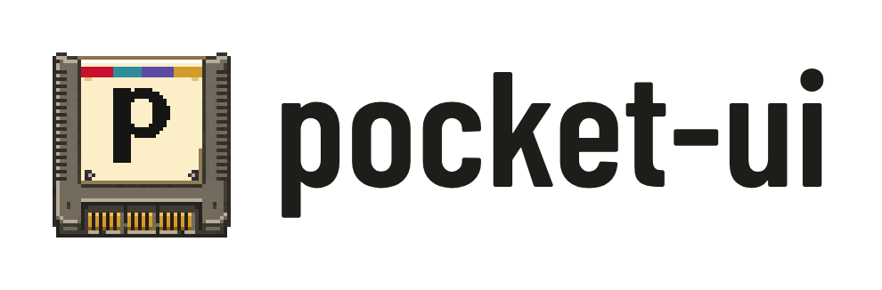
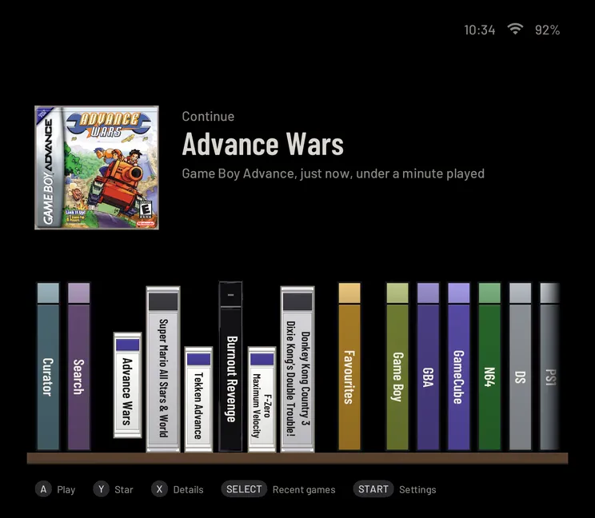
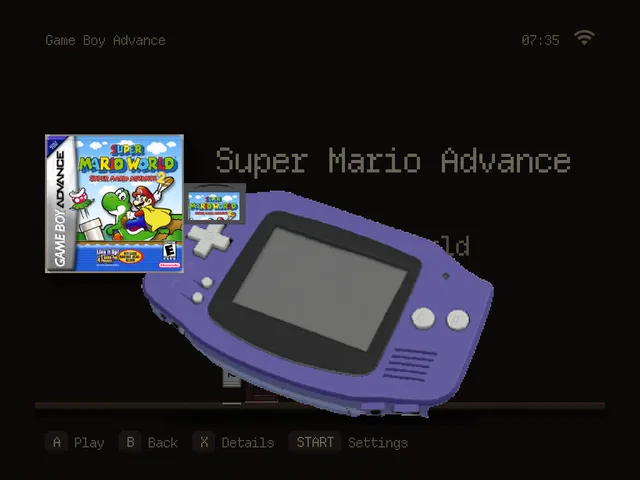
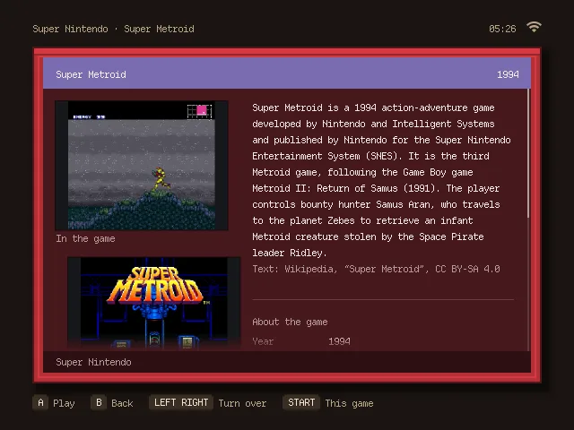
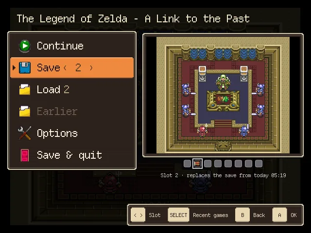
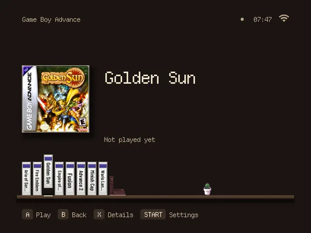

<h1 align="center">
  <picture>
    <source media="(prefers-color-scheme: dark)" srcset="docs/media/logo-on-dark.png">
    
  </picture>
</h1>

<p align="center"><b>pocket-ui puts every game in its real box on your handheld:</b><br>
pull it off the shelf, click it in, and pick up right where you left off.</p>

<p align="center">
  <a href="https://pocketui.xyz"></a>
</p>

<p align="center">
  <a href="https://pocketui.xyz/install"><b>SD card image for retro handhelds</b></a> ·
  <a href="https://pocketui.xyz/install#android"><b>App for Android</b></a> ·
  <a href="https://pocketui.xyz/try">Try it in your browser</a> ·
  <a href="https://pocketui.xyz/#trailer">Watch the trailer</a>
</p>

<table align="center">
  <tr>
    <td align="center"><br><sub>In it goes: the cartridge clicks into the Game Boy Advance</sub></td>
    <td align="center"><br><sub>Flip the box over to read the back</sub></td>
  </tr>
  <tr>
    <td align="center"><br><sub>One pause menu with visual save slots</sub></td>
    <td align="center"><br><sub>Retro style, one switch away</sub></td>
  </tr>
</table>

## Image or app?

<table>
  <tr>
    <th width="50%">pocket-ui OS · SD card image</th>
    <th width="50%">pocket-ui for Android · app</th>
  </tr>
  <tr>
    <td valign="top">For retro handhelds from Anbernic, Retroid and AYN: flash a spare microSD card, power on, and boot
    straight to your shelf like a dedicated console. Your stock system stays untouched; swap cards to switch back. For the
    TrimUI Brick and Smart Pro, just unzip the TrimUI package onto an empty card. Already on dArkOS? Launch
    <b>pocket-ui beta for dArkOS</b> right from the Ports menu.<br><br>
    <b><a href="https://pocketui.xyz/install">Get the image</a></b> · <a href="../../releases/latest">Releases</a></td>
    <td valign="top">Got an Android handheld with built-in controls, like a Retroid Pocket or AYN Odin 2? Run pocket-ui as
    a frontend app: same shelf, same instant Continue, classic consoles built right in, and your own emulator apps for PS2,
    GameCube and more. No flashing needed. Preview build for Android 8 or newer.<br><br>
    <b><a href="https://pocketui.xyz/install#android">Get the app (APK)</a></b></td>
  </tr>
</table>

## Why you'll like it

- **Real game boxes.** Cartridges, jewel cases and cardboard boxes built from photos of the real hardware. Hit X to pop
  a case open, or flip it over to read the back.
- **Pop it in and play.** The cartridge clicks home, the old TV warms up, and you're in. Quit, and everything packs
  neatly back onto the shelf.
- **Instant Continue.** Your recent games sit slightly ajar on the shelf. One press drops you right back into the exact
  moment you left off.
- **The case knows your progress.** For dozens of classics, flipping the box shows how far you've gotten, read straight
  from your save: badges, stars, hearts, missions and play clock.
- **One pause menu for every console.** Eight visual save slots, Earlier to jump back a few minutes, screen frames and
  CRT looks from Game Boy to GameCube.

Plus Retro mode in one toggle, phone-to-handheld ROM uploads, your own RomM server right on the shelf, Game check, Kids
Mode and one-press Wi-Fi updates. [See everything it does](https://pocketui.xyz/features).

Free and open source, with no account and no tracking. Menus in English, German, Spanish, Brazilian Portuguese, French,
Italian, Korean, Simplified Chinese, Vietnamese and Japanese.

**Supported systems:** Game Boy, GBC, GBA, NES, SNES, Mega Drive, Master System, Game Gear, PC Engine, PlayStation, N64,
PSP, Dreamcast, Nintendo DS, Saturn, arcade and PortMaster ports. Stronger handhelds like the AYN Odin 2 also play PS2,
GameCube, Wii and 3DS. Nintendo DS works great without a touchscreen too: move the stylus with the D-pad, flip layouts
with one button, and enjoy faster DS play via DSperate on TrimUI and Anbernic H700 handhelds.
[See what plays on your handheld](https://pocketui.xyz/systems)

## Your Pockets, in step

Play on one handheld tonight and pick up on another tomorrow with the exact same save. **Pocket Sync** keeps saves in
sync directly from Pocket to Pocket over your home Wi-Fi or Tailscale. No PC, no account, no cloud.

- **Pair once** with a six-digit code. New saves hop over after each session, and waking a Pocket pulls down anything
  you saved elsewhere.
- **Add as many Pockets as you own**, with no host or server to manage. A Pocket on the road finds your handheld at home
  over Tailscale.
- **Never overwrites your progress.** Played the same game on two handhelds? You pick which save to keep, and the other
  goes safely into a backup folder.
- **Clear shelf notices:** see what arrived ("New save from TrimUI Brick · Golden Sun") and check each paired Pocket's
  last sync.
- **Where it runs:** pocket-ui OS, the TrimUI package and pocket-ui for Android (Handheld view while open). Turn it on
  under Settings → Connections → Pocket Sync.

## Your shelf in any browser

Turn on the **web companion** (Settings → Connections → Web companion) to browse your handheld from your phone or
computer over home Wi-Fi or Tailscale:

- **Full library view:** browse every console and cover, search all games, and edit play status, ratings or notes with
  instant updates on your handheld.
- **Easy uploads:** drop in ROMs and they sort into the right system folder (fetching box art automatically when online).
  Upload BIOS files and PortMaster data just as easily.
- **Stats and live view:** check play history, battery status and what's currently on your handheld's screen.

Scan a QR code once to pair a browser on your Wi-Fi. The web companion stays completely off until you enable it.

## What's new

Full release notes live on the [Releases page](../../releases), and [CHANGELOG.md](CHANGELOG.md) tracks every version in
one place. Both pocket-ui OS and the Android app let you know when an update is ready over Wi-Fi.

## Get the image

Three quick steps:

1. **Download the image for your handheld** from [pocketui.xyz/install](https://pocketui.xyz/install) (about 1.3 GB).
2. **Flash it to a spare microSD card** with [balenaEtcher](https://etcher.balena.io) or Raspberry Pi Imager (no need to
   unzip). 8 GB works for most models; use 16 GB+ for the RG28XX and RG35XX 2024. The R36S has its own card, see the table below.
3. **Slide it into slot 1 and power on.** First boot sets up the card, restarts once, and greets you to pick language,
   Wi-Fi and look.

Your handheld's stock system stays untouched: swap your original card back in and everything is right as you left it.
Add games from your phone or computer over Wi-Fi via Settings → Games → Add games.

| Brand | Models | |
|---|---|---|
| **Anbernic** | RG35XX Plus, RG35XX SP, RG35XX H, RG35XX Pro, RG35XX 2024, RG28XX, RG34XX, RG34XX-SP, RG40XX H, RG40XX V, RG CubeXX, RG-SP | [Image per model](https://pocketui.xyz/install#anbernic). Dedicated builds for newer-screen Plus/SP and RG40XX H DDR3. Original 2023 RG35XX not supported. |
| **Retroid** | Pocket Mini V2 | [Image](https://pocketui.xyz/install#retroid), plus one step: Boot mode → Loader. Android stays untouched. |
| **AYN** | Odin 2, Odin 2 Mini, Odin 2 Portal | [Image](https://pocketui.xyz/install#odin), after installing ROCKNIX's boot helper once (it replaces the bootloader; Android apps and data stay). |
| **TrimUI** | Brick (incl. Brick Hammer); Smart Pro and Brick Pro experimental | [Unzip the TrimUI package onto an empty FAT32 card](https://pocketui.xyz/install#brick); nothing is flashed. |
| **Retroid, beta** | Pocket 5, Flip 2, Pocket 6, Pocket Nova | [Beta images](https://pocketui.xyz/install#rp5-uefi), see notes below. Some need OpenABL once (it replaces the bootloader; Android apps and data stay). |
| **R36S, beta** | Genuine R36S (clones aren't covered yet) | [Own card](https://pocketui.xyz/install#r36s) in TF1; your original card stays in TF2 with your games. No Wi-Fi needed, updates come as a zip, and the first start takes up to 10 minutes. |
| **Already on dArkOS** | 640×480 dArkOS handhelds, including the R36S | [pocket-ui beta for dArkOS](https://pocketui.xyz/install#darkos): unzip into `ports`; nothing is flashed. |
| **Already on ROCKNIX** | any of the above | [Install on top in five minutes, remove any time](https://pocketui.xyz/install#way-1) |

**Retroid beta images:** no boot on real hardware is confirmed yet, and testers are very welcome. Original screens only,
not the 12 GB Visionox models. On Pocket 5 and Flip 2, boot from Retroid's **Loader** option if your menu has it (nothing
gets flashed). If it only shows **UEFI**, install OpenABL once with the `openabl` folder from a ROCKNIX SM8250 card. On
Pocket 6 and Nova, try Retroid's **UEFI** with Secure Boot off first, or fall back to OpenABL from a ROCKNIX SM8550 card.
OpenABL replaces the bootloader (`abl_a` and `abl_b`), while your Android apps and data stay. Run the backup exactly once before flashing and copy both files to
your computer. Running it again after flashing overwrites the original backup on the handheld. Follow the
[install guide](docs/INSTALL-DUAL-BOOT.md#installing-openabl-once) for the steps and the way back.

[All downloads](../../releases/latest)

## Quick answers

- **Do I lose my stock system?** No. pocket-ui OS lives on its own microSD card. On a Brick or one of the Anbernic models
  above, put your original card back in to return to stock. On Retroid and AYN, choose Android in the boot menu as
  described in the [install guide](docs/INSTALL-DUAL-BOOT.md).
- **What about my ROM folders and saves?** Bring them as they are. pocket-ui reads common folder names without renaming
  anything. In-game saves (`.srm`, `.sav`) sitting beside their ROM keep working; save states don't carry across
  different emulators.
- **Which BIOS files do I need?** Most consoles need none. Saturn, Famicom Disk System, CD add-ons, PS2 and some arcade
  sets do: drop yours in `roms/bios` and run Settings → Games → Game check to see what's missing.
- **Are any games included?** No, bring your own. An empty shelf offers a [starter pack](docs/STARTER-PACK.md) of free
  homebrew games.
- **Is it free?** Yes. Free and open source, with no account, no ads and no tracking.

More answers in the [FAQ](https://pocketui.xyz/faq).

## Learn more

- [Try it in your browser](https://pocketui.xyz/try): real pocket-ui in a browser tab, nothing to install
- [Guide](https://pocketui.xyz/guide): walk through your first evening with screenshots
- [Manual](docs/user/index.md): the complete user guide (also on your handheld under Settings → Help & tools)
- [What's new](CHANGELOG.md): full changelog
- [Status](docs/STATUS.md): every feature and where it's been tested
- Discord: https://discord.gg/sDqUV4M49g (help, ideas and device testers)

Run into a bug? Use **Settings → Help & tools → Report a problem** to pack your logs into one zip, then
[open an issue](../../issues) or email robby@robbyczesany.com. Real-hardware reports help a ton.

## How it's made

pocket-ui is built by Robby Czesany with AI coding agents (Claude and Codex). The agents write most of the code; he
designs how it looks and feels and tests it on real handhelds. Questions are welcome in
[Discussions](https://github.com/robbyczgw-cla/pocket-ui/discussions).

## For developers

pocket-ui is written in Rust: `pocket-ui` handles the shelf and menus, and `pocket-core` is our libretro game player.

```sh
cargo zigbuild --release --target aarch64-unknown-linux-gnu.2.38 --bin pocket-ui --bin pocket-core
cargo test --release
```

Setup, dev loop and repo layout: [docs/DEVELOPING.md](docs/DEVELOPING.md) ·
[docs/ARCHITECTURE.md](docs/ARCHITECTURE.md) · [all docs](docs/README.md) ·
[CONTRIBUTING.md](CONTRIBUTING.md) · [code of conduct](CODE_OF_CONDUCT.md) · [SECURITY.md](SECURITY.md)

## Licence

pocket-ui is free software under the **GNU General Public License, version 2 or (at your option) any later version**
(`GPL-2.0-or-later`), without any warranty. The full text is in [LICENSE](LICENSE). Copyright (C) 2026 Robby Czesany.

pocket-ui is based on [ROCKNIX](https://rocknix.org) and is not endorsed by the ROCKNIX team. It includes no games,
ROMs or BIOS files. Everything that is not ours keeps its own licence, and some cores that ROCKNIX ships are for
non-commercial use only: read [NOTICE.md](NOTICE.md) before you redistribute an image.

## Credits

Thank you to ROCKNIX, libretro and the authors of the cores, PortMaster, RetroAchievements, Wikidata, Evan Amos and
everyone else in [CREDITS.md](CREDITS.md).
