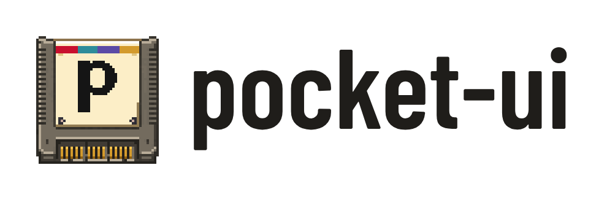
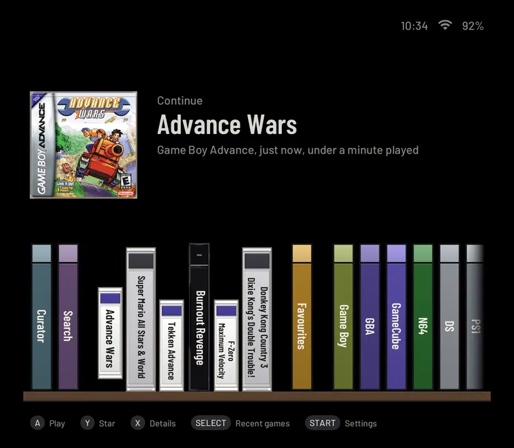

<h1 align="center">
  <picture>
    <source media="(prefers-color-scheme: dark)" srcset="docs/media/logo-on-dark.png">
    
  </picture>
</h1>

<p align="center"><b>A free frontend with its own game player for retro handhelds.</b><br>
Your games on one shelf, press A and you're playing, right where you left off.</p>

<p align="center">
  <a href="https://pocketui.xyz"></a>
  <br><sub><a href="https://pocketui.xyz">Watch the trailer on pocketui.xyz</a></sub>
</p>

## Why you'll like it

- **Straight back in.** A game starts from the picture of where you left it, and the shelf is up in a blink.
  Coming back after weeks? It tells you when you last played and shows the note you left yourself.
- **One pause menu for every console.** HOME gives you Continue, 8 save slots with pictures, Earlier (a step back of
  a few minutes), screen frames, CRT and LCD looks, cheats and the controls of that console, from Game Boy to
  PlayStation 2.
- **Every game in its case.** Box art on real cases, cartridges and discs, stickers for the games you finished, and
  six looks to choose from, including Easy: one big game at a time, for anyone you hand the handheld to.
- **Set up on the handheld.** Wi-Fi, box art, Bluetooth pads, games sent from your phone, a Game check that tells you
  why a game won't start, and updates over Wi-Fi that keep your saves.
- **Yours.** No account, no tracking, free and open source. Menus in English, German and Spanish.

## Get it

**[Download the latest version](../../releases/latest)** and follow the [install page](https://pocketui.xyz/install.html):

- **Ready SD card image**: write it to a card with balenaEtcher or Raspberry Pi Imager and start. There is one for the
  Retroid Pocket Mini V2 and one for each Anbernic H700 model.
- **Already on ROCKNIX?** Unzip the Ports installer into `roms/ports` and pick **Install pocket-ui** under Ports.
  About five minutes, and **Uninstall pocket-ui** brings ROCKNIX's own menu back. Your games, saves and settings stay.

You bring your own games and, for a few systems, BIOS files; pocket-ui includes neither. On an empty card it offers a
[starter pack](docs/STARTER-PACK.md) of free homebrew games.

**Runs on** handhelds with [ROCKNIX](https://rocknix.org): Retroid Pocket Mini V2, Mini, 5, Flip 2, 6 and Nova ·
AYN Odin 2, Odin 2 Mini and Odin 2 Portal · Anbernic RG35XX Plus, H, Pro, 2024 and SP, RG28XX, RG40XX H and V,
RG34XX, RG34XX-SP and RG-SP. Played on most: the Mini V2, the Odin 2 Mini and the RG35XX Plus. Which consoles run on
which chip: [docs/DEVICES.md](docs/DEVICES.md).

## Learn more

| | |
|---|---|
| [Guide](https://pocketui.xyz/guide.html) | From the download to your first game, with pictures |
| [Manual](docs/user/index.md) | Everything pocket-ui does, page by page; also on the handheld under Settings → Help & tools → Manual |
| [FAQ](https://pocketui.xyz/faq.html) | Short answers to the usual questions |
| [What's new](CHANGELOG.md) | Every version and what it changed |
| [Status](docs/STATUS.md) | Every feature and how far it has been tried on a real handheld |

Something off? **Settings → Help & tools → About → Report a problem** makes a file for a report, or
[open an issue](../../issues). pocket-ui is young and made on the Mini V2; reports from other handhelds help most.

## For developers

pocket-ui is written in Rust. `pocket-ui` is the frontend, `pocket-core` our own libretro player
([docs/HOST.md](docs/HOST.md)); PlayStation 2, GameCube, Wii and 3DS run on their own emulators behind the same pause
menu ([docs/BIG-EMULATORS.md](docs/BIG-EMULATORS.md)). Build for the handheld with
[cargo-zigbuild](https://github.com/rust-cross/cargo-zigbuild):

```sh
rustup target add aarch64-unknown-linux-gnu
cargo install cargo-zigbuild
cargo zigbuild --release --target aarch64-unknown-linux-gnu.2.38 --bin pocket-ui --bin pocket-core
```

`cargo test --release` runs the tests on a Linux or macOS computer, and `scripts/vdev.sh` starts a virtual Mini V2 in
Docker. The dev loop, the tests and the layout of the code are in [docs/DEVELOPING.md](docs/DEVELOPING.md) and
[docs/ARCHITECTURE.md](docs/ARCHITECTURE.md); other ways to install (next to Android, over SSH) in
[docs/INSTALL-DUAL-BOOT.md](docs/INSTALL-DUAL-BOOT.md) and [docs/SD-IMAGE.md](docs/SD-IMAGE.md); every document in
[docs/README.md](docs/README.md). See [CONTRIBUTING.md](CONTRIBUTING.md), the [code of conduct](CODE_OF_CONDUCT.md)
and [SECURITY.md](SECURITY.md).

Made by Robby Czesany with AI coding agents: they write most of the code, Robby decides what gets built and tests it on his own handhelds. Some art starts from public-domain photos run through an AI pixel tool.

## Licence

pocket-ui (the `pocket-ui` and `pocket-core` programs and everything else written for this repository) is free
software under the **GNU General Public License, version 2 or (at your option) any later version**
(`GPL-2.0-or-later`). The full text is in [LICENSE](LICENSE). It comes without any warranty.

Copyright (C) 2026 Robby Czesany.

pocket-ui is based on [ROCKNIX](https://rocknix.org) and is not endorsed by the ROCKNIX team. Everything that is
not ours keeps its own licence. [NOTICE.md](NOTICE.md) lists it, with sources: ROCKNIX, the emulators and
libretro cores, the system pictures (public-domain photos by Evan Amos, converted with PixelLab), the fonts
(Barlow and Titillium Web, SIL Open Font License) and the Rust crates
([docs/THIRD-PARTY-CRATES.md](docs/THIRD-PARTY-CRATES.md)).

- Several libretro cores that ROCKNIX ships (snes9x, genesis_plus_gx, picodrive, fbneo) are licensed for
  non-commercial use only, and so are ROCKNIX's branding and artwork (CC BY-NC-SA 4.0). pocket-ui contains none of
  them, but an image that bundles them must not be sold. Check [NOTICE.md](NOTICE.md) before you redistribute one.
- pocket-ui does not include games, ROMs, BIOS files or ROCKNIX itself, and nothing here offers any. Game footage and
  box art on pocketui.xyz, in `docs/media/hero.webp` and in the manual's screenshots (`docs/user/pictures/`) belong
  to their owners. `scripts/check-release-tree.py` checks a tree, a tar or an image for them.
- `assets/gamedb.bin` holds data from Wikidata, released under CC0. No Wikipedia text is included.
- `assets/curatordb.bin` and `assets/data/curator-tags.json` (Curator's feel tags) are our own data, derived at
  build time from those CC0 facts, under pocket-ui's licence. No Wikipedia or other copyrighted text is included.

## Credits

- [ROCKNIX](https://rocknix.org) and its contributors: the operating system pocket-ui runs on.
- [libretro](https://www.libretro.com) and the authors of the cores pocket-core and RetroArch load.
- The [libretro thumbnail collection](https://thumbnails.libretro.com) for the box art.
- [Wikidata](https://www.wikidata.org) for the game facts on the game card (year, developer, publisher, genre,
  series, players, review scores). They are CC0 (public domain); `assets/gamedb.bin` is a compact copy built by
  `scripts/build-gamedb.py`.
- [Wikipedia](https://en.wikipedia.org) for the game descriptions, under
  [CC BY-SA 4.0](https://creativecommons.org/licenses/by-sa/4.0/). They are not part of pocket-ui: the device
  loads an article's lead when a card is opened and names the article and the licence under the text.
- [PortMaster](https://portmaster.games) for the ports catalogue.
- ARMSX2, Dolphin and Azahar, the standalone emulators for PlayStation 2, GameCube and Wii, and 3DS.
- [hakuX](https://github.com/rfandango/hakuX) by rfandango, with the Linux/libretro port by portare-ch, for Xbox
  (experimental); pocket-ui ships a core built from [hakuX-Linux](https://github.com/robbyczgw-cla/hakuX-Linux)
  (GPL-3.0-or-later, see [NOTICE.md](NOTICE.md)).
- [RetroAchievements](https://retroachievements.org) and its rcheevos library (MIT), in `vendor/rcheevos`.
- Retroid's [u-boot for the Pocket devices](https://github.com/RetroidPocket/u-boot), used by the dual-boot setup.
- [NextUI](https://github.com/LoveRetro/NextUI) and MinUI for the ideas behind the interface.
- Barlow, by Jeremy Tribby, for the interface font, and Titillium Web for the test store's font package.
- [Evan Amos](https://commons.wikimedia.org/wiki/User:Evan-Amos), whose public-domain console photographs on Wikimedia
  Commons are the base of the system pictures ([assets/systems/SOURCES.md](assets/systems/SOURCES.md)).
