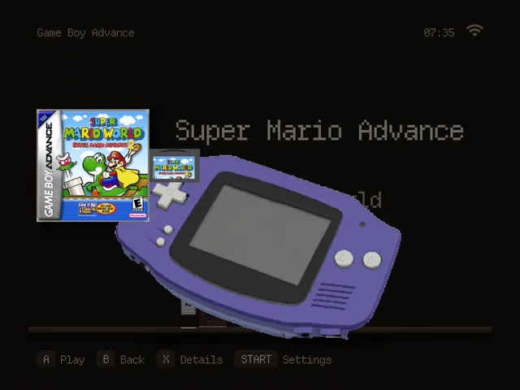
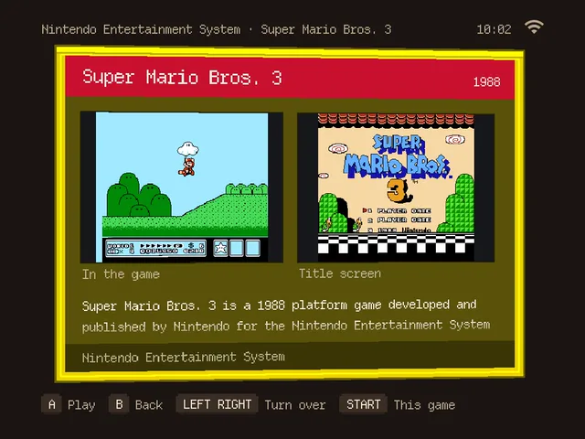
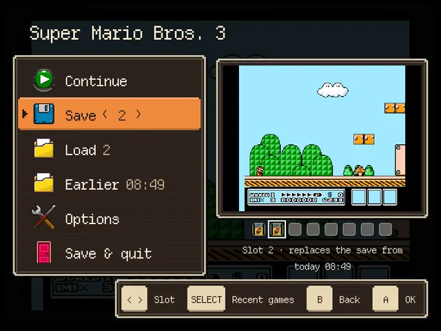
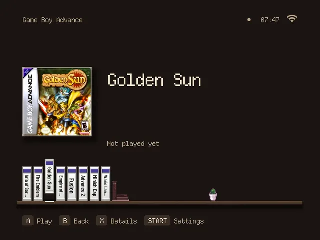

<h1 align="center">
  <picture>
    <source media="(prefers-color-scheme: dark)" srcset="docs/media/logo-on-dark.png">
    
  </picture>
</h1>

<p align="center"><b>pocket-ui OS puts every game in its real box on your retro handheld:</b><br>
take it off the shelf, click it in, and continue right where you stopped.</p>

<p align="center">
  <a href="https://pocketui.xyz"></a>
</p>

<p align="center">
  <a href="https://pocketui.xyz/install"><b>Get it</b></a> ·
  <a href="https://pocketui.xyz/try">Try it in your browser</a> ·
  <a href="https://pocketui.xyz/#trailer">Watch the trailer</a>
</p>

<table align="center">
  <tr>
    <td align="center"><br><sub>In it goes: the cartridge clicks into the Game Boy Advance</sub></td>
    <td align="center"><br><sub>Turn the box over and read what it's about</sub></td>
  </tr>
  <tr>
    <td align="center"><br><sub>One pause menu: save slots with pictures</sub></td>
    <td align="center"><br><sub>The Retro look, one switch away</sub></td>
  </tr>
</table>

## Why you'll like it

- **Real cases.** Cartridges, jewel cases and big cardboard boxes, made from photos of the real things. Press X and
  the case opens; turn it over and read what the game is about.
- **In it goes.** The cartridge clicks into its console, the old TV flickers on, and you're playing. Quit, and it
  pops back out and goes home to the shelf.
- **Continue.** Your last games wait half open on the shelf. One press and you're back in the very moment you left.
- **One pause menu for every console.** Save slots with pictures, Earlier to jump back a few minutes, screen frames
  and CRT looks, from Game Boy to GameCube.

Plus a Retro look in one switch, games sent from your phone, Game check, Kids Mode and updates over Wi-Fi.
[See everything it does](https://pocketui.xyz/features).

No account, no tracking, free and open source. Menus in English, German and Spanish.

**What it plays:** Game Boy, Game Boy Color and Advance, NES, Super Nintendo, Mega Drive, Master System, Game Gear,
PC Engine, PlayStation, Nintendo 64, PSP, Dreamcast, Nintendo DS, Saturn, arcade and PortMaster ports. On the stronger
handhelds, such as the AYN Odin 2, also PlayStation 2, GameCube, Wii and 3DS.
[What plays on which handheld](https://pocketui.xyz/systems)

### New in 0.4

- **Games leave the way they came in.** Quit, the TV picture closes to a dot, and the cartridge or disc goes back into its case.
- **More consoles open up:** the NES lifts its flap; Game Boy Color, Master System, Game Gear, PC Engine, PSP and 3DS
  got their own scenes.
- **Smoother everywhere:** cases turn over in perspective, the TV switches on out of a growing line.
- **Arcade games** stand on the shelf as an upright cabinet.
- **A controls card** with your handheld's buttons under the console's own names.
- **TrimUI Brick, finished:** no more Beta label, and a short press on Power puts it to sleep with the game saved.
- **0.4.1:** an SD card for the Anbernic RG CubeXX, and sound at middle volume is back on Anbernic handhelds.

[Every version](CHANGELOG.md)

## Get it

Three steps, one card:

1. **Download the card for your handheld** from [pocketui.xyz/install](https://pocketui.xyz/install) (about 1.2 GB).
2. **Flash it to a spare microSD card** with [balenaEtcher](https://etcher.balena.io) or Raspberry Pi Imager. No
   unzipping needed. 8 GB is enough (16 GB for the RG28XX and RG35XX 2024).
3. **Card in the first slot, switch on.** It sets itself up, restarts once, and says hello: pick your language, your
   Wi-Fi and your look.

Your handheld's own system stays exactly as it is: put your old card back and it's like nothing happened. Then add your
games from your phone or computer over Wi-Fi (Settings → Games → Add games).

| Brand | Models | |
|---|---|---|
| **Anbernic** | RG35XX Plus, RG35XX SP, RG35XX H, RG35XX Pro, RG35XX 2024, RG28XX, RG34XX, RG34XX-SP, RG40XX H, RG40XX V, RG CubeXX, RG-SP | [Card per model](https://pocketui.xyz/install#anbernic). Newer-screen Plus/SP and RG40XX H DDR3 have their own. Not the original RG35XX (2023). |
| **Retroid** | Pocket Mini V2 | [Card](https://pocketui.xyz/install#retroid), plus one step: Boot mode → Loader. Android stays. |
| **AYN** | Odin 2, Odin 2 Mini, Odin 2 Portal | [Card](https://pocketui.xyz/install#odin), after ROCKNIX's boot helper once. Android stays. |
| **TrimUI** | Brick (incl. Brick Hammer), Smart Pro; Brick Pro experimental | [Unzip the card download onto an empty card](https://pocketui.xyz/install#brick), nothing is flashed. |
| **Retroid, beta** | Pocket 5, Flip 2, Pocket 6, Pocket Nova | [Beta cards](https://pocketui.xyz/install#retroid-cards), see below. Android stays. |
| **Already on ROCKNIX** | any of the above | [Add pocket-ui in five minutes, undo it any time](https://pocketui.xyz/install#way-1) |

**Retroid beta cards:** on the Pocket 5 and Flip 2, start the card from Retroid's "Loader"; if the boot menu says
"UEFI", set up OpenABL once with ROCKNIX's guide. The Pocket 6 and Nova start from Retroid's UEFI entry; if yours falls
back to the boot menu, set up OpenABL once. Not the 12 GB models with the Visionox screen. These cards haven't started
on a real one yet, so testers are very welcome.

[All downloads](../../releases/latest)

## Quick answers

- **Do I lose my stock system?** No. pocket-ui OS lives on its own card; swap cards to switch back. On Retroid and
  AYN, Android stays where it is.
- **My ROM folders and saves?** Bring them as they are: it reads the folder names other systems use and renames nothing.
  In-game saves (`.srm`, `.sav`) next to their game keep working; save states don't move between emulators.
- **Which BIOS files?** Most systems need none. Saturn, Famicom Disk System, the CD add-ons, PlayStation 2 and some
  arcade sets do: put your own in `roms/bios`, and Game check (Settings → Games → Game check) tells you what's missing.
- **Any games included?** No, bring your own. An empty shelf offers a [starter pack](docs/STARTER-PACK.md) of free
  homebrew games.
- **Is it free?** Yes. Free and open source, no account, no ads, no tracking.

More in the [FAQ](https://pocketui.xyz/faq).

## Learn more

- [Guide](https://pocketui.xyz/guide): your first evening, with pictures
- [Manual](docs/user/index.md): everything, page by page; also on the handheld under Settings → Help & tools
- [What's new](CHANGELOG.md): every version
- [Status](docs/STATUS.md): every feature and where it has been played

Something off? **Settings → Help & tools → About → Report a problem** makes a file for a report, or
[open an issue](../../issues). Reports from your handheld help a lot.

## How it's made

pocket-ui is built by Robby Czesany together with AI coding agents (Claude and Codex). The agents write most of the
code; he decides what gets built and how it should look and feel, and plays it on his own handhelds. Questions are
welcome in [Discussions](https://github.com/robbyczgw-cla/pocket-ui/discussions).

## For developers

pocket-ui is written in Rust: `pocket-ui` is the shelf and menus, `pocket-core` our own libretro player.

```sh
cargo zigbuild --release --target aarch64-unknown-linux-gnu.2.38 --bin pocket-ui --bin pocket-core
cargo test --release
```

Set-up, the dev loop and the code layout: [docs/DEVELOPING.md](docs/DEVELOPING.md) ·
[docs/ARCHITECTURE.md](docs/ARCHITECTURE.md) · [every document](docs/README.md) ·
[CONTRIBUTING.md](CONTRIBUTING.md) · [code of conduct](CODE_OF_CONDUCT.md) · [SECURITY.md](SECURITY.md)

## Licence

pocket-ui is free software under the **GNU General Public License, version 2 or (at your option) any later version**
(`GPL-2.0-or-later`), without any warranty. The full text is in [LICENSE](LICENSE). Copyright (C) 2026 Robby Czesany.

pocket-ui is based on [ROCKNIX](https://rocknix.org) and is not endorsed by the ROCKNIX team. It includes no games,
ROMs or BIOS files. Everything that is not ours keeps its own licence, and some cores that ROCKNIX ships are for
non-commercial use only: read [NOTICE.md](NOTICE.md) before you redistribute an image.

## Credits

Thank you to ROCKNIX, libretro and the authors of the cores, PortMaster, RetroAchievements, Wikidata, Evan Amos and
everyone else in [CREDITS.md](CREDITS.md).
