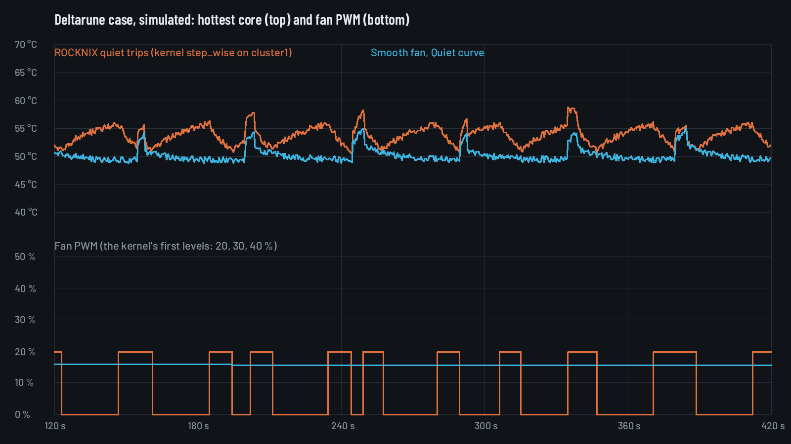

# Smooth fan: a quiet fan curve for the Mini V2

> **Status (2026-10-23; ledger: [STATUS.md](STATUS.md)):** built; unit tests on a fake sysfs, launcher tests, a thermal
> simulation and an end-to-end run in the virtual device with mock fan files all pass. **First run on a Mini V2 done**
> ([First device run](#first-device-run-2026-10-23-mini-v2-rocknix-20261001)): take-over, an 8-minute A/B against
> ROCKNIX's trips under a busy prime core, and the hand-back on `kill -STOP` and `kill -9`. **Still open:** the lowest
> PWM that keeps turning, the 78 °C guard on the hardware, an ear test, and 10 minutes of real play; the recipe in
> [On the device](#on-the-device) is for those. Settings → Playing → Performance & fan → **Smooth fan** (on by default)
> switches it; off is the behaviour from before.

## The problem

The owner, playing the Deltarune PortMaster port: "it plays quietly, then the fan is super loud for 10 seconds". Measured on the
device: gmloader keeps the prime core (cpu7) at 2.84 GHz busy-waiting, cpu7 at about 58 °C, the whole CPU at about 4 %,
the GPU idle, ROCKNIX's `cooling.profile=quiet`. The fan goes off, then on for a few seconds, then off again.

## How ROCKNIX drives the fan on the SM8250

Read in ROCKNIX's tree (`~/.cache/rocknix-distribution`, `next` @ 8b70f69) and on the device baseline
(a system dump of the developer's unit, not published):

- **Device tree** (`devices/SM8250/linux/dts/qcom/sm8250-pwm-fan-cooling.dtsi`): six `active` trips are added to the
  `cluster1` thermal zone (45/55/62/68/73/78 °C, each with 5 °C hysteresis), each mapped to one fixed cooling state of
  the pwm-fan (`cooling-device = <&fan 1 1>`, `2 2`, `3 3`, `4 4`, `6 6`, `8 8`). The zone keeps mainline's `hot`
  (90 °C) and `critical` (110 °C) trips. The fan (`sm8250-retroidpocket-common.dtsi`) has
  `cooling-levels = <0 51 77 102 128 153 179 204 255>` and a tachometer (`pulses-per-revolution = <2>`); ROCKNIX's
  patch `9997-set-boot-fanspeed` starts it at PWM 51.
- **Kernel** 7.2 (`packages/linux/package.mk`), config `devices/SM8250/linux/linux.aarch64.conf`:
  `CONFIG_THERMAL_GOV_STEP_WISE=y` (the default), `CONFIG_THERMAL_GOV_POWER_ALLOCATOR=y`,
  **`# CONFIG_THERMAL_GOV_USER_SPACE is not set`**, `# CONFIG_THERMAL_GOV_BANG_BANG is not set`,
  `CONFIG_SENSORS_PWM_FAN=m`. The CPU clusters and the GPU have their own cooling devices
  (`cpufreq-cpu0/4/7`, `devfreq-3d00000.gpu`) in their own zones.
- **`bin/fancontrol`** (quirk `platforms/SM8250`): quiet, moderate and aggressive only rewrite the six `active` trip
  temperatures (quiet 52/62/69/75/80/85) and exit; the kernel does the rest. `custom` disables the fan's zone
  (`mode disabled`) and runs its own shell loop writing `pwm1` every 3 s. It sets `pwm1_enable` to 2 first ("the fan
  is hard disabled at enable=0 and ignores every pwm1 write").
- **`runemu.sh`**: reads `cooling.profile` before a game, then `get_setting cooling.profile <platform> <rom>`, sets
  that and restarts fancontrol; after the game it sets the old one again and `systemctl restart fancontrol &`.
  `get_setting` falls back from `<platform>["<rom>"].key` and `<platform>.key` to `system.key`, `key` and `global.key`
  (`profile.d/001-functions`), so this happens at the start and end of **every** runemu game, with the global value
  when the game has none of its own.

So with quiet the fan is off below 52 °C, jumps to 20 % at 52, falls back to off below 47, and steps to 30 % at 62
(40 % at 69 ...). With the prime core busy-waiting, the cluster sensor wanders around 52 °C: on, 10-15 s at 20 %,
off, warm up, on again. Every start from standstill is the loud moment.

## The mechanism, and why

| Option | On this kernel |
|---|---|
| Zone policy `user_space` + write `pwm1` | `user_space` is not built in; can't be selected |
| `bang_bang` | not built in |
| `power_allocator` on the fan's zone | needs a `passive` trip (cluster1 has none), and only drives power actors (the fan isn't one) |
| Zone `mode disabled` + write `pwm1` (ROCKNIX's custom) | works, but disables the whole zone, its `critical` trip and any kernel backstop with it |
| Step the cooling device's `cur_state` | only nine levels, and step_wise sets it again on its next evaluation |
| **Park the six `active` trips at a backstop + write `pwm1`** | **chosen** |

How step_wise behaves (`drivers/thermal/gov_step_wise.c`, `thermal_core.c`, `hwmon/pwm-fan.c`): on each evaluation of
a zone it computes a target per trip and cooling device and writes the cooling device only when a target changed.
Evaluations happen on trip temperature writes (synchronously), on the sensor's threshold interrupts around the trips,
on resume, and on polling if the zone polls. A write to `pwm1` goes straight to the PWM and also updates the cooling
device's state (`pwm_fan_update_state`), which step_wise reads as its "current state".

So while pocket-ui drives the fan:
1. The six `active` trips are moved to **83.5 °C** (`fan_curve::BACKSTOP_TRIP`; above the guard, below `hot`, not a
   value of any ROCKNIX profile, so a leftover is recognisable). Below it no target changes and the kernel leaves
   `pwm1` alone. Above it all six trips are crossed and the kernel runs the fan at full speed: a backstop of the
   kernel's own, should pocket-ui ever fail there. `hot`, `critical` (and a `passive` trip, if one existed) are never
   written; the zone stays enabled; the CPU and GPU zones and cooling devices are never touched, so throttling and
   the thermal shutdown are exactly ROCKNIX's.
2. Around every trip write the PWM is **parked** at 51 (cooling state 1 or lower) and put back right after: the
   evaluation the write causes then finds the lowest state and has nothing to step down. Microseconds at 51 are
   inaudible.
3. pocket-ui writes `pwm1` (0-255) along the curve.
4. If something sets the PWM anyway (the read-back differs from what was written), it is counted and written again;
   six times within a minute and pocket-ui gives the fan back for ten minutes rather than fight (log:
   `fan curve: ... the kernel set the fan`). That covers a zone that polls, which could not be checked without the
   device.

Hand-back: park, the six trips' own temperatures back (the kernel's evaluation then sets the level they ask for), and
if the fan's zone is cooler than the lowest trip, PWM 0 (the kernel would have it off and nothing would tell it to
change). Above the lowest trip the fan is never stopped by us.

## The curve

`fan_curve::Controller`, stepped every 0.5 s (1 s while the fan is off and the Pocket cool):

| Part | What |
|---|---|
| Input | the hottest zone whose type starts with `cpu`, `gpu` or `cluster` (and the fan's zone) |
| Smoothing | exponential, 5 s time constant while rising, 15 s while falling |
| Curve | piecewise linear per shape, from its start temperature to full speed at 78 °C |
| Hysteresis | on the curve: up along it, down along it read 3 °C hotter, so wobbles don't move the fan; on stopping: only after the smoothed temperature has been below the shape's stop temperature for 45 s |
| Slew | at most +8 / -4 PWM per second (40 → 255 in about 27 s) |
| Start | from standstill at PWM 51 (the kernel's level 1, which the fan is known to start from) for 2 s, then down to the curve |
| Running minimum | 40 (`MIN_RUN_PWM`, about 16 %), below the old first step; `POCKETUI_FAN_MIN_PWM` sets another once measured. Without a tachometer it is 51. On the experimental Pocket 5, Flip 2 and Mini V1 (same fan driver and cooling device tree, another fan and case, never measured) it starts at 51, the kernel's own first level (`device::Device::fan_min_run`, [DEVICES.md](DEVICES.md#safety-on-untested-hardware)) |
| Stall | tachometer at 0 for 3 s while the fan should turn: a kick (2 s at 51 or more) and the minimum +6 (at most 102) |
| Guard | any of those zones at 78 °C or more (raw, not smoothed): 255 at once, whatever the profile, until all are below 72 °C |

| Shape | Points (°C → PWM) | Starts | Stops below | Follows |
|---|---|---|---|---|
| Very quiet | 60→40, 66→44, 71→60, 74→100, 76.5→160, 78→255 | 60 °C | 55 °C | nothing in ROCKNIX; ours, 8 °C later than Quiet |
| Quiet | 52→40, 60→46, 66→64, 71→100, 75→160, 78→255 | 52 °C | 46 °C | ROCKNIX quiet |
| Balanced | 46→40, 55→56, 62→85, 68→128, 73→185, 78→255 | 46 °C | 40 °C | ROCKNIX moderate |
| Cool | 40→46, 48→70, 55→100, 61→138, 66→180, 71→220, 78→255 | 40 °C | 35 °C | ROCKNIX aggressive |

**Profiles.** Very quiet, Quiet and Cool are those shapes (Very quiet only by choice, never from Auto). **Auto** takes the shape of ROCKNIX's `cooling.profile` (looked up as
`get_setting` does: `system.cooling.profile`, `cooling.profile`, `global.cooling.profile`; quiet → Quiet,
aggressive → Cool, moderate or none → Balanced); `custom` means ROCKNIX's own loop runs, and pocket-ui keeps out.
The readout calls the Balanced shape "Auto" (it is what Auto gives with ROCKNIX's moderate profile).

**Start values (2026-10-23).** Games: fan starts on **Quiet** (`perf_fan::games_fan_default`), Fan outside games on
Auto. Measured on the Mini V2 with Burnout 3 on ARMSX2: Quiet averaged PWM 52 against Auto's 64, at most 71 against
80, the CPU at 60–70 °C (backstop 83.5 °C), no clock throttling. Only a `performance.json` without the key (or none, a
new install) starts on Quiet: the file is written whole, so a saved `"games_fan": "auto"` may be a choice or a value
written along with another row, and is kept. Auto still means ROCKNIX's profile. The choice is also the Fan row of
Quick settings over a game (`quick_profiles`); a change there reaches Smooth fan's plan at once.

**Where they apply** (`fan_curve::Plan`, set by `App::perf_fan_sync`):

| Moment | Choice |
|---|---|
| Shelf, lists, Settings | Fan outside games |
| pocket-core game | the game's own (pause menu → Extras → Fan, which falls back to Games: fan); pocket-core writes it to `/tmp/pocket-ui-fan.game` (it is started with `POCKETUI_FAN_REQUEST`) and no longer writes trips |
| PortMaster port with a fan of its own (START on its card → Performance & fan, `port_perf`) | that choice (`Plan::own`): it wins over a `cooling.profile` runemu.sh switched to for the port |
| RetroArch, PS2/GameCube/Wii/3DS, PortMaster ports without one (runemu.sh) | Games: fan as it is now (also when Quick settings change it during the game); if runemu.sh switched `cooling.profile` for this game (ROCKNIX's per-game setting), that profile's shape |
| Asleep (light, deep), powering off | the kernel's |
| `pocket-core --restore-system` running at pocket-ui's start | the kernel's until it is done (a killed game's trips must not be noted as the system's) |

runemu.sh's `systemctl restart fancontrol` at the start and end of every game rewrites the trips: the engine sees trips
that aren't its backstop, waits until they read the same twice (fancontrol writes them one by one), notes them as the
system's (keeping the old value for any still at the backstop), parks and raises them again. The kernel has the fan
for about a second then.

**Smooth fan off** restores the old behaviour exactly: `perf_fan::FanKeeper`'s trip profiles outside games,
pocket-core's `Power::set_fan` in its games, ROCKNIX's profile in other games. Switching it off waits for the curve to
hand back (`Handle::release_and_wait`) before a trip profile notes anything, and `Power::set_fan` refuses to note
trips holding the backstop.

**Default on.** Every way out leads back to ROCKNIX's own control (next section), the kernel's protection is never
touched, the guard is independent of the profile, and the kernel keeps a full-speed backstop at 83.5 °C even if
pocket-ui stopped without anyone noticing. The remaining risks are the unknowns of the real fan (the running
minimum, a polling zone), and both are detected (stall, intervention counter) and end in ROCKNIX's control. The
device test below should confirm it before a release.

## Very quiet (2026-10-28)

The owner wants a quieter device over maximum performance: with Quiet the fan starts at 52 °C and turns ~4500 rpm at its
minimum during a demanding game while charging. **Very quiet** (German "Sehr leise", `Fan::VeryQuiet`, value
`veryquiet`, `Shape::VeryQuiet`) keeps the fan **off until 60 °C** (smoothed) and **off again below 55 °C** (45 s hold,
as for every shape), so a wobble of ±3 °C around 60 does not toggle it. Points: 60→40, 66→44, 71→60, 74→100, 76.5→160,
78→255 (Quiet: 100 at 71, 160 at 75); never above Quiet's PWM at the same temperature (unit test). Start pulse (2 s at
51) and the running minimum (`MIN_RUN_PWM` 40) are unchanged. Offered in Games: fan, Fan outside games, Quick settings,
the pause menu (Options → Extras → Fan) and a port's page. **Not the default** (Games: fan stays Quiet, outside games
Auto); the owner decides after trying it.

**Margins** (numbers from this document and ROCKNIX's tree above, nothing new measured): the guard is 78 °C raw on any
CPU/GPU/cluster zone (255 at once, unchanged); the kernel's backstop is the six trips at 83.5 °C (unchanged); `hot`
is 90 °C and `critical` 110 °C (never written). The CPU and GPU zones' own cooling devices (cpufreq, devfreq) throttle
by the kernel's rules regardless of the fan; the Quiet runs measured with Burnout saw 60–70 °C and no throttling.
Very quiet lets the cluster reach ~64–66 °C before the fan is above its minimum, i.e. 12 °C under the guard, 17 °C
under the backstop and 24 °C under `hot`. The fan is at 100 (40 %) by 74 °C, 4 °C below the guard. The device test
decides whether a demanding game stays below the throttle point.

**Smooth fan off:** the six trips are 60/68/74/79/83/86 °C (`power::Fan::trips`); `hot` (90) stays above.

**Recommendation as the default for the Mini V2:** not yet. Decide after the device run below: if a demanding game
(ARMSX2) stays below ~70 °C hottest sensor with no clock throttling and the fan is mostly off or at the minimum,
Very quiet is a good default for Games on the Mini V2 (it has a large heatsink margin); keep Quiet for Auto outside.

**Device test plan** (the test device, under its device lock, battery above 20 %, remember the fan setting
and put it back; the watch loop of [On the device](#on-the-device)):
1. Games: fan → Very quiet; a demanding game through pocket-core or ARMSX2 (Burnout 3), charging, 10 minutes.
2. From `sensors.log`/the watch loop: hottest sensor max and mean, time with PWM 0, fan starts (target: ≤ 2 per
   10 min), PWM max, rpm at the minimum, clock throttling (`scaling_cur_freq` against max on cpu7/cpu4).
3. Acceptable: hottest sensor max ≤ 75 °C, no sustained CPU/GPU clock drop, the guard (78 °C) not reached, `the kernel
   set the fan` 0. Above that, report instead of tuning the curve blind.
4. Also outside games on the shelf for 5 minutes (should be off), then restore the setting.

## Safety

| Event | What happens | Tested by |
|---|---|---|
| ≥ 78 °C on a CPU/GPU/cluster zone | full speed at once, until < 72 °C | `the_guard_*` (fan_curve), virtual device |
| ≥ 83.5 °C on cluster1 | the kernel itself: full speed (backstop) | design; device recipe step 6 |
| hot / critical / CPU throttling | never written; the kernel's as always | `taking_over_moves_only_the_active_trips_*`, launcher test "hot and critical untouched" |
| sleep (light, deep), powering off | handed back before; taken again on wake | `taking_over_*`, virtual device |
| Smooth fan switched off | handed back, waited for, then the trip profiles | `the_thread_hands_back_*`, virtual device |
| pocket-ui exits normally | `perf_fan_exit`: handed back, waited for | `the_thread_hands_back_*` |
| pocket-ui crashes or is killed | the launcher's `clean_up` hands back first thing (`fan_handback`) | launcher tests, `the_launchers_shell_hand_back_*`, virtual device (`kill -9`) |
| the curve's thread hangs (pocket-ui stopped, stuck on sysfs) | the launcher's `watch_fan` sees the heartbeat stand still for 3 looks 2 s apart and hands back | launcher test, virtual device (`kill -STOP`) |
| the launcher gets TERM/HUP (shutdown, essway stopped) | `trap`: hand back, then exit | launcher test |
| a crash whose note was lost, backstop still in the trips | the next take-over notes ROCKNIX's trips for `cooling.profile` instead | `a_lost_note_*` |
| no fan, no zone, `pwm1_enable` 0, zone disabled, trips not writable | nothing is written ("not here: ..." once in the log), looked at again a minute later | `no_fan_no_writes`, `settling_waits_*` |
| no temperature readable | handed back | engine |
| the kernel keeps setting the PWM | handed back for 10 minutes | `the_kernel_setting_the_fan_*` |
| the heartbeat can't be written | handed back (the watchdog would otherwise flap) | engine |
| a note naming other files | only paths below `<root>/sys` without `..` are written, in both readers | `the_launcher_and_the_engine_read_the_same_note`, launcher test |

**Why a thread, and the launcher as watchdog.** The curve runs on its own thread of pocket-ui (`fan_curve::spawn`), not
in a separate process: it needs pocket-ui's moment (game, sleep, settings) at once, a process would need its own start,
IPC and life cycle, and every way pocket-ui ends already passes the launcher's `clean_up`. The thread is independent
of the UI thread: a UI that freezes doesn't stop the fan from following the temperature. What is guarded is the
thread itself: it rewrites `/tmp/pocket-ui-fan.beat` every tick, and the launcher (which outlives pocket-ui and is
plain shell) hands back from the note when the count stops moving, without stopping pocket-ui. If the thread comes
back, it sees ROCKNIX's trips, notes them and takes over again.

**Cost.** About 20 small sysfs reads every 0.5 s while the fan turns or the Pocket is warm, every 1 s otherwise;
while asleep, or where there is no fan, the thread only rewrites its heartbeat every 5 s; no work on the UI thread (the App sets a plan only when
the moment changes). The launcher's watchdog is a `sleep 2` loop.

## Files

| File | Who | What |
|---|---|---|
| `/tmp/pocket-ui-fan-curve.restore` | engine writes, engine and launcher read | the hand-back (`fan_curve::Note`): `park <pwm1> 51`, six `trip <file> <temp>`, `off-below <zone temp> <lowest trip> <pwm1>`; exists only while pocket-ui drives the fan |
| `/tmp/pocket-ui-fan.beat` | engine writes, launcher and page read | `<count> <unix s> <state> <shape> <smoothed °C × 10> <pwm>`; state `off`, `start`, `curve`, `guard`, `system`, `unavailable` |
| `/tmp/pocket-ui-fan.game` | pocket-core writes, engine reads | the pocket-core game's fan choice |
| `<data>/performance.json` | the page | `smooth_fan` (missing: on) |

Code: `src/fan_curve.rs` (shapes, `Controller`, `Note`/`hand_back`, `Engine`, the thread, `Beat`, `sim`),
`src/app_perf_fan.rs` (the plan), `src/extras.rs` (`fan_request`), `src/perf_fan.rs` (`Prefs::smooth_fan`, the readout),
`src/perf_fan_page.rs` (the row), `deploy/run-pocket-ui.sh` (`fan_handback`, `watch_fan`, the trap).

## Simulation

`cargo run --release --example fan_curve_sim -- <dir>` runs `fan_curve::sim`: a heatsink with one time constant
(15 s with the fan off), a fan whose cooling grows with its duty, the hottest core 4 °C above the heatsink plus 3 °C
during load spikes (3-5 s every 45 s) and sensor noise, the cluster sensor close to the heatsink. Tuned so the old
behaviour looks like the device: cluster around 52 °C, prime core around 56-58 °C, the fan off and on. Not a
measurement; the device run replaces it.



| 13 minutes after the first two | ROCKNIX quiet trips (kernel) | Smooth fan, Quiet |
|---|---|---|
| fan starts / stops | 28 / 29 | 0 / 0 |
| time with the fan off | 63 % | 0 % |
| biggest PWM change within 1 s | 51 (20 %) | 1 (0 %) |
| PWM mean / max | 19 / 51 (20 %) | 40 / 41 (16 %) |
| hottest core mean / max | 53.8 / 59.0 °C | 50.3 / 55.6 °C |

The curve trades the on/off cycle for a slow, steady fan below the old first step. Whether 16 % on this fan is
quieter than the cycle is the device's question (step 2 below).

## The virtual device

The virtual device has no fan; `POCKETUI_FAN_ROOT=<dir>` in `/storage/pocket-ui/dev.env` points the engine, the readout
and the launcher's hand-back at mock files below `<dir>/sys`. What was run (2026-10-23, `VDEV_NAME=fan`): a
`thermal_zone6` of type `cluster1-thermal` with `cdev0/type` = `pwm-fan`, `hot`/`critical` and ROCKNIX's quiet trips,
a `thermal_zone2` `cpu7-top-thermal`, `hwmon3` `pwmfan` with `pwm1`, `pwm1_enable` 2 and a fake tachometer (a loop
writing `pwm1 × 25` to `fan1_input`). Results: take-over at 58 °C (start at 51, then 49 on the curve, trips 83500,
hot/critical unchanged); 80 °C → 255 within a second, back down by 4/s; `kill -STOP` → handed back by the watchdog
after 6 s, `kill -CONT` → noted and taken again; `kill -9` → trips back within 0.5 s, the restarted pocket-ui took over
again; power tap → handed back, wake from deep sleep → taken again; a GBA game (mGBA) got `POCKETUI_FAN_REQUEST`, wrote
`auto`, `set fan cool` on its FIFO switched the curve to Cool, trips untouched by pocket-core; after the game back to
Quiet; Smooth fan off on the page → trips back, on → taken again.

## First device run (2026-10-23, Mini V2, ROCKNIX 20261001)

- **Take-over:** `driving the fan (6 trips of thermal_zone6 at 83.5 °C, were [52, 62, 69, 75, 80, 85]; running minimum
  PWM 40)`. Hot (90 °C) and critical (110 °C) unchanged. `the kernel set the fan`: 0 times over the session.
- **A/B, 8 minutes each,** one prime core busy (`taskset -c 7` busy loop, like gmloader), Games: fan Auto
  (cooling.profile quiet), logs in `/storage/fan-test/` on the device:

  | | Smooth fan | ROCKNIX trips |
  |---|---|---|
  | Fan starts | 1 | 2 |
  | Fan off | 2 % of the time (the start) | 16 % (on/off) |
  | PWM | 45–51, single steps | 0 ↔ 51 |
  | Hottest sensor, mean | 60.9 °C | 63.6 °C |

  The busy loop held the zone above 52 °C almost all the time, so the trips cycled less than in real play (Deltarune
  hovers around 52 °C); the real-play difference should be larger. PWM 45 kept the fan at ~4600 rpm.
- **Fallbacks:** `kill -STOP` → ROCKNIX's trips back after ~6 s ("the fan curve stopped answering"), retaken after
  `kill -CONT`; `kill -9` → the launcher hands back at once, the restarted pocket-ui takes over again.
- Still open: the lowest PWM that keeps turning (recipe step 2), the 78 °C guard on hardware, ear test.

## On the device

Everything below runs over SSH as root. Keep a second shell with the watch loop open throughout.

**0. Before.** Deploy. `grep 'fan curve:' /var/log/pocket-ui.log` should show `driving the fan (6 trips of
thermal_zoneN at 83.5 °C, were [52, 62, 69, 75, 80, 85]; running minimum PWM 40)` once the Pocket is awake (with
quiet). If it says `not here: ...`, the reason is what to report.

**The watch loop** (temperatures, PWM, rpm, trips, the curve's state, once a second, also into `/tmp/fan-watch.log`):

```sh
Z=$(grep -l pwm-fan /sys/class/thermal/thermal_zone*/cdev*/type | head -1); Z=${Z%/cdev*}
H=$(grep -l pwmfan /sys/class/hwmon/hwmon*/name | head -1); H=${H%/name}
echo "fan zone $Z ($(cat $Z/type)), fan $H, enable $(cat $H/pwm1_enable)"; paste $Z/trip_point_*_type $Z/trip_point_*_temp
while :; do
  hot=0; for z in /sys/class/thermal/thermal_zone*; do
    case $(cat $z/type) in cpu*|gpu*|cluster*) v=$(cat $z/temp); [ "$v" -gt "$hot" ] && hot=$v ;; esac
  done
  echo "$(date +%T) hottest $hot zone $(cat $Z/temp) pwm $(cat $H/pwm1) rpm $(cat $H/fan1_input) trips $(cat $Z/trip_point_*_temp | tr '\n' ' ')| $(cat /tmp/pocket-ui-fan.beat 2>/dev/null)"
  sleep 1
done | tee /tmp/fan-watch.log
```

1. **Take-over.** The six `active` trips read 83500, `hot` 90000 and `critical` 110000 unchanged;
   `cat /tmp/pocket-ui-fan-curve.restore` lists ROCKNIX's quiet trips. Settings → Playing → Performance & fan → Now: "… ·
   smooth, Quiet".
2. **Running minimum** (with **Smooth fan off**, the Pocket below 52 °C, so the kernel leaves the fan alone):
   `for p in 60 55 50 45 40 36 32 28 24; do echo $p > $H/pwm1; sleep 5; echo "$p $(cat $H/fan1_input) rpm"; done`, then
   starts from standstill: `for p in 30 36 40 45 51; do echo 0 > $H/pwm1; sleep 5; echo $p > $H/pwm1; sleep 4; echo "start $p: $(cat $H/fan1_input) rpm"; done; echo 0 > $H/pwm1`.
   Note the lowest PWM that keeps turning (rpm > 0) and how each sounds. If 40 stalls, or something lower is fine
   and quieter, put `POCKETUI_FAN_MIN_PWM=<lowest that keeps turning + 4>` into `/storage/pocket-ui/dev.env` and
   report it (it becomes the default). Smooth fan on again.
3. **Deltarune**, Games: fan Auto (cooling.profile quiet → Quiet curve), 10 minutes, watch loop running; then the same
   10 minutes with Smooth fan off. Count fan starts in each:
   `awk '{p=$7; if (l==0 && p>0) n++; l=p} END {print n" starts"}' /tmp/fan-watch.log` (split the log per run). Expected
   with the curve: one start, a steady low PWM, changes of a few steps at a time; and whether it is quieter to the ear.
4. **The kernel leaves the PWM alone.** Over the whole session: `grep -c 'the kernel set the fan' /var/log/pocket-ui.log`
   should stay 0 or a handful (each re-raise may cause one). Regular ones, about one per second or per poll, mean
   cluster1 polls: report it (the curve then gives the fan back after six and the log says `the kernel kept setting
   the fan`).
5. **fancontrol restarted under the curve** (what runemu.sh does after every game): with the fan turning,
   `systemctl restart fancontrol`. Within ~2 s the log has `the system set its fan trips again (...): noted, the
   curve goes on`, the trips read 83500 again and the PWM continues.
6. **Guard.** Fan outside games Quiet; heat it: `for i in 1 2 3 4 5 6 7 8; do yes > /dev/null & done` (or a PS2 game
   on Performance). When any zone reaches 78 °C: PWM 255 within a second, beat state `guard`, Now says "full speed,
   hot". `killall yes`: below 72 °C it ramps down by about 4 per second. Watch that nothing passes 83.5 °C with the
   guard on; if it ever does, the kernel's backstop also runs the fan full.
7. **Fallbacks, one at a time** (after each: trips back to ROCKNIX's, note gone; the log line in brackets):
   - Smooth fan → Off on the page (`the system's fan control again (asleep, or Smooth fan off)`); On again: taken.
   - Power tap (light sleep), and deep sleep: handed back before; on wake taken again.
   - `kill -9 $(pidof pocket-ui)`: within a second (`launcher: fan: back to ROCKNIX's control (pocket-ui ended)`);
     pocket-ui restarts and takes over.
   - `kill -STOP $(pidof pocket-ui)`: after 6-8 s (`... (the fan curve stopped answering)`); `kill -CONT`: taken again
     (`the system set its fan trips again`).
   - `. /etc/profile; set_setting cooling.profile custom` with Fan outside games Auto: handed back within a second
     (`ROCKNIX's custom fan profile`); `set_setting cooling.profile quiet` and it takes over again. (Don't restart
     fancontrol in between: without `/storage/.config/fancontrol.conf` it would reset the profile to moderate.)
   - A fight: `for i in 1 2 3 4 5 6 7; do echo 204 > $H/pwm1; sleep 1; done`: after six, `the kernel kept setting the
     fan`, ROCKNIX's control for ten minutes.
   - Power off from the quick settings: after the next boot, the last run's log in `/storage/.config/pocket-ui/logs/`
     has the hand-back before the shutdown.
8. **Games.** A GBA game with Fan → Cool in its pause menu: the beat says `cool` (and `/tmp/pocket-ui-fan.game` says
   `cool`); `ls /tmp/pocket-core.restore` has no fan entry; quit: back to Fan outside games. The Deltarune port with
   Games: fan Quiet: `quiet`. Optional, ROCKNIX's per-game profile wins:
   `set_setting 'ports["<the port's .sh file>"].cooling.profile' aggressive`, start the port: the beat says `cool`;
   remove the line from `/storage/.config/system/configs/system.cfg` afterwards. With Fan → Quiet on the port's card
   (START → Performance & fan) and that line still there: the beat says `quiet`, the port's own choice wins.

**What to send back:** `/tmp/fan-watch.log` of step 3 (both runs), the step 2 table and what it sounded like,
`grep 'fan curve:\|launcher: fan' /var/log/pocket-ui.log`, and anything in step 4 or 7 that didn't happen as written.

**Switching it off for good** if anything is wrong: Settings → Playing → Performance & fan → Smooth fan → Off. ROCKNIX's
control is back at once and stays (`"smooth_fan": false` in `performance.json`).


SM8550 experimental device profiles (`device.rs`: Pocket 6/TOP-DPAD and Nova, [DEVICES.md](DEVICES.md))
reuse the existing layouts. `sleep_settings` normalises their buttons/timers and `sleep` keeps every path at
screen off, with an optional dark-time power-off and no RTC alarm. `power::set_fan`, `fan_curve::Engine` and
`hand_back`, plus launcher recovery, leave SM8550 PWM and thermal trips to ROCKNIX. CPU policies are discovered.
