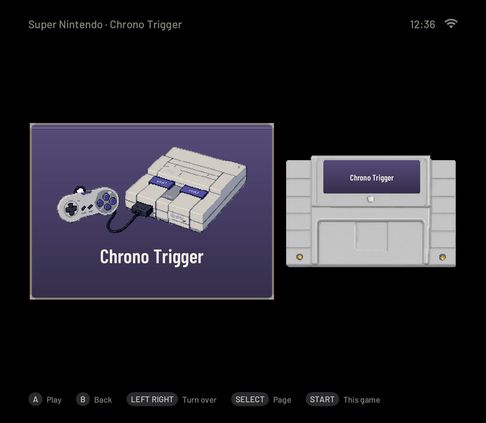
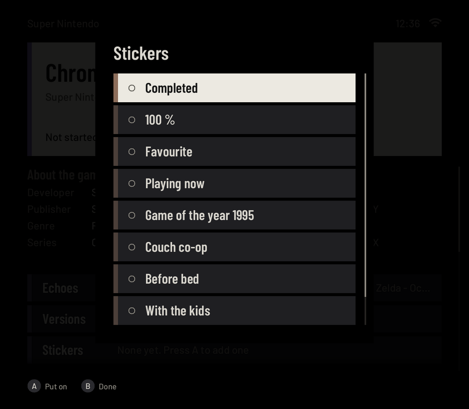

# Pictures

Rendered from the code with made-up data, not photographed: `scripts/readme-shots.sh` runs `pocket-ui --snapshot`
on the library of `scripts/curator-fake-library.py` (game titles only; no cover art, no game frames) and writes
these files. Run it again after a change to the screens.

| Picture | Screen |
|---|---|
|  | The README's header: the cartridge and the wordmark, `logo-on-dark.png` for GitHub's dark theme (from the logo pack, not rendered by `readme-shots.sh`) |
|  | Home in the Shelf look, dark: the last game, favourites, Curator, smart shelves and systems |
|  | The same in the light appearance |
|  | Home in the Split look |
|  | The Cabinet look: the selected game's case on the top board, the old TV, and a plant and a trophy that grew with the play time |
|  | A list of games as cases on the Shelf: discs, cartridge boxes and cases, each in its console's look |
|  | A game's card: facts from Wikidata, your status, rating and notes, Echoes, versions, stickers |
|  | The game as a box with its cartridge beside it |
|  | The Stickers sheet on a game's card |
|  | Curator's Lens: filters with live counts |
|  | The pause menu on HOME (over a pocket-core game; a snapshot has no game picture behind it) |
|  | Save with the slot strip |
|  | Settings, in five categories |
|  | Settings, Look & feel, Cozy extras: each little touch on or off |
|  | The Theme page: colours, font and button symbols with a live preview |
