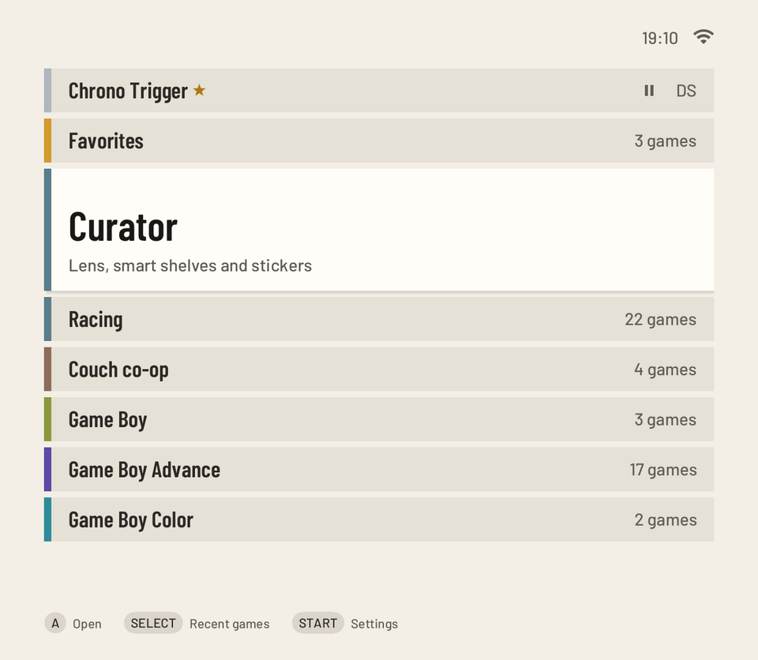
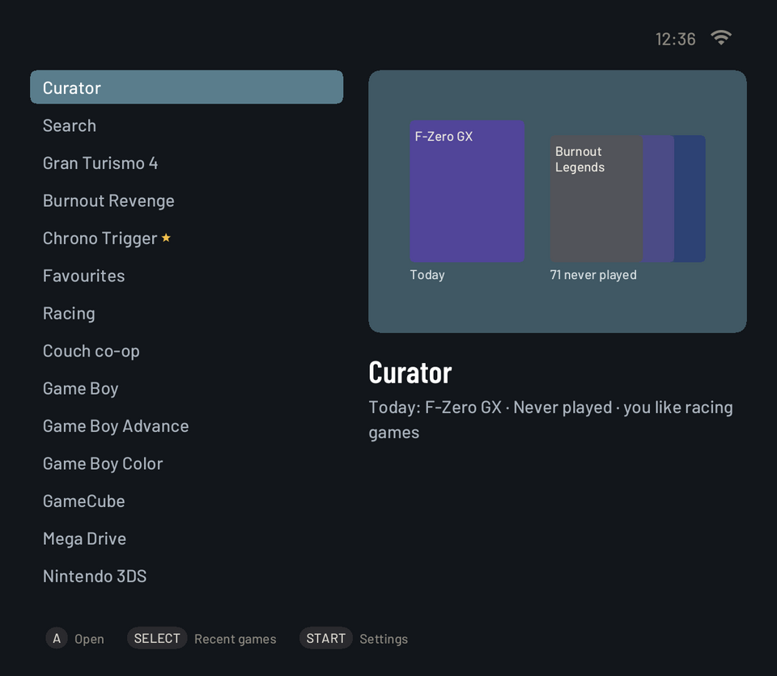
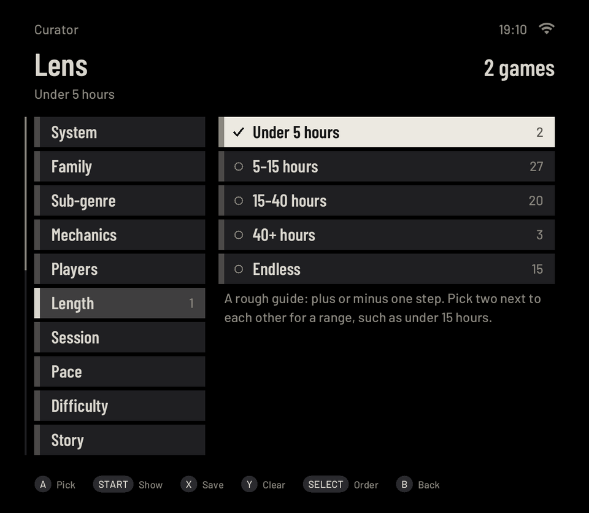
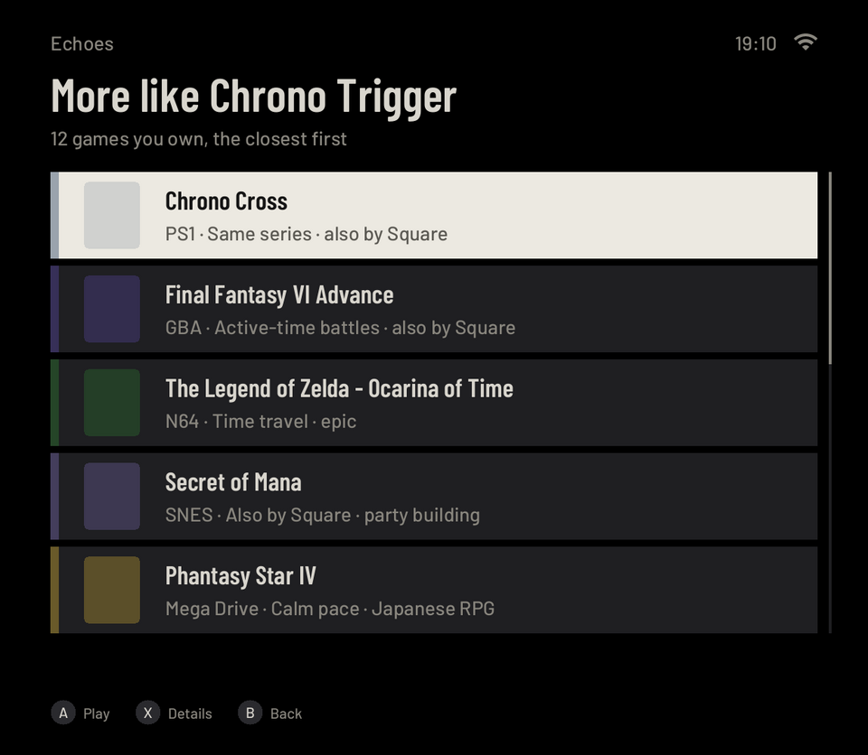
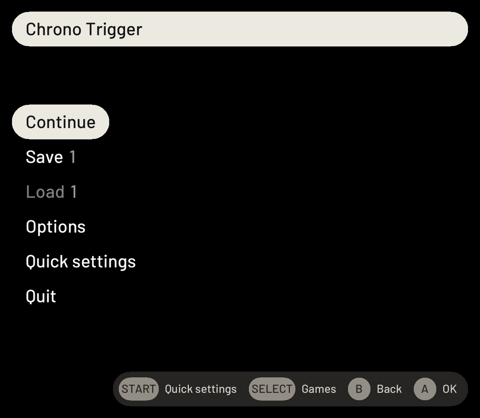
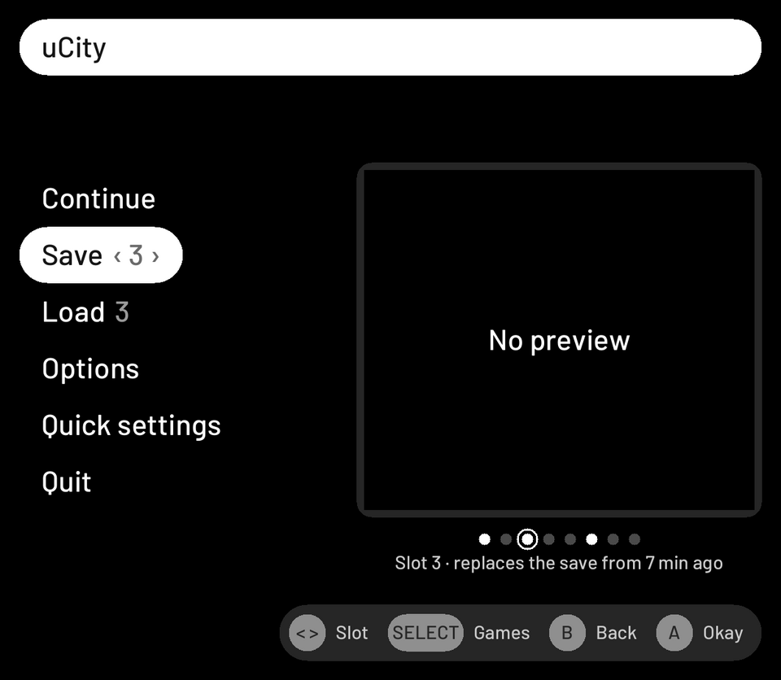
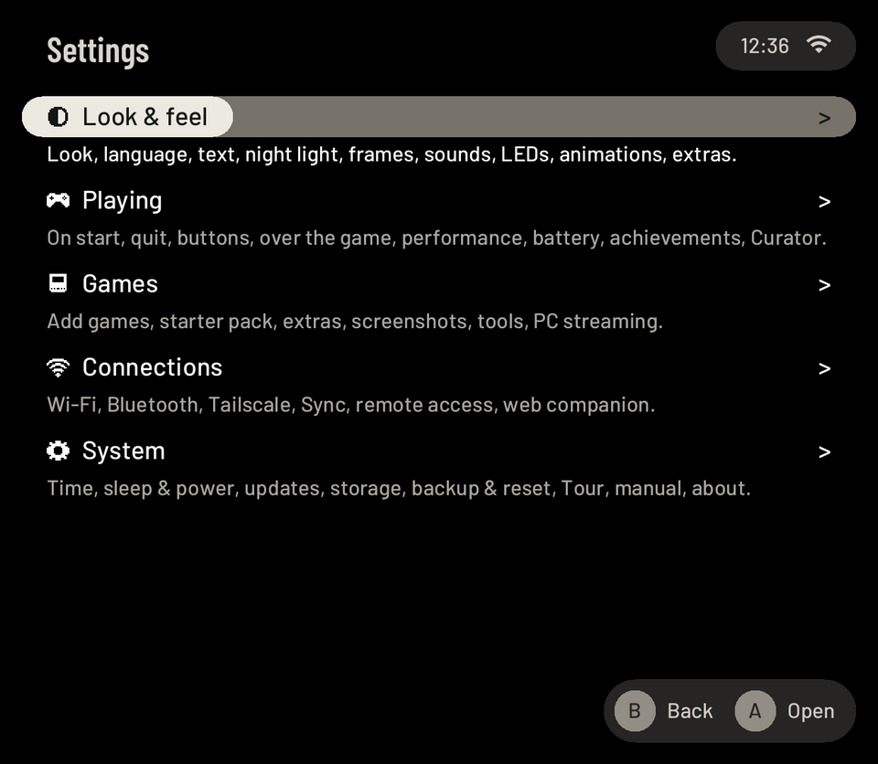

# Pictures

Rendered from the code with made-up data, not photographed: `scripts/readme-shots.sh` runs `pocket-ui --snapshot`
on the library of `scripts/curator-fake-library.py` (game titles only; no cover art, no game frames) and writes
these files. Run it again after a change to the screens.

| Picture | Screen |
|---|---|
|  | The README's header: the cartridge and the wordmark, `logo-on-dark.png` for GitHub's dark theme (from the logo pack, not rendered by `readme-shots.sh`) |
|  | Home in the Shelf look, dark: the last game, favourites, Curator, smart shelves and systems |
|  | The same in the light appearance |
|  | Home in the Split look |
|  | The Cabinet look: Curator's shelves as a bookcase |
|  | A game's card: facts from Wikidata, your status, rating and notes, Echoes, versions, stickers |
|  | Curator's Lens: filters with live counts |
|  | Echoes: more like this game, from your own library |
|  | The pause menu on HOME (over a pocket-core game; a snapshot has no game picture behind it) |
|  | Save with the slot strip |
|  | Settings, in five categories |
