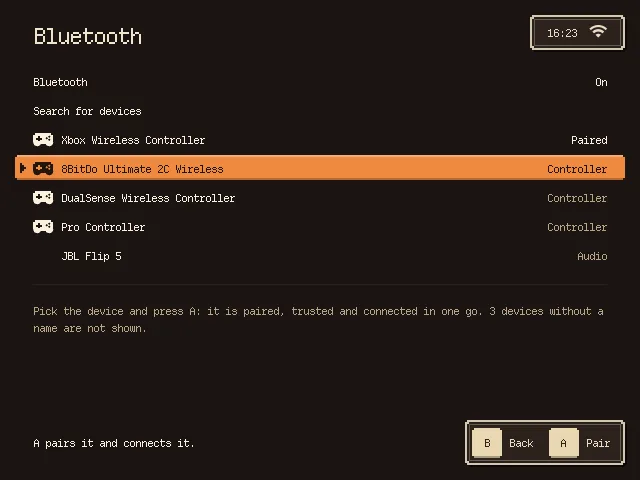

# Bluetooth

> **TrimUI Brick:** controllers and headphones pair right here just as below. When Bluetooth headphones or a speaker are
> connected, game and menu audio routes straight to them and returns to the Brick's speaker as soon as they disconnect;
> both the volume buttons and the mute slider work with them too. Turn headphone volume down before connecting the first
> time. The quantum and PipeWire notes below apply to ROCKNIX only.

Settings → Connections → **Bluetooth** pairs gamepads, headphones, speakers and other Bluetooth gear with your Pocket.

If nothing is paired yet, the list says **No devices found** and reminds you to put your device in pairing mode, then
select **Search for devices**.

| Row | What A does |
|---|---|
| **Bluetooth** | Turns Bluetooth On or Off (mirrors the toggle in quick settings; takes a few seconds) |
| **Search for devices** | Scans for devices in pairing mode for 15 seconds, turning Bluetooth on first if needed. Press A again to stop early |
| A paired device | Connects or disconnects it |
| A found device | Pairs, trusts and connects in a single press |

To pair a new device:

1. Put it in pairing mode. For **Xbox** controllers, hold the small pair button on top until the Xbox button blinks fast.
   For **PlayStation**, hold Share (or Create on DualSense) + the PS button until the light flashes. For **Switch Pro**,
   **8BitDo** and most other pads, hold the pair button for ~3 seconds. For headphones and speakers, check their manual
   (usually a long press on Power or Bluetooth).
2. Highlight **Search for devices** and press A. Controllers appear at the top with a small gamepad icon.
3. Highlight your device and press A. You'll see Pairing and Connecting, followed by a confirmation. If pairing fails,
   the page explains why—most often "Put the device in pairing mode first."

Paired controllers reconnect automatically whenever you turn them on, even after sleep. They work in menus right away,
and in pocket-ui's own player they join as the next player: your handheld stays Player 1 and the first Bluetooth pad
becomes Player 2 (change assignments anytime under [Players](pause-menu.md#players)). Press **X** on a paired device to
forget it, then X again to confirm (B cancels). Forgetting clears its player slot—handy for old pads or when you switch
an 8BitDo controller between modes (D, S, X), since each mode pairs as its own controller.

**Per-controller button mapping.** Every Bluetooth pad keeps its own custom layout (even two identical models are tracked
separately) and recalls it whenever it connects: configure it in Settings → Controls →
[Controller setup](controls-settings.md#controller-setup). Xbox, PlayStation, Switch Pro and 8BitDo controllers are
recognised automatically along with their sticks and triggers. Want to check raw inputs? Settings → Controls →
[Test buttons](settings-sound.md#test-buttons) lights up every button, trigger and stick live.

**Headphones and speakers** pair the exact same way—their row is labelled Audio, and once connected all menu and game
sound routes through them. Expect a slight audio delay over Bluetooth, which can make timing-heavy games feel a hair
less snappy than the built-in speaker. Power them off or press A to disconnect and audio switches back to the handheld's
speaker immediately, even mid-game.

> **Note:** an early build distorted game audio over Bluetooth headphones (2026-10-27). The fix passed bench testing,
> though it hasn't been ear-tested on real headphones yet—if you hear crackling, let us know via Report a problem.

Controllers always appear at the top of the scan list, followed by audio and other devices. Unnamed nearby Bluetooth
beacons (phones, watches, TVs) are filtered out automatically, with a count shown at the bottom.
