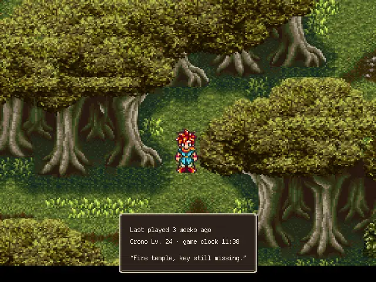

# Continue

Every game you play picks up right where you stopped. Press **A** and you're straight back in that exact moment with no
extra prompts. Nothing stays running in the background and nothing extra clogs your card: it simply loads the moment
saved when you quit or put the handheld to sleep. With [Game start animation](settings.md#game-start-animation) set to
Cozy (and Motion on Full), you watch the game slide into its console while your moment loads in the background; Quick
skips straight in.

## An open case means a moment is waiting

Your last five games with a saved moment sit slightly ajar on the shelf: on Home's recent row and inside their console's
row, the game peeks out the top of the box, and highlighting it slides the cartridge, card or disc part-way out. In Split
and Cabinet, **Continue** beside the title signals the same thing. For games whose in-game save pocket-ui can read, your
actual progress ("8 badges · Charizard Lv. 45 · game clock 31:12",
[Where you are in the game](library.md#where-you-are-in-the-game)) replaces the last-played date. The first time you see
an open case, a quick hint explains "Open means your moment is waiting" (shown once, never in Kids Mode). Older games
with saved moments still continue the same way; they just sit closed on the shelf.

In Shelf and Cabinet, the case begins opening the instant you press **A** while pocket-ui loads the game.

## How fast

Resume speed depends on the emulator. Measured from pressing A to seeing your game with Game start animation set to
Quick (on Cozy, the game appears right after the ~1.6 s console animation, or once a slower emulator finishes booting):

| System | Mini V2 | RG35XX Plus |
|---|---|---|
| Game Boy, Super Nintendo, Game Boy Advance | 0.1 to 0.2 s | 0.3 to 0.5 s |
| PlayStation | 0.2 s | 0.7 s |
| Nintendo DS | 0.4 s | |
| PSP | 0.7 s | |
| Nintendo 64 | 0.9 s | |
| PlayStation 2 | about 3 s, then its load | |
| GameCube | about 18 s | |

PlayStation 2, GameCube, Wii and 3DS boot the game first and take as long as their emulator takes: they show a small spinner
until then. A game that can't continue stands as a normal case:

- **No saved moment:** Xbox (until its core has save states), Wii U, PS3, Vita, ports, ScummVM, PICO-8, TIC-80 and other
  emulators without one. A game you haven't quit yet stands closed too. PlayStation 2 games stand open from your next Quit.
- **The game now runs on another emulator or core:** its moment belongs to the old one. The start says so and begins fresh. On
  pocket-ui's own host the old moment moves to a free save slot with its picture, and the message says which one: switch back
  and Load it from there. This holds after a game on another emulator or core you played in between.
- **The game's file changed** (a new copy or a different version, judged by what is in the file, also the tracks of a `.cue` or `.m3u`; copying the card alone changes nothing): a moment of another file isn't loaded. The start says so and
  begins fresh; the moment moves to a free save slot under Load, and the message says which one.
- **A soft patch was added, replaced or removed** ([patches](patches-msu1.md)): the same, because the patched game is another game to its moment.
- **Another game has the same file name** (in another folder of the system): they share save states, see [troubleshooting](troubleshooting.md). A moment the other game may have written isn't loaded, and the start says so.
- **The moment is gone** (you deleted it, or a card was swapped): the start says so and begins fresh. In-game saves are never
  touched by any of this.
- **The emulator refuses the moment** (after an update of its core): the same, "Couldn't go back to that moment", and the
  moment goes to a free save slot. With all eight slots full it is kept on the card and moves into the first slot that is
  free at a later start.
- **The newest moment is damaged** (a card that didn't finish writing it): the game goes back to the moment before it and says
  "The game didn't close normally: back at your last saved moment", as after a crash or an empty battery.

There is no switch for the open case. A game whose file, patch or emulator changed doesn't load the old moment. With
[Continue where I quit](settings-playing.md#continue-where-i-quit) off, a Quit keeps no new moment and the switch's line says so; on
pocket-ui's own host the older moment no longer stands open (it stays under Load), and moments from sleep still do. Motion off: the game is simply out, and the spinner's dots
stand still.

## Where was I?

Back to a game after more than two weeks: while its moment loads, a quiet card at the bottom of its picture says when you
played it last ("Last played 3 weeks ago"), how long you have played it, and your note from the
[game card](library.md) if you wrote one. For a game whose save pocket-ui can read, where you are in it ("8 badges ·
Charizard Lv. 45 · game clock 31:12", [Where you are in the game](library.md#where-you-are-in-the-game)) takes the place of the
time played: the game's own clock is in it. Nothing asks you anything. On pocket-ui's own host the game stands still at your
moment until you press any button, without sound, so you can read it and miss nothing. That button just starts play. Other emulators show it until the game
is there. A press while the picture is still loading also skips the card. If the picture or moment cannot be loaded,
the game starts without waiting for the reminder. A game played within the last two weeks, a game that starts fresh and
Kids Mode show no card. Easy shows only when you played last and your note. It is **off** until you switch it on:
Settings → Playing → [Remind me where I was](settings-playing.md#remind-me-where-i-was). The lines about where you are in the
game on the shelf and the box's back don't depend on it.

## On an Android phone

It works the same way on your phone, out of the box. The last five games you played in pocket-ui's own player stand a little
open, the line under the name says **Continue**, and the button says **Continue** (with a controller, **A Continue**). One tap and
you're back in that moment. Games that open in another app, like RetroArch, can't
continue this way and stand closed.

- **Home, or switching apps:** your moment is saved on the way out, and the game stands open. Returning to the running player leaves it paused until Continue.
- **The game was killed while on screen** (a crash, or Force stop): you're back at the last moment that was saved, and the
  start says so.
- **The file changed, the emulator refuses the moment, or a newer in-game save exists:** the game starts fresh and tells you. The
  moment isn't lost: it moves to a free save slot and the message says which one, so Load gets you there. If all eight are full it's kept aside.
- **The file is gone, or Android took back access to its folder:** a message says so and nothing is touched. Put the file back
  or choose the folder again, and the moment is still there.

With **Remind me where I was** switched on (it is off until you do; the row is in the Android app's own Settings), the internal player shows the **Where was I?** card after more than two weeks on the
restored frame for as long as you need. Any press or touch starts play immediately. Easy leaves
out the total play time.
A failed resume shows no reminder. In particular, a short old PSP moment opens **Recovery**
with an explanation; the moment remains under Load and the in-game save is kept safe.

## In-game saves

In-game saves (the kind a cartridge keeps, "battery saves") on pocket-ui's own host are written
every 10 seconds when they change and again when you quit. They are stored in the same place and
format RetroArch uses, so they work with both.

If pocket-ui’s own host is still loading a game after three seconds, “Loading the game…” and a spinner stay visible until loading finishes.
