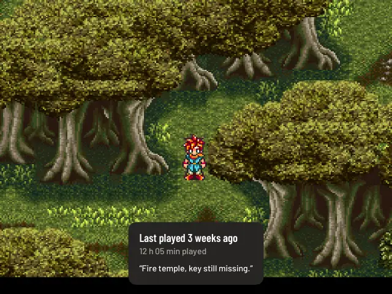

# Continue

A game you have played comes back where you left it. **A** on it goes straight back to the moment you left, with no
question and no waiting. Nothing keeps running and nothing extra goes on your card: it is the moment Quit or sleep wrote.

## An open case means a moment is waiting

Your last five games with a saved moment stand a little open on the shelf: on Home's recent row and in their system's row,
the game peeks out over the case's top, and when you pick one its cartridge, card or disc comes a little out of the side.
In the Minimal, Split, Cards and Cabinet looks the word **Continue** beside the game says the same. The first time an open case is on screen, one line says what it means: "Open means your moment is waiting"
(once, never in Kids Mode).
Other games with a moment continue the same way when you start them; they just don't stand open.

## How fast

It depends on the emulator. From A until the moment is back on the screen, measured on real games:

| System | Mini V2 | RG35XX Plus |
|---|---|---|
| Game Boy, Super Nintendo, Game Boy Advance | 0.1 to 0.2 s | 0.3 to 0.5 s |
| PlayStation | 0.2 s | 0.7 s |
| Nintendo DS | 0.4 s | |
| PSP | 0.7 s | |
| Nintendo 64 | 0.9 s | |
| PlayStation 2 | about 3 s, then its load | |
| GameCube | about 18 s | |

PlayStation 2, GameCube, Wii and 3DS boot the game first and take as long as their emulator takes: they show a small spinner
until then. A game that can't continue stands as a normal case:

- **No saved moment:** Xbox (until its core has save states), Wii U, PS3, Vita, ports, ScummVM, PICO-8, TIC-80 and other
  emulators without one. A game you haven't quit yet stands closed too. PlayStation 2 games stand open from your next Quit.
- **The game now runs on another emulator or core:** its moment belongs to the old one. The start says so and begins fresh; the old moment stays under Load. This holds after a game on another emulator or core you played in between.
- **The game's file changed** (a new copy or a different version, judged by what is in the file, also the tracks of a `.cue` or `.m3u`; copying the card alone changes nothing): a moment of another file isn't loaded. The start says so and
  begins fresh; the old moment is kept in a free slot under Load.
- **A soft patch was added, replaced or removed** ([patches](patches-msu1.md)): the same, because the patched game is another game to its moment.
- **Another game has the same file name** (in another folder of the system): they share save states, see [troubleshooting](troubleshooting.md). A moment the other game may have written isn't loaded, and the start says so.
- **The moment is gone** (you deleted it, or a card was swapped): the start says so and begins fresh. In-game saves are never
  touched by any of this.
- **The emulator refuses the moment** (after an update of its core): the same, "Couldn't go back to that moment".

On pocket-core, a moment skipped after a file or emulator change, or refused by the core, moves to the first free save
slot. The start message says which one. It stays there after Save & quit. If all eight slots are full, it is kept aside
and moves into the first free slot when you next start the game. To load another emulator's moment, switch back to that
emulator first. Existing slots and in-game saves stay as they were.

There is no switch for the open case. A game whose file, patch or emulator changed doesn't load the old moment. With
[Continue where I quit](settings.md#continue-where-i-quit) off, a Quit keeps no new moment and the switch's line says so; on
pocket-ui's own host the older moment no longer stands open (it stays under Load), and moments from sleep still do. Motion off: the game is simply out, and the spinner's dots
stand still.

## Where was I?

Back to a game after more than two weeks: while its moment loads, a quiet card at the bottom of its picture says when you
played it last ("Last played 3 weeks ago"), how long you have played it, and your note from the
[game card](library.md) if you wrote one. Nothing asks you anything. On pocket-ui's own host the game stands still at your
moment for about four seconds, without sound, so you can read it and miss nothing; then it plays on. Any button plays at
once. A game that loads longer shows the card while it loads and counts that time. Other emulators show it until the game
is there. A press while the picture is still loading also skips the card. If the picture or moment cannot be loaded,
the game starts without waiting for the reminder. A game played within the last two weeks, a game that starts fresh and
Kids Mode show no card. Easy shows only when you played last and your note. Settings → Playing →
[Remind me where I was](settings.md#remind-me-where-i-was) switches it off.

## On an Android phone

It works the same way on your phone, out of the box. The last five games you played in pocket-ui's own player stand a little
open, the line under the name says **Continue**, and the button says **Continue** (with a controller, **A Continue**). One tap and
you're back in that moment. Games that open in another app, like RetroArch, can't
continue this way and stand closed.

- **Home, or switching apps:** your moment is saved on the way out, and the game stands open.
- **The game was killed while on screen** (a crash, or Force stop): you're back at the last moment that was saved, and the
  start says so.
- **The file changed, the emulator refuses the moment, or a newer in-game save exists:** the game starts fresh and tells you. The
  moment isn't lost: it moves to a free save slot and the message says which one, so Load gets you there. If all eight are full it's kept aside.
- **The file is gone, or Android took back access to its folder:** a message says so and nothing is touched. Put the file back
  or choose the folder again, and the moment is still there.

## In-game saves

In-game saves (the kind a cartridge keeps, "battery saves") on pocket-ui's own host are written
every 10 seconds when they change and again when you quit. They are stored in the same place and
format RetroArch uses, so they work with both.
