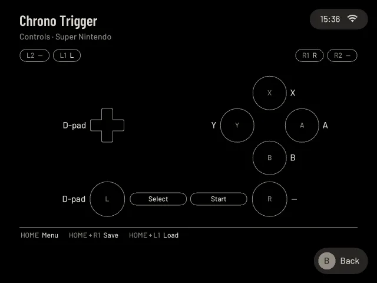

# The controls card

New to a console, or back after a year: which button of the Pocket is which button of the game? The **controls card**
shows it on a drawing of the Pocket's buttons, each in its place: the shoulder buttons at the top, the D-pad at the left,
the four face buttons at the right, SELECT and START in the middle, the sticks under them when the console has them.
In each button stands the console's own name for it: on a SNES the right button says **A**, on a PlayStation the
bottom one has the **cross**, on a Nintendo 64 the bottom button is **A** and the right stick says **C buttons**.
Where the Pocket's own letter is another, it stands small on the button's rim.

A button the console does not have is only a faint outline (a Game Boy has two buttons, so two are named). Shoulder
buttons, SELECT and START and the sticks show only when the console has them. The drawing grows with the screen.

Nothing on it is made up, and nothing is an emulator's own word. The names are the console's, as on its box and pad,
from the emulator's list of buttons; extras of the emulator stay off the card: the turbo buttons, and the sun sensor of
the Boktai games, which shows only for those games (**L3** less sunlight, **R3** more). The card also shows **your own
changes** from [Options → Controls](options.md#controls): a button you gave another job is drawn in amber (a turbo
button you put on a button of your own shows too), a button that now does nothing shows a dash. Under the drawing
stands, large, the key that opens the **Pause menu** (**HOME**), and, when they are switched on under
[Options → Shortcuts](options.md#shortcuts), **HOME + R1** saves, **HOME + L1** loads and **HOME + X** zooms (Zoom is
off until you switch it on).

## Where it is

- **The first time you start a console.** Before the first game of a console (not of every game) the card comes up on its
  own. Any button, or a tap, goes on to the game; if you do nothing it goes on by itself after twelve seconds. Continuing a game you already played skips the card. It comes
  once for each console and not again by itself. In [Kids Mode](kids-mode.md) it does not come.
- **On the game's card.** Press X on a game, scroll down: the row **Controls** is after the game's other rows (Screenshots)
  and before Hide or delete. A opens the card, B comes back.
- **In the pause menu.** HOME, Options, **Controls**: the first line, **Controls card**, shows the card of the game you are
  playing, with the console's own button names as the emulator reports them, and your changes as they are right now. B comes
  back to the list.

The pause menu itself has no extra line for it.

## Which consoles

The card names the buttons of the Game Boy, Game Boy Color, Game Boy Advance, NES / Famicom, SNES / Super Famicom,
PlayStation, PlayStation Portable, Nintendo 64, Mega Drive / Genesis, Master System, Game Gear, Sega Saturn and
Dreamcast from the start. On a **Mega Drive** A, B and C are the left, bottom and right buttons, Y the top one, X and Z
are L1 and R1, and SELECT is Mode. On a **Master System** and a **Game Gear** the bottom button is 1 and the right one 2;
SELECT resets the console, and on a Master System START is its Pause button.

For any other console the card uses the button names from the first game you played on it, as far as they are plain
button names (A, B, Start, Run …). Until then, or when there are none, it is a short card: "Play with the D-pad and the
buttons", and the key for the Pause menu. Games that run in RetroArch or in another emulator show only HOME as the
menu; their buttons are set in that emulator.

On a **Nintendo 64**, the right stick is the C buttons. Hold R2 and the four face buttons are the C buttons instead.
On a **PlayStation** both sticks go to the game, as on a DualShock; with Options → Controls → **Left stick as D-pad** on, the
left stick is the D-pad again and the card says so.

## When it looks wrong

- A button shows a dash although you expect it to work: it does nothing in this game (the console has no such button, or you
  set it to None in Options → Controls). **Reset controls** there puts everything back.
- A button you know from the emulator is missing (turbo, a sensor): the card leaves the emulator's extras out. They
  still work, and Options → Controls lists them.
- The card does not come at a first start: it only comes for games that run on pocket-ui's own host, once for each console,
  and not in Kids Mode. The game's card has the row at any time.

On a TrimUI Brick, **MENU** opens the menu. The card and hints use the name printed on that device; other devices use **HOME**.

## On Android

Tap **Controls** on a game's card (R2 with a gamepad), or **Controls** in the pause sheet.
It is the same drawing, on one screen in every Retroid format: the console's names in the
places of your gamepad's buttons (Android does not know which letters your maker printed,
so the card goes by the places), and **Back** for the Pause menu. Without a gamepad the
touch buttons on the screen carry the same names, and **Pause** opens the menu. The **Back**
button beside the title closes the card. The first game of a console opens it once; Back
or A goes on. Continuing an existing moment skips it. External emulator apps own their
controls.

## Bluetooth and separate controller layouts

The controls card describes the game's layout after the controller's own layout. **Controller setup**, beside
**Controls card** in Pause → Options → Controls, changes one controller for the shelf, menus and games;
Settings → Playing → Buttons opens the same setup. An occupied button swaps automatically and L2/R2 can be
captured whether the controller reports buttons or analogue axes. See [Controller setup](controls-settings.md#controller-setup).
