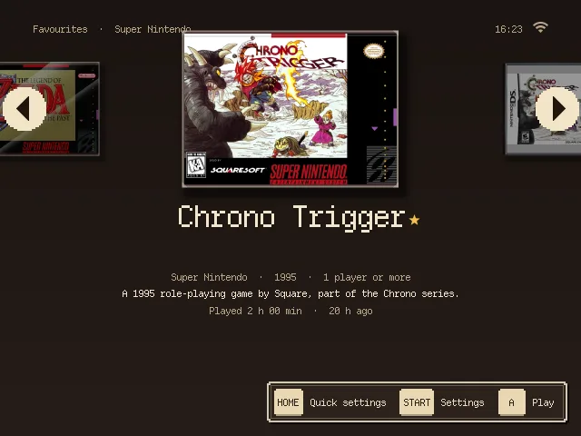

# Easy

Made for a small collection and zero distractions: one big game at a time, always in the same order. Your favourites
come first, followed by each console and its games, and it opens straight onto the last game you played.

- **Left** and **Right** browse your games (hold to scroll faster); **A** starts playing. When a saved moment is waiting,
  the button says **Continue** and the case sits slightly ajar. The first time you see an open case, a quick note under
  the title explains "Open means your moment is waiting" (shown once).
- **X** opens the game card, just like in the other layouts. **Y** stars or unstars the game. **HOME** opens quick
  settings (brightness, volume, Wi-Fi and power). **START** opens Settings, where you can switch to another layout
  anytime. The hint bar only shows **A**, **HOME** and **START** to keep things clean; the other buttons still work.
- If you have more than one console, **Up** and **Down** jump between systems. The top line always shows where you are
  (such as "3 of 9 · Super Nintendo" or "Favourites").
- Pressing **HOME** during a game gives you a compact menu: **Continue**, then **Save & quit** (or **Quit** if the game
  can't save a moment, or if [Continue where I quit](settings-playing.md#continue-where-i-quit) is Off—your in-game saves
  are still safe). Games that only keep in-game saves ask "Have you saved in the game?" once. The third row,
  **More: saves, brightness, options**, opens the full [pause menu](pause-menu.md), and **B** returns. **START** opens
  quick settings.
- No on-screen counters: the FPS/CPU readout and Pixel Path stay hidden in Easy, no matter what
  [Over the game](settings-playing.md#over-the-game) is set to. Your setting isn't overwritten, so switching to another
  layout brings them right back.
- No game switcher by design: **SELECT** on the shelf (and **HOME + SELECT** or **SELECT** in the pause screen) does
  nothing here. The other layouts keep the [switcher](playing.md#recent-games).
- If a game can't launch, you get a plain message that stays on screen: press **A** to open the right fix (Game check or
  Add games), or **B** to go back. An empty card shows **No games yet** as usual.
