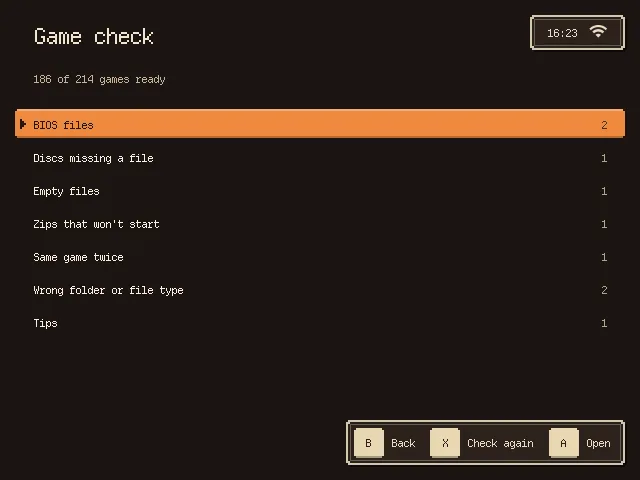

# Game check

Settings → Games → **Game check** answers one simple question: "Will my games actually start?" It scans your SD card in
the background without slowing down the shelf, then shows either **All good** with your ready game count or a short list
of issues. Folders with more than 50,000 entries only check the first 50,000; if those are clean, it says
**First 50,000 files checked** instead of All good:

| Row | Example | What to do |
|---|---|---|
| **Folders that can't be read** | A system entry in `es_systems.cfg` is broken or missing a name or ROM folder | Fix the entry at the file and line shown, then rescan your games. All other systems stay on the shelf |
| **System list** | "The system list is missing / can't be read / has no system in it / every entry is damaged, so pocket-ui uses its built-in list." | Games in standard folders (`roms/gba`, `roms/nes`, …) still appear. To use a custom list, fix or restore `es_systems.cfg` (path shown) and rescan |
| **BIOS files** | "Sega CD: BIOS missing." with exact filenames; "The BIOS file is in the wrong folder"; "Wrong BIOS: its checksum differs"; "This BIOS file is empty" | Copy your console's BIOS into `roms/bios`, or move or rename it as shown |
| **Discs missing a file** | "Disc: Game.cue is there, its Game.bin is missing." Also `.m3u` playlists with no playable discs | Place the missing file right beside it with the exact matching filename |
| **Empty files** | "This file is empty." | Copy the game file over again |
| **Zips that won't start** | "There is no game file in Game.zip"; "Game.zip holds 2 game files" | Fix the archive as described (the same message appears if you try launching it) |
| **Same game twice** | `Game (1).gba` beside `Game.gba`, or the same game in another version in the same folder: another region or revision (`Chrono Trigger (Europe).sfc` beside `0457-Chrono Trigger (US).smc`), `Zelda, The` for `The Zelda`, a `.zip` beside the unpacked game, the same checksum under another name. Hacks, fan translations, betas, Japanese releases and games in separate folders count as separate games (the folders of two systems that share one shelf, like Genesis and Mega Drive, count as one folder) | Press A to hide the extra version from your shelf. The one you have saves, save states, play time or a star for always stays, and when you played two versions both stay. Otherwise Europe or World stays before USA, then the newest revision. The file stays on your card, and Settings → System → Storage can unhide it anytime |
| **Wrong folder or file type** | A `.gba` inside `roms/snes`, `.sfcc`, `Game.sfc.txt`, a `.rar`, a game nested two folders deep, or an unrecognised folder | Move or rename the file to the folder or extension shown |
| **Needs a stronger handheld** | PS2 games on an H700 handheld | Nothing to fix; they stay on your card. Shown only when known for your device |
| **Tips** | "PlayStation games start without a BIOS, and a few run better with one." | Optional advice. Tips never take away the green **All good** |

Press A on a row to see the affected games, and A on a game to see what's wrong, where it lives and how to fix it. Press
B to go back (or cancel a running scan) and X to scan again. Everything runs offline: pocket-ui never downloads games or
BIOS files, never deletes your ROMs and never touches saves. BIOS files are verified by size and checksum against known
good dumps from real consoles; game files aren't read all the way through, so a corrupt ROM with a valid name and size is
only caught when you launch it.

When new games arrive via Add games, pocket-ui offers to run Game check right away ("12 new games"). If you copy games
another way (like popping the SD card into a computer), a brief note on Home points you to Game check, except right after
first-start setup, so your brand-new shelf stays clean. If you copy files the shelf can't read (a disc missing its `.bin`,
or an unknown folder) and no new games appear, the note says "Some game files can't be read.
Settings › Games › Game check says why." An empty Home shows the same hint under "No games yet".

System names with `&` (like Game & Watch) work fine. If a single entry in `es_systems.cfg` is broken, only that entry is
skipped while your other games stay put, with a note pointing to Game check. If the whole system list can't be read,
pocket-ui falls back to its built-in standard folders and lets you know (both in a note and on an empty shelf). Your
system list and game files are never modified.
