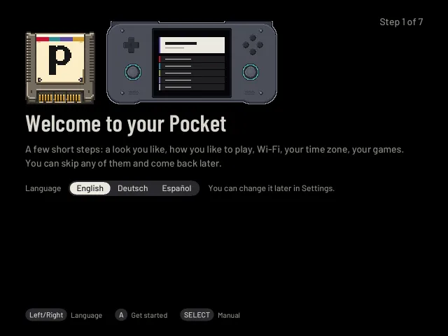
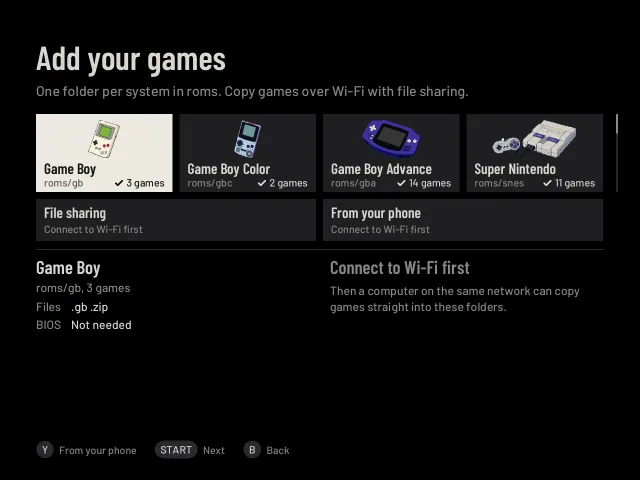

# Getting started

This page takes you from a ROCKNIX card to your first game in pocket-ui. You need a computer once, to copy files to the card.

> **Already play on ROCKNIX or Android?** [Coming from ROCKNIX or Android](coming-from.md) says what happens to your
> saves, states, favourites and settings.

> **Not a Mini V2?** The two-file card install below is for the Mini V2 only. Other Retroid devices and the Anbernic H700
> handhelds are on [Other handhelds](other-handhelds.md) (other Retroid devices, SM8550, H700). They are
> supported as **experimental**.

## 1. Put pocket-ui on the card

Download from the [install page](https://pocketui.xyz/install.html) and pick one way:

- **Ready-made SD card image**, the easiest: there is one for the Mini V2 and one for each Anbernic H700 model. Write it to
  a card with balenaEtcher or Raspberry Pi Imager. Writing erases the card; the handheld itself isn't changed. On an
  H700 handheld put the card in and switch on; on the Mini V2 go on with [section 2](#2-start-pocket-ui).
- **Ports installer**, when ROCKNIX is already on your card: section 2 below.
- **Fresh card, two files**: right below.
- **Over SSH**: the [install guide](../INSTALL-DUAL-BOOT.md).

pocket-ui contains no games and no BIOS files; add only ones you own.

### Fresh card: two files

If you flashed the official ROCKNIX image yourself, you can add pocket-ui from your computer, without Wi-Fi and without
any command line:

1. New to ROCKNIX on the Mini V2? Set it up once with [ROCKNIX's own guide](https://rocknix.org/devices/retroid/retroid-pocket-mini/) (it covers flashing the card and ROCKNIX's one-time bootloader step), then come back. Flash ROCKNIX 20261001 or newer to the card, but **don't switch the device on yet**.
2. Take the card out and put it in again. Your computer shows one drive called **ROCKNIX**.
3. Copy two files into that drive, in the top folder: `mount-storage.sh` and `pocket-ui-seed.tar.gz` (both are in the
   pocket-ui card zip). Don't rename them or unpack them. Eject the card.
4. Put the card in and switch on. The first start looks like normal ROCKNIX: it makes room for your games and restarts
   by itself.
5. At the second start the screen says "pocket-ui: installing", and then pocket-ui opens. The two files disappear from
   the drive on their own.

Your games, saves and settings are never touched. If pocket-ui doesn't come up, ROCKNIX starts as usual and the
drive holds a file `pocket-ui-install.log` that says why (for example "damaged": copy the tar again). The two files
stay until the install worked, so you can just try again.

## 2. Start pocket-ui

pocket-ui starts from the SD card next to Android; Android and its data stay as they are, and nothing is flashed. A
setting in Retroid's own start menu picks which one starts:

1. Put the SD card into the switched-off device.
2. Hold **Volume Down** and press **Power**. Retroid's menu opens; its bottom line reads "Boot mode: Android".
3. Pick **Switch boot mode** with the volume keys and press Power until the line reads **Boot mode: Loader**, then
   pick **Start**. (Volume Up + Power does not start pocket-ui on current Retroid firmware.)
4. The first start takes a few minutes and restarts once by itself. Then pocket-ui's setup opens (step 3 below).

The setting stays: from now on, switching on starts pocket-ui while the SD card is in.

**What you see when it starts:** Retroid's logo, a moment of black, then a dark screen with a single "pocket-ui" bar
whose coloured edge slowly changes colour, as long as the Pocket is getting ready (about 20 seconds). Then the screen
dips to black and the shelf fades in. The first start after setting up the card says "Getting ready for the first
start…" under it, and a start that takes longer than a minute says "Still starting…".

**To go back to Android:** hold Volume Down and press Power, pick **Switch boot mode** until the line reads **Boot
mode: Android**, then **Start**. The SD card can stay in.

**If the screen stays black** with Boot mode: Loader, switch back to Android as above and see "If something goes
wrong" in the [install guide](../INSTALL-DUAL-BOOT.md). The guide also has the way for a ROCKNIX card you
already use, with no computer commands: copy the one file **Install pocket-ui.sh** into the `roms/ports` folder of the
card (switch on Samba in ROCKNIX's Network Settings, then open `\\<device name or IP>` on Windows or `smb://<device name or IP>` on a Mac and use the games share; [ROCKNIX explains it](https://rocknix.org/play/add-games/)), open **Ports** in EmulationStation (restart its list once: Start, Game Settings, Update Gamelists) and start
**Install pocket-ui**. The screen shows what it checks and installs; if something does not fit, it says what, changes
nothing and **Close** takes you back to EmulationStation. To remove pocket-ui again, open EmulationStation (in pocket-ui: Settings → Help & tools → About → Open
EmulationStation…, or hold SELECT and START), then start **Ports → Uninstall pocket-ui** (the installer leaves it there).

Running the installer again repairs missing or damaged program files, even with the same version number. A complete
matching install is left in place. Your games and saves stay as they are.

If pocket-ui is not installed, ROCKNIX's own menu (EmulationStation) appears instead. If pocket-ui keeps stopping, it
goes back to the last version that worked, then to a [safe mode](safe-mode.md) page; EmulationStation only opens by
itself if pocket-ui cannot start at all.

## 3. First start

The first time pocket-ui runs, it walks you through four short stages: your language, Wi-Fi, your games, and how
your games stand on the shelf. Dots at the top right show how far you are. Every stage works like a list in Settings:
**Up/Down** reach every row and choice on the page (a bar or the light row shows where you are), **Left/Right** change
the one you are on, **A** takes it, and the way on is always a row or "A" itself (Continue, Looks right, Finish).
**B goes back** to the stage before (L1 does too), and **START skips the rest** of the setup; inside a keyboard or a
list B, L1 and START are the keyboard's and the list's. The hint bar names the keys of the row you are on. **L2**
switches **Easy to read** on every stage (larger text and calmer menus, at once, also in the keyboards): the small
**L2 Aa** at the top right says so. Settings → Help & tools → **First-start setup** runs it all again later.

1. **Your language.** The Spanish welcome reads **Bienvenido a tu Pocket**. Under the cartridge and your handheld,
   Left/Right choose **English**, **Deutsch** or **Español**:
   the screen changes at once, and the choice is kept ([Language](language.md)). It starts on the system language
   ROCKNIX was set to. The row under it is **Easy to read**: Down reaches it and Left/Right switch it there (L2 does it
   from anywhere), Up goes back to the language. Setting the Pocket up for a child? The third row, **For a child**
   (On with Left/Right; Y switches it too), notes it, and Kids Mode's own steps come after your games (below); not on
   the Steam Deck. A ("Get started") goes on from any row. SELECT opens the manual, this guide, on the device (in
   English); B comes back.
2. **Wi-Fi.** Choose a network. Already connected: A on it is Continue. A network that connects says "Connected to
   Home" and the setup goes on by itself. Under the networks: **Other network…**, **Wi-Fi country**, **Time zone**,
   **Scan again** (X does it too) and last **Continue** (**Continue offline** without a connection), the way on
   without Wi-Fi. The Time zone row: the zone is
   guessed while you are here and shown with its time ("Vienna, 22:41"); A there changes it. Only when there is no
   clear guess does the setup ask, right after Wi-Fi (see [Time zone](#time-zone)). A handheld without a Wi-Fi chip
   shows the time zone here instead.
3. **Your games.** What is on the card: "Found 81 games" and the consoles with their names and how many games each, or, with no games
   yet, the way that works on this handheld. **Continue** (or **I'll add games later**) goes on, **Add more…** opens
   the systems, their folders and file sharing ([Add games](#5-add-games)), and B comes back from there. Something in
   the roms folder that isn't read (a folder of no system, a disc game missing a file) is named in a line of its own.
   **Box art** is one switch, **On** as it ships: the boxes come in the background while you're online, only a game's
   name is sent ([Pictures & extras](extras.md#box-art) has the finer choice). Nothing is downloaded before you leave
   this page. No switch on a handheld without Wi-Fi.
4. **How your games stand.** A small picture of the shelf in each look, the one shown in the middle and its
   neighbours at the sides: your own games when the card has some, else games called "Sample game". Left/Right
   switch looks; Easy says what it does ("One big game at a time, simple menus."). Under them three rows, as in
   every list: Down reaches **Style** (Barlow, Pixel, Rounded or [Retro](theme.md#style)), **Colours** (Retro's
   Cocoa and Pea while it is on) and **Appearance** (Dark, Light or Automatic), a bar beside the row you are on;
   Left/Right change it and the pictures above show it at once, Up goes back to the looks. **A** ("Finish") goes
   straight to your shelf, with the look shown, from any row; B goes back to your games, so pressing B a few times
   never ends the setup by surprise. Under the rows: in a game, HOME opens the menu (save, load, quit), and the look
   changes any time in Settings → Look (as far as the screen has room). See [Playing](playing.md#looks) for the six
   looks.

For a child (the third row of the first page): after your games, Kids Mode's own steps (a PIN, the games a child may play, its
colour, time and volume) take the look's place, and the setup ends with them ([Kids mode](kids-mode.md)). B on their
first page goes on to the look as without it, which then says where Kids Mode is for later. With no game Kids Mode can start it is left out, never an empty
shelf: the look stage then says to set it up later in Settings → System → Kids mode.

After a restart or a flat battery in the middle, the setup opens again at the stage it had reached.

The first start asks no play style and shows no feature cards: everything stands as pocket-ui ships it, and features
introduce themselves when you meet them. Settings → Help & tools → **How you like to play** (The shelf, Easy,
Enthusiast or one card per feature) and [Tour](tour.md) are there whenever you like.

### Time zone

The time zone is guessed while the Wi-Fi page is up and shown on its last row with the time it is there now.
pocket-ui guesses it without asking any web service, so nothing about you leaves the device. It looks, in this order,
at:

1. **The zone the system already has**, if it is not UTC and somebody chose it. The zone a fresh image ships with
   (New York) does not count: nobody chose it, so the next two decide.
2. **The country of your Wi-Fi region.** The Wi-Fi chip knows the country it is allowed to transmit in (the same
   setting that decides which channels it may use; it often learns it from the network once connected). For a
   country with one time zone, such as Austria or Germany, that zone is set at once and the row says it. For a
   country with several time zones (the United States, Canada, Australia, Brazil, Russia, Mexico and a few more),
   there is no single answer: right after Wi-Fi the setup opens on a list of that country's cities.
3. **Nothing known:** right after Wi-Fi the setup asks, "Couldn't tell where you are".

When it asks: two rows under the card. **Looks right** (or **Keep UTC**) keeps what is shown, **Choose another…**
(X does it too) opens the regions with a search row on top (the same list as Settings → System →
[Time](settings-system.md#time); L1 empties the search field). A country's own list of cities ends with **Other
places…**. **B** goes back to the Wi-Fi page it belongs to. It asks once: after an answer, leaving Wi-Fi again (B
back, a connection later) goes straight on. On the Time zone row of the Wi-Fi
page, A opens the same regions and B comes back to Wi-Fi; a zone you
pick there stays.

The Wi-Fi region is only a hint to where you live: a Pocket bought abroad can still carry another country's
setting, so look at the city on the row. The clock sets itself from the internet whenever Wi-Fi is on; that switch
stays under Settings → System → Time. Without Wi-Fi, set the date and time by hand there
([Date and time](settings-system.md#time)).

## 4. Connect to Wi-Fi

Settings → Connections → **Wi-Fi**, or the Wi-Fi step of the first start.

1. pocket-ui scans for networks. The line under the title says which network you are connected to, how strong
   it is here and the Pocket's address. The list shows the connected network first, then the others by signal
   strength, then saved networks that are out of range. Each row says **Connected**, **Connecting…**, **Saved**,
   **Saved, out of range**, **Password** or **No password**. A network only says **Connected** once it has given the
   Pocket an address and things online work.
   If the first row says **This network wants a sign-in**, the network (a hotel, a train) wants its page done
   first: see [Hotel and train Wi-Fi](hotel-wifi.md).
2. Choose a network and press A ("Connect").
   In the first start, a network that connects shows "Connected to Home" and the setup goes on by itself. A on the
   connected network is Continue.
3. For a network with a password, type it on the on-screen keyboard:
   - D-pad: move between keys
   - A: type the selected key
   - B: delete the last character (with nothing typed, B goes back to the list)
   - X: Shift, for one capital letter
   - Y: switch between letters and symbols ("?123" / "abc")
   - START, or the **Connect** key: connect

   The password is shown in plain text while you type.
4. Connecting can take up to a minute. The result appears under the title, for example
   "That network is out of range. Scan again." or "The network took too long to respond. Try again." When the network
   refuses the password, the keyboard opens again with what you typed and "Wrong password. Try again." above the keys:
   B takes letters off the end, L1 empties the field, START tries again. The network doesn't keep the refused one. On the list, B goes back.

If the Pocket is already connecting to the network you chose, it waits for that connection (up to 50 seconds) instead of
starting again. Choosing a different network leaves the previous one first; a newly typed password replaces an old
attempt. "Wi-Fi isn’t ready yet" means the radio or network service is still starting; try again in a moment.

The **Scan again** row (or X) refreshes the list. The line under the title is always true to what happened:

- **Wi-Fi is off. Press A to turn it on.** The radio is off (switched off in quick settings, or blocked while the
  Pocket started), and the first row, **Wi-Fi is off**, turns it on with A. The list is empty because there is nothing
  to search with, not because nobody is near. If it does not come on, the line says "Couldn't turn Wi-Fi on. Press A to
  try again."
- **Couldn't search for networks. Try again (X).** The search itself did not work (the system's network service did not
  answer). X tries again. After a start, or when Wi-Fi has just come on, pocket-ui tries once more by itself after a
  few seconds.
- **No networks found. Press X to scan again.** The search worked and nobody is in reach.

Quick settings and this page show the same state: switching Wi-Fi in one shows in the other. The network is remembered and reconnects when the
system starts. If the connection drops while pocket-ui runs, it reconnects by itself (see
[Troubleshooting](troubleshooting.md#questions)).

### Saved networks, hidden networks, the Wi-Fi country

- **A on a saved network** connects to it without asking for the password again. If the saved password no
  longer works, the keyboard comes up.
- **Y on a saved network** asks "Forget …? Press Y again." Y again forgets it (the password goes with it); B keeps
  it. To use it again, connect and type the password.
- **A network that stays on Connecting…**: the Pocket keeps trying a saved network by itself, for example after the
  router's password changed. After a minute the line under the title says "… isn't letting this Pocket in. Press A to
  type the password again." and the row says **Not answering**; A opens the keyboard.
- **Other network…**, the second-to-last row: for a network that doesn't show its name. Type the name, START, then
  the password, START. Leave the password empty for an open network.
- **Wi-Fi country**, the last row: **Automatic** (the default) uses the country the Wi-Fi chip reports, shown
  in brackets. Choose your country when networks on some 5 GHz channels don't show or connect. L2/R2 jump to the
  next or previous letter. The choice is kept across restarts.

## 5. Add games

### Nothing on the SD card yet: the starter pack

A card with no games shows **No games yet** on Home, with **Get the starter pack** (A) and **Add games** (X) for your own. The pack is
a handful of small games that their authors share for anyone to play, from Game Boy to Super Nintendo, Mega Drive and GBA. You can
also open it from Settings → Games → **Starter pack**.

1. Offline, Home's button says **Connect to Wi-Fi** (A opens the Wi-Fi page; B comes back here).
2. Press A on **Get the starter pack**. **Get all** takes every game, A on a game takes just that one. Each is checked and put into
   its system's folder (for example `roms/gb`); B leaves the page while it runs, and the games appear on the shelf when it is done.

**Add games** works online or not and opens the ways to copy your own. **Look around** (B) puts the hint away and shows the empty
shelf in your look; A brings it back, START opens Settings. The hint returns at the next start while the card is empty.

Nothing is added without your A, and a file that is already there is never replaced. Each game's card (X) names its author and
licence; [the credits](../STARTER-PACK.md) list them all.

Games go into the `roms` folder, **one folder per system**, for example `roms/gba` for Game Boy
Advance or `roms/snes` for Super Nintendo. The folder names are the ones ROCKNIX uses; the
[Systems](systems.md) page lists the common ones.

- Put game files **directly** into the system folder. One level of subfolders is read as well, the way a folder per game
  is usually kept: a subfolder with a single game in it shows as one game named after the folder (a disc game with its
  `.cue`/`.bin` files, or a game with an `.m3u` playlist for several discs, see [Games on several discs](systems.md#games-on-several-discs)); a subfolder with several games shows each of
  them. Folders starting with `.` or `_` and anything two levels down are not read.
- Each system accepts the file types ROCKNIX lists for it. Other files are ignored.
- Names are tidied on the shelf: tags such as "(USA)" or "[!]" are hidden, a version number at the end is dropped ("Pipes.v1.02"
  becomes "Pipes"), and "Legend of Zelda, The" becomes "The Legend of Zelda". When two games of a system would end up
  with the same name, each keeps what tells it apart: "Tobu Tobu Girl (Europe)" and "Tobu Tobu Girl (World)", else the
  file type ("(ZIP)") or the folder it is in.
- A disc game (`.cue` or `.gdi`) whose track file is missing is not on the shelf: it could not start. Add games
  names it ("A file is missing: ...", see below); once the file is there, the game appears. The track files of a disc (`.bin` next to its
  `.cue`) are part of that game, not games of their own.
- BIOS files, for the systems that need them, go into `roms/bios`: your own. [Game check](game-check.md) says what's missing.

### The systems grid

Settings → Games → **Add games** (and the "Add your games" step of the first start) shows a tile per system: its
console, its name and its folder, for example `roms/gba`. A system that already has games shows a tick and how
many.

- The popular systems come first: Game Boy, Game Boy Color, Game Boy Advance, NES, Super Nintendo, Mega Drive,
  PlayStation, Nintendo 64, PSP, Nintendo DS, PlayStation 2, GameCube and Dreamcast. Any other system that has
  games follows them.
- The last tile, **All systems**, opens every system ROCKNIX can start (A on it; A again closes the list). Systems
  without a console picture show a plain cartridge.
- Move with the D-pad (L1/R1 jump three rows). Under the grid, the selected system shows its folder, the file
  types it takes, and whether it needs a BIOS: "Not needed", the files it needs and whether they are in
  `roms/bios` (in red while one is missing), or, for systems pocket-ui knows nothing about, that a BIOS would go
  into `roms/bios`.
- The game counts are read when the page opens and again on a button press.
- **Ways to copy games.** Down from the last row: **File sharing**, **From your phone** (what your
  handheld has). Left/Right choose, A switches. [Second card](copy-games.md).

### Over Wi-Fi (file sharing)

1. Open Settings → Games → **Add games** (or the "Add your games" step of the first start). Without a network, the
   right side names the way that works on your card. With Wi-Fi but sharing off, it says "File sharing is off" and how
   to turn it on, without an address yet.
2. Press X ("Turn on file sharing"). The right side under the grid now shows the address, a user (`pocket`) and a
   password made for this Pocket.
3. On your computer, open the address shown on the screen and log in with that user and password:
   - macOS: Finder → Go → Connect to Server, `smb://<address>/games-roms`, "Registered User".
   - Windows: `\\<address>\games-roms` in Explorer's address bar.
   - Linux: `smb://<address>/games-roms` in the file manager.

   The share opens the `roms` folder. Only that folder is shared: pocket-ui's settings, system
   updates and logs are not reachable over the network. Everything inside `roms` is
   there, including `bios`, `savestates`, `ports` and `PortMaster`, so anyone who knows the password can change them.
   PortMaster games take their own files in their folder inside `ports`. The `screenshots`
   folder is shared: that is where [screenshots](playing.md#screenshots) taken in a game end up.
4. Copy your games into the right system folders.
5. Press X again ("Turn off file sharing") when you're done. Otherwise it stays on, also after a restart, and comes back by itself once the Pocket is on Wi-Fi.

The password stays the same for this Pocket. BIOS files go into the `bios` folder of the share. Anyone who has the
password can add or change files there, so keep it to yourself.

### With the SD card in a computer: the GAMES drive

The ready-to-flash RG28XX card, 16 GB or bigger, has a **GAMES** drive: put the card in your computer and drag your games
in ([The GAMES drive](games-drive.md)). On other cards, use file sharing, or a second card on a handheld with a second
slot: Windows and macOS can't write to the card's STORAGE part.

Without Wi-Fi there's also a second card on a handheld with two slots: [Second card](copy-games.md).

### Coming from EmulationStation

The whole move, saves included, is on [Coming from ROCKNIX or Android](coming-from.md). Only the gamelists are here.

If your games were on ROCKNIX's EmulationStation, KNULLI, Batocera or ES-DE, copy each system's `gamelist.xml` with the games:
pocket-ui reads the names, descriptions and pictures in it, and never changes it. More:
[Your EmulationStation gamelists](library.md#your-emulationstation-gamelists).

### When new games appear

The game list is read when pocket-ui starts. To be on screen quickly, the shelf first shows the list as it was
last time and reads the folders again right after; games you added or deleted since then appear or disappear within
about a second, the way they do after Add games. It is also read again whenever you leave a step you opened from
Settings (for example Settings → Games → Add games, then B). If a game does not show up, check that it is directly
in the right folder and has a file type that system accepts; Add games names folders it doesn't read and disc games
missing a file.

A game whose file is no longer on the SD card (deleted or moved over file sharing, for example) does not start: the
Pocket says "*Game* can't start: its file … is no longer there" and reads the list again.

A saved Wi-Fi network opens its Connect / Forget menu with A. B closes that menu back to the same network
on the list; another B returns to the previous first-start step. In Add games, the grid scrolls with the
selected tile, including on a small screen. In the Starter pack list, Up/Down choose a game; Left/Right leave
the focus where it is.
When another Wi-Fi network is already connected, choosing a saved network that a fresh scan cannot find
leaves the current connection in place and says it is out of range. Hidden networks still get a connection
attempt, since their absence from a scan does not mean they are unavailable.
