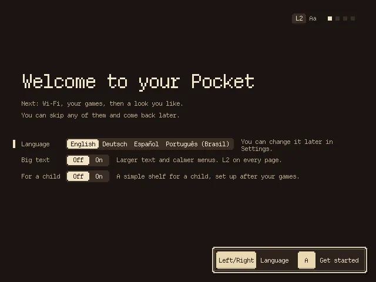
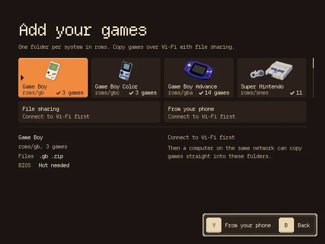

# Getting started

This page walks you from a blank SD card (or existing ROCKNIX card) to your first game in pocket-ui. You only need a
computer once to set up the card.

> **Already playing on ROCKNIX, dArkOS or Android?** Read [Coming from ROCKNIX, dArkOS or Android](coming-from.md) to
> see what carries over for saves, states, favourites and settings.

> **Not on a Mini V2?** The two-file card install below is for the Mini V2 only. Other Retroid models, SM8550 devices
> and Anbernic H700 handhelds are covered on [Other handhelds](other-handhelds.md) (marked **experimental** where not
> yet tested on hardware). The R36S has its own beta card, also described there.

## 1. Put pocket-ui on the card

Head to the [install page](https://pocketui.xyz/install.html) and pick the method that fits your setup:

- **Ready-made SD card image (easiest):** available for the Mini V2, Anbernic H700 models and the R36S (beta). Flash it to a spare card
  with balenaEtcher or Raspberry Pi Imager. Flashing wipes the card while leaving your handheld untouched. On H700
  handhelds, just pop the card in and power on; on a Mini V2, continue with [section 2](#2-start-pocket-ui).
- **Ports installer:** for a card already running ROCKNIX (see section 2 below).
- **Fresh card, two files:** right below.
- **Over SSH:** see the [install guide](../INSTALL-DUAL-BOOT.md).

pocket-ui includes no games or BIOS files; bring your own.

### Fresh card: two files

If you already flashed the official ROCKNIX image yourself, you can add pocket-ui from your PC or Mac with no Wi-Fi and
no terminal:

1. New to ROCKNIX on the Mini V2? Follow [ROCKNIX's own guide](https://rocknix.org/devices/retroid/retroid-pocket-mini/)
   once (flashing + ROCKNIX's one-time bootloader step), then come back. Flash ROCKNIX 20261001 or newer, and **don't
   power on yet**.
2. Unplug and replug the card so your computer mounts the **ROCKNIX** drive.
3. Drop `mount-storage.sh` and `pocket-ui-seed.tar.gz` (from the pocket-ui card zip) into the root of that drive. Do not
   rename or unpack them. Safely eject the card.
4. Insert the card and power on. First boot looks like normal ROCKNIX while it expands the games partition and reboots.
5. On the second boot you'll see "pocket-ui: installing", then pocket-ui launches and cleans up the two setup files
   automatically.

Your games, saves and settings stay untouched. If pocket-ui doesn't launch, ROCKNIX boots normally and writes
`pocket-ui-install.log` on the drive explaining why (for example, a corrupted archive: recopy the tar and try again). The two
files stay until setup succeeds.

## 2. Start pocket-ui

pocket-ui OS boots from your microSD card right alongside Android, leaving Android and its data untouched. Retroid's
built-in boot menu picks which OS starts:

1. Insert the SD card while the handheld is powered off.
2. Hold **Volume Down** and press **Power**. Retroid's boot menu opens, showing "Boot mode: Android" at the bottom.
3. Use the volume keys to highlight **Switch boot mode** and press Power until it reads **Boot mode: Loader**, then pick
   **Start**. (Volume Up + Power does not launch pocket-ui on current Retroid firmware.)
4. First boot takes a few minutes and restarts once on its own before opening first-start setup (step 3 below).

Your choice sticks: from now on, powering on boots straight into pocket-ui whenever the SD card is inserted.

**What boot looks like:** Retroid's logo, a brief black screen, then a dark screen with a "pocket-ui" bar whose glowing
edge shifts colour while the system loads (~20 seconds). Then the shelf fades in. Your first boot shows "Getting ready
for the first start…", and any boot over a minute shows "Still starting…".

**Switching back to Android:** hold Volume Down + Power, toggle **Switch boot mode** back to **Boot mode: Android**, and
select **Start**. You can leave the SD card in.

**Black screen with Boot mode: Loader?** Switch back to Android as above and check "If something goes wrong" in the
[install guide](../INSTALL-DUAL-BOOT.md). That guide also covers adding pocket-ui to an existing ROCKNIX card without
terminal commands: copy **Install pocket-ui.sh** into `roms/ports` over Samba (enable Samba in ROCKNIX's Network
Settings, open `\\<device name or IP>` on Windows or `smb://<device name or IP>` on Mac; see
[ROCKNIX's guide](https://rocknix.org/play/add-games/)), refresh gamelists in ROCKNIX (Start, Game Settings, Update
Gamelists), open **Ports** and run **Install pocket-ui**. It checks compatibility first and changes nothing if your
device isn't supported. To uninstall later, return to ROCKNIX's own menu (Settings → Help & tools → About →
**Open EmulationStation…**, or hold SELECT + START) and run **Ports → Uninstall pocket-ui**.

Re-running the installer repairs missing or damaged files even on the same version, while leaving a healthy install and
all your games and saves intact.

If pocket-ui isn't installed, ROCKNIX's own menu opens instead. If pocket-ui crashes repeatedly, it rolls back to the
last working version and then offers [safe mode](safe-mode.md); ROCKNIX's own menu only opens automatically if
pocket-ui cannot launch at all.

## 3. First start

On first launch, pocket-ui walks you through five quick screens: language, Wi-Fi, games, layout and coziness. Progress
dots sit at the top right. Navigation matches Settings everywhere: **Up/Down** moves between rows, **Left/Right**
changes values, **A** confirms and advances, **B** or **L1** goes back, and **START** skips the rest (inside a keyboard
or list, B, L1 and START belong to that screen). Hit **L2** on any step to toggle **Big text** immediately (marked **L2
Aa** at top right). You can re-run setup later in Settings → Help & tools → **First-start setup**.

1. **Your language.** Use Left/Right to choose **English**, **Deutsch**, **Español**, **Português (Brasil)**,
   **Français**, **Italiano**, **한국어**, **简体中文**, **Tiếng Việt** or **日本語** (the screen updates live, defaulting to ROCKNIX's language; in Spanish it reads
   **Bienvenido a tu Pocket**; see [Language](language.md)). Below it sit **Big text** (also toggled anywhere with L2)
   and **For a child** (toggle with Left/Right or Y to launch Kids Mode setup after your games). Press **A** ("Get
   started") from any row to continue, or **SELECT** to open this manual on the handheld (B returns).
2. **Wi-Fi.** Pick a network and hit A to connect (if already connected, A continues). A successful connection shows
   "Connected to Home" and moves on automatically. Below the network list sit **Other network…**, **Wi-Fi country**,
   **Time zone**, **Scan again** (or X), and **Next** (**Continue offline** when disconnected). Time zone is guessed
   automatically and shown with local time ("Vienna, 22:41"); press A to change it. Setup only prompts for a city if it
   cannot guess unambiguously (see [Time zone](#time-zone)). Handhelds without Wi-Fi show the time zone picker here
   instead.
3. **Your games.** Shows what pocket-ui found ("Found 81 games" plus per-console counts), or how to copy games if the
   card is empty. Choose **Next** (or **I'll add games later**), or open **Add more…** for system folders and file
   sharing ([Add games](#5-add-games); B returns). Unrecognised folders or disc games missing files are flagged cleanly
   on their own line. **Box art** is a single toggle (**On** by default; only game names are sent while online, with
   finer controls in [Box art & downloads](extras.md#box-art)). Under it, **Real box pictures (ScreenScraper)** brings
   real spines, labels, box backs and manuals from ScreenScraper.fr after the box art (**Off** until you switch it on; no
   account needed, sign in later in Box art & downloads). **A** opens its page: tick each kind on its own with **A**, with a
   real example of the chosen one beside the list, and the line that says what is sent; **START** (Turn on) switches it on
   with the kinds ticked, **B** (Not now) leaves it off. **Real box backs** starts unticked, so turning a box over shows
   pocket-ui's own back with your progress ([ScreenScraper](extras.md#screenscraper)). It is the same page as the
   [New in this version](tour.md) card after an update; A on the row while it is on switches it off. Nothing downloads
   until you leave this screen. Both are hidden on non-Wi-Fi handhelds.

   **pocket-ui for Android** follows this with **Your handheld** (part of the same step, no extra dot): **Start on the
   shelf** makes pocket-ui your Home app, so the handheld starts on the shelf and Home in a game opens its pause menu.
   It is **Off** until you switch it on; Android then asks once with its own question. A line below points to
   Settings → System → **Android extras** for more. **Next** goes on to the layouts.
4. **How your games stand.** Previews each shelf layout using your own library (or sample games on an empty card). Use
   Left/Right to compare layouts (Easy notes "One big game at a time, simple menus."). Down once reaches **Order**
   beside the layout's name (**By console**, the start, or **By series**: a shelf for each series, see
   [Shelves by series](playing.md#shelves-by-series)); further down, adjust **Style** (Barlow or [Retro](theme.md#style)), **Colours** (Cocoa or Pea when Retro is active) and
   **Appearance** (Dark, Light or Automatic), seeing every change live. Press **A** ("Next") from any row to keep
   your pick and advance; B returns to your games. A quick note below reminds you that layouts can change any time in
   Settings → Look and that optional downloads live in Settings → Games → Box art & downloads. See [Playing](playing.md#looks) for all four looks.
5. **How cozy should it be?** Pick one preset instead of hunting through toggles: **Plain** (quick starts, no case
   sounds or extras), **Cozy** (the default: opening cases, console start animations and sounds, time-of-day lighting,
   evening TV glow, old-TV switch-on/off, stickers, printed discs and sealed new games) or **Everything** (Cozy plus
   live attract-mode demos on the Cabinet TV for unplayed games, which uses extra battery). Press **A** ("Finish") to
   enter your shelf, B to go back, or START to finish unchanged. Every effect remains individually toggleable in
   Settings › Look › [Cozy extras](settings.md#cozy-extras) and Game start animation; **Lived-in shelf** is always
   opt-in there.

If you turned on **For a child**, Kids Mode setup (PIN, allowed games, colour, time limit and max volume) replaces the
layout step ([Kids mode](kids-mode.md)). Pressing B on its first page returns to normal layout setup; if the card has no
compatible games yet, Kids Mode is skipped so you never land on an empty shelf (set it up later in Settings → System →
Kids mode).

The last page, **You're all set**, says what HOME does in a game and where **Pocket Sync** is (Settings → Connections →
Pocket Sync), for when you have pocket-ui on a second device: the first start doesn't ask about it.

No pad at hand? In **pocket-ui for Android** every key on the first start's hint bar is a button too, and on Your games
a tap on a row selects it (a second tap does it), so the first start reaches your shelf by touch alone.

If the battery dies or you reboot mid-setup, first start resumes right at the step you reached.

First start skips long feature tours and lets features introduce themselves naturally. Whenever you want to customise
presets or explore everything, open Settings → Help & tools → **How you like to play** (The shelf, Easy, Enthusiast or
card by card) and [Tour](tour.md).

### Time zone

The time zone is guessed while the Wi-Fi page is up and shown on its last row with the time it is there now.
pocket-ui guesses it without asking any web service, so nothing about you leaves the device. It looks, in this order,
at:

1. **The zone the system already has**, if it is not UTC and somebody chose it. The zone a fresh image ships with
   (New York) does not count: nobody chose it, so the next two decide.
2. **The country of your Wi-Fi region.** The Wi-Fi chip knows the country it is allowed to transmit in (the same
   setting that decides which channels it may use; it often learns it from the network once connected). For a
   country with one time zone, such as Austria or Germany, that zone is set at once and the row says it. For a
   country with several time zones (the United States, Canada, Australia, Brazil, Russia, Mexico and a few more),
   there is no single answer: right after Wi-Fi the setup opens on a list of that country's cities.
3. **Nothing known:** right after Wi-Fi the setup asks, "Couldn't tell where you are".

When it asks: two rows under the card. **Looks right** (or **Keep UTC**) keeps what is shown, **Choose another…**
(X does it too) opens the regions with a search row on top (the same list as Settings → System →
[Time](settings-system.md#time); L1 empties the search field). A country's own list of cities ends with **Other
places…**. **B** goes back to the Wi-Fi page it belongs to. It asks once: after an answer, leaving Wi-Fi again (B
back, a connection later) goes straight on. On the Time zone row of the Wi-Fi
page, A opens the same regions and B comes back to Wi-Fi; a zone you
pick there stays.

The Wi-Fi region is only a hint to where you live: a Pocket bought abroad can still carry another country's
setting, so look at the city on the row. The clock sets itself from the internet whenever Wi-Fi is on; that switch
stays under Settings → System → Time. Without Wi-Fi, set the date and time by hand there
([Date and time](settings-system.md#time)).

## 4. Connect to Wi-Fi

Settings → Connections → **Wi-Fi**, or the Wi-Fi step of the first start.

1. pocket-ui scans for networks. The line under the title says which network you are connected to, how strong
   it is here and the Pocket's address. The list shows the connected network first, then the others by signal
   strength, then saved networks that are out of range. Each row says **Connected**, **Connecting…**, **Saved**,
   **Saved, out of range**, **Password** or **No password**. A network only says **Connected** once it has given the
   Pocket an address and things online work.
   If the first row says **This network wants a sign-in**, the network (a hotel, a train) wants its page done
   first: see [Hotel and train Wi-Fi](hotel-wifi.md).
2. Choose a network and press A ("Connect").
   In the first start, a network that connects shows "Connected to Home" and the setup goes on by itself. A on the
   connected network is Continue.
3. For a network with a password, type it on the on-screen keyboard:
   - D-pad: move between keys
   - A: type the selected key
   - B: delete the last character (with nothing typed, B goes back to the list)
   - X: Shift, for one capital letter
   - Y: switch between letters and symbols ("?123" / "abc")
   - START, or the **Connect** key: connect

   The password is shown in plain text while you type.
4. Connecting can take up to a minute. The result appears under the title, for example
   "That network is out of range. Scan again." or "The network took too long to respond. Try again." When the network
   refuses the password, the keyboard opens again with what you typed and "Wrong password. Try again." above the keys:
   B takes letters off the end, L1 empties the field, START tries again. The network doesn't keep the refused one. On the list, B goes back.

If the Pocket is already connecting to the network you chose, it waits for that connection (up to 50 seconds) instead of
starting again. Choosing a different network leaves the previous one first; a newly typed password replaces an old
attempt. "Wi-Fi isn't ready yet" means the radio or network service is still starting; try again in a moment.

The **Scan again** row (or X) refreshes the list. The line under the title is always true to what happened:

- **Wi-Fi is off. Press A to turn it on.** The radio is off (switched off in quick settings, or blocked while the
  Pocket started), and the first row, **Wi-Fi is off**, turns it on with A. The list is empty because there is nothing
  to search with, not because nobody is near. If it does not come on, the line says "Couldn't turn Wi-Fi on. Press A to
  try again."
- **Couldn't search for networks. Try again (X).** The search itself did not work (the system's network service did not
  answer). X tries again. After a start, or when Wi-Fi has just come on, pocket-ui tries once more by itself after a
  few seconds.
- **No networks found. Press X to scan again.** The search worked and nobody is in reach.

Quick settings and this page show the same state: switching Wi-Fi in one shows in the other. The network is remembered and reconnects when the
system starts. If the connection drops while pocket-ui runs, it reconnects by itself (see
[Troubleshooting](troubleshooting.md#questions)).

### Saved networks, hidden networks, the Wi-Fi country

- **A on a saved network** opens a small menu: **Connect** (without asking for the password again; if the saved
  password no longer works, the keyboard comes up) or **Forget**.
- **Y on a saved network** asks "Forget …? Press Y again." Y again forgets it (the password goes with it); B keeps
  it. To use it again, connect and type the password.
- **A network that stays on Connecting…**: the Pocket keeps trying a saved network by itself, for example after the
  router's password changed. After a minute the line under the title says "… isn't letting this Pocket in. Press A to
  type the password again." and the row says **Not answering**; A opens the keyboard.
- **Other network…**, the second-to-last row: for a network that doesn't show its name. Type the name, START, then
  the password, START. Leave the password empty for an open network.
- **Wi-Fi country**, the last row: **Automatic** (the default) uses the country the Wi-Fi chip reports, shown
  in brackets. Choose your country when networks on some 5 GHz channels don't show or connect. L2/R2 jump to the
  next or previous letter. The choice is kept across restarts.

A saved Wi-Fi network opens its Connect / Forget menu with A. B closes that menu back to the same network
on the list; another B returns to the previous first-start step. When another Wi-Fi network is already connected,
choosing a saved network that a fresh scan cannot find leaves the current connection in place and says it is out of
range. Hidden networks still get a connection attempt, since their absence from a scan does not mean they are
unavailable.

## 5. Add games

### Nothing on the SD card yet: the starter pack

A card with no games shows **No games yet** on Home, with **Get the starter pack** (A) and **Add games** (X) for your own. The pack is
a handful of small games that their authors share for anyone to play, from Game Boy to Super Nintendo, Mega Drive and GBA. You can
also open it from Settings → Games → Box art & downloads → **Starter pack**.

1. Offline, Home's button says **Connect to Wi-Fi** (A opens the Wi-Fi page; B comes back here).
2. Press A on **Get the starter pack**. **Get all** takes every game, A on a game takes just that one (Up/Down choose a
   game; Left/Right leave the focus where it is). Each is checked and put into
   its system's folder (for example `roms/gb`); B leaves the page while it runs, and the games appear on the shelf when it is done.

**Add games** works online or not and opens the ways to copy your own. **Look around** (B) puts the hint away and shows the empty
shelf in your look; A brings it back, START opens Settings. The hint returns at the next start while the card is empty.

Nothing is added without your A, and a file that is already there is never replaced. Each game's card (X) names its author and
licence; [the credits](../STARTER-PACK.md) list them all.

### Where your games go

Games go into the `roms` folder, **one folder per system**, for example `roms/gba` for Game Boy
Advance or `roms/snes` for Super Nintendo. The folder names are the ones ROCKNIX uses; the
[Systems](systems.md) page lists the common ones.

- Put game files **directly** into the system folder. One level of subfolders is read as well, the way a folder per game
  is usually kept: a subfolder with a single game in it shows as one game named after the folder (a disc game with its
  `.cue`/`.bin` files, or a game with an `.m3u` playlist for several discs, see [Games on several discs](systems.md#games-on-several-discs)); a subfolder with several games shows each of
  them. Folders starting with `.` or `_` and anything two levels down are not read.
- Each system accepts the file types ROCKNIX lists for it. Other files are ignored.
- Names are tidied on the shelf: tags such as "(USA)" or "[!]" are hidden, a version number at the end is dropped ("Pipes.v1.02"
  becomes "Pipes"), and "Legend of Zelda, The" becomes "The Legend of Zelda". A release number in front from an old
  scene set goes too ("0902 - MegaMan & Bass" and "1572-Super Metroid" show as "MegaMan & Bass" and "Super Metroid"),
  while titles with numbers keep them ("1943 - The Battle of Midway", "2048", "007 - GoldenEye"). Underscores show as
  spaces. Only the shown name changes: your files keep their names, so saves stay where they are. When two games of a system would end up
  with the same name, each keeps what tells it apart: "Tobu Tobu Girl (Europe)" and "Tobu Tobu Girl (World)", else the
  file type ("(ZIP)") or the folder it is in.
- A disc game (`.cue` or `.gdi`) whose track file is missing is not on the shelf: it could not start. Add games
  names it ("A file is missing: ...", see below); once the file is there, the game appears. The track files of a disc (`.bin` next to its
  `.cue`) are part of that game, not games of their own.
- BIOS files, for the systems that need them, go into `roms/bios`: your own. [Game check](game-check.md) says what's missing.

### The systems grid

Settings → Games → **Add games** (and the "Add your games" step of the first start) shows a tile per system: its
console, its name and its folder, for example `roms/gba`. A system that already has games shows a tick and how
many.

- The popular systems come first: Game Boy, Game Boy Color, Game Boy Advance, NES, Super Nintendo, Mega Drive,
  PlayStation, Nintendo 64, PSP, Nintendo DS, PlayStation 2, GameCube and Dreamcast. Any other system that has
  games follows them.
- The last tile, **All systems**, opens every system ROCKNIX can start (A on it; A again closes the list). Systems
  without a console picture show a plain cartridge.
- Move with the D-pad (L1/R1 jump three rows); the grid scrolls with the selected tile, including on a small screen. Under the grid, the selected system shows its folder, the file
  types it takes, and whether it needs a BIOS: "Not needed", the files it needs and whether they are in
  `roms/bios` (in red while one is missing), or, for systems pocket-ui knows nothing about, that a BIOS would go
  into `roms/bios`.
- The game counts are read when the page opens and again on a button press.
- **Ways to copy games.** Down from the last row: **File sharing**, **From your phone** (what your
  handheld has). Left/Right choose, A switches. [Second card](copy-games.md).

### Over Wi-Fi (file sharing)

1. Open Settings → Games → **Add games** (or the "Add your games" step of the first start). Without a network, the
   right side names the way that works on your card. With Wi-Fi but sharing off, it says "File sharing is off" and how
   to turn it on, without an address yet.
2. Press X ("Turn on file sharing"). The right side under the grid now shows the address, a user (`pocket`) and a
   password made for this Pocket.
3. On your computer, open the address shown on the screen and log in with that user and password:
   - macOS: Finder → Go → Connect to Server, `smb://<address>/games-roms`, "Registered User".
   - Windows: `\\<address>\games-roms` in Explorer's address bar.
   - Linux: `smb://<address>/games-roms` in the file manager.

   The share opens the `roms` folder. Only that folder is shared: pocket-ui's settings, system
   updates and logs are not reachable over the network. Everything inside `roms` is
   there, including `bios`, `savestates`, `ports` and `PortMaster`, so anyone who knows the password can change them.
   PortMaster games take their own files in their folder inside `ports`. The `screenshots`
   folder is shared: that is where [screenshots](playing.md#screenshots) taken in a game end up.
4. Copy your games into the right system folders.
5. Press X again ("Turn off file sharing") when you're done. Otherwise it stays on, also after a restart, and comes back by itself once the Pocket is on Wi-Fi.

The password stays the same for this Pocket. BIOS files go into the `bios` folder of the share. Anyone who has the
password can add or change files there, so keep it to yourself.

### With the SD card in a computer: the GAMES drive

The ready-to-flash RG28XX and RG35XX 2024 cards, 16 GB or bigger, have a **GAMES** drive: put the card in your computer and drag your games
in ([The GAMES drive](games-drive.md)). On other cards, use file sharing, or a second card on a handheld with a second
slot: Windows and macOS can't write to the card's STORAGE part. The R36S plays from your original card in TF2, so its games go there.

Without Wi-Fi there's also a second card on a handheld with two slots: [Second card](copy-games.md).

### Existing gamelists

The whole move, saves included, is on [Coming from ROCKNIX, dArkOS or Android](coming-from.md). Only the gamelists are here.

If your games come from another handheld system that writes `gamelist.xml` files, copy each system's `gamelist.xml` with the games:
pocket-ui reads the names, descriptions and pictures in it, and never changes it (deleting a game from the card removes that game's entry). More:
[Your gamelists](library-files.md#your-gamelists).

### When new games appear

The game list is read when pocket-ui starts. To be on screen quickly, the shelf first shows the list as it was
last time and reads the folders again right after; games you added or deleted since then appear or disappear within
about a second, the way they do after Add games. It is also read again whenever you leave a step you opened from
Settings (for example Settings → Games → Add games, then B). If a game does not show up, check that it is directly
in the right folder and has a file type that system accepts; Add games names folders it doesn't read and disc games
missing a file.

A game whose file is no longer on the SD card (deleted or moved over file sharing, for example) does not start: the
Pocket says "*Game* can't start: its file … is no longer there" and reads the list again.
