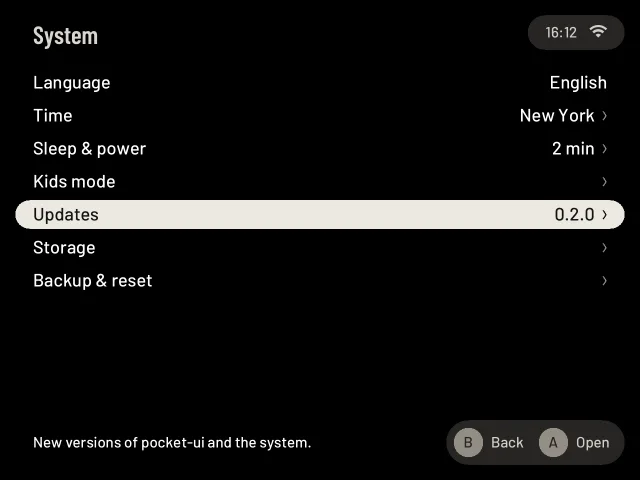
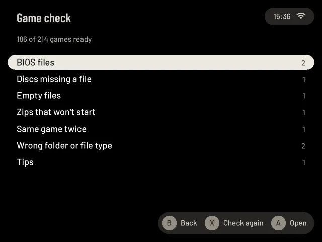
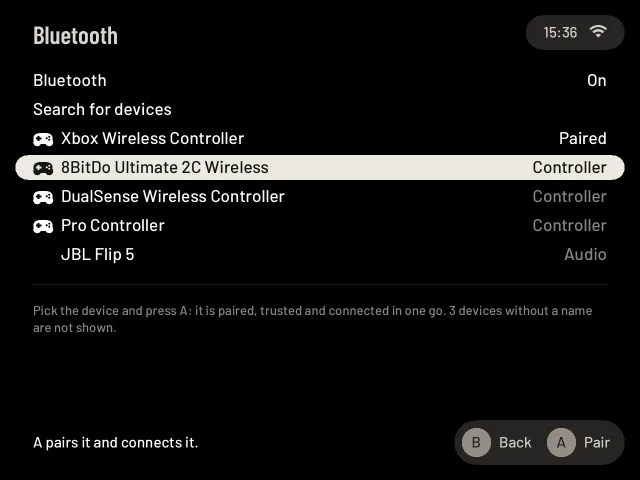
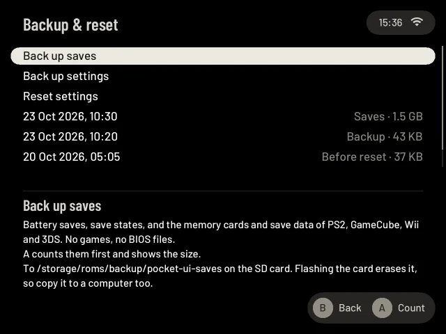

# How to

Short steps for the things people ask about most. Each one links to its full page.

## Update over Wi-Fi

1. Connect to Wi-Fi.
2. Settings → System → **Updates**. The page checks by itself and shows "0.2.1 available" (for example) next to
   **pocket-ui**.
3. Select **Install pocket-ui …** and press **A**. It downloads, checks the file and restarts.

Your games, saves and settings stay. If the new version doesn't start, the last one that worked comes back by itself.
More: [Updates](updates.md).

## A game won't start

1. Settings → Games → **Game check**. It looks through the card and never deletes anything.
2. **All good** means every game has what it needs. Otherwise press **A** on a row, then on a game: it says what is
   wrong and what to do, for example "Sega CD: BIOS missing." with the exact file name to put into `roms/bios`.
3. Fix it on the card (over file sharing, or with the card in a computer), then press **X** to check again.

More: [Game check](game-check.md), and [Troubleshooting](troubleshooting.md) when the check is green and the game
still doesn't start.

## Pair a Bluetooth controller

1. Put the controller in pairing mode (on most: hold its pair button for about 3 seconds until the light flashes).
2. Settings → Connections → **Bluetooth** → **Search for devices**, press **A**.
3. Select the controller and press **A**. It pairs, trusts and connects in one go.

It reconnects by itself the next time you switch it on. Buttons in the wrong place? Give it its own layout in Settings →
Playing → Buttons → [Controller setup](controls-settings.md#controller-setup), and check it with Settings → Help & tools →
[Test buttons](settings-system.md#test-buttons). Headphones and speakers pair the same way. More: [Bluetooth](bluetooth.md).

## Back up your saves, and get them back

Do this before you write a new image to the card: that erases everything on it.

1. Settings → System → **Backup & reset** → **Back up saves**. **A** shows how much it is, **A** again copies it.
2. Copy the backup to a computer: over file sharing it is `backup/pocket-ui-saves` in the games share.
3. After the new card is ready, copy the folder back to the same place. Then **Backup & reset**, **A** on the backup
   marked **Saves**, and **A** again.

A restore never overwrites a newer save: you keep both. More: [Backup & reset](settings-system.md#backup--reset).

## Keep saves the same on two devices

1. Connect to Wi-Fi, then Settings → Connections → **Sync** → **Syncthing**, **A**.
2. Install Syncthing on your computer, phone or second handheld and add this handheld by its **Device ID** (or scan
   the QR code on the Sync page).
3. Share the "Pocket saves" and "Pocket save states" folders with it, as [Pair a computer](sync.md#pair-a-computer)
   shows step by step.

Saves go out when a game ends, never while it runs. If you played on both before they synced, the game's card lets you
choose which save to keep, and the other stays as a copy. More: [Sync](sync.md).
