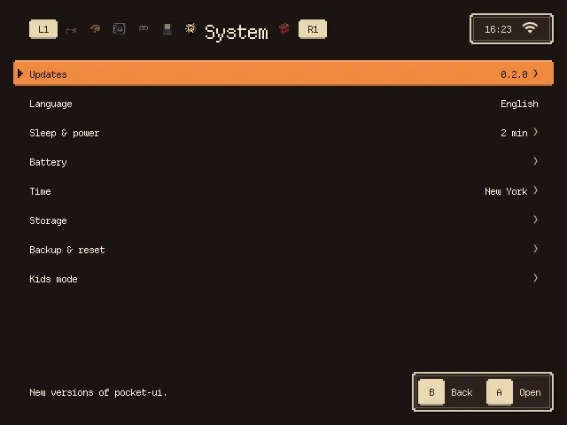
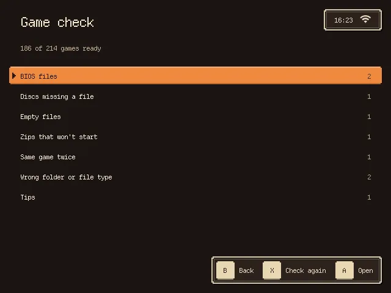
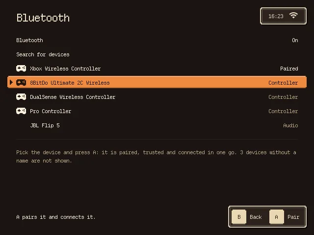
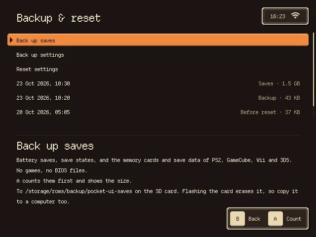

# How to

Quick step-by-step recipes for the things players do most, with links to the full details.

## Update over Wi-Fi

1. Connect to Wi-Fi.
2. Open Settings → System → **Updates**. pocket-ui checks automatically and shows any new release next to **pocket-ui**
   (e.g. "0.2.1 available").
3. Highlight **Install pocket-ui …** and press **A**. It downloads, verifies the signature and reboots.

Your games, saves and settings stay untouched. If a new build ever fails to boot, pocket-ui automatically rolls back to
the previous working version. More: [Updates](updates.md).

## Update without Wi-Fi

1. Download the offline update zip for your handheld from pocketui.xyz/install and **leave it zipped**.
2. Copy it onto your card: the GAMES drive (RG28XX / RG35XX 2024), the small first partition or second card (other
   pocket-ui OS cards), or next to the `pocket-ui` folder (TrimUI Brick).
3. Power on and press **A** on "Update to pocket-ui … found on the card".

More: [No Wi-Fi? Update from the card](updates.md#no-wi-fi-update-from-the-card).

## A game won't start

1. Open Settings → Games → **Game check**. It scans your library without ever deleting a file.
2. **All good** means everything looks ready. Otherwise hit **A** on a category and then on a game to see the exact fix
   (e.g. "Sega CD: BIOS missing." with the filename to put in `roms/bios`).
3. Fix the file over File sharing or on a computer, then press **X** to re-scan.

More: [Game check](game-check.md), or [Troubleshooting](troubleshooting.md) if Game check is clean and a game still
won't boot.

## Pair a Bluetooth controller

1. Put your controller into pairing mode (usually holding its pair button ~3 seconds until the LED blinks rapidly).
2. Open Settings → Connections → **Bluetooth** → **Search for devices** and press **A**.
3. Pick your controller and press **A** to pair, trust and connect in one step.

It reconnects automatically next time you wake it up. Wrong button layout? Remap it in Settings → Controls →
[Controller setup](controls-settings.md#controller-setup), and verify presses in Settings → Controls →
[Test buttons](settings-sound.md#test-buttons). Bluetooth headphones and speakers pair the exact same way. More:
[Bluetooth](bluetooth.md).

## Back up your saves, and get them back

Always do this before reflashing an SD card, since flashing erases everything on it.

1. Open Settings → System → **Backup & reset** → **Back up saves**. Press **A** to check the size, then **A** again to
   back up.
2. Copy `backup/pocket-ui-saves` from your handheld to a computer (it's right inside the File sharing folder).
3. Once your new card is ready, copy that folder back to the same spot, open **Backup & reset**, highlight the **Saves**
   backup, and press **A** twice to restore.

Restoring never overwrites a newer save; both versions are kept. More: [Backup & reset](settings-system.md#backup--reset).

## Keep saves the same on two devices

- **Between two Pockets:** use **Pocket Sync** (Settings → Connections → Pocket Sync). Turn it on on both handhelds and
  pair once with a six-digit code, with no PC or cloud needed.
- **With a computer, phone or Syncthing:**
  1. Connect to Wi-Fi and open Settings → Connections → **Sync** → **Syncthing** (**A**).
  2. Install Syncthing on your computer, phone or second handheld and add this Pocket by its **Device ID** (or scan the
     QR code shown on screen).
  3. Share the "Pocket saves" and "Pocket save states" folders as walked through in
     [Pair a computer](sync.md#pair-a-computer).

Saves sync after you quit a game, never mid-play. If you played the same game on two devices before syncing, the game
card lets you choose which version to keep while backing up the other. More: [Sync](sync.md).
