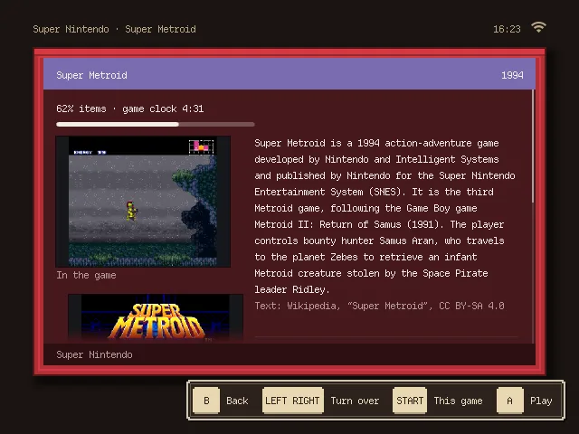

# Your library: game cards, play status, ratings and notes

Every game on your shelf has its own **game card**: a clean page showing its cover, release info, your play time, status,
notes, saves and related games already in your collection.

Long highlighted titles scroll gently to the end and back once before resting (reselect to scroll again). When nothing
is moving, pocket-ui rests idle until the clock, battery or a button press updates.

On Home, small title cards without box art scale down or use short console names so everything stays legible.

## Opening a card

Highlight any game on the shelf, inside a console list or in Favourites and press **X** ("X Details" in the hint bar).

If a ROM file is empty and can't launch, a **Problem** notice on the info page, box front/back and full card explains
why and tells you to recopy it (scrolling cleanly even with Large text or long titles).

| Button | On the card |
|---|---|
| A | Play the game, or open any highlighted row under "Your game" (save conflict, Echoes, Versions, Stickers, Screenshots, Delete from the card, Hide from the shelf). |
| B | Return to the shelf at the same game. |
| Y | Set play status, [My rating](#my-rating), [Wrong game? Choose another](#wrong-game-choose-another) or [Wrong pictures? Look up again](#wrong-pictures-look-up-again). |
| X | Write or edit your personal note. |
| START | Open [This game](options.md#this-game) to tweak picture, frame, performance, controls or emulator before launching (or [Performance & fan](performance.md#portmaster-ports) for PortMaster ports). |
| D-pad Up / Down | Scroll the card; once interactive rows (saves, Curator) enter view, Down steps into them and Up returns to scrolling. The last two rows are **Delete from the card** and **Hide from the shelf**. |
| L1 / R1 | Scroll a full page. |
| D-pad Right | On a card opened with X from [Just Play](curator.md#just-play): roll another suggestion. |

## The info page (Split)

In the **Split** layout, X opens the game's **info page**, putting everything at a glance on one screen. On the left: cover art
(or a console title card), status, play time, last played, star rating, achievements, **Save slots** ("3 of 8" or "All
empty" shown on the console's cartridge/memory card for pocket-core games, just like the
[pause menu](pause-menu-saves.md#save-slots-where-i-quit-and-before-load)), plus speed and "Update available, in Extras"
for PortMaster ports. On the right: title, console and year ("Favourite" if starred), metadata (developer, publisher,
genre, series, players, review scores) and a Wikipedia or gamelist description with source credit. Facts and description
scroll smoothly beneath the fixed header so long info blocks never push the summary away.

| Button | On the info page |
|---|---|
| A | Play the game, or open [Connections](#connections) when highlighting a linked developer, publisher, series or genre. |
| B | Return to your list. |
| Y | Set play status or star rating. |
| X | Write or edit your note. |
| START | Open [This game](options.md#this-game) (or Performance & fan on ports). |
| D-pad Up / Down | Step through linked facts (marked with an arrow), then scroll facts and description. |
| L1 / R1 | Page through facts and description. |
| SELECT | Toggle the full Details page (Echoes, Screenshots, Delete from the card…); SELECT returns to the info page. |

Long titles on both the info page and full Details page split gracefully at ` - ` or `: ` into a main title and smaller
subtitle (up to three lines, scaling down before truncating) without shifting cover art or facts. Shelf and Cabinet open
the interactive 3D game box instead.

## The game box

In **Shelf** and **Cabinet**, pressing X lifts the game's actual box onto the screen: cardboard cartridge box (horizontal
for SNES), PS1/Saturn jewel case, colour-coded PS2/GameCube/Wii/Xbox DVD case, Mega Drive clamshell, PSP UMD case, DS
case, or pocket-ui's signature case. As it opens, the cartridge, card or disc slides partway out at true scale while
artwork finishes loading asynchronously. Without cover art, cartridge labels display the game title in its original
language.

| Button | On the box |
|---|---|
| D-pad Left / Right | Flip the box between front and back *(on a [Just Play](curator.md#just-play) card, Right rolls a new pick and Left flips)*. |
| D-pad Down (front) | With [Photos of big moments](#photos-of-big-moments) On, opens the case to browse your milestone photos (the hint bar shows **Photos** in place of START when photos exist). |
| D-pad Up / Down, L1 / R1 | Scroll the back of the box; Down also steps into linked developer, publisher, series and genre pills. |
| A | Play the game, or follow a highlighted fact into [Connections](#connections). |
| B, Y, X | Back, status & rating, personal note. |
| START | Open [This game](options.md#this-game). |
| SELECT | Switch to the full Details page (Echoes, Screenshots, Delete from the card…); SELECT flips back to the box, and pocket-ui remembers which view you prefer. |

Pressing L1/R1 leaves any highlighted fact so A plays the game again.

The back mirrors a real retail box: title banner up top, gameplay screenshot and title screen beside the blurb, metadata
and your play stats underneath, and the console logo at the bottom. If no description is cached yet, it tells you why
("No Wikipedia article for this game" vs "Offline: the description comes with Wi-Fi", which fetches automatically next
time you're online).

## Where you are in the game

Flip the box over and, for supported games, pocket-ui reads your actual in-game save right beneath the title: *"8 badges ·
Charizard Lv. 45 · game clock 31:12"* in Pokémon, *"62% items · game clock 4:31"* in Super Metroid, *"43 of 96 exits"*
in Super Mario World, or *"2 of 3 pendants · 9 hearts"* in A Link to the Past. Under that sits real visual art pulled
from your own ROM: your Pokémon party sprites and earned badges (Gold/Silver/Crystal, Ruby/Sapphire/Emerald,
FireRed/LeafGreen, and party icons through DS SoulSilver), progress bars for Super Metroid and Super Mario World, or
A Link to the Past's pendants and crystals. The same live progress shows beside **Continue** on the shelf and on
[Where was I?](continue.md#where-was-i), 100% offline with no account needed. Turn off Settings → Look → Cozy extras →
**Progress from saves** to disable save reading completely.

For games whose save format isn't supported yet, your [RetroAchievements](achievements.md) step in when signed in
(*"34 of 60 achievements · 56%"*, shown once you've unlocked at least one; cached offline and refreshed on Wi-Fi at most
once an hour after play; hidden if **Progress from saves** is Off).

Progress always reads the game's real save file (`.srm`, `.sav`, `.dsv`), never a save state, so it matches across every
Pocket and emulator. The game clock is the game's own internal timer (separate from pocket-ui's Played counter; imported
saves from another handheld read "Played: Not here yet" until you play here).

| Games | Versions |
|---|---|
| Pokémon Red, Blue, Yellow, Gold, Silver, Crystal, Ruby, Sapphire, Emerald, FireRed, LeafGreen | USA and Europe in English |
| Super Metroid, Metroid: Zero Mission, Zelda: A Link to the Past, Link's Awakening DX, Oracle of Ages, Oracle of Seasons, The Minish Cap, Ocarina of Time | USA |
| Super Mario World, Super Mario All-Stars + Super Mario World, Super Mario 64, Mario Kart 64, Star Fox 64, Paper Mario, Zelda: Majora's Mask, Donkey Kong Country 1–3 | USA |
| Diddy Kong Racing | USA, Europe |
| Pokémon Diamond, Pearl, Platinum, HeartGold, SoulSilver, Black, White, Black 2, White 2 | USA and Europe in English |
| Golden Sun, Golden Sun: The Lost Age | USA and Europe in English |
| Final Fantasy III (VI), EarthBound, Chrono Trigger, Fire Emblem, The Sacred Stones, Kirby & the Amazing Mirror | USA |
| Role-playing games: Super Mario RPG, Lufia II, Pokémon Mystery Dungeon: Red Rescue Team, Final Fantasy VI Advance, Tactics Ogre: The Knight of Lodis, Breath of Fire II, Mario & Luigi: Superstar Saga | USA |
| Banjo-Kazooie, Metroid Fusion, GoldenEye 007 | USA |
| Mother 3 | English fan translation 1.3a (HQ Sound) |

Games are matched strictly by ROM content and verified with real save checksums. Unrecognised hacks, other revisions or
corrupt saves show nothing rather than guessing wrong. Multi-slot RPGs (like A Link to the Past or Super Mario
All-Stars) show the slot you saved most recently.

## Photos of big moments

Off until you turn on Settings → Screen & sound → **Photos of big moments**. Whenever your in-game save hits a milestone
in any supported game above (a Pokémon badge, every 10th level for your party leader, Zelda boss remains/instruments/
essences/medallions, Paper Mario Star Spirits, Mario Kart 64 gold cups, Star Fox 64 medals, Super Mario 64 star doors,
every 10% items/exits/Jiggies/balloons, or new chapters/missions), pocket-ui quietly snaps a retro instant photo and
tucks it inside the game's case (works in pocket-core and pocket-ui for Android's player; clock time alone never
triggers it).

Play stays completely uninterrupted. When you **Save & quit** (with Game start animation set to Cozy), your new photo (or
a little stack of them) slides softly into the case with a click, wearing a red **New** tab next time you open it. Pick
the third setting, **Also in play**, if you want a subtle shutter flash and developing Polaroid-style snap right during
gameplay *(Linux handhelds only; TrimUI Brick and pocket-ui for Android offer Off and On)*.

From the front of the box, press **Down** to open the case and flip through your album, newest on top, stamped with the
milestone, game clock and date (*"Badge 3 · 4 h 12 min · 18 Nov 2026"*):

| Button | In the open case |
|---|---|
| D-pad Left / Right | Flip through photos. |
| A | Hold the photo up closer with its caption (B puts it back). |
| X | Delete photo (A confirms, B keeps). |
| B, D-pad Up | Close the case. |

Each snap captures the gameplay frame a few seconds *before* you opened the save menu (up to 320 px wide). Milestones
don't duplicate if you reload an older save, capped at 5 per session and 30 per game (~1.5 MB, oldest cycled out).
Stored privately in `album/<system>/<game>/` and never uploaded anywhere. Turning it Off (or turning Cozy extras →
**Progress from saves** Off) disables snapping cleanly.

## Stickers on the case

Mark your favourite boxes with five slightly tilted collector stickers: **Completed** (green tick), **100 %** (gold
seal), **Favourite** (star), **Playing now** and **Game of the year** (with your chosen year). On the full card page
(press SELECT from the box or info page), highlight **Stickers** and press A. Toggle stickers with A; on Game of the
year, adjust the year with Left/Right (defaults to release year or current year). In the box with Playful cases On,
closing the sheet presses each new sticker down with a subtle click and lifts removed ones away (any button skips).

Stickers appear on box fronts in Shelf and Cabinet, plus one mini badge at the top of the spine on the shelf (priority:
Game of the year → 100 % → Completed → Playing now → Favourite). Saved in `library.json`, synced via [Sync](sync.md) and
included in backups.

## Connections

On the info page and box back, developer, publisher, series and genre values marked with an arrow jump straight to
**your other games** sharing them. Highlight a pill with Down and press A:

- **Developer:** "More from Criterion Games" (chronological)
- **Publisher:** "More published by Electronic Arts" (chronological)
- **Series:** "Burnout series, in release order" (includes this game for context)
- **Genre:** "More racing games" (alphabetical)

Opens as a normal shelf: A plays, X opens another card, B steps right back to where you came from (merging multi-console
copies to your preferred [Versions](curator.md#versions)). Smart matching handles name variations ("Criterion" /
"Criterion Games" / "Criterion Studios", "Racing" / "racing video game") and infers series from titles when you own two
or more entries. Links only appear when you actually own another matching game. Disable anytime under Settings → Look →
[Cozy extras](settings.md#cozy-extras) → **Game connections**.

## What the card shows

- **Header:** box art, title, console, release year, player count, status and play time.
- **Pictures:** "In the game" screenshot and "Title screen" when available and Settings → Games → Box art & downloads →
  **Pictures** is set to Box art and screenshots ([Box art & downloads](extras.md#pictures)).
- **About the game:** developer, publisher, genre, series and Wikidata review scores (e.g. "Metacritic 92 · via
  Wikidata"), plus "Listed as" if database spelling differs from your filename.
- **Your game:** status, star rating, play time, sessions, last played, note, visual **Save slots** on the cartridge or
  memory card ([pause menu](pause-menu-saves.md#save-slots-where-i-quit-and-before-load)), "Continue: 2 h ago",
  [Achievements](achievements.md) progress and live **Battery** estimate ("About 3 h 20 min left, 18% an hour"; see
  [Battery in this game](pause-menu.md#battery-in-this-game)). PortMaster ports also show **Speed** (plus "Busy core?
  Press START" when detected; see [PortMaster ports](performance.md#portmaster-ports)).
- **Two versions of this game's save:** appears only when [Sync](sync.md) spots a save conflict between devices. Press A
  to pick the winner ([Two versions of a save](sync.md#two-versions-of-a-save)).
- **Echoes**, **Versions** and **Stickers:** Curator rows (each toggleable under Settings → Games → Curator).
- **Screenshots (N):** appears once you've snapped screenshots with HOME + A ("Newest: Today"); press A for this game's
  [gallery](playing.md#looking-at-your-screenshots).
- **Description:** opening summary from English Wikipedia (or your [gamelist](library-files.md#your-gamelists) / offline
  facts fallback).
- **More by … / Other games in …:** only games **you actually own**, never a store.
- **Delete from the card** and **Hide from the shelf:** the last two rows of the card ([details below](#hide-or-delete-a-game)).

Even homebrew, ROM hacks and test ROMs not in the offline database get a full card with your status, play time and note.

## Play status

Press **Y** on a card to pick a status:

| Status | Mark on the shelf |
|---|---|
| Not started | none |
| Playing | a dot |
| Paused | two bars |
| Completed | a tick |
| Dropped | a dash |

Marks show on the right edge of spines and lead your game subtitle ("Playing, last played 2 h ago ...").

After your **second session** (at least 1 minute each) of an unmarked game, the card gently prompts "Playing? Press Y" with
Playing highlighted; picking any status (including Not started) clears the prompt.

## My rating

Rate any game 1–5 stars under **Y → My rating** (all the way left clears back to "Not rated"). Feeds into
[Lens](curator.md#lens) filtering, **Best rated first** sorting, plus [Just Play](curator.md#just-play) and
[Echoes](curator.md#echoes) taste weights (5 stars = strong boost like a Favourite, 4 = mild boost, 3 = neutral, 1–2 =
discourage similar picks).

## Wrong game? Choose another

Wrong metadata? Press **Y → Wrong game? Choose another** to pick the closest match on that console (or **None of these**
to clear facts). Saved in `library.json` and overrides automatic checksum/serial/filename matching. *(Covers are matched
separately; see the next section.)*

## Wrong pictures? Look up again

Wrong or missing cover/screenshot? Press **Y → Wrong pictures? Look up again** (requires Wi-Fi). pocket-ui clears cached
images for that game, re-checks its ROM checksum or PS1/PS2 disc serial
([PlayStation 1 and 2 discs](library-files.md#playstation-1-and-2-discs)) and fetches fresh art, updating the shelf
title and facts if the match changed. *(Note: also replaces any custom PNG under that filename.)*

## Notes

Press **X** on a card to jot down an 80-character note (like "after the first boss") using the on-screen keyboard (START
saves; clear text + START removes it).

## Hide or delete a game

The last two rows of a game's card (press SELECT to view card rows; right after Stickers and Screenshots, above the
description) are **Delete from the card** and **Hide from the shelf**:

- **Hide from the shelf:** hides the game everywhere (Home, lists, Favourites, Search, Curator, On start,
  [web companion](web-companion.md)) without deleting a single byte, great for BIOS tests, demos or spare discs. Restore
  anytime under Settings → System → Storage → **Hidden games** ([Play history](curator.md#play-history) keeps past time).
- **Delete from the card:** names the game, previews space freed and filenames ("Frees 2.3 GB: 3 files."), then asks
  twice (A, then A again; B cancels). Removes every file belonging to the game (`.cue` + `.bin`, `.gdi`, `.m3u` discs,
  single-game folders, `.zip` or `.7z`), plus its cover art, screenshots, `gamelist.xml` entry with exclusive scraped
  media, and its [Shelf space](settings-playing.md) slot, clearing it immediately from Recent games, Continue and
  Favourites.

  **Saves and states** stay safe by default unless you flip the row above Delete to **"Delete too"** (shared PS2/GameCube
  memory cards and PS2 disc states are never deleted automatically; if [Sync](sync.md) is active, you're warned that
  deleting saves removes them on synced devices too). Deletion is permanent (no recycle bin), though play time, status and
  notes stay in `library.json` if you ever re-add the game.

  Unavailable while a game is running or in [Kids mode](kids-mode.md) (kids have no game card), and hidden where
  pocket-ui can't write to your ROM folder: pocket-ui beta for dArkOS mounts games read-only, and on Android your games
  sit in shared folders managed by other apps (delete them with your Files app there). The
  [web companion](web-companion.md) offers the exact same Delete action on each game's page.

## Where it is kept

Statuses, ratings, notes and session counts live in `/storage/.config/pocket-ui/library.json` (written safely against
power cuts with an automatic `library.json.bak` fallback, keyed by file path).

Wikipedia descriptions cache once in `/storage/.config/pocket-ui/wikipedia/` (delete the folder to re-fetch) and fill
in quietly in the background on Wi-Fi while idle (sharing the little corner dot with box art).

## Where the facts come from

- **Wikidata** (CC0 public domain): bundled offline across ~30 consoles for title, year, developer, publisher, genre,
  series, game mode, player count and Wikidata-recorded review scores (naming the reviewer).
- **Wikipedia** (CC BY-SA 4.0): fetched on demand over Wi-Fi and cached locally with attribution
  (`Text: Wikipedia, “<article>”, CC BY-SA 4.0`). Identifies itself simply as `pocket-ui-wiki/0.1` and sends nothing
  personal beyond the requested article titles.
