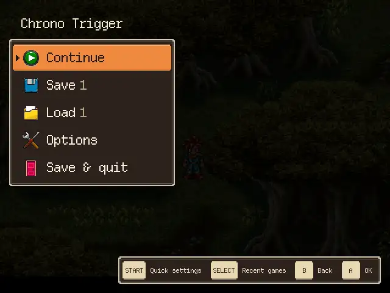

# The pause menu (HOME)

**Tap HOME** (MENU on Anbernic handhelds) while playing to pause your game and open the menu. Your first launch on
pocket-ui's own player shows a one-time reminder (not in Kids Mode, and not in RetroArch, standalone emulators or
Android), and first-start setup notes it too: "In a game, HOME opens the menu: save, load, quit." Your paused game
stays dimmed behind the menu. Available rows depend on which emulator runs that console (see [Systems](systems.md)):

| Emulator | Menu, top to bottom |
|---|---|
| pocket-ui's own host | Continue, Save, Load, Earlier, Options, Save & quit |
| pocket-ui's own host, signed in to RetroAchievements | Continue, Save, Load, Earlier, Options, Achievements, Save & quit |
| pocket-ui's own host, for ScummVM, PICO-8 and TIC-80 (no save states) | Continue, Options, Quit |
| PlayStation 2 (ARMSX2), GameCube and Wii (Dolphin), 3DS (Azahar) | Continue, Save, Load, Options, Save & quit |
| Xbox (hakuX in RetroArch, experimental) | Continue, Options, Quit |
| RetroArch | Continue, Save, Load, Options, Save & quit |
| PortMaster ports | Continue, Options, Quit |
| Other emulators | Continue, Options, Quit |

Since 0.2.1, pocket-ui compresses the moment saved on Quit or sleep so writes to the SD card stay fast and safe. Manual
slots keep their existing format, and older Auto states still load cleanly.

If you ever downgrade to 0.2.0 or 0.1.14, those builds boot from your in-game save instead of reading or overwriting
compressed moments. Upgrading back restores support for both formats while protecting newer in-game saves from rollback.
If a compressed moment is ever damaged, pocket-ui refuses it with a clear message and boots your in-game save instead.

See [Saving in the pause menu](pause-menu-saves.md) for save slots, Where I quit, Before load, Earlier and full-card
handling.

Navigation wraps around: **Up** from Continue jumps to Quit, and **Down** from Quit returns to Continue. Press **START**
from any row to open [quick settings](quick-settings.md) (brightness, volume, Wi-Fi, fan) right away.

The right side of the header estimates remaining battery **for this exact game** (e.g. "About 3 h 20 min left in this
game"). See [Battery in this game](#battery-in-this-game).

Extra rows appear automatically when relevant: **Pixel Path** (right above Quit when enabled in
[Settings → Games → Curator](settings-playing.md#curator)), **Players** (after Options/Achievements when two or more
controllers are connected), and **Disc** (before Options for multi-disc games; see [Changing discs](#changing-discs)).
**Earlier** hides when [Earlier states](pause-menu-saves.md#earlier) is off and no snapshots exist yet (default for N64,
PSP, DS, Dreamcast and Saturn).

Save and Load only appear when supported. For systems that rely purely on in-game saving (ScummVM, PICO-8, TIC-80,
[other emulators](#other-emulators)), the menu omits them and reminds you to save inside the game before quitting.

- **Continue** jumps straight back into the game (B or another HOME tap does the same).
- **Save** stores your current spot in one of eight slots (see
  [Save slots](pause-menu-saves.md#save-slots-where-i-quit-and-before-load)). With **Game start animation: Cozy** and
  **Motion: Full**, a snapshot zooms neatly into its slot with a soft click (~0.5 s) before resuming. The save finishes
  the instant you press A, and any button or tap skips the animation straight back into gameplay (pocket-ui's own player
  only).
- **Load** restores a saved moment: your last exit ("Where I quit"), the spot replaced by your last Load ("Before
  load"), or any manual slot. Greyed out when the highlighted entry is empty.
  **From the start** resets the console while keeping the cartridge real-time clock intact (including Pokémon Gold, Silver
  and Crystal on Gambatte).
  On ROCKNIX, the RetroArch pause menu warns if it cannot verify a new save file or confirm that RetroArch received a
  load request.
- **Earlier** (pocket-ui's own player) jumps back to automatic snapshots captured every 5 minutes of active play plus
  session starts. See [Earlier](pause-menu-saves.md#earlier).
- **Disc** (pocket-ui's own player, multi-disc games) swaps discs cleanly. See [Changing discs](#changing-discs).
- **Options** tunes the current game ([Options](options.md) on pocket-ui's own player;
  [Options for PlayStation 2, GameCube, Wii and 3DS](options-big.md) on standalone emulators). On RetroArch and other
  emulators it opens [Runs on](options.md#runs-on) plus RetroArch picture/rewind settings (on pocket-ui's own player,
  Runs on lives inside Options). Rows that open subpages (Options, Achievements, Players, Pixel Path, Zoom) end with
  **›**; inline toggles show **‹ value ›** and switch with Left/Right.
- **Achievements** (pocket-ui's own player, signed into RetroAchievements) shows locked and unlocked achievements with
  progress. See [Achievements](achievements.md#the-pause-menu).
- **Zoom** (pocket-ui's own player, under **Options**) magnifies the paused screen: [Zoom](big-text.md#zoom).
- **Players** (pocket-ui's own player, 2+ controllers) assigns controllers to Player 1 to 4. See [Players](#players).
- **Pixel Path** (enabled in Settings → Games → Curator) inspects how your video and audio reach the screen stage by
  stage. See [Pixel Path](#pixel-path).
- **START** opens [quick settings](quick-settings.md#quick-settings) right over your paused game so you can preview
  brightness changes live. Performance and Fan changes apply immediately unless overridden for this specific game in
  Options. Press B or HOME to return to the pause menu.
- **Quit** (labelled **Save & quit** when auto-saving your spot) returns you to the shelf. In-game saves and memory
  cards always write on every exit. Whether Quit also saves a Continue moment is controlled by
  [Settings → Playing → **Continue where I quit**](settings-playing.md#continue-where-i-quit):
  - **On (default):** saves your exact moment ("Saving and quitting…") so next launch picks right back up.
  - **Off:** skips saving a new moment ("Quitting…"; in-game saves are still kept). On pocket-ui's own player, next
    launch starts fresh while keeping any older moment under **Load → Where I quit**. PS2, GameCube, Wii and 3DS exit
    faster and resume from your last saved moment on next launch (your memory card saves stay intact). Sleep saves still
    count as saved moments.

  Emulators without save states (ScummVM, PICO-8, TIC-80, other standalone emulators) show "Quitting…" and note where
  saving happens.

  RetroArch always saves on exit because ROCKNIX enables auto-save-state globally. Switching games via
  [Recent games](playing.md#recent-games) always saves your spot too so you can hop right back.

Press **SELECT** inside the pause menu to open [Recent games](playing.md#recent-games) (B returns).

Holding HOME while pressing another button triggers [shortcuts](options.md#shortcuts) instead of opening the menu (also
mapped in RetroArch where supported; see [Shortcuts in RetroArch games](options.md#shortcuts-in-retroarch-games)).

## Changing discs

Games that come on several discs (on pocket-ui's own host: PlayStation, and other disc consoles whose emulator can
change discs) have a **Disc** row in the menu, for example "Disc 1 of 3". It is there when the game is started from an
`.m3u` playlist or a multi-disc `.pbp` file; how to make an `.m3u` is on the [Systems](systems.md#games-on-several-discs) page. A
game with one disc (a single `.cue` or `.chd`) has no Disc row.

- **Left / Right** choose a disc. The line beside the menu says which disc is in and what A does.
- **A** puts the chosen disc in and goes back to the game. On the disc that is already in, A puts in the next one, so
  when the game asks for disc 2, HOME, Down to Disc and A is all it takes.

The game sees the drive open and close, as on the console. A short note over the game says which disc is in now, for
example "Disc 2 of 3". If the emulator can't tell which disc is in, the line beside the menu only says which one A
puts in.

## Battery in this game

The line at the right of the menu's title is the time the charge left lasts at the rate **this game** used the
battery while you played it. pocket-ui measures every game while it runs on battery, once a minute, and keeps what
it found (even across restarts). It only says what it measured:

| The line | Means |
|---|---|
| "About 3 h 20 min left in this game" | This game has been measured for at least 20 minutes on battery, and the charge dropped by 3% or more in that time |
| "About 4 h left (PS2 games)" | This game hasn't been measured enough yet: the other games of its console stand in |
| "About 5 h left (all games)" | No game of this console has been measured enough either: all the games you played stand in |
| "83%" (just the charge) | Not played long enough on battery yet to tell how long it lasts |
| "Charging" | The Pocket is on the charger and charging |
| "Full" | The Pocket is on the charger and the battery is full |

Time asleep, on the charger or starting and ending a game is never counted. The newest play counts most, so after a change
(another [Performance](performance.md) setting, an older battery) the time follows within a few hours. The game's own time left
also shows on its [card](library.md#what-the-card-shows), and the whole Pocket's in
[Settings → System → Battery](settings-system.md#battery).

## Players

On pocket-ui's own host you can play together, up to four players. Connect a controller (Settings → Connections →
[Bluetooth](bluetooth.md)) and it is the next player: the Pocket's own buttons are Player 1, the first
controller Player 2, and so on. When one connects or goes away during a game, a short message says so, for example
"DualSense connected, Player 2".

**Players** lists Player 1 to 4 and the controller each one has.

- **Up / Down** selects a player. **A on a controller** makes it the selected player (whoever had that player takes its old
  place) and selects the next, so everyone presses A once on their own controller. **B** goes back to the menu.

Your choice is kept for the next games. At the start of a game the controllers that are on take the players in that
order, without gaps: a controller that is off keeps no place, so the next one moves up. To play on a TV with a controller as Player 1, select Player 1 and press A on that
controller; press A on the Pocket to change it back.

- A controller that goes away during a game leaves its player without a controller. When it comes back it is the same
  player again. A newly connected controller uses another free place; it cannot take the one kept for it.
- Forgetting a controller (Settings → Connections → Bluetooth, X twice) also takes it off this list.
- With all four players taken, another controller waits; the page lists it under "Waiting for a free player".
- The game decides how many players it has: in a game for one player, Player 2's controller does nothing.
- Every player's buttons do what [Options → Controls](options.md#controls) sets for the game. Rumble goes to each player's own
  controller (the Pocket's motor for its own buttons), as strong as Options → Speed, rumble, fan → Rumble says.
- Only games on pocket-ui's own host have this page. RetroArch and the other emulators number the controllers
  themselves, except the stable virtual seats passed to ROCKNIX's SDL Dolphin, ARMSX2 and Azahar.
  See [Controller setup](controls-settings.md#controller-setup) and [Playing together](controls.md#playing-together).

## Pixel Path

Settings → Games → Curator → **Pixel Path in the pause menu** adds it to the pause menu (it is off by default). It shows the path a game's picture and
sound take, from the emulator to the screen and the speaker, one stage per line. Each stage has a coloured dot:

| Colour | Grade | Means |
|---|---|---|
| Purple | Pristine | Pixel-perfect and native: nothing is changed |
| Green | Faithful | Close to the original; something small differs, such as a pace 0.46% faster or sound converted to another rate |
| Blue | Enhanced | More than the original, on purpose: a higher resolution, run-ahead, a screen effect, cheats |
| Orange | Compromised | Something is lost: pictures that came late, gaps in the sound, a stretched picture, blur where whole pixels would fit |

The grade at the top, next to "Pixel Path", is the lowest of the stages.

| Stage | What it shows |
|---|---|
| Core | The emulator and its version |
| Source | The console's picture: its size, how many per second, the shape of its pixels. 3D systems: the resolution the emulator renders at, against the console's own |
| Scale | How large the picture is drawn on the screen: a whole number of times (5×, every pixel a 5×5 block) or not, where, and how sharp |
| Look | Screen effects, the frame around the picture, colour changes, the emulator's own colour correction |
| Display | The screen's rate and how the game keeps pace with it, and pictures that came too late |
| Latency | An estimate of the time from a button to the screen, and run-ahead |
| Audio | The sound's rate and how it is converted for the speaker, the buffers, gaps in the sound |

The line under the stages is the last 5 seconds of play: pictures per second, the emulator's time per frame, how
busy the processor was, late pictures and sound gaps. The game is paused while the menu is open, so these are the
seconds just before you opened it.

Up/Down moves between the stages, **A** explains the selected one, **Y** shows Pixel Path over the game
([Over the game](#pixel-path-over-the-game)), or hides it, and **B** goes back. The latency is worked out from how pocket-ui runs a game, not measured with a camera,
and the game's own reaction comes on top of that; it is marked "≈".

While the page is closed and Over the game isn't on Pixel Path, it does nothing at all.

### Pixel Path for PS2, GameCube, Wii and 3DS

ARMSX2 (PS2), Dolphin (GameCube, Wii) and Azahar (3DS) draw the picture and play the sound themselves and tell
pocket-ui nothing while they run. For them Pixel Path reads the emulator's own settings files instead, the values the
game runs with (what you changed under [Options](options-big.md) included), and shows them stage
by stage:

| Stage | What it shows |
|---|---|
| Core | The emulator and how it draws (Vulkan, OpenGL) |
| Source | The internal resolution: 1×, 2×, … the console's, and the size that makes for GameCube, Wii (640×528 at 1×) and 3DS (400×240 at 1×); a widescreen patch or hack |
| Scale | The aspect ratio (4:3, 16:9, Auto, Stretch) or the 3DS screen layout, and how the picture is smoothed on its way to the screen |
| Look | What the emulator adds: FXAA, sharpening, a TV shader, anti-aliasing, texture filters such as xBRZ, or "Nothing added" |
| Display | The screen and whether the emulator waits for it (VSync) |
| Latency | "Not measured": pocket-ui can't time a game it doesn't run, so there is no number rather than a guess |
| Audio | The emulator's sound output and its buffer, on its way to the speaker through PipeWire |

Only stages a setting alone decides get a grade: a resolution above the console's is Enhanced, below it Compromised, the
console's own Pristine; a picture stretched to the screen is Compromised, the game's shape kept is Faithful; an effect
added is Enhanced, nothing added Pristine. The others show their values with a grey dot and no grade, and the top
says **Partly graded**. The line under the stages names the files the values came from. **Y** (Pixel Path over the game) is
there only for games on pocket-ui's own host.

If an emulator's settings can't be read (the file is missing or isn't one Pixel Path understands), the menu leaves
Pixel Path out for that game rather than show seven empty stages. RetroArch and the other emulators have no Pixel Path
in their menu.

## Over the game

One setting decides what is drawn over a game while you play, besides the short messages:

| Level | What you see |
|---|---|
| **Off** | Nothing. The default |
| **FPS** | Frames per second and CPU load in the top left corner: [the FPS line](#the-fps-line-and-sensors) |
| **FPS + sensors** | The same line with the temperature, the fan and the battery draw added |
| **Pixel Path** | One quiet line beside the picture, graded in colour, which turns orange when something slips: [Pixel Path over the game](#pixel-path-over-the-game). Only with [Pixel Path](#pixel-path) in the pause menu |

Only one of them shows at a time: Pixel Path's line has the frame rate too. The Pixel Path level is for the
enthusiasts: it is offered with Settings → Games → Curator → **Pixel Path in the pause menu** on, which the Enthusiast profile
turns on. Without it, a Pixel Path chosen before 0.4 shows the FPS line.

**Where to set it.**

- Settings → Playing → **Over the game**: what every game starts with (Left/Right or A). See
  [Settings](settings-playing.md#over-the-game).
- Options → Speed, rumble, fan → **Over the game**: for the running game, until you quit.
  [Keep for](options.md#keep-for) says whether it stays for this game or this console, like every option, and then it
  wins over Settings.
- **HOME + Y** while you play switches to the next level at once (Off, FPS, FPS + sensors, then Off again; Pixel Path
  after FPS + sensors with Pixel Path in the pause menu)
  and says which, for example "Over the game: FPS". It lasts until you quit or change Over the game in Options. The
  shortcut can be switched off under [Shortcuts](options.md#shortcuts).

With **Off** nothing is drawn and nothing is measured for it. Over the game works in the games pocket-core runs. The
emulators that run on their own (PS2, GameCube, Wii, 3DS) draw their own picture and have their own Show FPS in their
[Options](options-big.md); pocket-ui puts nothing over them.

If you used the older settings: Show FPS **On** is now **FPS**, **Sensors** is **FPS + sensors**, and the Curator's **Pixel Path over every game**
is now Settings → Playing → Over the game on **Pixel Path**. Your choices
were carried over.

### The FPS line and sensors

**FPS** shows frames per second and CPU load in the top left corner, for example "60 FPS   CPU 23%", updated twice a
second. 100% is one processor core. While fast-forwarding it adds the frames the emulator runs, for example
"60 FPS   EMU 239   CPU 50%". **FPS + sensors** adds the Pocket's state to that line, for example
"60 FPS   CPU 23%   62 °C   Fan 45%   4.8 W":

- the hottest temperature the Pocket measures, in whole degrees;
- the fan, as its speed in percent, or "Fan off" while it stands still;
- what the battery gives out in watts, to a tenth, or "charging" while it is charging.

In German the words are German ("Lüfter 45 %", "lädt"); the numbers and units stay as they are.
The numbers are read twice a second, beside the game and not in its way. Whatever a device doesn't have, because there is
no fan or no battery gauge, is simply left out of the line.

### Pixel Path over the game

On **Pixel Path**, Over the game shows one quiet line next to the picture, after a coloured dot, for example
"mGBA · 5× sharp · 60.00 fps · ≈34 ms · 48 kHz". It comes with Pixel Path in the pause menu (Settings → Games → Curator):
without it the level isn't offered.

The dot is the overall grade, in its colour. Then the emulator, how the picture is scaled (a 3D system drawing above
the console's resolution says so: "2× res, crisp"), the pictures per second (a 50 Hz game: the game's own rate), the
latency estimate (with run-ahead: "≈19 ms, 1 ahead") and the sound's rate. The numbers cover the last 5 seconds of
play and are updated twice a second.

The moment something slips, the dot turns orange and the line says what, in orange: "3 late" (pictures that came
too late, a stutter), "2 underruns" (short gaps in the sound), "run-ahead off" (run-ahead switched itself off because
the game couldn't keep up; this stays for 5 seconds). Once the last 5 seconds are clean again, the line calms down.

**Where it is.** Never over the picture when there is space beside it: in the band above the picture (Game Boy
Advance, SNES and most consoles at Integer, 3D systems at Aspect), else below it, else at the side (Nintendo DS).
When the picture fills the screen, or the bands are too narrow for it (Game Boy at 7×), it is small and see-through
in the top left corner. It looks the same in dark and light appearance, like every message over a game.

**Y** on the [Pixel Path](#pixel-path) page puts Over the game on Pixel Path for the running game, or takes it back to
what it was, as a change in Options does.

## Xbox

Xbox games (`roms/xbox`, `.iso`) run in RetroArch with the hakuX core, which is experimental. The menu has Continue, Options
(resolution and screen scaling, applied at the next start),
Quit, and says "No save states for Xbox games yet: save in the game before you quit." There is no
Save, Load or Earlier: the core cannot save states yet. The Xbox's own saves in the game work, and they stay on the Pocket
(not in `roms/xbox`). Quit closes the game cleanly; if it hangs, pocket-ui stops it after about 20 seconds. The Save and Load rows
appear by themselves when a later core can save states. More in [Systems](systems.md#xbox).

## PortMaster ports

HOME opens the menu over a running port, and **Continue** gives the port its buttons back. Saving depends on the game;
there is no frontend Save or Load: the menu says "Saving is up to the game. Use its save option if it has one."

- **Options** is the port's own **Performance & fan** ([PortMaster ports](performance.md#portmaster-ports)). What you
  change there applies from the port's next start.
- **Quit** closes the port's window as its own Exit would, then stops everything this launch started (the
  game, the button translator and any helper programs), within about five seconds, so the next port you start keeps its
  controls. Anything not saved in the game is lost.

## Other emulators

Other emulators (for example for Xbox) keep their own saves. Their menu has no Save or Load and says, beside
Continue, Options and Quit: "This emulator keeps its own saves. Save in the game before you quit." Quit asks the
emulator to close; if it has not closed after about five seconds, pocket-ui stops it, and anything unsaved is lost.

**Wii U, PlayStation 3 and PlayStation Vita (experimental, AYN Odin 2 family and the other SM8550 handhelds).** Cemu, RPCS3 and Vita3K have no
save states, so their menu is the same: Continue, Options, Quit, with the line above. HOME opens the
menu over the game, and Continue goes back to it. Quit closes the emulator's window, as its own Exit would, and gives
it about eight seconds to finish; if it hangs, pocket-ui stops it (and, after five more seconds, ends it), and
anything not saved in the game is lost. While one of them runs, the pad belongs to the game; only HOME is pocket-ui's.
Performance in Quick settings and Settings → Playing → Performance & fan applies as for the other big systems.

ScummVM, PICO-8 and TIC-80 on pocket-ui's own host have no save states either. Their menu has no Save or Load and
says where their saving is, for example "No save states for ScummVM: START opens its own Save and Load".

If the game cannot keep Before load, Load leaves you where you are and says so. Free space on the card or keep playing before trying again. If Quit cannot save, you return to the shelf with a message; the previous saved moment stays. A game chosen in the switcher waits until you have read the message and choose again.
