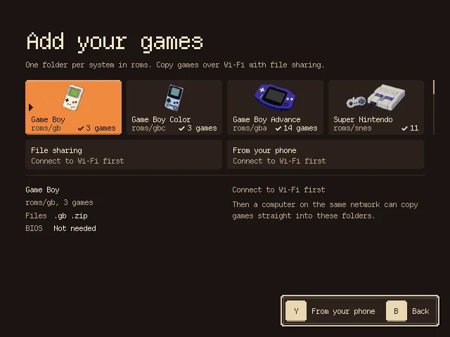

# Games from your phone

The fastest way to drop in a few games: beam them straight from your phone. Just make sure your phone and Pocket are on
the same Wi-Fi network.

1. Open Settings → Games → **Add games** (or the "Add your games" step during first start) and press **Y** ("From your
   phone"). The **Send from your phone** screen shows a big QR code alongside a short address you can type manually
   (your Pocket's Wi-Fi IP, a port and a one-time code like `…:41234/k7m2qx9p`).
2. Scan the QR code with your phone camera and open the link (works in iPhone Safari and Android Chrome—no app to
   install). Pick your game files; on Android you can also pick an entire folder.
3. pocket-ui sorts each file into its console folder automatically by extension. For shared formats (`.zip`, `.iso`,
   `.chd`, `.cue`/`.bin`, `.cso`), your phone asks which console it belongs to, showing only systems your Pocket supports.
   Disc images are never guessed—PSP, PS2, GameCube, Wii and Saturn all use `.iso`, and the wrong folder won't launch.
   After answering for one file, a quick button lets you apply the same console to the rest. Picking a `.cue` or `.gdi`
   pulls along its track files automatically without asking again, and uploading a disc folder on Android keeps its folder
   structure (`psx/Game (Europe)/Game.cue` plus its `.bin` tracks).
4. Watch progress live on your Pocket: **Waiting for your phone**, **Phone connected**, each file's progress bar, and
   finally **Added: 3 games**. Press **B** when you're finished—the upload page closes and your new games appear on the
   shelf.

## What it does and doesn't do

- **Supported files:** cartridges (Game Boy through N64, including `.zip`), DS, arcade sets, disc images (`.iso`,
  `.chd`, `.cue`/`.bin`, `.gdi`, `.m3u` …) and 3DS. DOOM, Daphne, PICO-8, ports, DOS and computer games are excluded
  because their files can tell a launcher what to run—copy those via File sharing or the SD card. Saves and BIOS files
  aren't accepted here either; copy BIOS files to `roms/bios` on your computer or via the
  [web companion](web-companion.md).
- **Size limits:** cartridges up to 64 MB, DS 512 MB, arcade sets 1 GB, discs up to 9 GB, 3DS 4 GB. For huge disc
  collections, copying straight to the SD card is faster.
- **Safe disc sheets:** `.cue`, `.gdi` and `.m3u` files can only reference tracks inside their own folder; paths pointing
  outside are rejected.
- **No accidental overwrites:** existing games are never replaced—your phone says "Already on the Pocket" and skips them.
  To replace a file, delete the old copy first over File sharing or on your SD card.
- **Free-space check:** before sending, your Pocket checks that the file fits while leaving headroom for saves. If space
  is too tight, your phone says so and nothing is written.
- **Clean transfers:** incoming files land in a hidden temporary folder (`roms/.pocket-ui-uploads`) and only move into
  place once finished. If Wi-Fi drops, you close the page or the Pocket sleeps mid-upload, the partial file is cleaned up
  automatically.
- **Auto-close:** the upload screen closes if the display turns off (timeout, lid or power button), after 10 minutes
  idle, or after one hour total. Press A to reopen it with a fresh code. Your Pocket won't auto-sleep while a transfer is
  actively running.
- When you exit Add games, your library refreshes and offers [Game check](game-check.md) to flag empty files, wrong
  extensions or missing BIOS files in plain English.
- Offline? The page says **Connect to Wi-Fi first**—press **A** to jump straight to Wi-Fi settings. During first start,
  connecting returns you directly to the QR code; pressing B without connecting returns to Add games.

## What plain HTTP on a Wi-Fi means

The upload page only runs while it's open on your Pocket, only on your local Wi-Fi, and requires the fresh one-time code
shown on screen. **The connection is not encrypted:** someone else on the same Wi-Fi could see the code and the files you
send, tamper with them in transit, or upload files while the page stays open. Both your phone and Pocket remind you of
this ("Not encrypted, so use it on your own Wi-Fi at home"). Nobody can browse or download anything from your Pocket
through this page—no game list, no saves, no settings; it only checks whether a filename already exists. Use it on your
home Wi-Fi, and stick to File sharing at home or your SD card when you're on hotel or café networks. Too many wrong code
attempts close the page automatically.
