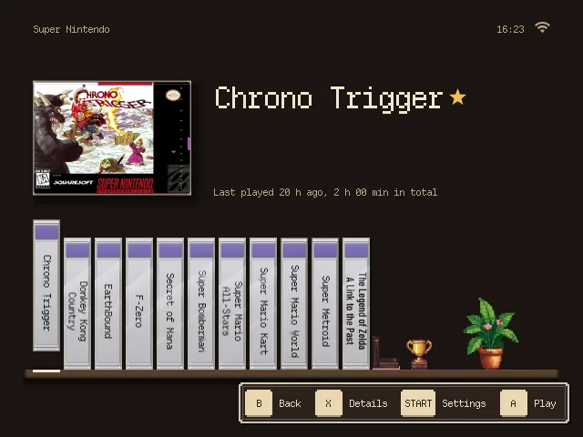
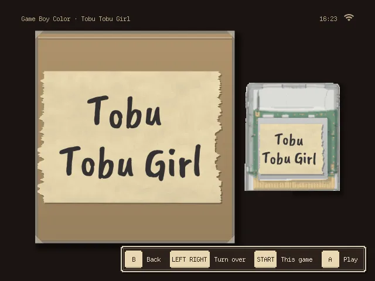

# Playing

## Home

Home lays everything out along one shelf from left to right (or top to bottom as a list in Split):

1. **Curator**, your library by mood: the Lens and your smart shelves ([Curator](curator.md#curator)). Its row highlights
   today's pick ("Today: Super Metroid"). It sits at the top on Home (in Cabinet, it sits as its own shelf below
   Favourites).
2. **Search**, to find any game as you type ([Finding a game](#finding-a-game)). Home opens right below it so Continue is
   one tap away, Search is one press up, and Curator two. In Cabinet, press Up from the top shelf to open Search.
   **Just Play** sits right above Continue (or one box left of your last game in Cabinet): hit A to jump straight into a
   picked game, or X to see what it chose and why ([Just Play](curator.md#just-play)). Toggle it in Settings → Games →
   Curator (hidden in Kids Mode).
3. **Your recent games**, up to six. The first is your last-played game, labelled **Continue** on the Shelf so you can
   press A immediately.
4. **Favourites**, every game you starred with Y, sorted alphabetically. Appears once you star a game and hides when
   empty.
5. **Pinned smart shelves**, each appearing as its own row (or shelf in Cabinet). Every Curator section can be toggled in
   [Settings → Games → Curator](settings-playing.md#curator).
6. **PC streaming**, shown when Moonlight is installed (included on ROCKNIX) and enabled under Settings → Games →
   Systems on the shelf. Launches Moonlight directly (no pause menu, doesn't log game play time; see
   [PC streaming](pc-streaming.md)).
7. **Your systems**, sorted alphabetically. Only consoles with games appear, skipping any you hid under
   [Systems on the shelf](settings-playing.md#systems-on-the-shelf).

**What highlighted rows preview.** Wherever box art appears (above the shelf in Shelf, in the side panel in Split), these
rows show previews too:

- **Curator:** today's picked cover plus games waiting for you: either unfinished games untouched for a month ("4 to
  rediscover") or unplayed titles ("12 never played"), with a short note explaining the pick ("Today: Super Metroid ·
  Never played · you gave it 5 stars"). The pick refreshes daily or when your play shifts it.
- **Favourites** and **pinned smart shelves:** side-by-side covers of their first games, or clean printed title cards for
  games without box art. Empty shelves simply read "No games here yet".
- Right after boot, while Curator scans your library for a moment, rows display titles cleanly with no blank boxes.

Any game hidden from its card (**Hide from the shelf**, [Hide or delete a game](library.md#hide-or-delete-a-game)) disappears
from shelves, search and the game switcher; unhide it under Settings → System → [Storage](storage.md) → Hidden games.
Deleting from the SD card asks twice to confirm.

Press **START** on Home or inside any console list to open **Settings** (B returns; see [Settings](settings.md)). Tap
**HOME** on the shelf for quick settings (brightness, volume, Wi-Fi, Bluetooth, sleep and power).
On Anbernic H700 handhelds, the speaker gets more headroom above 25% and reaches ROCKNIX's speaker level
at 100%. The saved volume percentage carries over, and the speaker gain ramps up when needed.

Each row includes a quick detail line:

- **Recent games:** console, last played and total play time (with region/filename disambiguation if you own two copies,
  like "Tobu Tobu Girl (Europe)").
- **Console game list:** "Last played …, … in total", or "Not played yet".
- **Consoles:** game count, plus console trivia in most layouts ([Console pages](console-pages.md)).

The top-right status bar shows the clock, Wi-Fi icon when connected, and battery percentage (with ", charging" on power).
Devices without a battery sensor show time only, and an unset clock stays blank until synced. After quitting a game with
[Sync](sync.md) enabled, a brief status appears beside it ("Saves synced").

Long titles end with "…" at rest; pause on a row for 1.5 seconds and the title scrolls smoothly across. Starred games
display a small star beside their name.

## Finding a game

**Jump by letter.** Press **L2** or **R2** in any console list, Favourites, smart shelf or the Home console list to skip
alphabetically with a big letter indicator (numbers and symbols appear first under "#"). Hold to keep jumping. On Home,
R2 from recent games jumps straight to your first console.

**Search.** Press **Up** from Continue and hit **A** (or Up from the top shelf in Cabinet) to open live search:

- Case and accents don't matter: "pokemon" matches Pokémon.
- Partial words work: "mar ka" matches Mario Kart.
- Typo-tolerant: "mrio kart" or "zelad" still finds your game (1 typo from 4 letters, 2 from 7; first-letter typos fall
  back to "close matches" when nothing else hits).
- Region tags ("(USA)", "[!]") and leading list numbers ("0902 - ") are ignored.
- Prefix matches rank first.
- Empty searches show your last five queries so you can rerun one with A. Hidden systems stay excluded.

Press **START** (or **Results**) to jump into the result list: **A** plays, **Y** stars, **X** opens the game card, and
**B** returns to typing. Touch screens let you tap keys directly and double-tap a result to launch.

## Looks

pocket-ui includes four shelf layouts. Pick yours with a live preview in Settings → Look → **Layout**. Every layout
supports Dark, Light or Automatic [Appearance](settings.md#appearance) and adjustable [Motion](settings.md#motion).

| Look | What it shows |
|---|---|
| **Shelf** | Games lined up spine to spine; your picked game rises up to show its cover. |
| **Easy** | One big game box at a time with simple menus. See [Easy](easy.md). |
| **Split** | Clean game list on the left, big box art and details on the right. |
| **Cabinet** | Wooden shelving with a lamp, console and little TV; pull a box out to see its cover. |

Minimal and Cards were retired in 0.4; if you used either, pocket-ui switches you to Split once with a short notice.

Cover art, when you have it, appears on the front of the case shown above the shelf (Shelf), in the detail panel (Split)
and on the front of the case you pull out (Cabinet), whose spine also takes the
cover's colour. See [Box art & downloads](extras.md#box-art). In Split the picture also changes
by itself: after you stay on a game for a moment it fades from the box art to the game running and to the title
screen, when you have them ([Pictures](extras.md#pictures)); with Motion Off it stays on the box art. In Split, Curator,
Favourites and the pinned rows show their covers in the panel, as on the Shelf look (below).

In the Cabinet, **Up/Down** moves between shelves and **Left/Right** between games. Only the shelves that fit
below the preview are shown. The position beside the game details (for example **2 / 6**) counts all shelves,
including Continue, Favourites and Curator when present; arrows show when another shelf is above or below.

In the Cabinet, every game stands in the case it came in, each system its own: the cardboard boxes of the Super
Nintendo, Nintendo 64, NES, Game Boy and Game Boy Advance, the Mega Drive's clamshell case, the Master System's and Game
Gear's case with the white grid, the thin PlayStation jewel case, the light Dreamcast and Saturn case, the tall black PS2
case, the GameCube's, the white Wii case, the slim PSP case, the DS and 3DS cases, the Xbox and Vita cases; every other
system has pocket-ui's own case with its name and colour at the top. The cartridge or disc is inside, and a disc is
printed like the real one: the cover's art on its label and the game's name round its rim, in its system's look (the
PlayStation's black disc, the GameCube's small disc, the Dreamcast's silver ring, the white Wii disc, the UMD in its
shell). Each spine takes
its colours from the game's cover and has its name on it (a long name gets smaller or a second line before anything is
left off). A game with no box art at all looks home-made: masking tape with its name in marker on a plain box and a
blank cartridge, or a hand-written CD-R and insert; once it gets box art, the art takes its place. Every case has its real size: a PS2 case stands tall, a Game
Boy Advance box low, all on the shelf's board. Where a shelf has room, a bookend holds its games up
and a plant, a lamp or a cactus stands beside them, never in front of one. The shelves grow with your play: the
plant starts as a sprout and grows with the hours you play, a trophy appears after your first completed game, a
framed "100 %" after your first 100 % sticker, and a system you have played for 10 hours gets a small figurine on its
shelf. The room follows the clock too: cool and bright in the morning, warm in the evening with the lamp on, dim at
night. Both can be switched off in Settings → Look → Cozy extras. The case you pick comes out of the shelf
and stands on top of the cabinet, right over its shelf, turned to its cover; the whole cover shows, never cut. Under
the picked shelf you see the next ones, as many as fit whole. The top shelf holds the recent games, the next one your Favourites, then
come Curator's shelves, then one shelf per system. A starts the game: its cartridge or disc goes into the console.

### Starting a game

In Shelf and Cabinet, A starts the emulator while the case opens and its cartridge or disc goes into the console,
with a quiet click and glow. **Quick** shows the game as soon as it is ready. Any button skips the animation.
**Game start animation: Cozy** (Settings → Look → Game start animation; the default in these looks) takes about a second.
pocket-core waits for it: the shelf fades to black, then the game opens from a bright TV line over a third of a
second, including handhelds and Continue. With Remind me where I was switched on, its card keeps its saved picture while you read.
With menu sounds on, you hear the case, insertion and TV's soft thunk. Other looks skip this animation.

With **Cozy** and **Playful cases** the big consoles really take their game: the PlayStation's, GameCube's, Dreamcast's
and Saturn's lid opens, the disc's case opens too, the disc is lifted out and lowered flat, label up, onto the spindle and the lid shuts; the PS2's and Xbox's tray slides out and
takes the disc in; a SNES, N64 or Mega Drive cartridge is pushed down behind the slot's lip and clicks; a Game Boy or GBA
cartridge turns its label away and goes in behind the top edge (also on Game Boy Color); a DS card turns its label away before going behind the upper screen, and the Wii pulls its disc in through the slot. It takes about 1.6 seconds, and any button skips it at once.

For GBA you can choose **Game Boy Advance SP** in Settings → Look → [Cozy extras](settings.md#cozy-extras)
→ **GBA console**. Its clamshell opens and stays open while the cartridge enters the bottom/front slot,
contacts first and label facing the underside. Quick keeps that slot and orientation on its shorter timeline.
The console pictures throughout the menus follow the choice; it starts with the original Game Boy Advance.

On the other systems each game still goes in its own way (Settings → Look → Cozy extras → Playful cases, on with Cozy): a
cartridge is pushed into its slot and seats with a little squash as it clicks; a game card clicks all the way in; a disc
console's tray slides out, the disc drops in and the tray shuts with the sound's clunk; the GameCube, PlayStation,
Dreamcast and Mega-CD open their lid instead; the Wii takes the disc in through the slot. The PSP turns round and its UMD slides into the door at its back. A case you
pick springs out of the shelf and wiggles once, the disc beside an open box turns slowly for a few seconds, and holding
Left or Right on the Shelf tips the spines a little until they swing back.

In the **Shelf** look, the one pocket-ui starts with, everything stands on one shelf, seen from the spine: each game
in its system's real case (the same cases as in the Cabinet below), its spine in its cover's colour with its name
on it; a long name gets a little smaller or a second line before anything is left off ("…" is the last resort). Your systems, Curator, Favourites and Search stand there as plain boxes in their
colours, a system with its short name ("SNES"). Left and Right (or Up and Down) move along the shelf, L1 and R1 five at a
time. The one you pick rises out of the row and is shown large above the shelf, turned to its front with the cover
(at once with Motion Off); beside it are its name and what is known about it: when you last played it, a system's facts,
the covers of Curator's pick or your Favourites. A game without a cover shows its home-made front.
Where a shelf has room left, a bookend holds the games up and a plant or a lamp stands beside them, with what your
play has earned (the growing plant, the trophy, the framed "100 %", the system's figurine), and the light follows the
time of day, as in the Cabinet.

Curator in the Cabinet ([Curator](curator.md#curator)): the **Curator** shelf holds a box for the Lens and one for
each smart shelf and label (Y pins one to Home, X opens its options, as in the Curator list). A on a box opens
its games as a shelf of their own, right under the Curator shelf, with the list's name on the plate; B goes back to
the Curator shelf. A smart shelf or label pinned to Home is a shelf of its own all the time, under the Curator
shelf; a label's shelf has the label itself on the board's edge. START in the Lens shows its games the same
way. A list with no games stays closed and says so. Your Favourites are real cases on their own shelf, with their covers, as in every
system's shelf.

### The TV on the cabinet

In the Cabinet look a small old TV stands on the cabinet's top board, at the right, and shows the selected game: its
screenshot when pocket-ui has downloaded one (Settings → Games → Box art & downloads → Box art), else the latest picture of your
own play (the one Continue starts from), else its cover; a game with none of these shows its console. The picture
changes with a short crossfade as you move (at once with Motion off). A handheld game (Game Boy, Game Boy Advance, Game
Gear, Neo Geo Pocket, Lynx, WonderSwan, DS, PSP …) shows on its handheld instead, the game on its little display, in the
TV's place. Beside the TV, on its left, stands the console the selected game is played on (a SNES, an N64, a
PlayStation …), in the colour you chose on its [console page](console-pages.md); it changes as you move to the next shelf, like
a real living-room shelf. A handheld game adds nothing (its handheld already stands there), nor does a computer or
arcade game. The TV (or handheld), the console's place and the top board stay where they are from shelf to shelf; only
the shelves move. On a small screen the TV is smaller; where it would be too small to see it is left out, and where the
cases out of the shelf need the room, the console is.
With Settings → Look → [Cozy extras](settings.md#cozy-extras) → **TV plays the game** on (it starts **off**), a game you
have never played plays on the TV after a two-second rest (its own demo, silent, up to 25 seconds); press A and its
picture grows to the whole screen and you play on from there (a game still in its plastic wrap, [Sealed new games](settings.md#cozy-extras), starts the usual way instead: the wrap tears off first). It runs the game in a second, hidden player, which
costs processor time and battery while it plays, so it is your choice; with the switch off nothing extra runs and
the TV keeps its still picture. New pictures appear when you return.

### Easy

One big game at a time, simple menus: see [Easy](easy.md).

## Console pages

Most systems have a page about the console itself, with its facts and its Credits & links (X on the system): see [Console pages](console-pages.md).

## Starting a game

Select a game and press A ("Play"). The rest of the shelf fades out and the game starts. A game you
played before fades in from the picture of where you left it, the same picture Recent games shows,
so you see your place while the emulator starts; then the screen frame around it fades in. With Settings → Playing → Remind me where I was switched on (it is off by default), after a break of more than
two weeks a quiet card on that picture says when you played last and shows your note, for a few seconds or until a button ([Where was I?](continue.md#where-was-i)). When you
quit, you come back to where you were; on Home the selection goes back to the top, so your last game
is ready to continue. Settings → Playing → **On start** can open that game right when the Pocket starts
([Settings](settings-playing.md#on-start)).

pocket-ui counts the time from starting a game to quitting it and adds it to that game's play time.

If a game on pocket-ui's own host cannot start, a card at the top of the shelf says why for a few
seconds, and in most cases the game starts again right away with RetroArch. See
[Systems](systems.md#when-a-game-does-not-start-on-the-own-host).

### After Quit

With **Game start animation: Cozy** and **Motion: Full**, the way back mirrors putting the game in: the picture switches off,
the cartridge or disc comes out, and its case closes and returns to the shelf. A home console's picture collapses to
a line and a dot when **Old-TV switch-off** is enabled; a handheld's display simply goes dark. The case stays a little
open when Continue is available. This also works in Easy and Kids Mode when Cozy is selected.

The shelf accepts input immediately. Any button or touch ends the effect and acts on the shelf in the same press.
Quick, Reduced and Off return directly to the shelf. Case sounds use the existing Sounds and Case sounds switches. With Playful on, the PSP door has its own click as it opens or closes.

## Recent games

**Press SELECT** on the shelf to see your recent games side by side, each as a screen showing where
you left it: the picture saved when you last quit, or the newest save slot, or the cover art, or a
card with the name in the system's colour. Below it are the name, the system and when you played it. Two versions
of one game are told apart by name, as in the system list.

- **A** says **Continue** where a moment is waiting (the same games that stand open on the shelf) and goes back to it; for any other game it says **Play** and starts it.
- **Y** stars it. A game hidden on its card is not shown.
- **B** closes the switcher.

While playing, **hold HOME and press SELECT** (or press SELECT in the pause menu). The game pauses,
and the switcher opens with the running game first, marked "Now playing". A on it goes back to the
game; A on another game saves and quits the running one, exactly like Quit in the pause menu, and
starts the other one where you left it. From a Game Boy, Game Boy Color, Game Boy Advance, NES, Super Nintendo or
Mega Drive game to one on the [own host](systems.md#on-pocket-uis-own-host), the next game starts as soon as the
first has saved, so the switch takes about as long as starting a game.

The [Easy](easy.md) look has no switcher: SELECT does nothing there.

## Screenshots

**Hold HOME and press A** while you play. The picture is saved as a PNG and "Screenshot saved" shows for a moment;
with Settings → Screen & sound → [Menu sounds](#menu-sounds) on there is also a quiet camera click. The game does not pause
and the pause menu does not open.

- **Where:** `roms/screenshots/<system>/<game> <date> <time>.png` on the SD card, for example
  `roms/screenshots/gba/Tetris 2026-10-24 18-05-09.png`. The time in the name has dashes, not colons, because the SD card
  does not allow colons. Two screenshots in the same second get a number after the time. A character the SD card does not
  allow in a name (such as a slash) becomes an underscore in the file name. The folder is under `roms`, so the
  [file share](getting-started.md#5-add-games) shows it next to your games.
- **On pocket-ui's own host** the screenshot is the game's own picture at the size the game makes it (a Game Boy
  picture is 160 x 144 pixels), without the screen frame, the overlays and the scaling. It is saved while the game
  goes on. Options → Shortcuts → **Screenshot** switches it off.
- **PlayStation 2, GameCube, Wii, 3DS and PortMaster ports:** pocket-ui takes a picture of the whole screen, as the
  game shows it. Nothing can be drawn over these games, so there is no message: you hear the camera click (Menu sounds on),
  or the low double sound if it did not work. This shortcut cannot be switched off there.
- **RetroArch** games take the same shortcut. Switch it off under Options → Shortcuts → Screenshot.
- **If it does not work,** the message says why: "Screenshot not saved: the SD card is full", "...: the folder can't be
  written to" or "...: no picture yet" (the game has not shown a picture). A screenshot is either whole or not there;
  a failed one leaves no file behind. Settings → System → [Storage](storage.md) shows what takes up space,
  and pocket-ui says so on the shelf once less than 1 GB is left.
- The [web companion](web-companion.md) shows a game's screenshots on its page.

### Looking at your screenshots

You do not need a computer to see them. Settings → Games → **Screenshots** lists every screenshot, newest first, in
groups by day ("Today", "Yesterday", then the date). Each has a small picture, the game, its console and the time; the
value of the row in Settings is how many there are. A game's [card](library.md#what-the-card-shows) has a row
**Screenshots (3)** as soon as the game has one, which opens the same page with only that game's screenshots; B
comes back to the card.

| Button | In the list | Full screen |
|---|---|---|
| A | Open the picture full screen | Nothing |
| B | Back (to Settings, or to the card) | Back to the list |
| D-pad Up / Down | The one before or the next; L1 / R1 move five | The one before or the next, like Left and Right |
| D-pad Left / Right | Nothing | The one before or the next, in the list's order (newest first) |
| X | Delete: "Delete this screenshot?", then **A** deletes it for good and **B** keeps it | The same |
| Y | **Shelf picture** (below) | The same |

- **On the touch screen** a tap opens a screenshot, a swipe up or down moves along the list. Full screen, swipe left or
  right, or tap the left or right third of the picture, to browse. The hint pills at the bottom work as the buttons.
- **Full screen** shows the picture alone on black, the game and the time over it, and "3 of 12". A small picture,
  such as a Game Boy's, is shown at a whole multiple of its size (so no pixel is wider than the next), a larger one
  fitted to the screen.
- **Shelf picture (Y):** the screenshot becomes the game's "In the game" picture, the one the shelf's Split look and
  the game card show ([Box art & downloads](extras.md#pictures)). It replaces the one from the collection. Y only shows while
  Game pictures shows screenshots.
- **Nothing there yet:** the page says "No screenshots yet" and how to take one. While the SD card is still being read
  it says "Looking for screenshots…".
- **A file that cannot be read** (a damaged PNG, or one cut short) shows a "?" in the list, and "This screenshot can't
  be opened" full screen. You can still delete it.
- **Only files named the way the Pocket names them** (`<game> <date> <time>.png` in a folder of the console, see
  above) are listed. A picture you copy into the folder under another name stays on the SD card, unlisted.
- **Nothing slows down.** The folder is read in the background, after the start and after each game; the pictures are
  made ready one at a time, never while you are moving through a list. A few pictures are kept in memory, the rest are
  read again when you come back.

## Playing on a TV

> **Not tried yet.** This has not been tested on a Mini V2 with a TV. Save your game before you plug in or unplug.

The Pocket can show its picture on a TV or monitor through its USB-C port: with a USB-C to HDMI adapter, or a dock
with an HDMI port. The adapter has to support video over USB-C ("DisplayPort Alt Mode"); a plain charging cable or
hub without it shows nothing.

- **Plug it in.** The picture moves to the TV and the Pocket's screen goes dark. On Home, "Showing on the TV" appears
  for a moment. A game keeps running.
- **The picture** is 1920 x 1080 at 60 Hz, even on a 4K TV (the TV enlarges it). Games are scaled by whole numbers, a
  Game Boy Advance game six times.
- **Sound** plays on the TV, for now even when headphones are plugged into the Pocket.
- **Controls:** the Pocket's buttons, a Bluetooth controller, or a USB controller on a dock. The touch screen does
  nothing while the picture is on the TV.
- **Unplug it** and everything is back on the Pocket's screen ("Back on the built-in screen"), a game too.
- **Battery:** an adapter without its own power runs off the Pocket's battery. A dock with a charger keeps the
  Pocket charging, more slowly than its own charger.
- **Sleep** pauses the game, but the TV keeps showing the picture.

## Continuing where you left off

- **pocket-ui's own host** saves the moment you quit, every time, however you quit, except a pause-menu Quit with
  Settings → Playing → [Continue where I quit](settings-playing.md#continue-where-i-quit) off. With it off, the next start is as if no
  moment had been kept, and the older moment stays under Load.
- **RetroArch** does the same, using ROCKNIX's standard setting, even with Continue where I quit off.
- **PlayStation 2, GameCube, Wii and 3DS** save the moment when you choose Quit in the pause menu (not with
  Continue where I quit off).
  At the next start the game first boots for a moment, then jumps to that moment. On GameCube and
  Wii this happens about three seconds after the game appears, and Dolphin shows a short message of
  its own; on 3DS about three seconds after the game's title appears.
- **Other emulators** start fresh. Use the game's own save feature.

If a game in pocket-ui's own host stops answering Pause or Quit, it closes after a few seconds
and keeps the previous saved moment. A game that is only busy saving or loading is not closed. If a PSP game
freezes without responding, including during Continue or shutdown, pocket-ui closes it after 25 seconds; saving a
PSP state on exit also has a 20-second safety limit. Progress after the last saved moment cannot be recovered,
while a newer in-game save is still protected when continuing.

Messages about a fresh start or a saved moment stay inside the screen as the game opens.

Your last five games with a saved moment also stand a little open on the shelf, and A goes straight back: [Continue](continue.md#continue).

## Menu sounds

pocket-ui's menus make quiet clicks: a soft tick as the selection moves, a short rising sound when you
choose something with A, a falling one when you go back with B, and their own sounds when the pause
menu, the quick settings or Recent games open. A low double sound means something can't be done,
for example Load on an empty save slot. Vol+ and Vol- give a short tick. In the Shelf and Cabinet looks, X opens the
game's case with the sound it makes: a plastic case snaps open, a cartridge's cardboard box opens with a soft flap.

The sounds never play while you are playing a game, with one exception: the camera click of a
[screenshot](#screenshots). In a game only the pause menu (and the game
switcher opened from it) makes the other sounds, and starting a game or going back into it is silent. There are no
sounds while the console is asleep or the volume is muted or at 0.

Connecting or disconnecting Bluetooth headphones in the menus adjusts the sound output's buffering within two seconds.
Muted menu audio also stops running in the background.

Settings → Screen & sound → **Menu sounds** controls them:

- **A** switches the sounds on or off. They start on, and quiet.
- **Left** and **Right** set how loud they are, in ten steps (30% by default). This is separate from
  the console's volume, which games use; the clicks follow both, so with the volume at 50% and Sounds at
  30% they are quieter still. Turning them up or down also switches them on, and each step plays a tick
  so you can hear the new level.
