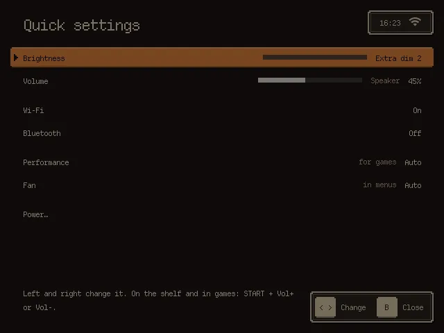

# Quick settings, sleep and power

## Quick settings

Tap **HOME** on the shelf—or press **START** inside the pause menu—to slide open Quick settings while your game stays
paused behind it. Brightness and Volume stay synced with Settings → Screen & sound. Rows, top to bottom:

| Row | Left/Right and A |
|---|---|
| **Brightness** | Adjust with Left/Right. Going below 5% drops into **Extra dim 1**, **2** and **3** for late-night play ([Extra dim](#extra-dim)) |
| **Volume** | Adjust with Left/Right. Muted audio reads "5%, muted". The label beside it shows your active output: Speaker, Headphones, Bluetooth (with device name), USB audio or HDMI ([Where the sound goes](#where-the-sound-goes)) |
| **Wi-Fi** | Press A to toggle Wi-Fi based on the radio's real live state (matching Settings → Connections → Wi-Fi). If Wi-Fi was enabled in your settings but blocked at boot, pocket-ui turns it back on once automatically; Wi-Fi you turned off stays off. If toggling fails, it warns "Couldn't turn Wi-Fi on. Try again." Turning Wi-Fi off ends any active remote session |
| **Bluetooth** | Press A to switch Bluetooth on or off (takes a few seconds). To pair pads or headphones, see [Bluetooth](bluetooth.md) |
| **Performance** | Left/Right (or A to step): Battery, Auto, Max—sets default game CPU speed |
| **Fan** | Left/Right (or A to step): Very quiet, Quiet, Auto, Cool—controls menu fan on the shelf, or game fan mid-game |
| **Power…** | Press A for the power menu: Sleep, Restart, Power off, Restart pocket-ui (plus Restart to boot menu where supported) |
| **Back to EmulationStation** | pocket-ui beta for dArkOS only: press A to return straight to dArkOS's own menu without a confirmation prompt. Shown on the shelf only; mid-game, the power menu offers it after saving and closing your game |

The top-right corner shows the clock, Wi-Fi icon and battery percentage, just like Home. Press B or HOME to close (from
the pause menu, it returns to the pause menu; tapping HOME mid-game always opens the pause menu, never Quick settings).
On touchscreens, tap a row to select, tap again for A, and tap the arrows beside values for Left/Right.

### Extra dim

Even 5% backlight can feel harsh in a pitch-black room. Drop Brightness below 5% to step through three darker software
dimming levels: **Extra dim 1**, **2** and **3**. It works across your shelf, menus and games while keeping text crisp
and readable, and survives reboots. Turning Brightness back up clears Extra dim first before raising the backlight. On
Android, use Android's built-in Extra dim under Accessibility instead.

### Where the sound goes

On Anbernic H700 handhelds running ROCKNIX, games stay silent cleanly at 0% volume (including N64). Mid-range volume
steps are also louder than in 0.4.0 while keeping max and 0% identical—older speaker levels adjust automatically on
first boot after updating without touching custom hardware tweaks.

The small label next to the Volume bar reports where audio is actually going **right now**, checked in the background
when you open Quick settings and refreshed every few seconds (briefly showing "…", or "Output unknown" if the OS doesn't
report it):

- **Speaker:** built-in speakers.
- **Headphones:** wired 3.5 mm jack.
- **Bluetooth: name:** connected Bluetooth headphones or speaker (long names shorten; full names show on the
  [Bluetooth](bluetooth.md) page, or plain "Bluetooth" if unreadable).
- **USB audio** / **HDMI:** external USB DAC/headset or HDMI display.

This indicator is read-only—pocket-ui doesn't force output switching. **Plugged in wired headphones and it still says
Speaker?** The OS didn't switch audio routes (ROCKNIX's 20241120 Retroid release notes flagged "no headphone switching"
as a kernel issue, which may still happen depending on your build). Try unplugging and re-plugging the jack, or putting
your Pocket to sleep and waking it. If it says Headphones with no sound, check the shared Volume slider above.

**Performance and Fan** mirror Settings → Playing → [Performance & fan](performance.md) and save immediately:

- **Performance** controls **Games: performance** (default for all games without an override): Battery runs around half
  speed for longer runtime, Auto lets the OS decide (full speed for PS2, GameCube and 3DS), and Max locks top clocks.
  The small sub-label reads "for games" on the shelf, or highlights a game's own override in orange mid-game.
- **Fan** adjusts **Fan outside games** on the shelf ("in menus") and **Games: fan** mid-game. Auto always uses the
  system's own cooling profile.
- Over a paused game, changes apply immediately: CPU clocks for pocket-core, PS2, GameCube, Wii and 3DS, and fan speed
  for every game when [Smooth fan](performance.md#smooth-fan) is On. PortMaster ports pick up new Performance on their
  next launch; RetroArch games keep OS speed ("this game: the system's").
- If a game, console or port has its own override, Quick settings shows it beside the value ("this game: Max") and
  explains that changing it here only adjusts the default for other games.
- Fanless handhelds hide the Fan row; devices where CPU speed isn't controllable show "Not available here".

## Sleep and power

> **Status:** deep sleep wake-up was timed on a Mini V2—screen and game come back in well under a second. Standby drain
> measures ~5%/hour on a Mini V2 (over 5.5 hours) and ~2.6%/hour on an RG35XX SP. **Power off**, **Restart**, **Restart
> pocket-ui**, **Switch off after sleeping** and Power set to **Screen off** haven't been hardware-verified yet—save
> in-game before stashing your handheld until this notice is cleared.

Sleep works in two stages, both configurable under Settings → System → **Sleep & power**
([below](#sleep--power-settings); dev details in [SLEEP.md](../SLEEP.md)):

- **Light sleep (screen off):** kicks in after 2 minutes idle by default—the screen turns dark and your game pauses. Any
  button (except volume keys) wakes it right back up.
- **Deep sleep:** starts 2 minutes into light sleep, or immediately on a short Power press or via **Power… → Sleep**.
  pocket-ui saves your game first, then suspends the hardware. Press Power to wake—the game appears immediately with
  sound following a beat later. Menus ignore presses for ~0.5 s after wake to prevent pocket triggers, while running
  games accept input instantly.
- **Power off** (power menu) saves and cleanly closes your running game first, then automatically reopens it next time
  you power on.
- **Switch off after sleeping:** off by default so your Pocket stays in standby like other handhelds. Because deep sleep
  still sips a few percent per hour, a full battery can drain after a day or two in a bag. Turn on a timer—1 h, 3 h or
  8 h—under Settings → System → **Sleep & power** and your Pocket will save your game and shut down cleanly in the dark
  once that time elapses (3 hours uses ~14% battery). Next power-on resumes your game straight away regardless of **On
  start** and shows "Switched off after 3 h asleep to save the battery." It never shuts off while charging, waking early
  works normally, and if a game can't save a Continue state (such as RetroArch) or saving fails, it stays safely asleep
  instead. When **Off**, no wake alarm is ever scheduled.
- **Low battery:** at 5% on battery, a brief alert appears on the shelf and in pocket-core games. At 2%, your Pocket
  saves the running game and powers off cleanly—even from light sleep—so progress is never lost to a dead battery.
  Skipped while charging.
- If an OS sleep block prevents suspend, the screen stays dark (press any button to wake); pressing Power still suspends
  manually.
- If suspend fails, the screen stays dark and retries after 4, 8, 16, then every 30 minutes.

RetroArch games stay paused in RAM during sleep rather than saving a state beforehand.

On the experimental Pocket 6 and Nova (where ROCKNIX sleep isn't available), a short Power press turns the screen off
while your game can keep running; any button wakes it. Sleep & power offers an optional **Switch off after** timer (Off
by default) while dark on battery.

If a reboot ever comes up dark with lost brightness settings, pocket-ui restores a dim visible level so you can readjust
in Quick settings.

### Sleep & power settings

Open Settings → System → **Sleep & power**. Pick rows with Up/Down, adjust with Left/Right (or A to step); changes apply
immediately and the footer explains each option. The bottom two rows sit under **Power button**. On smaller screens or
with Large text, the list scrolls cleanly above the description and hint bar.

| Row | Choices (default in bold) |
|---|---|
| **Screen off after** | Never, 30 s, 1 min, **2 min**, 5 min idle before light sleep (screen dark, game paused). Never keeps the screen on until you press Power |
| **Sleep after** | Never, 1 min, **2 min**, 5 min, 15 min in light sleep before deep sleep (saves first; stays in light sleep if the OS blocks suspend). Never stays awake with the screen dark (drains battery, still auto-saves and shuts down at 2%) |
| **Switch off after sleeping** | **Off**, 1 h, 3 h, 8 h asleep on battery before auto-saving and powering off cleanly (details above) |
| **Short press** | **Sleep**, Screen off: action for a brief Power button press |
| **Hold** | **Power menu**, Sleep: action for holding Power (~1 second) |

- **Short press: Screen off:** turns off the screen while audio keeps playing—handy for listening to a game soundtrack.
  Any non-volume button wakes the screen. In pocket-core, rendering pauses and buttons are ignored while dark (including
  the wake press) so pocket bumps can't mess up your game. RetroArch and standalone emulators keep running and receiving
  inputs, so wake them with Power. Games kept running this way won't auto-sleep (still auto-saving at 2% battery). On
  the shelf or pause menu, Screen off behaves just like normal light sleep and counts toward Sleep after.
- **Hold: Sleep:** holding Power puts your Pocket to sleep on release; the power menu remains available via Quick
  settings → **Power…**.
- **Retroid Pocket Flip 2** (experimental): closing the lid triggers your Short press action (Sleep or Screen off);
  opening it wakes the screen.
- Older sleep settings migrated from Settings → System → Battery carry over (an old 3-minute setting displays as 3 min
  under Screen off after until changed).
