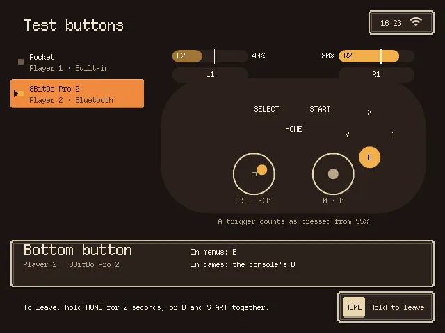

# Settings: Screen & sound, Controls

The **Screen & sound** and **Controls** categories from [Settings](settings.md). *(In earlier versions these lived under
Controls & sound; Brightness and Volume were only in [quick settings](quick-settings.md), Screen colour and Night light
were under Look, and Zoom in the pause menu has moved to [Playing](settings-playing.md#zoom-in-the-pause-menu).)*

## Screen & sound

Settings → **Screen & sound** covers display output, audio levels, colour warmth and menu feedback.

| Entry | What it holds |
|---|---|
| **Brightness** | Screen brightness, always synced with [quick settings](quick-settings.md) and START + Vol. Adjust step-by-step with Left/Right; going past the lowest hardware backlight drops into extra-dim software dimming |
| **Volume** | Master volume for games and menus, synced with quick settings and the hardware volume keys. Adjust with Left/Right |
| **Screen colour** | White balance from **Cooler 10** through **Neutral** to **Warmer 10**. Adjust live with Left/Right; press A to snap back to Neutral. Synced with [SELECT + Vol](controls-settings.md#volume-and-brightness-keys) |
| **Night light** | Warmer, low-blue evening screen colours in menus and games: **Off** (default), **On** or **Scheduled** with adjustable strength. See [Night light](#night-light) |
| **Menu sounds** | Subtle UI clicks (separate from game **Volume**). Press A to toggle On/Off, Left/Right to set click volume. See [Playing](playing.md#menu-sounds) |
| **Case sounds** | Tactile case clicks, cartridge/disc insertion sounds and CRT switch-on hum (Shelf and Cabinet layouts only; requires Menu sounds On). Starts **On**; toggle with A or Left/Right |
| **Photos of big moments** | Starts Off. When **On**, pocket-ui quietly snaps a little instant photo whenever your save hits a milestone (a new badge, a beaten boss, every 10 levels) and slides it into the game's case when you quit. **Also in play** (third option) shows a gentle shutter flash and developing photo right in-game (Linux handhelds only; TrimUI Brick and pocket-ui for Android offer Off and On). Turning it Off stops new snaps without deleting existing ones. See [Photos of big moments](library.md#photos-of-big-moments) |

Case sounds sits right beneath Menu sounds because it depends on it; if Menu sounds is Off, the footer reminds you.

The NES door sound comes from "NES door slam.mp3" by florn (freesound.org/s/454468/),
under CC BY 3.0 (creativecommons.org/licenses/by/3.0/). It was trimmed, mixed to mono,
filtered, faded and levelled. The other new recordings are CC0 1.0, by XenosNS (NES),
lartti (tray), ottoojala (jewel case), and ryanharding95 and ewellis (DVD cases).

### Night light

Settings → Screen & sound → **Night light** has its own page: [Night light](night-light.md).

## Controls

Settings → **Controls** puts button layouts, controller remapping, diagnostics, haptics and stick LEDs in one place.

| Entry | What it holds |
|---|---|
| **Buttons** | Choose which face button confirms in pocket-ui menus and how button icons look in hints, with a live four-button diagram. See [Buttons](#buttons) |
| **Controller setup** | Custom per-controller button mapping across menus and games. Pair wireless pads under Connections → [Bluetooth](bluetooth.md). See [Controller setup](#controller-setup) |
| **Test buttons** | Live button, trigger and analogue stick tester showing what each input does in menus and games. See [Test buttons](#test-buttons) |
| **Haptics** | Crisp, subtle tick as you move through menus (on every screen that clicks). Toggle with A; starts Off |
| **LEDs** | Analogue stick ring lights: Off, solid colour or battery colour (shown only on handhelds with sticks). On the TrimUI Brick this row is **Lights & buttons** for the Brick's LEDs, F1/F2 keys and mute slider. See [LEDs](#leds) |

### Buttons

Settings → Controls → **Buttons** shows two switches above a diagram of your four face buttons with their current hint
icons, labelling which one is **Confirm** and which is **Back**. A footer line confirms which button selects right now.
Flip either row with A or Left/Right; the new layout takes effect on your very next press and saves immediately.

#### Button layout

Sets which physical face button acts as A, B, X and Y in pocket-ui's menus:

- **Nintendo** (default): A right, B bottom, X top, Y left, matching the Mini V2's printed buttons.
- **Xbox**: A bottom, B right, X left, Y top, matching an Xbox controller.

Menus only; in-game controls and safe mode always follow the physical buttons. See
[Controls](controls.md#button-layout) for the exact rules.

On Android, your handheld's own OS setting controls Confirm/Back (like Controller style on Odin), so Buttons only shows
Button symbols ([Android](android-mvp.md)).

On the experimental **AYN Odin 2 Mini** and **Odin 2 Portal**, menus default to **Xbox** (A bottom, B right, X left, Y
top) to match their printed labels, while the original Odin 2 defaults to Nintendo. Your saved choice always wins, safe
mode always uses the printed layout, and games keep positional controls (so screenshots are always HOME + the right face
button, printed B on Mini/Portal, regardless of menu layout).

#### Button symbols

Changes how the four face buttons appear across hint bars, dialogs, the pause menu, this manual's chips and the controls
diagram:

- **Nintendo:** plain A, B, X and Y letters.
- **Xbox:** coloured A (green), B (red), X (blue) and Y (yellow).
- **PlayStation:** cross (A), circle (B), square (X) and triangle (Y).

Retroid and AYN handhelds default to Xbox icons, Anbernic handhelds to Nintendo; your pick always wins. Symbols are
purely visual; mix and match freely with [Button layout](#button-layout). Text descriptions below lists still refer to
buttons by letter.

### Controller setup

Settings → Controls → **Controller setup** lets you remap any connected controller and remembers it across reconnects:
pick the controller at the top, then press each desired button. Also accessible mid-game via Pause menu → Options →
Controls. See [Controller setup](controls-settings.md#controller-setup).

### Test buttons

Settings → Controls → **Test buttons** displays raw controller inputs live, ideal for diagnosing a sticky button, quirky
trigger, stick drift or verifying a custom remap.

- **Controller list (left):** shows your built-in pad plus every connected Bluetooth and USB controller with its player
  number and connection type. A dot lights whenever any input is active, and whichever pad you press draws on the right.
- **Live diagram:** face buttons, D-pad, L1/R1, SELECT, START, HOME and both sticks highlight as you press them. Face
  button labels reflect your [Button layout](settings-sound.md#button-layout) and custom remaps (remapped buttons show a
  small dot).
- **Triggers:** displays pull percentage live; the tick mark shows the press threshold (55%), releasing below 40%.
  Digital button triggers jump straight to 100%.
- **Sticks:** live X/Y values from -100 to 100 with a centre box showing the menu dead zone.
- **Last input:** identifies the controller, player number, menu action (A/B/X/Y/etc.) and in-game console button (noting
  **Remapped to** when moved by Controller setup). Unmapped inputs display **Not recognised** with their raw name, handy
  for bug reports.

Because every button (including B, START and HOME) is tested here, single presses won't exit. **Hold HOME for 2 seconds,
or hold B + START together on one controller** (a progress bar fills), or tap the bottom-right exit hint. Volume and
power keys work normally. Multiple controllers can be tested simultaneously; each lights independently while the readout
shows the latest press.

### LEDs

Settings → Controls → **LEDs** manages analogue stick ring lights. ROCKNIX ships them at full blast; pocket-ui turns
them **Off** automatically on first boot until you enable them here:

- **Lights:** **Off** (dark), **Colour** (single chosen glow on both sticks), or **Battery** (ROCKNIX's full-brightness
  green → orange → red battery indicator).
- **Colour** *(when set to Colour)*: calm presets: blue, warm, teal, green, violet, rose, or **The game's** (warm in
  menus, matching each console's shelf colour while playing).
- **Brightness** *(when set to Colour)*: 25%, 50%, 75% or 100%.

Adjust with Left/Right or step forward with A. Changes apply immediately, persist across reboots (including at ROCKNIX
boot) and switch off cleanly during sleep.

On the experimental TrimUI Brick Pro, **Lights & buttons** exposes separate F1/F2 assignments only; L3/R3 map to stick
clicks while the side switch and LED controls stay disabled.
