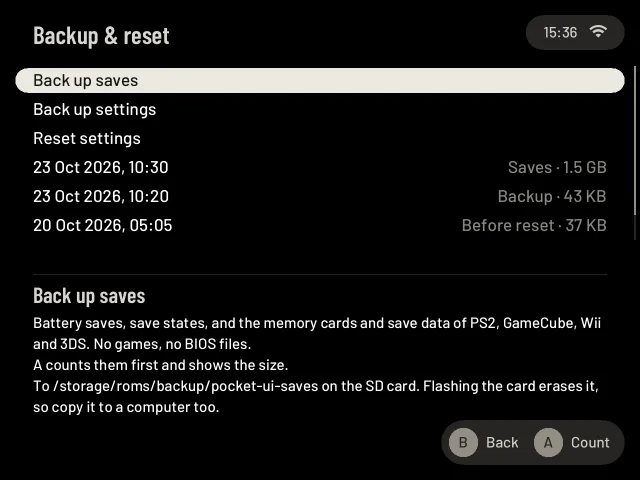
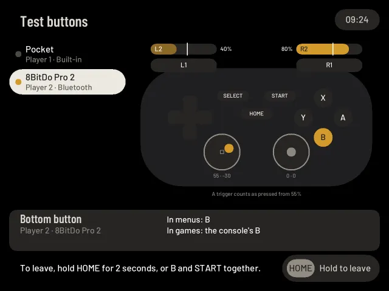

# Settings: Connections, System and Help & tools

The second half of [Settings](settings.md): the **Connections**, **System** and **Help & tools** categories (Wi-Fi, Bluetooth,
Tailscale, Sync, remote access, the Web companion; the language, the clock, sleep and power, updates, storage, backups; the Tour,
this guide, tools and the About page). Look, Sound & feel, Playing and Games, and how Settings opens, are on
[the first page](settings.md#open-settings).

## Connections

The Wi-Fi page agrees with the Quick settings radio switch: while it is off, the page says so and its first row turns it on again with A. Old scan results are hidden while the radio is off. On a handheld with no Wi-Fi chip (the experimental Anbernic RG28XX and RG35XX 2024) the page says "This device has no Wi-Fi" and offers nothing to choose.

Settings → **Connections**. Networks, controllers, and reaching the Pocket from your other devices.

| Entry | What it holds |
|---|---|
| **Wi-Fi** | Connect to a network, switch between saved ones, forget one, join a hidden network, set the Wi-Fi country. See [Getting started](getting-started.md#4-connect-to-wi-fi) |
| **Bluetooth** | Pair a controller, headphones or a speaker and see what is connected. See [Bluetooth](bluetooth.md) |
| **Tailscale** | Reach the Pocket from your other devices over a private network, even away from home. See [Tailscale](remote.md) |
| **Sync** | Keep saves and save states in step with your other devices with Syncthing, and, if you like, your favourites, notes and play history too. See [Sync](sync.md) |
| **Remote access (SSH)** | Log in from a computer. See [Remote access](#remote-access-ssh) |
| **Web companion** | Your library, play time and uploads in a browser on your phone or computer, over Tailscale only. Off by default. See [Web companion](web-companion.md) |

### Tailscale

Settings → Connections → **Tailscale** links the Pocket with your phone, computer and other devices over Tailscale, a private
network that works on any Wi-Fi, a phone hotspot or mobile data. See [Tailscale](remote.md) for the whole page.

1. Select **Tailscale** and press A to switch it on. It stays on after a restart until you switch it off.
2. Select **Sign in** and press A: a QR code appears. Scan it with your phone and approve the Pocket. The page shows
   **Connected as** your tailnet, the Pocket's Tailscale address and its name.
3. **Sign in with a key** is for a key made in the Tailscale admin console. **Name** changes what the Pocket is called on your
   tailnet. **Log out** asks twice.

Tailscale only sets up the network. To log in with SSH over it, switch on Remote access (SSH) as well.

### Remote access (SSH)

Settings → Connections → **Remote access (SSH)**. Remote access is **off** by default, and it is off again after every restart.

1. Press A ("Turn on remote access"). The screen shows `ssh root@<address>`, the user and a password made for this
   Pocket.
2. Log in from your computer with those. The password stays the same for this Pocket.
3. It stays on until you press A again to turn it off. After a restart it is off again.

Remote access is meant for people who want to copy files or look at logs. You do not need it to play. See
[SECURITY-HARDENING.md](../SECURITY-HARDENING.md) for what it changes.

## System

Settings → **System**. The language, the clock, sleep and the power button, new versions, what takes up space on the SD
card and backups.

| Entry | What it holds |
|---|---|
| **Language** | **English**, **Deutsch** or **Español**: menus, hints and messages. See [Language](language.md) |
| **Time** | Time zone, date and network time. See [Time](#time) |
| **Sleep & power** | When the screen goes off and the device sleeps, the slideshow before it, when it switches off after sleeping, and what the power button does. The row shows the screen-off time ("2 min"). See [Sleep & power](#sleep--power) |
| **Second screen** | Only on a handheld with two screens. **Game info** (the start): the lower screen shows the game Home rests on, its box and then its info page with your play time and save slots. **Off**: the lower screen stays dark. In a game it is off either way, except in DS games, which use both screens. Quitting a DS game brings Game info back, including after a temporary display error. |
| **Kids mode** | A big, simple shelf for a child, with a PIN: see [Kids mode](kids-mode.md). Not on the Steam Deck |
| **Updates** | New versions of pocket-ui and the system. See [Updates](updates.md) |
| **Storage** | What takes up space on the SD card, what can go, and the games you hid. The row shows the free space ("41.2 GB free"). See [Storage](storage.md) |
| **Backup & reset** | Back up your saves and states, or pocket-ui's settings and library notes, to the SD card, restore a backup, or reset the settings. See [Backup & reset](#backup--reset) |

### Time

Settings → System → **Time**.

- Choose a time zone by region and city. The list shows each city's offset from UTC and its local time right now.
  A search row (the on-screen keyboard) finds a city by name, in English, German or Spanish: "wien", "viena" and
  "vienna" all find Vienna, with or without accents. Cities with a name of their own in your language are listed by
  it ("Wien", "Viena").
- The clock changes at once on every screen, the time at the top right of Home too ([Home](playing.md#home)).
- **Network time** shows whether the clock is in sync (it needs Wi-Fi). Press A on it to ask again.
- **Date and time** sets the clock by hand, for a Pocket without Wi-Fi. A opens five boxes: year, month, day, hour
  and minute. Left and Right move between them, Up and Down change one (hold to keep going), A sets the clock, B leaves
  it as it was. You can also tap a box, and tap the top or bottom half of the chosen one. The time is the local time
  of your time zone, on the 24-hour clock; under the boxes is the date with its weekday. The day never goes past the
  end of its month (29 February only in a leap year). The clock keeps the time after a restart (if the Pocket can't
  keep it, the message after A says so). Network time stays
  on: once Wi-Fi reaches a time server, it sets the clock again. While network time has set the clock, the row says
  **From network time** and there is nothing to set.
- **A wrong clock is pointed out in orange under the list.** If the date is before 2026 or before the day this version of
  pocket-ui was made (a flat battery can leave the clock far in the past), the line says so. Play history, the night
  light and the dates on your saves follow the clock, so a game played with a wrong clock is filed under a wrong date.
  Set it under Date and time, or turn Wi-Fi on and let network time set it; then the line goes away. When the clock
  is very wrong, Date and time opens at the day this version of pocket-ui was made, so only a few presses are needed.
  A date before that day is not taken. The dates already written stay as they were. A second, milder line appears
  when the clock looks fine but Wi-Fi is off and no server has set it since it started ("it may be a little off");
  it does not appear after you set the clock by hand. The shelf also says it once, about 45 seconds after the start,
  when the clock is clearly wrong and nothing else is on screen.
- Setting the clock adds no play time: a game's time is counted on its own, whatever the clock does. A game that was
  already running when the clock changed keeps its start under the old date.

### Sleep & power

Settings → System → **Sleep & power**: Screen off after, Slideshow before screen off, Sleep after, Switch off after
sleeping, and the power button's short press and hold. The rows and their choices are under
[Sleep & power settings](quick-settings.md#sleep--power-settings), with what sleep does.

On experimental Pocket 6 and Nova, screen off replaces Sleep; ROCKNIX controls the fan.
See [Other Retroid devices](other-handhelds.md#other-retroid-devices).

### Backup & reset

Settings → System → **Backup & reset**.

- **Back up saves** copies your battery saves, save states (all of `savestates`, and the states beside your games), the
  PS2 and GameCube memory cards, Wii and 3DS save data and ScummVM's saves to a folder named after the date and time, in
  `/storage/roms/backup/pocket-ui-saves`. No games and no BIOS files. **A** counts them and shows the size and the free
  space; **A** again copies them, and you can keep looking at the page while it does (**B** stops it, and a stopped backup
  leaves nothing behind). If they don't fit, the page says how much is needed and nothing starts.
- **Flashing the card erases that folder too**, unless your games are on a second card, where the backup goes with them. So
  before you flash, copy it to a computer: over file sharing it is `backup/pocket-ui-saves` in the games share. To get
  the saves back on a newly flashed card, copy the folder back to the same place.
- **Restoring saves:** **A** on a backup marked **Saves** compares it with the card and says what would change; **A** again
  does it. What is missing comes back. What is older on the card is replaced, after a copy of it goes into a backup marked
  **Before restore**. What is newer on the card stays, and the backup keeps its copy, so you have both. A file name the
  card can't hold is named at the end. pocket-ui doesn't need to start again.
- **Back up settings** copies pocket-ui's settings, every Options page and your library notes (play status, notes, time
  played, favourites, recent games) to a folder named after the date and time, in `/storage/roms/backup/pocket-ui`
  on the SD card. Not your games, saves or states, not the file-sharing password and not your RetroAchievements sign-in.
  Over file sharing the folder is `backup/pocket-ui` in the games share.
- The backups are listed below, newest first (saves first), with why they were made (**Backup**, **Before reset**, **Before
  restore**) and their size. **A** on a settings backup, then **A** again, restores it: settings and library notes go back to how
  they were then. What you had is backed up first, so a restore can be undone.
- **Reset settings**, then **A** again: the look, appearance, motion, sounds, haptics, LEDs, sleep, Performance & fan,
  Curator and every console's and game's Options go back to their defaults. A backup is made first. Kept: your
  library notes, Sync and Tailscale, your accounts, what the Store installed, and the first start (you land on Home).
- After a restore of settings or a reset pocket-ui starts again by itself, which takes a few seconds.

ROCKNIX's own settings are not part of it, nor are the options PlayStation 2, GameCube, Wii and 3DS keep in ROCKNIX's
settings file.

## Playing: Battery and RetroAchievements

Two entries of Settings → [Playing](settings.md#playing) are described here, to keep the first page short.

### Battery

Settings → Playing → **Battery** shows the charge now, a time estimate, a graph, and what the games you played cost.

- **Time left.** "About 3 h 20 min left" on battery, "Full in about 45 min" while charging, "Plugged in" on the
  charger when it isn't charging below 95% (the system calls that "full", but the battery isn't), and the rate it is
  based on ("At the current rate: 15% an hour, measured over the last 40 min"). The rate is the drop of the
  charge over the last 20 to 90 minutes, with the newest minutes counting most, so a game you started a while
  ago shows in it. It appears only after 20 minutes on battery without sleep ("Not enough data yet" until then),
  and the first minutes after waking start from nothing: what the battery lost while asleep is not a rate.
  Charging needs about 6 minutes. A battery that changes its reading by a jump (a recalibration) starts the
  measurement again.
- **Graph.** The last 24 hours when it opens (less while the history is younger than that); L1/R1 switch between 3, 6, 12, 24 and 48 hours. The line is green
  while charging. Where the device slept, was off, or pocket-ui was not running, the graph shows a hatched
  stretch and no line across it.
- **Under the graph.** Voltage, current, power and temperature as the battery reports them, and for the games
  played last, how much they cost: "PS2 uses about 9% an hour, 3.6 W", and how long the charge lasts at that
  rate. A system needs 15 minutes on battery for that; time on the charger or asleep does not count.
- **When the screen goes off and the device sleeps** is no longer set here: a line under the graph points to
  Settings → System → [Sleep & power](#sleep--power), where those times are now, with the power button's.

pocket-ui reads the battery once a minute for as long as it runs, even while a game is open, and keeps the
last 48 hours in `battery-history.bin` in its data folder (about 46 kB). What each game used is kept apart, in
`battery-games.json`, for the pause menu's [Battery in this game](pause-menu.md#battery-in-this-game) and the card. The minute-by-minute readings appear immediately. They are saved together every ten minutes,
and before sleep, switching off or a normal exit. A restart keeps them; a sudden loss of power can lose
the last ten minutes. A damaged file is
replaced by its backup copy, or the history starts again.

### RetroAchievements

Settings → Playing → **RetroAchievements** signs the Pocket in to your free account on retroachievements.org, so the games on
pocket-ui's own host count achievements. See [Achievements](achievements.md) for everything that follows.

1. Select **Sign in** and press A. Type your user name on the gamepad keyboard, START; then your password, START.
   The Pocket needs Wi-Fi for this.
2. The page shows **Signed in as** your name. The password is not kept: only the sign-in key the site answers with.
3. **Log out** asks twice and removes the key. Your unlocks stay on the site.

In the Playing list the row shows your name when you are signed in, "Off" otherwise.

## Help & tools

Settings → **Help & tools**. The Tour, this guide, ROCKNIX's tools, the bug report file and what the Pocket is running.

| Entry | What it holds |
|---|---|
| **First-start setup** | The first start again from its first page: language, Wi-Fi, your games, how they stand. Your games, saves and settings stay; it ends on Home. See [Getting started](getting-started.md#3-first-start) |
| **How you like to play** | The shelf, Easy, Enthusiast or Choose for yourself (the cards): pocket-ui's extras in one go. The row shows where the switches stand now. See [How you like to play](#how-you-like-to-play) |
| **Tour** | The basics in 7 cards: playing and the HOME menu, continuing, saving, quick settings, adding games, Settings, then Easy to read (Large text and Reduced motion). See [Features and the Tour](tour.md) |
| **Manual** | This guide, on the device. See [Manual](#manual) |
| **Tools** | ROCKNIX's tools without its old menu: the emulators' own settings, RetroArch's menu, gamepad test and calibration, file manager, terminal, and tools installed from a store. See [Tools](#tools) |
| **Test buttons** | Every controller's buttons, triggers and sticks light up while you press them, and the page says what each press does in menus and in games. See [Test buttons](#test-buttons) |
| **Store** | Emulators, frames, themes and tools. Shown only on a device that has a store set up; there is no public store yet, so you will not see this row. See [Store](extras.md#store) |
| **Report a problem** | Opens About with this row selected; A there saves a file for a bug report in the `reports` folder of the games share ([Report a problem](troubleshooting.md#report-a-problem)) and shows where it is. The same row is in About, and in the dialog of SELECT + START held, where you look when something has just gone wrong |
| **About** | Version, the system underneath (on the SD card image "pocket-ui OS 0.3.1 · built on ROCKNIX 20261001 (SM8250)", on a ROCKNIX card with pocket-ui added just the ROCKNIX version), number of games, free space, network address, battery, where the logs are kept, and where the licence texts are (a Licences row when the page has the room: `/storage/pocket-ui/licences`: pocket-ui's licence, the credits, the licences of the programs it is built from and of its fonts; they come with the install package and the SD card image); on a Retroid Pocket 5, Flip 2 or first Mini also which one it is, marked experimental ([Getting started](other-handhelds.md#other-retroid-devices)). Two rows: **Report a problem** saves a file for a bug report in the `reports` folder of the games share ([Report a problem](troubleshooting.md#report-a-problem)); **Open EmulationStation…** opens ROCKNIX's own menu, after a warning ([Safe mode and EmulationStation](safe-mode.md#opening-emulationstation)); not on the TrimUI Brick, which has no EmulationStation |

### How you like to play

pocket-ui has more than it shows at first: Curator's Lens and Echoes, Pixel Path, screen frames, going straight back
into your game, and more. This page sets them in one go (the first start doesn't ask: everything stands as it ships).
Up/Down choose, A takes it and closes the page; under the rows the page says what the selected one switches on and
off, in everyday words. The feature cards are described in [Features and the Tour](tour.md).

- **The shelf**: "Your games on a shelf, as it comes." The start setting of a new Pocket: Lens & smart shelves,
  Labels, Echoes, Versions and Motion are on; Up next, Pixel Path, Echoes beyond this device, frames on every console
  and going straight back into your game are off. It puts every extra back as pocket-ui ships it, On start and
  Screen frames too.
- **Easy**: the same start settings with the [Easy](easy.md) look.
- **Enthusiast**: "Suggestions, play statistics, picture details and frames, all on." All of Curator, Pixel Path in
  the pause menu (the line over the game stays off), Auto screen frames on every console, and On start set to your
  last game.
- **Choose for yourself**: one card per feature, each with a small picture of what it does and three rows, **On**,
  **Off** and **Later**. Up/Down choose, A takes the choice and shows the next card, B goes back a card, START skips
  the rest. Later leaves the feature as it is.

A profile only sets switches that Settings has too; each stays on its Settings page. Menu sounds, haptics and the
stick lights are left as they are. Kids Mode has its own row: Settings → System → [Kids mode](kids-mode.md).

### Manual

Settings → Help & tools → **Manual** is this guide, on the device. It is part of the program, so it always matches the version
you run. The pages are the ones listed on the first page; the title line shows which one you are on.

| Button | What it does |
|---|---|
| D-pad Up / Down, or either stick | Scroll. Held, it goes on by itself; a stick scrolls faster the further you push it. |
| D-pad Left / Right | Scroll a screen up / down. |
| L1 / R1 | Previous / next page. After the last page comes the first. |
| A, X | When a link to another page is on the screen, it has a frame: A opens it, X moves the frame to the next link. |
| B | Back to the page a link came from; with none, back to Settings. |

A swipe on the touch screen scrolls as well. Every page remembers where you were until pocket-ui restarts.
Button names in the text are drawn like the buttons in the hint bar at the bottom of the screen, pictures are
left out. A link to another page can be opened (A, or a tap); a link to a web address shows the address after its words. On the first-start screens, SELECT opens
the manual and B comes back to that screen.

### Test buttons

Settings → Help & tools → **Test buttons** shows what a controller really sends, for a button that seems dead, a
trigger that feels off, a stick that drifts, or when you want to see what your own layout does.

- **Left: the controllers.** The Pocket's own buttons, every Bluetooth controller and every USB controller, each with
  its player number and how it is connected. A small light burns while something of that controller is down. The one
  you press a button on (or push a stick of) is drawn on the right.
- **The drawing.** Face buttons, D-pad, L1 and R1, SELECT, START, HOME and both sticks light up while they are down.
  The letters on the four face buttons are what those buttons are in the menus, after the [Button layout](settings.md#button-layout)
  and your own layout in Controller setup. A small dot on a button means your own layout moved it.
- **Triggers** show how far they are pulled, in percent. The tick on the bar is where they count as pressed (55%); they
  are let go again below 40%. A trigger that is only a button (some controllers) fills at once.
- **Sticks** show where the stick is, as two numbers from -100 to 100. The small square in the middle is the dead zone:
  menus ignore a stick that stays inside it.
- **The last button pressed**, on which controller and player, and what it is **in menus** (A, B, X, Y or its own name)
  and **in games** (the console's button, through your layout). If your layout moved it, the page says **Remapped to**
  and the button it acts as. A press that pocket-ui does not know is shown as **Not recognised**, with the name the
  controller gave it: useful in a bug report.

Every button is a test here, B, START and HOME too, so none of them leaves the page. **Hold HOME for 2 seconds, or B and
START together on one controller**; a bar shows how long to keep holding. A tap on the hint at the bottom right leaves
as well. The volume and power keys keep their meaning. With two controllers, both can be pressed at the same time: each
keeps its own lights, and the page names the one that pressed last.

### Tools

Settings → Help & tools → **Tools** starts ROCKNIX's own tools (the emulators' menus, RetroArch's menu, gamepad test and
calibration, file manager, terminal) and tools installed from a [store](extras.md#store). See [Tools](extras.md#tools).
