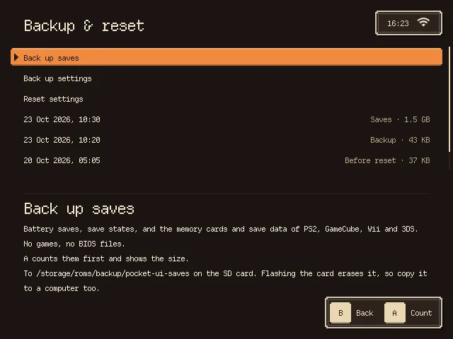

# Settings: Connections, System and Help & tools

The **Connections**, **System** and **Help & tools** sections of [Settings](settings.md): Wi-Fi, Bluetooth, Tailscale,
SSH, Sync, Pocket Sync, Web companion, PC streaming, updates, language, sleep and power, battery, clock, storage,
backups, Kids mode, this guide, Tour, tools and About. For Look and how Settings opens, see
[Settings](settings.md#open-settings).

## Connections

Settings → **Connections** gathers every wireless feature, controller pairing and remote service in one place.

Wi-Fi always stays in sync with Quick settings: when the radio is off, old scan results hide and the first row switches
Wi-Fi back on with A. On handhelds without Wi-Fi (such as the experimental Anbernic RG28XX and RG35XX 2024), the page
plainly states "This device has no Wi-Fi".

| Entry | What it holds |
|---|---|
| **Wi-Fi** | Join networks, switch or forget saved networks, connect to hidden SSIDs and set your Wi-Fi country. See [Getting started](getting-started.md#4-connect-to-wi-fi) |
| **Bluetooth** | Pair controllers, headphones and speakers and check live connections. See [Bluetooth](bluetooth.md) |
| **Tailscale** | Connect your Pocket to your private Tailscale network from anywhere. See [Tailscale](remote.md) |
| **Remote access (SSH)** | Turn on temporary SSH login from a computer. See [Remote access](#remote-access-ssh) |
| **Sync** | Sync saves, save states (and optionally favourites, notes and play history) via Syncthing. See [Sync](sync.md) |
| **Pocket Sync** | Sync saves directly between your Pockets using a 6-digit code, with no PC, account or cloud. Off by default. See [Your other Pockets](sync.md#your-other-pockets) |
| **Web companion** | Browse your library, check play time and upload games from a phone or PC browser over home Wi-Fi or Tailscale. Off by default. See [Web companion](web-companion.md) |
| **PC streaming** | Pair a gaming PC for Moonlight and launch PC games straight from your Pocket. See [PC streaming](pc-streaming.md) |

Devices that don't support Sync or PC streaming omit those rows (for example, the TrimUI Brick has no PC streaming).

### Tailscale

Settings → Connections → **Tailscale** puts your Pocket on your private Tailscale network so your phone, PC and Pocket
can reach each other over any Wi-Fi, hotspot or mobile data. Full guide: [Tailscale](remote.md).

1. Highlight **Tailscale** and press A to turn it on (stays on across reboots until you switch it off).
2. Highlight **Sign in** and press A for a QR code. Scan it on your phone and approve the Pocket, and the page updates to
   **Connected as** your tailnet with your Pocket's Tailscale IP and hostname.
3. Also offers **Sign in with a key** (for Tailscale admin auth keys), **Name** (sets your tailnet hostname) and
   **Log out** (asks twice).

Tailscale only builds the tunnel; enable Remote access (SSH) as well if you want SSH login over it.

### Remote access (SSH)

Settings → Connections → **Remote access (SSH)** starts **Off** by default and automatically turns back off on reboot:

1. Press A ("Turn on remote access") to view `ssh root@<address>`, username and your Pocket's unique password.
2. Connect from your computer with those details (the password stays consistent for this Pocket).
3. Press A again to turn it off, or reboot.

Handy for copying files or grabbing logs, though not needed for everyday gaming. See
[SECURITY-HARDENING.md](../SECURITY-HARDENING.md) for security details.

### Sync and PC streaming

Settings → Connections → **Sync** sets up Syncthing for saves, states and optional library data ([Sync](sync.md)).
Settings → Connections → **PC streaming** pairs Moonlight with your gaming PC ([PC streaming](pc-streaming.md)). *(Both
previously lived under Help & tools → For tinkerers.)*

## System

Settings → **System** covers updates, language, sleep/power, battery stats, clock, storage, backups and Kids mode.

| Entry | What it holds |
|---|---|
| **Back to EmulationStation** | pocket-ui beta for dArkOS only ([DARKOS.md](../DARKOS.md)): closes pocket-ui immediately and returns to dArkOS's own menu with no extra prompt (saving and closing any running game first). Also in Quick settings; holding SELECT + START still opens its dialog |
| **Updates** | Download and install pocket-ui updates over Wi-Fi or from your SD card. See [Updates](updates.md) |
| **Language** | Switch menus, hints and notices between **English**, **Deutsch**, **Español**, **Português (Brasil)**, **Français**, **Italiano** and **한국어**. See [Language](language.md) |
| **View** | pocket-ui for Android only: flip between **Handheld** (controller-first shelf) and **Mobile** (touch-first view). First start opens Handheld; your chosen view is remembered |
| **Sleep & power** | Screen-off timeout, sleep timer, auto-power-off after sleeping and Power button actions (shows current screen-off time, e.g. "2 min"). See [Sleep & power](#sleep--power) |
| **Battery** | Live charge, runtime estimate, 48-hour graph and per-console battery draw. See [Battery](#battery) |
| **Time** | Time zone search, network time sync and manual clock setup. See [Time](#time) |
| **Storage** | Space breakdown across games, saves, states, art and hidden games (shows free space, e.g. "41.2 GB free"). See [Storage](storage.md) |
| **Backup & reset** | Back up or restore saves and settings to your SD card, or reset settings to defaults. See [Backup & reset](#backup--reset) |
| **Kids mode** | Curated, PIN-locked shelf for kids with daily play limits and max volume. See [Kids mode](kids-mode.md) |

### Time

Settings → System → **Time**:

- **Time zone:** browse by region and city (showing UTC offset and local time) or search with the on-screen keyboard in
  any supported language ("wien", "viena" and "vienna" all match Vienna, with or without accents).
- Changing your zone updates every clock immediately, including Home's top-right corner ([Home](playing.md#home)).
- **Network time:** shows whether Wi-Fi clock sync succeeded; press A to sync again.
- **Date and time:** lets you set the clock manually on offline handhelds. Press A for five fields (year, month, day,
  hour, minute on a 24-hour clock, with weekday underneath): Left/Right move fields, Up/Down adjust (hold to scroll), A
  saves, B cancels (touch taps work too). Automatically respects month lengths and leap years. Persists across reboots
  (tells you if hardware can't hold time). Network time stays active and takes over once you reconnect. While synced, the
  row shows **From network time**.
- **Wrong-clock alert:** if the clock falls before 2026 or before your pocket-ui build date (common after a flat
  battery), an orange note warns you, since Play history, Night light and save timestamps depend on it. Set it manually
  (Date and time pre-fills the build date to save scrolling) or join Wi-Fi. Offline handhelds with a plausible clock show
  a gentler note ("it may be a little off") until set manually, and Home shows a one-time notice ~45 seconds after boot
  if the clock is clearly wrong.
- Adjusting the clock never inflates play time: active game timers run independently, and an already-running session
  keeps its original start date.

### Sleep & power

Settings → System → **Sleep & power** configures Screen off after, Sleep after, Switch off after sleeping, and Power
button short press / hold. Full table and behaviour: [Sleep & power settings](quick-settings.md#sleep--power-settings).

On experimental Pocket 6 and Nova, Screen off replaces Sleep and ROCKNIX manages the fan; see
[Other Retroid devices](other-handhelds.md#other-retroid-devices).

### Battery

Settings → System → **Battery** shows your current charge, estimated runtime, 48-hour chart and per-console power draw:

- **Time left:** shows "About 3 h 20 min left" on battery, "Full in about 45 min" while charging, or "Plugged in" when
  connected below 95% without charging, along with the recent drain rate ("At the current rate: 15% an hour, measured
  over the last 40 min"). Weighted toward the most recent 20 to 90 minutes of awake battery use (needs 20 minutes after boot
  or wake, ~6 minutes while charging; resets on sudden fuel-gauge jumps).
- **Graph:** opens on the last 24 hours; switch between 3, 6, 12, 24 and 48 hours with L1/R1. Charging shows in green;
  sleep or powered-off stretches appear hatched.
- **Live stats & console draw:** voltage, current, wattage and battery temperature, plus per-system estimates once
  you've logged 15+ minutes on battery ("PS2 uses about 9% an hour, 3.6 W" and estimated runtime).
- Sleep timers now live under Settings → System → [Sleep & power](#sleep--power) (linked below the graph).

pocket-ui samples battery once a minute while running and stores 48 hours in `battery-history.bin` (~46 kB) plus
per-game draw in `battery-games.json` for [Battery in this game](pause-menu.md#battery-in-this-game). Data flushes every
10 minutes and on sleep/shutdown/exit (a sudden power cut can lose up to 10 minutes; damaged files auto-recover from
backup or start fresh).

### Backup & reset

Settings → System → **Backup & reset**:

- **Back up saves:** copies battery saves, save states (all of `savestates` plus states beside ROMs), PS2/GameCube
  memory cards, Wii/3DS saves and ScummVM saves into a timestamped folder under `/storage/roms/backup/pocket-ui-saves`
  (no ROMs or BIOS files). First A calculates size vs free space; second A copies while you stay on the page (B cancels
  cleanly without leftovers). Refuses to start if space is too tight.
- **Before re-flashing your OS card:** flashing wipes internal backups too (unless your games live on TF2). Copy
  `backup/pocket-ui-saves` off over File sharing to your PC first, then copy it back afterwards to restore.
- **Restoring saves:** press A on any **Saves** backup to preview changes, then A again to restore. Missing saves return;
  older files on the card are safely copied into a **Before restore** backup before updating; newer files on the card
  stay untouched while the backup keeps its copy. No restart needed.
- **Back up settings:** saves pocket-ui settings, Options pages and library metadata (statuses, notes, play time,
  favourites, recents) to `/storage/roms/backup/pocket-ui` (`backup/pocket-ui` over File sharing). Excludes ROMs, saves,
  File sharing passwords and RetroAchievements tokens.
- Existing backups list newest first (saves above settings) tagged **Backup**, **Before reset** or **Before restore**
  with size. Press A twice on a settings backup to restore (automatically backing up your current config first so it's
  reversible).
- **Reset settings** (press A twice): resets layout, appearance, motion, sounds, haptics, LEDs, sleep, Performance &
  fan, Curator and all console/game Options back to defaults after taking a safety backup. Keeps library notes, Sync,
  Tailscale, accounts, downloaded extras and skips first-start setup.
- Settings restores and resets restart pocket-ui automatically within a few seconds.

ROCKNIX's own settings and standalone PS2/GameCube/Wii/3DS configs in `system.cfg` aren't included.

## Help & tools

Settings → **Help & tools** holds this manual, the Tour, setup profiles, ROCKNIX tools, bug reporting and system info.

| Entry | What it holds |
|---|---|
| **Manual** | Read this entire guide right on your handheld. See [Manual](#manual) |
| **Tour** | 7 quick cards covering controls, Continue, saves, Quick settings, adding games, Settings and Big text. See [Features and the Tour](tour.md) |
| **How you like to play** | One-click presets (The shelf, Easy, Enthusiast or Choose for yourself) for pocket-ui's extras. See [How you like to play](#how-you-like-to-play) |
| **First-start setup** | Re-run the welcome wizard (language, Wi-Fi on Linux, games, layout) without touching games, saves or settings. See [Getting started](getting-started.md#3-first-start) |
| **Tools** | Launch ROCKNIX utilities: emulator menus, RetroArch, gamepad test/calibration, file manager, terminal and installed tools. See [Tools](#tools) |
| **Report a problem** | Jumps to About with Report a problem highlighted; press A to save a diagnostic bundle into `reports` on the games share ([Report a problem](troubleshooting.md#report-a-problem)). Also available from SELECT + START held |
| **About** | Version, base OS (e.g. "pocket-ui OS 0.7.1 · built on ROCKNIX 20261001 (SM8250)" on SD images, or ROCKNIX version on add-on installs), game count, free space, IP, battery, log paths and open-source licences (`/storage/pocket-ui/licences`). Marks experimental Retroid models ([Other handhelds](other-handhelds.md#other-retroid-devices)). Includes **Report a problem** and **Open EmulationStation…** (with warning, [Safe mode](safe-mode.md#opening-rocknixs-own-menu); omitted on TrimUI Brick) |

### How you like to play

Sets all optional extras in one go (first start leaves stock defaults untouched so you can get playing fast). Pick with
Up/Down, press A to apply, and check the live summary below. See [Features and the Tour](tour.md) for every card.

- **The shelf:** *"Your games on a shelf, as it comes."* Clean defaults: Motion On; Lens & smart shelves, Echoes,
  Versions, Pixel Path, Echoes beyond this device, Screen frames and On start → Last game all Off (with Just Play ready
  on Home). Picking this later restores all defaults.
- **Easy:** same defaults paired with the [Easy](easy.md) layout.
- **Enthusiast:** *"Suggestions, play statistics, picture details and frames, all on."* Enables all of Curator, Pixel
  Path in the pause menu (overlay stays Off), Auto screen frames on every console and On start → Last game.
- **Choose for yourself:** walks through one preview card per feature with **On**, **Off** and **Later** (Up/Down + A,
  B goes back, START skips the rest).

Every toggle stays editable individually in Settings afterwards. Menu sounds, haptics and stick LEDs are left untouched.
For kids, use Settings → System → [Kids mode](kids-mode.md).

### Manual

Settings → Help & tools → **Manual** bundles this guide directly inside pocket-ui so it always matches your installed
version.

| Button | What it does |
|---|---|
| D-pad Up / Down, or either stick | Scroll (hold for smooth scrolling; sticks scale speed with tilt). |
| D-pad Left / Right | Page up / page down. |
| L1 / R1 | Previous / next page (wraps around). |
| A, X | Open the highlighted link (A) or hop to the next link on screen (X). |
| B | Go back to the previous linked page, or exit to Settings. |

Swiping scrolls on touchscreens, and every page remembers your scroll spot until restart. Button names render as inline
chips, screenshots are omitted, internal links open right inside the manual and web links print their URL. On
first-start screens, press SELECT to open the manual and B to return.

### Tools

Settings → Help & tools → **Tools** launches ROCKNIX's built-in utilities (emulator menus, RetroArch, gamepad test and
calibration, file manager, terminal) plus tools installed via package managers. Full list: [Tools](extras.md#tools).
