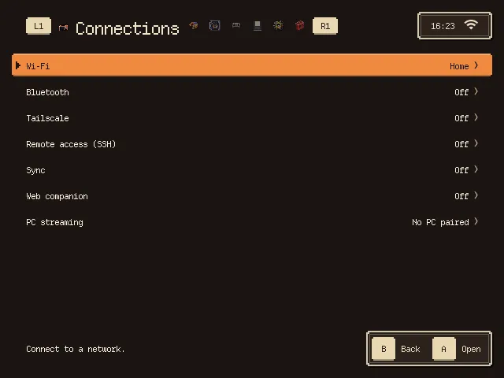

# Settings

## Open Settings

Press **START** on Home or in a system's game list. Settings is not an entry of the list. Settings opens straight on the
entries of its first category, Connections, with their values on the right and the selected entry's line at the bottom.
At the top the eight categories stand as small symbols in a row, the one you are in named beside its symbol, with **L1**
and **R1** at the ends: L1 and R1 go to the previous and the next category (round at the ends), each opening on its
first entry; a tap on a symbol goes to it. Without the shoulder buttons: **Up** on the first entry moves to the symbols,
**Left/Right** there change the category (the entries under them change with it), and **Down** or **A** goes back into
the entries. Up/Down move, A opens an entry (or switches it), and B comes back to where you were in one press. The symbols stay in the same place on every category: a long name is
shortened there ("Screen" for Screen & sound, "Help" for Help & tools), and where even that doesn't fit beside the
clock (large text in German, the TrimUI Brick), every category's name stands on its own line with the symbols in a slim
line under it.
The values ("Home" on Wi-Fi, "Shelf · Dark" on Look, "Auto · Quiet" on Performance & fan: what games run with)
are short; one that is looked up comes a moment later. An entry that opens a page ends in an arrow **›** on every row;
one without it changes right in the list: Appearance, Colours, Style, Text size, Motion, Screen frames, every On/Off
and the like change with Left/Right (or A), and the selected one shows **‹ ›** round its value. The hint at the
bottom says **A Open** or **‹ › Change**.

| Category | What is in it |
|---|---|
| **Connections** | Wi-Fi, Bluetooth, Tailscale, Remote access (SSH), Sync, Pocket Sync, Web companion, PC streaming. See [Connections](settings-system.md#connections) |
| **Look** | Layout, Appearance, Colours, Style, Text size, Motion, Game start animation, Cozy extras, Lived-in shelf. See [Look](#look) |
| **Screen & sound** | Brightness, Volume, Screen colour, Night light, Menu sounds, Case sounds, Photos of big moments. See [Screen & sound](settings-sound.md#screen--sound) |
| **Controls** | Buttons, Controller setup, Test buttons, Haptics, LEDs. See [Controls](settings-sound.md#controls) |
| **Playing** | On start, Continue where I quit, Console boot screen, Remind me where I was, Screen frames, Over the game, Zoom in the pause menu, Performance & fan, RetroAchievements. See [Playing](settings-playing.md#playing) |
| **Games** | Add games, Box art & downloads, Game check, Systems on the shelf, Shelf space, Curator, Screenshots, From EmulationStation, Android games (Android only), RomM. See [Games](settings-playing.md#games) |
| **System** | Back to EmulationStation (dArkOS only), Updates, Language, View (Android only), Sleep & power, Battery, Time, Storage, Backup & reset, Kids mode. See [System](settings-system.md#system) |
| **Help & tools** | Manual, Tour, How you like to play, First-start setup, Tools, Report a problem, About. See [Help & tools](settings-system.md#help--tools) |

Every entry is in one category only, and no entry opens a list of more entries: a page opens from an entry only for a
step of its own (choosing a network, a password, a QR code, a list to look through).
**Screen & sound** (brightness, volume, the screen's colour, the menu sounds) and **Controls** (the buttons, the
controllers and what you feel) share a page of their own: [Settings: Screen & sound, Controls](settings-sound.md). Connections, System and Help & tools are on
[Settings: Connections, System and Help & tools](settings-system.md).

A page that opens from somewhere else (a hint, a feature card, the pause menu) goes back with B to its category's
list, as if you had opened it from Settings. In this guide a place in Settings is
written as its path: Settings → System → **Battery** is the Battery entry in the System category.

The first start's pages (Wi-Fi, Add games, the look) are the same pages. Opened from Settings, B returns to the
category's list instead of moving on. The first start's time zone has no page of its own here: Settings → System →
**Time** does the same job. Settings → Help & tools → **First-start setup** runs the whole first start again
([Getting started](getting-started.md#3-first-start)).

## Look

Settings → **Look**. How pocket-ui looks: first how your games stand (the layout), then the style (appearance, colours, type),
the reading aids (text size, zoom), what moves (motion, the game start) and the little touches you see. The screen's
brightness and colour are in [Screen & sound](settings-sound.md#screen--sound). Every choice has a row of its own.
Big text, Large text and Reduced motion together, is a card of the [Tour](tour.md) and a key of the first start.

| Entry | What it holds |
|---|---|
| **Layout** | How your games stand: Shelf, Easy, Split or Cabinet, each a live preview of your own shelf. See [Choose a look](#choose-a-look) |
| **Appearance** | **Dark** (the default), **Light** or **Automatic**. A or Left/Right switches it. See [Appearance](#appearance) |
| **Colours** | The colours of every page: Warm, Indigo Cube, Grey Brick, Green X or Blue Station; with the Retro style, Cocoa or Pea. A or Left/Right switches it. See [Colours and style](theme.md) |
| **Style** | Barlow type, or **Retro**: pixel letters, frames and icons everywhere, with its own colours and menu sounds; **Retro Pixelify** is Retro with Pixelify's rounder letters. A or Left/Right switches it. See [Colours and style](theme.md#style) |
| **Text size** | **Normal** (the default), **Medium** or **Large**: larger text on every screen, fewer rows on a page. A or Left/Right switches it. See [Text size](#text-size) |
| **Motion** | **Full** (the default), **Reduced** or **Off**: how much the menus move. A or Left/Right switches it. See [Motion](#motion) |
| **Game start animation** | **Cozy**: watch your game slide into the console, and after Quit come back out of it into its case, and the pages, the box and the menus move a little slower and softer. **Quick**: straight into the game, the animations as short as they get. A or Left/Right switches it. Cozy in the Shelf and Cabinet looks until you choose, Quick in the others. See [Game start animation](#game-start-animation) |
| **Cozy extras** | The little touches you see, each on or off on its own: the TV on the cabinet (and whether it plays a game you haven't played), stickers, printed discs, playful cases, the old-TV switch-on, the handheld switch-on, power lights, light by time of day, decorations, progress from your saves, game connections, Rediscover. See [Cozy extras](#cozy-extras) |
| **Lived-in shelf** | **Off** (starts off) or **On**: in the Shelf layout some cases of a row of games lean on their neighbour, a few lie on a small stack, and the spaces between them differ a little, like a shelf at home. A or Left/Right switches it. See [Lived-in shelf](#lived-in-shelf) |

### Choose a look

Settings → Look → **Layout** is the first start's last page ("How your games stand"): a scaled-down picture of your shelf in each look, drawn by
the shelf itself with a few of your systems and one game (with its box art when it has one; on an SD card without
games, a built-in set of "Sample game"s). It works like every list: Left/Right switch between the four looks, and the
shelf behind Settings takes the look at once. See [Playing](playing.md#looks) for what each look does. The
[appearance](#appearance), the [motion](#motion) and the [animations](#game-start-animation) are entries of their own in Settings,
not rows of this page. A keeps the look as shown; B ("Cancel") goes back to Settings and puts back the look you came with.

### Appearance

Settings → Look → **Appearance**; A or Left/Right switches it. It applies to every look.

- **Dark**, the default: black pages. On the Mini V2's OLED screen black pixels are off, so Dark uses the
  least battery.
- **Light**: warm paper pages with dark text, easier to read in daylight. Lit pixels use power, so Light uses more
  battery than Dark.
- **Automatic**: light from 07:00, dark from 20:00, by the clock of your time zone ([Time](settings-system.md#time)). It changes
  only after a few seconds in which nothing was pressed, with a short fade; during a game it changes unseen.

The choice is saved at once. The pause menu, the power menu and the small messages that appear over the screen
(volume, brightness, notices) stay dark in both, since they sit over the game's picture.

### Colours

Settings → Look → **Colours** switches the colour set in place; the whole screen shows it at once. See
[Colours and style](theme.md#colours).

### Style

Settings → Look → **Style** switches the type, or the whole Retro style, in place. See [Colours and style](theme.md#style).

### Text size

On small screens such as the Anbernic H700 handhelds, the shelf, game cards and menus keep their full layout,
scaled down to fit the screen. If the writing feels small, choose Medium or Large here.

Settings → Look → **Text size** makes the text larger on every screen. A or Right goes on to the next size,
Left back to the one before, and the screen shows the new size at once; the choice is saved at once and kept across restarts and updates.

- **Normal**, the default: the sizes pocket-ui is designed with.
- **Medium**: the text is about an eighth larger everywhere you read it, for when Normal is a little small and Large
  is more than you need. It changes the same things as Large, a step less.
- **Large**: the text is about a quarter larger everywhere you read it: the shelf and the game lists, Settings and
  its pages, the pause menu and its pages, the quick settings, the game card, Curator (the Lens, Echoes, Versions, play
  history), the search and its keyboard, the console pages, notices and this manual. The large titles (a pulled-out
  label's name, the big letter of a jump, the battery figure) are big enough already and stay as they are.

With Medium and Large the rows are taller, so a page shows fewer of them and scrolls a little sooner. A name or value that is
too long for its row ends with "…" and a long text is wrapped, never cut in the middle of a word; where a hint bar has no
room for every hint, whole hints give way (the least needed first; A, B, HOME and START last), never a button without its word. A few things keep their size because they
belong to a picture of a fixed size: the titles on the cases' spines and the shelf cards in the Cabinet look, the
pictures on the Tour's cards and the look previews' shrunken screens, and what is drawn over a running game by
pocket-core (the in-game messages and Pixel Path's line over the game).

The first start has **Big text** on every page (**L2**, and a row on its first page), so larger text is there from
the start.
Safe mode uses the size chosen here too.

### Motion

Settings → Look → **Motion**; A or Left/Right switches it (the first start keeps the default; its Big text,
L2, switches Reduced on with Large text).

- **Full**, the default: the selection glides to the row you move to, lists scroll smoothly, pages slide in,
  the game card rises out of its label, the hints and small messages fade.
- **Reduced**: only fades. Pages and messages still fade in, but nothing slides, grows or glides.
- **Off**: no animation at all; every press shows its result in the next frame.

Moving menus aim for up to 60 frames a second. Still pages rest until something changes.

None of them makes anything slower: a press changes what is selected or opened at once, whichever you choose,
and pressing again in the middle of a movement takes it straight to the new place. The choice is saved at once.

### Game start animation

Settings → Look → **Game start animation**. The first start doesn't ask: the look decides until you choose here.

- **Cozy**: when you start a game in the Shelf or the Cabinet look, you watch its case open and the cartridge or disc slide into the console
  (about a second, with a click). Pages, the game's box and the menus take about a third longer and ease in more softly.
- **Quick**: straight into the game; the animations as short as they get.

Until you choose, the look decides: Cozy for Shelf and Cabinet, Quick for Split. Once you choose, it stays
yours, whatever look you pick later. With Cozy, a game of pocket-core's is shown once the animation is over, so it starts
about a second later than with Quick (a game that needs longer to load is not held at all); any button skips the rest.
The shelf fades to black before the picture comes on like an old TV, in a third of a second: a bright line grows out of
the middle, and the picture opens out of it, squeezed at first. A handheld's game (Game Boy, GBA, DS, PSP) has no TV and
no tube: once the game is in, the console's power light comes on and its display lights up (a muted tone, nothing else gets bright),
the rest of the screen goes dark round it and the picture comes up out of the dark, a little sooner than the tube's would have. Continue follows the same order: an open case plays the whole scene too, its moment waiting, still, until the game is in; the saved picture behind a reminder stays visible
(with Motion on Full; Quick and Reduced skip it, and a button press cuts it short).
**Motion** (Reduced, Off) still overrides it: nothing slides where Motion says so.

After Quit, Cozy plays the way back in every look that puts games into consoles, including Easy and Kids Mode.
The shelf is already usable: any button or touch ends the effect and takes its usual action. A handheld display
goes dark; with Old-TV switch-on enabled a TV picture closes to a line and a dot. The cartridge or disc returns
to its case, which stays a little open when Continue waits. Quick and Motion Reduced or Off show the shelf at once.

### Lived-in shelf

Settings → Look → **Lived-in shelf** makes the Shelf layout's rows of games look like a shelf at home, calm and still easy
to read: now and then a case leans a few degrees on its neighbour, the last two or three of a long row (and in a long row
often a few in the middle) lie on a small stack with their spines to you, smaller cases on bigger ones, the spaces between
the cases differ a little and a few stand a little further back or forward. **Off** (the default): every case stands
straight, as before. A or Left/Right switches it; it takes effect at once and is kept across restarts.

It is the same at every start: each game's place and pose come from the game itself, so nothing moves while you scroll,
and a game you add only changes the row around it. It is in every row of games, Favourites included; Home's row of
systems and short rows (fewer than six games) stay straight, and a game whose case stands open (Continue waits) always
stands up. A row that fits on the shelf standing straight never has to scroll for a stack: it gets no stack then. Select
a leaning case and it comes out of the row as any other; select a lying one and it slides out of its stack sideways,
like a book, and stays on what it lay on. The leaning and lying cases are drawn ahead in the
moments after you open a row, so scrolling along it stays smooth.

### Cozy extras

Settings → Look → **Cozy extras** switches the little touches you see, one by one, for when you like some of them and
not others. Up/Down move, A (or Left/Right) switches the selected one **On** or **Off**; it takes effect at once and is
kept across restarts. The line under the list says what the selected one does and in which looks you see it. Reset
settings (System → Backup & reset) puts them back as they start. Playful cases and the old-TV switch-on and switch-off need the
[animations](#game-start-animation) or the [motion](#motion) to be seen; while one of those keeps them from showing, the line at
the bottom says which. Case sounds, the one you hear, is an entry of [Screen & sound](settings-sound.md#screen--sound), beside Menu sounds.

| Extra | What it does | Start |
|---|---|---|
| **TV on the cabinet** | A small old TV on top of the cabinet shows the selected game. Cabinet look only | On |
| **TV plays the game** | The TV on the cabinet shows a game you have never played running live, without sound, after you rest on it for two seconds, for 25 seconds at most ([The TV on the cabinet](playing.md#the-tv-on-the-cabinet)). It runs a second, hidden player, so the handheld works harder and the battery drains faster while it plays. Off: no second player is ever started and nothing extra runs; the TV shows its still picture as before. Cabinet look only | Off |
| **Stickers on cases** | Your stickers on the cases. Off hides them on the shelf and the box; they stay on the game and on its card's Stickers row. Shelf and Cabinet looks only | On |
| **Printed discs** | Discs printed with their cover's art and title. Off: a plain disc in its console's colour. Shelf and Cabinet looks only | On |
| **Playful cases** | Cases spring out and wiggle, each game goes into its console its own way, the open box's disc turns, spines lean as you scroll, stickers you put on are pressed onto the case in the game box ([Playing](playing.md#starting-a-game)). Shelf and Cabinet looks only, with Motion on Full | On with Cozy, Off with Quick |
| **Sealed new games** | A game you have never played stands in the shop's clear plastic wrap: on the shelf, in the cabinet, in Easy, on Split's box art and on its card, and the box's front and back. The first time you start it the wrap tears off with a rip (with Animations on Cozy and Motion on Full; otherwise it is simply gone), for good. A game counts as played when it has playing time, a status you chose, a save or state, a clock file, a memory card or known progress, or is in your recent games | On |
| **Old-TV switch-on** | The game's picture comes on like an old TV when it starts: a bright dot in the dark, a line, the empty blue channel with a moment of snow, then the game's picture comes through (under half a second; the game already runs). A handheld (Game Boy, GBA, DS, PSP …) switches on like a handheld instead: its power light and display come on in the console, then the picture comes up. In looks with the insertion animation, with Animations on Cozy and Motion on Full | On |
| **Old-TV switch-off** | After Quit a TV picture closes to a line and a dot that glows on a moment, like an old TV; a handheld's game just goes dark. Off: the way back starts from black. Shelf and Cabinet looks, with Animations on Cozy and Motion on Full | On |
| **Handheld switch-on** | A handheld's display switches on and off like the real one, over the game's first half second: the Game Boy's olive glass goes dark green and its picture rises out of it, the Game Boy Color's and the GBA's glass comes up from grey, the SP's front light glows on before its picture, the PSP's picture fades in softly, the Game Gear's and the Lynx's backlight flickers on, the DS's two screens light up. After Quit the Game Boy's picture sinks back into its green, the SP's front light drops at once, the Game Gear's backlight cuts out, the PSP fades to black. Off: the picture just comes up out of the dark and goes dark. Shelf and Cabinet looks, with Animations on Cozy and Motion on Full | On |
| **Power lights** | The power light of a handheld's screen frame in the game (Game Boy, Game Boy Color, GBA, SP, PSP, Game Gear, Lynx and the other handheld frames) does what the real one did: it shows your battery, and when the battery reaches the "Battery low" level (5 %) the Game Boy's red light dims, the GBA's and the SP's green light turns red, the PSP's blinks orange and the Game Gear's flashes red. When a moment is saved it blinks twice, briefly. Off: the light stays steadily on. Without a frame (Screen frames off or full screen) there is no light | On |
| **Light by time of day** | The room's light follows your Pocket's clock: cool and bright in the morning, warm in the evening with the lamp glowing, dim at night. Very gentle: covers and text keep their colours. Shelf and Cabinet looks only | On |
| **Evening TV glow** | After dark by your Pocket's clock, while the TV on the cabinet is on, the room dims a little and the TV's warm light falls on the boards and the cases near it. Gentle: covers and text stay readable. Cabinet look only | On |
| **Decorations** | Things on your shelves that grow with your play: the plant grows with your hours, a trophy after your first completed game, a framed "100 %" after your first 100 % sticker, a small figurine for each system you played for 10 hours. Only where a shelf has room. This works with Light by time of day on or off. Off: the shelves as they were. Shelf and Cabinet looks only | On |
| **Progress from saves** | Where you are, from your own save: on the box's back, beside Continue and on Where was I? ([details](library.md#where-you-are-in-the-game)). Off: no line anywhere and no save is read, so nothing is given away | On |
| **Game connections** | The developer, publisher, series and genre on the info page and the box's back lead to your other games with the same one ([Connections](library.md#connections)). Off: they are only shown | On |
| **Rediscover** | Games you haven't played for a long time, as a row in Curator's list | On |
| **GBA console** | **Game Boy Advance** or **Game Boy Advance SP**. Changes the GBA hardware picture everywhere, including the shelf, console page and cabinet. The SP opens before its cartridge slides into the bottom slot, label facing the underside. Up/Down reaches the row; A or Left/Right changes it and keeps the choice across restarts. Your games and emulator stay the same | Game Boy Advance |

#### Sealed new games

A game you have never played comes in the shop's clear plastic wrap, like a new one off the shelf, so your untouched games
look different from the ones you have played. The first time you start it, the wrap tears off with a rip (with
Animations on Cozy and Motion on Full; otherwise it is simply gone) and stays off for good, also if you never finish the game.
A game counts as played when it has playing time, a session, a status you chose or a place in your recent games,
or when a save, save state, clock file or memory card belongs to it, or pocket-ui knows its progress. Saves copied
from another device or frontend count too, even with no recent entry or measured time here. The shelf, box and
"Never played" lists use this same rule. A save without a timed session says "Not here yet" for its play time;
pocket-ui does not invent a duration or last-played date. "Where was I?" still needs a known date and a resumable moment.

#### Console colours

Some consoles come in more than one colour, as the real ones did: the **Game Boy Advance** (Original, Milky Blue, Pink), the
**Game Boy Color** (Original, Dandelion), the **Nintendo 64** (Original, Ice Blue, Jungle Green) and the **GameCube**
(Original, Jet Black). It is not a row here: on the console's page (X on the system) a line under the picture, like
**‹ Milky Blue ›**, names the colour, and **Left** and **Right** go to the next one and round again to the Original (a tap on
the left or right half of that line does the same). The colour shows everywhere: the console on the shelf, its page, the
cabinet's TV, and the moment a game goes into it and comes out again. It is kept across restarts. The Advance SP (GBA console
above) has its own picture. A colour a later version does not know yet shows the Original.
