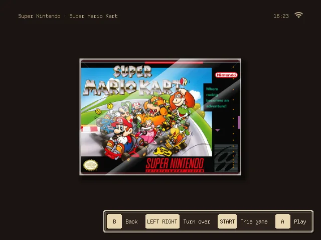

# Settings

## Open Settings

Press **START** on Home or in a system's game list. Settings is not an entry of the list. Settings opens straight on the
entries of its first category, Connections, with their values on the right and the selected entry's line at the bottom.
At the top the eight categories stand as small symbols in a row, the one you are in named beside its symbol, with **L1**
and **R1** at the ends: L1 and R1 go to the previous and the next category (round at the ends), each opening on its
first entry; a tap on a symbol goes to it. Without the shoulder buttons: **Up** on the first entry moves to the symbols,
**Left/Right** there change the category (the entries under them change with it), and **Down** or **A** goes back into
the entries. Up/Down move, A opens an entry (or switches it), and B comes back to where you were in one press. The symbols stay in the same place on every category: a long name is
shortened there ("Screen" for Screen & sound, "Help" for Help & tools), and where even that doesn't fit beside the
clock (large text in German, the TrimUI Brick), every category's name stands on its own line with the symbols in a slim
line under it.
The values ("Home" on Wi-Fi, "Shelf · Dark" on Look, "Auto · Quiet" on Performance & fan: what games run with)
are short; one that is looked up comes a moment later. An entry that opens a page ends in a small arrow **>**; one
without it is a switch: Appearance, Colours, Style, Text size, Motion, Screen frames and the like change with A or
Left/Right, right in the list, and the selected one shows **‹ ›** round its value. The hint at the bottom says
**A Open** or **A Change**.

| Category | What is in it |
|---|---|
| **Connections** | Wi-Fi, Bluetooth, Tailscale, Remote access (SSH), Sync, Web companion, PC streaming. See [Connections](settings-system.md#connections) |
| **Look** | Layout, Appearance, Colours, Style, Text size, Zoom in the pause menu, Motion, Game start animation, Cozy extras. See [Look](#look) |
| **Screen & sound** | Brightness, Volume, Screen colour, Night light, Menu sounds, Case sounds. See [Screen & sound](settings-sound.md#screen--sound) |
| **Controls** | Buttons, Controller setup, Test buttons, Haptics, LEDs. See [Controls](settings-sound.md#controls) |
| **Playing** | On start, Continue where I quit, Console boot screen, Remind me where I was, Screen frames, Over the game, Performance & fan, RetroAchievements. See [Playing](#playing) |
| **Games** | Add games, Box art & downloads, Game check, Systems on the shelf, Curator, Screenshots, From EmulationStation. See [Games](#games) |
| **System** | Back to EmulationStation (dArkOS only), Updates, Language, View (Android only), Sleep & power, Battery, Time, Storage, Backup & reset, Kids mode. See [System](settings-system.md#system) |
| **Help & tools** | Manual, Tour, How you like to play, First-start setup, Tools, Report a problem, About. See [Help & tools](settings-system.md#help--tools) |

Every entry is in one category only, and no entry opens a list of more entries: a page opens from an entry only for a
step of its own (choosing a network, a password, a QR code, a list to look through).
**Screen & sound** (brightness, volume, the screen's colour, the menu sounds) and **Controls** (the buttons, the
controllers and what you feel) share a page of their own: [Settings: Screen & sound, Controls](settings-sound.md). Connections, System and Help & tools are on
[Settings: Connections, System and Help & tools](settings-system.md).

A page that opens from somewhere else (a hint, a feature card, the pause menu) goes back with B to its category's
list, as if you had opened it from Settings. In this guide a place in Settings is
written as its path: Settings → System → **Battery** is the Battery entry in the System category.

The first start's pages (Wi-Fi, Add games, the look) are the same pages. Opened from Settings, B returns to the
category's list instead of moving on. The first start's time zone has no page of its own here: Settings → System →
**Time** does the same job. Settings → Help & tools → **First-start setup** runs the whole first start again
([Getting started](getting-started.md#3-first-start)).

## Look

Settings → **Look**. How pocket-ui looks: first how your games stand (the layout), then the style (appearance, colours, type),
the reading aids (text size, zoom), what moves (motion, the game start) and the little touches you see. The screen's
brightness and colour are in [Screen & sound](settings-sound.md#screen--sound). Every choice has a row of its own.
Big text, Large text and Reduced motion together, is a card of the [Tour](tour.md) and a key of the first start.

| Entry | What it holds |
|---|---|
| **Layout** | How your games stand: Shelf, Easy, Split or Cabinet, each a live preview of your own shelf. See [Choose a look](#choose-a-look) |
| **Appearance** | **Dark** (the default), **Light** or **Automatic**. A or Left/Right switches it. See [Appearance](#appearance) |
| **Colours** | The colours of every page: Warm, Indigo Cube, Grey Brick, Green X or Blue Station; with the Retro style, Cocoa or Pea. A or Left/Right switches it. See [Colours and style](theme.md) |
| **Style** | Barlow type, or **Retro**: pixel letters, frames and icons everywhere, with its own colours and menu sounds; **Retro Pixelify** is Retro with Pixelify's rounder letters. A or Left/Right switches it. See [Colours and style](theme.md#style) |
| **Text size** | **Normal** (the default), **Medium** or **Large**: larger text on every screen, fewer rows on a page. A or Left/Right switches it. See [Text size](#text-size) |
| **Zoom in the pause menu** | Whether the pause menu's first page lists Zoom: **Off** (the default) or **On**. Zoom is always under Options, and listed here too while Big text is on. A switches it. See [Zoom in the pause menu](#zoom-in-the-pause-menu) |
| **Motion** | **Full** (the default), **Reduced** or **Off**: how much the menus move. A or Left/Right switches it. See [Motion](#motion) |
| **Game start animation** | **Cozy**: watch your game slide into the console, and after Quit come back out of it into its case, and the pages, the box and the menus move a little slower and softer. **Quick**: straight into the game, the animations as short as they get. A or Left/Right switches it. Cozy in the Shelf and Cabinet looks until you choose, Quick in the others. See [Game start animation](#game-start-animation) |
| **Cozy extras** | The little touches you see, each on or off on its own: the TV on the cabinet (and whether it plays a game you haven't played), stickers, printed discs, playful cases, the old-TV switch-on, light by time of day, decorations, progress from your saves, game connections, Rediscover. See [Cozy extras](#cozy-extras) |

### Choose a look

Settings → Look → **Layout** is the first start's last page ("How your games stand"): a scaled-down picture of your shelf in each look, drawn by
the shelf itself with a few of your systems and one game (with its box art when it has one; on an SD card without
games, a built-in set of "Sample game"s). It works like every list: Left/Right switch between the four looks, and the
shelf behind Settings takes the look at once. See [Playing](playing.md#looks) for what each look does. The
[appearance](#appearance), the [motion](#motion) and the [animations](#game-start-animation) are entries of their own in Settings,
not rows of this page. A keeps the look as shown; B ("Cancel") goes back to Settings and puts back the look you came with.

### Appearance

Settings → Look → **Appearance**; A or Left/Right switches it. It applies to every look.

- **Dark**, the default: black pages. On the Mini V2's OLED screen black pixels are off, so Dark uses the
  least battery.
- **Light**: warm paper pages with dark text, easier to read in daylight. Lit pixels use power, so Light uses more
  battery than Dark.
- **Automatic**: light from 07:00, dark from 20:00, by the clock of your time zone ([Time](settings-system.md#time)). It changes
  only after a few seconds in which nothing was pressed, with a short fade; during a game it changes unseen.

The choice is saved at once. The pause menu, the power menu and the small messages that appear over the screen
(volume, brightness, notices) stay dark in both, since they sit over the game's picture.

### Colours

Settings → Look → **Colours** switches the colour set in place; the whole screen shows it at once. See
[Colours and style](theme.md#colours).

### Style

Settings → Look → **Style** switches the type, or the whole Retro style, in place. See [Colours and style](theme.md#style).

### Text size

On small screens such as the Anbernic H700 handhelds, the shelf, game cards and menus keep their full layout,
scaled down to fit the screen. If the writing feels small, choose Medium or Large here.

Settings → Look → **Text size** makes the text larger on every screen. A or Right goes on to the next size,
Left back to the one before, and the screen shows the new size at once; the choice is saved at once and kept across restarts and updates.

- **Normal**, the default: the sizes pocket-ui is designed with.
- **Medium**: the text is about an eighth larger everywhere you read it, for when Normal is a little small and Large
  is more than you need. It changes the same things as Large, a step less.
- **Large**: the text is about a quarter larger everywhere you read it: the shelf and the game lists, Settings and
  its pages, the pause menu and its pages, the quick settings, the game card, Curator (the Lens, Echoes, Versions, play
  history), the search and its keyboard, the console pages, notices and this manual. The large titles (a pulled-out
  label's name, the big letter of a jump, the battery figure) are big enough already and stay as they are.

With Medium and Large the rows are taller, so a page shows fewer of them and scrolls a little sooner. A name or value that is
too long for its row ends with "…" and a long text is wrapped, never cut in the middle of a word; where a hint bar has no
room for every hint, whole hints give way (the least needed first; A, B, HOME and START last), never a button without its word. A few things keep their size because they
belong to a picture of a fixed size: the titles on the cases' spines and the shelf cards in the Cabinet look, the
pictures on the Tour's cards and the look previews' shrunken screens, and what is drawn over a running game by
pocket-core (the in-game messages and Pixel Path's line over the game).

The first start has **Big text** on every page (**L2**, and a row on its first page), so larger text is there from
the start.
Safe mode uses the size chosen here too.

### Zoom in the pause menu

Settings → Look → **Zoom in the pause menu**: the [pause menu](pause-menu.md) on pocket-ui's own host lists **Zoom** before
Quit. **Off** is the default, because the magnifier is a help for small text and most players never need it: then Zoom is a
row of Options, next to Picture and Controls, and can be a [shortcut](options.md#shortcuts) (HOME + X). While
[Big text](big-text.md#big-text) is on, the row is on the first page whatever this switch says. A switches it.
See [Zoom](big-text.md#zoom).

### Motion

Settings → Look → **Motion**; A or Left/Right switches it (the first start keeps the default; its Big text,
L2, switches Reduced on with Large text).

- **Full**, the default: the selection glides to the row you move to, lists scroll smoothly, pages slide in,
  the game card rises out of its label, the hints and small messages fade.
- **Reduced**: only fades. Pages and messages still fade in, but nothing slides, grows or glides.
- **Off**: no animation at all; every press shows its result in the next frame.

Moving menus aim for up to 60 frames a second. Still pages rest until something changes.

None of them makes anything slower: a press changes what is selected or opened at once, whichever you choose,
and pressing again in the middle of a movement takes it straight to the new place. The choice is saved at once.

### Game start animation

Settings → Look → **Game start animation**. The first start doesn't ask: the look decides until you choose here.

- **Cozy**: when you start a game in the Shelf or the Cabinet look, you watch its case open and the cartridge or disc slide into the console
  (about a second, with a click). Pages, the game's box and the menus take about a third longer and ease in more softly.
- **Quick**: straight into the game; the animations as short as they get.

Until you choose, the look decides: Cozy for Shelf and Cabinet, Quick for Split. Once you choose, it stays
yours, whatever look you pick later. With Cozy, a game of pocket-core's is shown once the animation is over, so it starts
about a second later than with Quick (a game that needs longer to load is not held at all); any button skips the rest.
The shelf fades to black before the picture comes on like an old TV, in a third of a second: a bright line grows out of
the middle, and the picture opens out of it, squeezed at first. A handheld's game (Game Boy, GBA, DS, PSP) has no TV and
no tube: once the game is in, the console's power light comes on and its display lights up (a muted tone, nothing else gets bright),
the rest of the screen goes dark round it and the picture comes up out of the dark, a little sooner than the tube's would have. Continue follows the same order: an open case plays the whole scene too, its moment waiting, still, until the game is in; the saved picture behind a reminder stays visible
(with Motion on Full; Quick and Reduced skip it, and a button press cuts it short).
**Motion** (Reduced, Off) still overrides it: nothing slides where Motion says so.

After Quit, Cozy plays the way back in every look that puts games into consoles, including Easy and Kids Mode.
The shelf is already usable: any button or touch ends the effect and takes its usual action. A handheld display
goes dark; with Old-TV switch-on enabled a TV picture closes to a line and a dot. The cartridge or disc returns
to its case, which stays a little open when Continue waits. Quick and Motion Reduced or Off show the shelf at once.

### Cozy extras

Settings → Look → **Cozy extras** switches the little touches you see, one by one, for when you like some of them and
not others. Up/Down move, A (or Left/Right) switches the selected one **On** or **Off**; it takes effect at once and is
kept across restarts. The line under the list says what the selected one does and in which looks you see it. Reset
settings (System → Backup & reset) puts them back as they start. Playful cases and Old-TV switch-on need the
[animations](#game-start-animation) or the [motion](#motion) to be seen; while one of those keeps them from showing, the line at
the bottom says which. Case sounds, the one you hear, is an entry of [Screen & sound](settings-sound.md#screen--sound), beside Menu sounds.

| Extra | What it does | Start |
|---|---|---|
| **TV on the cabinet** | A small old TV on top of the cabinet shows the selected game. Cabinet look only | On |
| **TV plays the game** | The TV on the cabinet shows a game you have never played running live, without sound, after you rest on it for two seconds, for 25 seconds at most ([The TV on the cabinet](playing.md#the-tv-on-the-cabinet)). It runs a second, hidden player, so the handheld works harder and the battery drains faster while it plays. Off: no second player is ever started and nothing extra runs; the TV shows its still picture as before. Cabinet look only | Off |
| **Stickers on cases** | Your stickers on the cases. Off hides them on the shelf and the box; they stay on the game and on its card's Stickers row. Shelf and Cabinet looks only | On |
| **Printed discs** | Discs printed with their cover's art and title. Off: a plain disc in its console's colour. Shelf and Cabinet looks only | On |
| **Playful cases** | Cases spring out and wiggle, each game goes into its console its own way, the open box's disc turns, spines lean as you scroll, stickers you put on are pressed onto the case in the game box ([Playing](playing.md#starting-a-game)). Shelf and Cabinet looks only, with Motion on Full | On with Cozy, Off with Quick |
| **Sealed new games** | A game you have never played stands in the shop's clear plastic wrap: on the shelf, in the cabinet, in Easy, on Split's box art and on its card, and the box's front and back. The first time you start it the wrap tears off with a rip (with Animations on Cozy and Motion on Full; otherwise it is simply gone), for good. A game counts as played when it has playing time, a status you chose, a save or state, a clock file, a memory card or known progress, or is in your recent games | On |
| **Old-TV switch-on** | The game's picture comes on like an old TV when it starts, and goes off like one (to a line and a dot) after Quit. A handheld (Game Boy, GBA, DS, PSP …) switches on like a handheld instead: its power light and display come on in the console, then the picture comes up; after Quit its game just goes dark. In looks with the insertion animation, with Animations on Cozy and Motion on Full | On |
| **Light by time of day** | The room's light follows your Pocket's clock: cool and bright in the morning, warm in the evening with the lamp glowing, dim at night. Very gentle: covers and text keep their colours. Shelf and Cabinet looks only | On |
| **Decorations** | Things on your shelves that grow with your play: the plant grows with your hours, a trophy after your first completed game, a framed "100 %" after your first 100 % sticker, a small figurine for each system you played for 10 hours. Only where a shelf has room. This works with Light by time of day on or off. Off: the shelves as they were. Shelf and Cabinet looks only | On |
| **Progress from saves** | Where you are, from your own save: on the box's back, beside Continue and on Where was I? ([details](library.md#where-you-are-in-the-game)). Off: no line anywhere and no save is read, so nothing is given away | On |
| **Game connections** | The developer, publisher, series and genre on the info page and the box's back lead to your other games with the same one ([Connections](library.md#connections)). Off: they are only shown | On |
| **Rediscover** | Games you haven't played for a long time, as a row in Curator's list | On |
| **GBA console** | **Game Boy Advance** or **Game Boy Advance SP**. Changes the GBA hardware picture everywhere, including the shelf, console page and cabinet. The SP opens before its cartridge slides into the bottom slot, label facing the underside. Up/Down reaches the row; A or Left/Right changes it and keeps the choice across restarts. Your games and emulator stay the same | Game Boy Advance |

#### Sealed new games

A game you have never played comes in the shop's clear plastic wrap, like a new one off the shelf, so your untouched games
look different from the ones you have played. The first time you start it, the wrap tears off with a rip (with
Animations on Cozy and Motion on Full; otherwise it is simply gone) and stays off for good, also if you never finish the game.
A game counts as played when it has playing time, a session, a status you chose or a place in your recent games,
or when a save, save state, clock file or memory card belongs to it, or pocket-ui knows its progress. Saves copied
from another device or frontend count too, even with no recent entry or measured time here. The shelf, box and
"Never played" lists use this same rule. A save without a timed session says "Not here yet" for its play time;
pocket-ui does not invent a duration or last-played date. "Where was I?" still needs a known date and a resumable moment.

#### Console colours

Some consoles come in more than one colour, as the real ones did: the **Game Boy Advance** (Original, Milky Blue, Pink), the
**Game Boy Color** (Original, Dandelion), the **Nintendo 64** (Original, Ice Blue, Jungle Green) and the **GameCube**
(Original, Jet Black). It is not a row here: on the console's page (X on the system) a line under the picture, like
**‹ Milky Blue ›**, names the colour, and **Left** and **Right** go to the next one and round again to the Original (a tap on
the left or right half of that line does the same). The colour shows everywhere: the console on the shelf, its page, the
cabinet's TV, and the moment a game goes into it and comes out again. It is kept across restarts. The Advance SP (GBA console
above) has its own picture. A colour a later version does not know yet shows the Original.

## Playing

Settings → **Playing**. What happens when you start and quit, how a game goes in and what is drawn over it, how fast games run, and achievements.

| Entry | What it holds |
|---|---|
| **On start** | What you see when the Pocket starts: **Home** (the default) or **Last game**, straight back into the game you played last. A or Left/Right switches it. See [On start](#on-start) |
| **Continue where I quit** | Whether the pause menu's Quit keeps the moment you are at for the next start: **On** (the default) or **Off**, only the game's own saves. A switches it. See [Continue where I quit](#continue-where-i-quit) |
| **Console boot screen** | Whether a fresh start of a Game Boy, Game Boy Color, Game Boy Advance or PlayStation game runs through the console's own boot screen (needs your own BIOS file): **Off** (the default) or **On**. A switches it. See [Console boot screen](#console-boot-screen) |
| **Remind me where I was** | Back to a game after more than two weeks: when you played it last and your note, while its moment loads. **Off** (the default) or **On**. A switches it. See [Remind me where I was](#remind-me-where-i-was) |
| **Screen frames** | Where a game gets a frame when you haven't chosen one: **Off** (the default), **Handhelds** or **Every console**. A or Left/Right switches it. See [Screen frames](#screen-frames) |
| **Over the game** | The frame rate, the sensors or (with Pixel Path in the pause menu) Pixel Path's line over every game, or nothing (the default). See [Over the game](#over-the-game) |
| **Performance & fan** | How fast the processor runs and how early the fan starts in games, the fan in the menus, and the temperatures right now. See [Performance and fan](performance.md) |
| **RetroAchievements** | Sign in to retroachievements.org to earn achievements in pocket-core games. See [RetroAchievements](#retroachievements) |

### On start

Settings → Playing → **On start** chooses what the Pocket shows when it starts:

- **Home**, the default: the shelf.
- **Last game**: the game you played last opens right away and continues where you left off, like a console woken
  from standby. The shelf shows for a moment and fades into the game's last picture.

To keep a game that went wrong from starting over and over, Last game only opens it when the Pocket was really
started (switched on or restarted), and only when that game ended normally last time. The Pocket shows Home
instead when the game stopped with an error, when pocket-ui stopped unexpectedly and started again, when the
device shut down unexpectedly, or after an update of pocket-ui.

A game you left by **Power off** in the power menu opens again at the next start whatever this setting says,
as described under [Sleep and power](quick-settings.md#sleep-and-power).

### Continue where I quit

Settings → Playing → **Continue where I quit** decides what the pause menu's **Quit** does with the moment you are at. A
switches it.

- **On**, the default: Quit saves the moment ("Saving and quitting…"). The next start of the game, and
  **Last game** under [On start](#on-start), continue from there.
- **Off**: Quit writes only the game's own saves (its save feature, memory cards) and leaves the moment out
  ("Quitting…"). On pocket-ui's own host the next start is as if no moment had been kept; the older moment stays
  under **Load** as **Where I quit**, until a Quit saves a new one. On PlayStation 2, GameCube, Wii and 3DS the next start still
  continues from the moment of your last Quit with the switch on. A moment saved by sleep counts as that last Quit. The
  details per emulator are in [The pause menu](pause-menu.md#the-pause-menu-home).

This is how NextUI and MinUI quit: their in-game menu has one Quit that writes the game's own saves, and they keep a
moment to resume only when the device sleeps or switches off. With the switch off, the Pocket does the same.

### Console boot screen

Settings → Playing → **Console boot screen**: with **On**, a game that starts from the beginning runs through its console's own boot
screen first: the Nintendo logo of the Game Boy, Game Boy Color and Game Boy Advance, the start-up of the PlayStation. **Off** is the
default and starts the game at once. A switches it.

It needs your own BIOS file in the BIOS folder (`roms/bios`; pocket-ui ships none). The file must be the original, of exactly this size:

| Console | File | Size |
|---|---|---|
| Game Boy (and games without Color) | `gb_bios.bin` | 256 bytes |
| Game Boy Color (a game with Color support runs through this one) | `gbc_bios.bin` | 2304 bytes |
| Game Boy Advance | `gba_bios.bin` | 16384 bytes |
| PlayStation | `scph5501.bin` or another usual PlayStation BIOS name (`scph1001.bin`, `scph5500.bin`, …) | 512 KB |

Without the file the game starts as before and a short note on the game's first picture names the file it needs. The other
consoles (SNES, Mega Drive, N64 and the rest) have no boot screen to run and start as before.

Only a fresh start runs it, never one that continues a moment: with [Continue where I quit](#continue-where-i-quit) **On** (the
default) the next start picks up the moment Quit kept, so there is no boot screen. For a game that always starts fresh, with the
logo, switch **Continue where I quit** **Off** and set [On start](#on-start) to **Last game**: the Pocket then starts into
the last game through its boot screen. A game's own saves (battery, memory card) carry on as usual.

### Remind me where I was

Settings → Playing → **Remind me where I was**: when a game continues its moment and you last played it more than two
weeks ago, a quiet card shows while the moment loads: when you played it last, how long you have played it, and your note
from the game card if there is one. On pocket-ui’s own host the game stands still at that moment until you press any button. That button just starts play. **Off** is the default; A switches it. See [Where was I?](continue.md#where-was-i).

The switch applies to pocket-ui's own host and to PlayStation 2, GameCube, Wii and 3DS. **RetroArch games still save
the moment on Quit** with the switch off: ROCKNIX sets RetroArch to save on every exit, and RetroArch has no way to
leave it out. Sleep, Power off and [Recent games](playing.md#recent-games) always keep the moment, whatever
the switch says.

### Over the game

Settings → Playing → **Over the game**: what is drawn over every game while you play, **Off** (the default),
**FPS** or **FPS + sensors**, and **Pixel Path** with Settings → Games → Curator → **Pixel Path in the pause menu** on (the
Enthusiast profile turns it on); what each shows is in [Over the game](pause-menu.md#over-the-game). Right
or A goes on, Left goes back. A console or game with its own choice under Options → Speed, rumble, fan keeps it, and **HOME + Y**
switches to the next level while you play. The [Easy](easy.md) look never draws any of it, whatever this says, and leaves the setting alone.

### Screen frames

Settings → Playing → **Screen frames** says which games get a [screen frame](options.md#screen-frame) when you haven't chosen
one yourself. A or Left/Right switches it.

- **Off**, the default: no console starts with a frame, so games show a clean picture on black.
- **Handhelds**: the handhelds (Game Boy, Game Boy Advance, Game Gear and the others) start with frame Auto, the home
  consoles with None.
- **Every console**: every console starts with frame Auto. The home consoles get the monitor surround, the Nintendo DS
  its DS frame.

A frame saved for a console or a game in the pause menu (Options → Picture, kept for the game or the console) stays as it is either
way. The choice applies from the next game you start.

### Performance and fan

Settings → Playing → **Performance & fan**: how fast the processor runs and how early the fan starts in games, the fan in the
menus, **Smooth fan**, and the temperatures right now. It has its own page: [Performance and fan](performance.md).

### RetroAchievements

Settings → Playing → **RetroAchievements** signs the Pocket in to your free account on retroachievements.org, so the games on
pocket-ui's own host count achievements. See [Achievements](achievements.md) for everything that follows.

1. Select **Sign in** and press A. Type your user name on the gamepad keyboard, START; then your password, START.
   The Pocket needs Wi-Fi for this.
2. The page shows **Signed in as** your name. The password is not kept: only the sign-in key the site answers with.
3. **Log out** asks twice and removes the key. Your unlocks stay on the site.

In the Playing list the row shows your name when you are signed in, "Off" otherwise.

## Games

Settings → **Games**. Getting games and what runs them onto the Pocket, which systems are on the shelf, and the tools around them.

| Entry | What it holds |
|---|---|
| **Add games** | A tile per system with its folder, file types and BIOS needs, file sharing, sending games from your phone (Y), and folders or disc games it can't read. See [Getting started](getting-started.md#the-systems-grid) and [From your phone](phone-upload.md) |
| **Box art & downloads** | Box art, the Pictures choice and Starter pack; PortMaster games on ROCKNIX and TrimUI, and optional Cheats on TrimUI. The row was called Extras. See [Box art & downloads](extras.md) |
| **Game check** | "Will my games start?": goes through your card and says, in plain words, what is missing and what to do. Only looks; it can hide a duplicate from the shelf when you press A. See [Getting started](game-check.md) |
| **Systems on the shelf** | Which systems are on Home, a tick each. The row says "1 hidden" (or 2, 3...) while a system with games is off the shelf: this is the way back. See [Systems on the shelf](#systems-on-the-shelf) |
| **Curator** | The Lens and smart shelves, Echoes, versions and play history, each on or off. See [Curator](#curator) |
| **Screenshots** | The pictures you took with HOME + A, newest first, in groups by day, with a small picture each. A opens one full screen, X deletes it. The first row, **My shelf as a picture**, makes one square picture (1440 × 1440, in the colours of your page, whichever look the shelf is in) of your shelf to post: up to 20 of your games, the favourites, stickered and box-art ones first, with the trophy, the plant and a small pocket-ui mark. A shelf with no game says so. The value at the right is how many there are; with none the page says how to take one. See [Looking at your screenshots](playing.md#looking-at-your-screenshots) |
| **From EmulationStation** | The favourites and ratings in your EmulationStation `gamelist.xml` files: A adds the favourites to Favourites or uses the ratings as My rating, without changing a thing in EmulationStation. Says "No gamelist" when there is none. See [Your EmulationStation gamelists](library.md#your-emulationstation-gamelists) |

### Systems on the shelf

Settings → Games → **Systems on the shelf** . The list has every system that has games, each with a tick
box, its console and the number of games. All are ticked by default. When Moonlight is installed, the last row is
**PC streaming**, unticked by default: tick it to have the [PC streaming](pc-streaming.md) entry on Home.

- **A** unticks the selected system: its card leaves Home, and its games leave Home's recent games and the game
  switcher (SELECT). A again puts it back.
- The games themselves stay where they are. **Starred games stay in Favourites**, even those of a hidden system:
  a star is a choice for that one game. A recent game of a hidden system comes back the moment its system is
  ticked again.
- The last ticked system cannot be unticked; the page says why.
- The choice is saved at once (in `settings.json`) and kept across restarts and updates.
- **B** goes back to the Settings list.

The first start does not have this list; every system is on the shelf until you change it here.

When no system has games yet, the page says so and shows how they come: once games are on the SD card, their systems
show up here.

### Curator

Settings → Games → **Curator** turns the parts of [Curator](curator.md#curator) on or off. A (or Left/Right) switches the selected
row; the line under the list says what it does. Changes apply at once.

| Row | Default | What it does |
|---|---|---|
| **Lens & smart shelves** | Off | The Curator row on Home, with the Lens, and your pinned smart shelves. On with Enthusiast, and on a Pocket that was set up before this became a choice |
| **Just Play on Home** | On | The row on Home: A starts a game that suits you now, X shows it first with the reason ([Just Play](curator.md#just-play)). Off after an update only if the Lens was off before |
| **Echoes on the game card** | Off | "More like this" on every card |
| **Merge versions in mixed lists** | Off | A game you own on several systems shows once in Favourites, smart shelves and Echoes, and starts its preferred version |
| **Games not on this device in Echoes** | Off | Echoes also names a few games you don't have. Names only |
| **Pixel Path in the pause menu** | Off | Adds Pixel Path to the pause menu: how a game's picture and sound reach you, stage by stage, graded in colour. See [Pixel Path](pause-menu.md#pixel-path). It also adds the Pixel Path level to [Over the game](#over-the-game), the line beside the picture while you play; switched off, that level draws the FPS line |
| **Play history** | On | Curator → History and the Year in review: what you played this week, month and year. Kept on this Pocket only. Off: nothing new is recorded, and what was recorded stays. See [Play history](curator.md#play-history) |

Switching a part off hides it; your smart shelves and preferred versions stay and come back when you
switch it on again.
