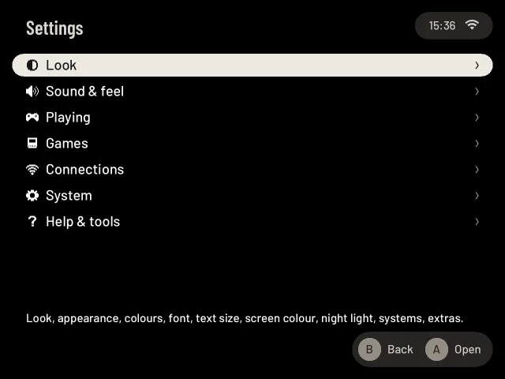

# Settings

## Open Settings

Press **START** on Home or in a system's game list. Settings is not an entry of the list. Settings opens on seven
categories, one line each with a small icon and its name, all on one screen; the line at the bottom names what is in the
selected one. Use Up/Down to move and A to open a category: its own short list of entries, with their values on the
right and the selected entry's line at the bottom. In that list A opens an entry (or switches it), B goes back to
the categories with the one you came from selected, and B there comes back to where you were.
The values ("Home" on Wi-Fi, "Shelf · Dark" on Look, "Auto · Quiet" on Performance & fan: what games run with)
are short; one that is looked up comes a moment later. An entry that opens a page ends in a small arrow **>**; one
without it is a switch: Appearance, Colours, Style, Text size, Motion, Screen frames and the like change with A or
Left/Right, right in the list, and the selected one shows **‹ ›** round its value. The hint at the bottom says
**A Open** or **A Change**.

| Category | What is in it |
|---|---|
| **Look** | Layout, Systems on the shelf, Cozy extras, Appearance, Colours, Style, Text size, Screen colour, Night light. See [Look](#look) |
| **Sound & feel** | Animations, Playful cases, Old-TV switch-on, Motion, Zoom in the pause menu, Sounds, Case sounds, Haptics, LEDs. See [Sound & feel](settings-sound.md) |
| **Playing** | On start, Continue where I quit, Remind me where I was, Buttons, Over the game, Screen frames, Performance & fan, Battery, RetroAchievements. See [Playing](#playing) |
| **Games** | Add games, Game check, Extras, From EmulationStation, Screenshots, Curator, PC streaming. See [Games](#games) |
| **Connections** | Wi-Fi, Bluetooth, Tailscale, Sync, Remote access (SSH), Web companion. See [Connections](settings-system.md#connections) |
| **System** | Language, Time, Sleep & power, Second screen (two screens only), Kids mode, Updates, Storage, Backup & reset. See [System](settings-system.md#system) |
| **Help & tools** | First-start setup, How you like to play, Tour, Manual, Tools, Test buttons, Store (only on a device with a store set up), Report a problem, About. See [Help & tools](settings-system.md#help--tools) |

The second half of Settings, [Connections, System and Help & tools](settings-system.md), has its own page.

A page that opens from somewhere else (a hint, a feature card, the pause menu) goes back with B to its category's
list, and from there to the categories, as if you had opened it from Settings. In this guide a place in Settings is
written as its path: Settings → Playing → **Battery** is the Battery entry in the Playing category.

The first start's pages (Wi-Fi, Add games, the look) are the same pages. Opened from Settings, B returns to the
category's list instead of moving on. The first start's time zone has no page of its own here: Settings → System →
**Time** does the same job. Settings → Help & tools → **First-start setup** runs the whole first start again
([Getting started](getting-started.md#3-first-start)).

**Sound & feel** (what moves, what you hear and what you feel) has a page of its own: [Settings: Sound & feel](settings-sound.md).

## Look

Settings → **Look**. How pocket-ui looks, in the first start's order: first how your games stand (the layout, which
systems, the cozy extras), then the style (appearance, colours, type, the screen). Every choice has a row of its own.
Easy to read, Large text and Reduced motion together, is a card of the [Tour](tour.md) and a key of the first start.

| Entry | What it holds |
|---|---|
| **Layout** | How your games stand: Shelf, Easy, Minimal, Split, Cards or Cabinet, each a live preview of your own shelf. See [Choose a look](#choose-a-look) |
| **Systems on the shelf** | Which systems are on Home, a tick each. The row says "1 hidden" (or 2, 3...) while a system with games is off the shelf: this is the way back. See [Systems on the shelf](#systems-on-the-shelf) |
| **Cozy extras** | The little touches you see, each on or off on its own: the TV on the cabinet, stickers, printed discs, the memory card in the pause menu, light by time of day, decorations, game connections, Rediscover. See [Cozy extras](settings-sound.md#cozy-extras) |
| **Appearance** | **Dark** (the default), **Light** or **Automatic**. A or Left/Right switches it. See [Appearance](#appearance) |
| **Colours** | The colours of every page: Warm, Indigo Cube, Grey Brick, Green X or Blue Station; with the Retro style, Cocoa or Pea. A or Left/Right switches it. See [Colours and style](theme.md) |
| **Style** | Barlow, Pixel or Rounded type, or **Retro**: pixel letters, frames and icons everywhere, with its own colours and menu sounds; **Retro Pixelify** is Retro with Pixelify's rounder letters. A or Left/Right switches it. See [Colours and style](theme.md#style) |
| **Text size** | **Normal** (the default), **Medium** or **Large**: larger text on every screen, fewer rows on a page. A or Left/Right switches it. See [Text size](#text-size) |
| **Screen colour** | The screen's white: **Cooler 10** … **Neutral** … **Warmer 10**. Left/Right changes it, you see it at once; A goes back to Neutral. The same setting as [SELECT + Vol](controls-settings.md#volume-and-brightness-keys), so the two always agree |
| **Night light** | Warmer, less blue colours in the evening, in the menus and in games: **Off** (the default), **On** or **Scheduled**, with a strength. See [Night light](night-light.md) |

### Choose a look

Settings → Look → **Layout** is the first start's last page ("How your games stand"): a scaled-down picture of your shelf in each look, drawn by
the shelf itself with a few of your systems and one game (with its box art when it has one; on an SD card without
games, a built-in set of "Sample game"s). It works like every list: Left/Right switch between the six looks, and the
shelf behind Settings takes the look at once. See [Playing](playing.md#looks) for what each look does. Under the
preview are three rows, the [appearance](#appearance), the [motion](settings-sound.md#motion) and the [animations](settings-sound.md#animations):
Down reaches each one (a bar beside it shows which), Left/Right change it, Up goes back to the looks. A keeps
everything as shown; B ("Cancel") goes back to Settings and puts back the look and the rows as they were when you
came. The hint bar names the keys of the row you are on.

### Appearance

Settings → Look → **Appearance**; A or Left/Right switches it. It applies to every look.

- **Dark**, the default: black pages. On the Mini V2's OLED screen black pixels are off, so Dark uses the
  least battery.
- **Light**: warm paper pages with dark text, easier to read in daylight. Lit pixels use power, so Light uses more
  battery than Dark.
- **Automatic**: light from 07:00, dark from 20:00, by the clock of your time zone ([Time](settings-system.md#time)). It changes
  only after a few seconds in which nothing was pressed, with a short fade; during a game it changes unseen.

The choice is saved at once. The pause menu, the power menu and the small messages that appear over the screen
(volume, brightness, notices) stay dark in both, since they sit over the game's picture.

### Colours

Settings → Look → **Colours** switches the colour set in place; the whole screen shows it at once. See
[Colours and style](theme.md#colours).

### Style

Settings → Look → **Style** switches the type, or the whole Retro style, in place. See [Colours and style](theme.md#style).

### Text size

On small screens such as the Anbernic H700 handhelds, the shelf, game cards and menus keep their full layout,
scaled down to fit the screen. If the writing feels small, choose Medium or Large here.

Settings → Look → **Text size** makes the text larger on every screen. A or Right goes on to the next size,
Left back to the one before, and the screen shows the new size at once; the choice is saved at once and kept across restarts and updates.

- **Normal**, the default: the sizes pocket-ui is designed with.
- **Medium**: the text is about an eighth larger everywhere you read it, for when Normal is a little small and Large
  is more than you need. It changes the same things as Large, a step less.
- **Large**: the text is about a quarter larger everywhere you read it: the shelf and the game lists, Settings and
  its pages, the pause menu and its pages, the quick settings, the game card, Curator (the Lens, Echoes, Versions, play
  history), the search and its keyboard, the console pages, notices and this manual. The large titles (a pulled-out
  label's name, the big letter of a jump, the battery figure) are big enough already and stay as they are.

With Medium and Large the rows are taller, so a page shows fewer of them and scrolls a little sooner. A name or value that is
too long for its row ends with "…" and a long text is wrapped, never cut in the middle of a word; where a hint bar has no
room for every hint, whole hints give way (the least needed first; A, B, HOME and START last), never a button without its word. A few things keep their size because they
belong to a picture of a fixed size: the titles on the cases' spines and the shelf cards in the Cabinet look, the
pictures on the Tour's cards and the look previews' shrunken screens, and what is drawn over a running game by
pocket-core (the in-game messages and Pixel Path's line over the game).

The first start has **Easy to read** on every page (**L2**, and a row on its first page), so larger text is there from
the start.
Safe mode uses the size chosen here too.

### Night light

Settings → Look → **Night light** has its own page: [Night light](night-light.md).

### Systems on the shelf

Settings → Look → **Systems on the shelf** . The list has every system that has games, each with a tick
box, its console and the number of games. All are ticked by default. When Moonlight is installed, the last row is
**PC streaming**, unticked by default: tick it to have the [PC streaming](pc-streaming.md) entry on Home.

- **A** unticks the selected system: its card leaves Home, and its games leave Home's recent games and the game
  switcher (SELECT). A again puts it back.
- The games themselves stay where they are. **Starred games stay in Favourites**, even those of a hidden system:
  a star is a choice for that one game. A recent game of a hidden system comes back the moment its system is
  ticked again.
- The last ticked system cannot be unticked; the page says why.
- The choice is saved at once (in `settings.json`) and kept across restarts and updates.
- **B** goes back to the Settings list.

The first start does not have this list; every system is on the shelf until you change it here.

When no system has games yet, the page says so and shows how they come: once games are on the SD card, their systems
show up here.

## Playing

Settings → **Playing**. What happens when you start and quit, the buttons, how fast games run, the battery and achievements.

| Entry | What it holds |
|---|---|
| **On start** | What you see when the Pocket starts: **Home** (the default) or **Last game**, straight back into the game you played last. A or Left/Right switches it. See [On start](#on-start) |
| **Continue where I quit** | Whether the pause menu's Quit keeps the moment you are at for the next start: **On** (the default) or **Off**, only the game's own saves. A switches it. See [Continue where I quit](#continue-where-i-quit) |
| **Remind me where I was** | Back to a game after more than two weeks: when you played it last and your note, while its moment loads. **On** (the default) or **Off**. A switches it. See [Remind me where I was](#remind-me-where-i-was) |
| **Buttons** | Which face button confirms in pocket-ui's menus, and how the buttons look in the hints, with a picture of the four buttons. See [Buttons](#buttons) |
| **Over the game** | The frame rate, the sensors or Pixel Path's line over every game, or nothing (the default). See [Over the game](#over-the-game) |
| **Screen frames** | Where a game gets a frame when you haven't chosen one: **Off** (the default), **Handhelds** or **Every console**. A or Left/Right switches it. See [Screen frames](#screen-frames) |
| **Performance & fan** | How fast the processor runs and how early the fan starts in games, the fan in the menus, and the temperatures right now. See [Performance and fan](performance.md) |
| **Battery** | Battery history, time left, what a game costs. See [Battery](settings-system.md#battery) |
| **RetroAchievements** | Sign in to retroachievements.org to earn achievements in pocket-core games. See [RetroAchievements](settings-system.md#retroachievements) |

### On start

Settings → Playing → **On start** chooses what the Pocket shows when it starts:

- **Home**, the default: the shelf.
- **Last game**: the game you played last opens right away and continues where you left off, like a console woken
  from standby. The shelf shows for a moment and fades into the game's last picture.

To keep a game that went wrong from starting over and over, Last game only opens it when the Pocket was really
started (switched on or restarted), and only when that game ended normally last time. The Pocket shows Home
instead when the game stopped with an error, when pocket-ui stopped unexpectedly and started again, when the
device shut down unexpectedly, or after an update of pocket-ui.

A game you left by **Power off** in the power menu opens again at the next start whatever this setting says,
as described under [Sleep and power](quick-settings.md#sleep-and-power).

### Continue where I quit

Settings → Playing → **Continue where I quit** decides what the pause menu's **Quit** does with the moment you are at. A
switches it.

- **On**, the default: Quit saves the moment ("Saving and quitting…"). The next start of the game, and
  **Last game** under [On start](#on-start), continue from there.
- **Off**: Quit writes only the game's own saves (its save feature, memory cards) and leaves the moment out
  ("Quitting…"). On pocket-ui's own host the next start is as if no moment had been kept; the older moment stays
  under **Load** as **Where I quit**, until a Quit saves a new one. On PlayStation 2, GameCube, Wii and 3DS the next start still
  continues from the moment of your last Quit with the switch on. A moment saved by sleep counts as that last Quit. The
  details per emulator are in [The pause menu](pause-menu.md#the-pause-menu-home).

This is how NextUI and MinUI quit: their in-game menu has one Quit that writes the game's own saves, and they keep a
moment to resume only when the device sleeps or switches off. With the switch off, the Pocket does the same.

### Remind me where I was

Settings → Playing → **Remind me where I was**: when a game continues its moment and you last played it more than two
weeks ago, a quiet card shows while the moment loads: when you played it last, how long you have played it, and your note
from the game card if there is one. On pocket-ui’s own host the game stands still at that moment until you press any button. That button just starts play. **On** is the default; A switches it. See [Where was I?](continue.md#where-was-i).

The switch applies to pocket-ui's own host and to PlayStation 2, GameCube, Wii and 3DS. **RetroArch games still save
the moment on Quit** with the switch off: ROCKNIX sets RetroArch to save on every exit, and RetroArch has no way to
leave it out. Sleep, Power off and [Recent games](playing.md#recent-games) always keep the moment, whatever
the switch says.

### Buttons

Settings → Playing → **Buttons** has two rows and, under them, a picture of the four face buttons where they sit on
your device, each with the symbol the hints show for it; the one that confirms is named **Confirm** and the one that
goes back **Back**. A line under the picture says which button confirms right now. A or Left/Right switches the
selected row, and the next button you press already works the new way. Both choices are saved at once.

#### Button layout

Which face button plays A, B, X and Y in pocket-ui's own screens.

- **Nintendo**, the default: A on the right, B at the bottom, X on top, Y on the left, as printed on the Mini V2.
- **Xbox**: A at the bottom, B on the right, X on the left, Y on top, as on an Xbox controller.

Menus only: games and safe mode keep the printed buttons. What it changes and what it leaves alone is in
[Controls](controls.md#button-layout).

On experimental **AYN Odin 2 Mini** and **Odin 2 Portal**, the default menu layout is **Xbox** (A bottom,
B right, X left, Y top), matching the printed letters. The original Odin 2 defaults to Nintendo. A saved choice
wins. Safe mode follows the device’s printed layout. Games keep their positional controls: the screenshot
shortcut is HOME + the right face button (printed B on Mini/Portal), regardless of the menu layout.

#### Button symbols

How the hints show the four face buttons, everywhere a key is shown (the hint bars, dialogs, the pause menu, this
manual's key chips and its controls picture).

- **Nintendo**: plain letters A, B, X and Y.
- **Xbox**: A, B, X and Y on green, red, blue and yellow.
- **PlayStation**: cross, circle, square and triangle. Cross stands for A, circle for B, square for X and triangle
  for Y.

Retroid and AYN handhelds start with Xbox, Anbernic handhelds with Nintendo; your choice wins. It only changes the
pictures of the keys: which button confirms is [Button layout](#button-layout)'s job, and the two can be
combined freely. The explanations under a list still name the keys by their letter.

### Over the game

Settings → Playing → **Over the game**: what is drawn over every game while you play, **Off** (the default),
**FPS**, **FPS + sensors** or **Pixel Path**; what each shows is in [Over the game](pause-menu.md#over-the-game). Right
or A goes on, Left goes back. A console or game with its own choice under Options → Speed, rumble, fan keeps it, and **HOME + Y**
switches to the next level while you play. The [Easy](easy.md) look never draws any of it, whatever this says, and leaves the setting alone.

### Screen frames

Settings → Playing → **Screen frames** says which games get a [screen frame](options.md#screen-frame) when you haven't chosen
one yourself. A or Left/Right switches it.

- **Off**, the default: no console starts with a frame, so games show a clean picture on black.
- **Handhelds**: the handhelds (Game Boy, Game Boy Advance, Game Gear and the others) start with frame Auto, the home
  consoles with None.
- **Every console**: every console starts with frame Auto. The home consoles get the monitor surround, the Nintendo DS
  its DS frame.

A frame saved for a console or a game in the pause menu (Options → Picture, kept for the game or the console) stays as it is either
way. The choice applies from the next game you start.

### Performance and fan

Settings → Playing → **Performance & fan**: how fast the processor runs and how early the fan starts in games, the fan in the
menus, **Smooth fan**, and the temperatures right now. It has its own page: [Performance and fan](performance.md).

## Games

Settings → **Games**. Getting games and what runs them onto the Pocket, and the tools around them.

| Entry | What it holds |
|---|---|
| **Add games** | A tile per system with its folder, file types and BIOS needs, file sharing, sending games from your phone (Y), and folders or disc games it can't read. See [Getting started](getting-started.md#the-systems-grid) and [From your phone](phone-upload.md) |
| **Game check** | "Will my games start?": goes through your card and says, in plain words, what is missing and what to do. Only looks; it can hide a duplicate from the shelf when you press A. See [Getting started](game-check.md) |
| **Extras** | Box art, the Pictures choice and Starter pack; PortMaster games on ROCKNIX and TrimUI, and optional Cheats on TrimUI. See [Extras](extras.md) |
| **From EmulationStation** | The favourites and ratings in your EmulationStation `gamelist.xml` files: A adds the favourites to Favourites or uses the ratings as My rating, without changing a thing in EmulationStation. Says "No gamelist" when there is none. See [Your EmulationStation gamelists](library.md#your-emulationstation-gamelists) |
| **Screenshots** | The pictures you took with HOME + A, newest first, in groups by day, with a small picture each. A opens one full screen, X deletes it. The value at the right is how many there are; with none the page says how to take one. See [Looking at your screenshots](playing.md#looking-at-your-screenshots) |
| **Curator** | The Lens and smart shelves, labels, Echoes, Up next, versions and play history, each on or off. See [Curator](#curator) |
| **PC streaming** | Pair a gaming PC for Moonlight on the Pocket itself, see the paired PCs, stream one of their games. See [PC streaming](pc-streaming.md) |

### Curator

Settings → Games → **Curator** turns the parts of [Curator](curator.md#curator) on or off. A (or Left/Right) switches the selected
row; the line under the list says what it does. Changes apply at once.

| Row | Default | What it does |
|---|---|---|
| **Lens & smart shelves** | On | The Curator row on Home, with the Lens, and your pinned smart shelves; also [Just Play](curator.md#just-play) on Home |
| **Echoes on the game card** | On | "More like this" on every card |
| **Up next after a game** | Off | When you quit a game you played for a minute or more, one line on the shelf suggests a game of yours like it. X plays it, any other button puts it away (A is the shelf's own); it goes by itself after a few seconds. See [Up next](curator.md#up-next) |
| **Merge versions in mixed lists** | On | A game you own on several systems shows once in Favourites, smart shelves and Echoes, and starts its preferred version |
| **Labels** | On | The card's Stickers & labels row, labels in the Curator list and pinned labels on Home |
| **Games not on this device in Echoes** | Off | Echoes also names a few games you don't have. Names only |
| **Pixel Path in the pause menu** | Off | Adds Pixel Path to the pause menu: how a game's picture and sound reach you, stage by stage, graded in colour. See [Pixel Path](pause-menu.md#pixel-path). The line beside the picture while you play is [Over the game](#over-the-game) → Pixel Path, which doesn't need this switch |
| **Play history** | On | Curator → History and the Year in review: what you played this week, month and year. Kept on this Pocket only. Off: nothing new is recorded, and what was recorded stays. See [Play history](curator.md#play-history) |

Switching a part off hides it; your smart shelves, labels and preferred versions stay and come back when you
switch it on again.
