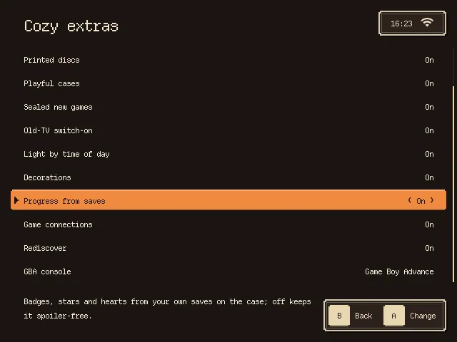

# Settings

## Open Settings

Press **START** on Home or inside any console's game list (Settings is a dedicated button, not a shelf entry). It opens
straight onto the first category, **Connections**, with live values on the right and a short description of the selected
row at the bottom.

Across the top sits a bar of icons for all eight categories (showing the active category's name beside its icon) framed
by **L1** and **R1**: tap L1/R1 to flip categories (wrapping at the ends), or tap an icon on touchscreens. Prefer the
D-pad? Press **Up** from the top row to focus the icon bar, move **Left/Right** to switch categories, then **Down** or
**A** to drop into its rows. Press **B** to return straight to where you came from. On tighter layouts (like Large text
in German or on the TrimUI Brick), category names sit cleanly above a slim icon row.

Rows ending with **›** open a subpage (**A Open**); rows without **›** switch right in place with **Left/Right** or
**A**, showing **‹ ›** around the selected value (**‹ › Change**).

| Category | What is in it |
|---|---|
| **Connections** | Wi-Fi, Bluetooth, Tailscale, Remote access (SSH), Sync, Pocket Sync, Web companion, PC streaming. See [Connections](settings-system.md#connections) |
| **Look** | Layout, Appearance, Colours, Style, Text size, Motion, Game start animation, Cozy extras, Lived-in shelf. See [Look](#look) |
| **Screen & sound** | Brightness, Volume, Screen colour, Night light, Menu sounds, Case sounds, Photos of big moments. See [Screen & sound](settings-sound.md#screen--sound) |
| **Controls** | Buttons, Controller setup, Test buttons, Haptics, LEDs. See [Controls](settings-sound.md#controls) |
| **Playing** | On start, Continue where I quit, Console boot screen, Remind me where I was, Screen frames, Over the game, Zoom in the pause menu, Performance & fan, RetroAchievements. See [Playing](settings-playing.md#playing) |
| **Games** | Add games, Box art & downloads, Game check, Systems on the shelf, Shelf space, Curator, Screenshots, From EmulationStation, Android games (Android only), RomM. See [Games](settings-playing.md#games) |
| **System** | Back to EmulationStation (dArkOS only), Updates, Language, View (Android only), Sleep & power, Battery, Time, Storage, Backup & reset, Kids mode. See [System](settings-system.md#system) |
| **Help & tools** | Manual, Tour, How you like to play, First-start setup, Tools, Report a problem, About. See [Help & tools](settings-system.md#help--tools) |

On pocket-ui beta for dArkOS, some rows stay out of the way: Bluetooth, Remote access (SSH) and Time are configured in
dArkOS itself; Tailscale, Sync, RomM and Screen frames aren't available in that port yet; Wi-Fi displays your dArkOS
connection status; and games copy straight into dArkOS's own folders rather than via the Starter pack.

Every setting lives in exactly one category, and subpages only open for focused steps (picking a network, typing a
password, scanning a QR code or browsing a list). See
[Settings: Screen & sound, Controls](settings-sound.md) and
[Settings: Connections, System and Help & tools](settings-system.md) for the remaining categories.

Any settings page opened via a shortcut, feature card or pause menu returns cleanly to its category list on **B**.
Throughout this guide, paths read like Settings → System → **Battery**.

First-start screens (Wi-Fi, Add games, Layout) are the exact same pages; opened here, B simply goes back to Settings.
Re-run the entire welcome flow anytime via Settings → Help & tools → **First-start setup**
([Getting started](getting-started.md#3-first-start)).

## Look

Settings → **Look** controls how your shelf looks, reads and moves, from layout and colours to text size, animations and
cozy visual touches. Brightness, screen colour and audio live under [Screen & sound](settings-sound.md#screen--sound).
For a one-switch readability preset (Large text + Reduced motion), see the **Big text** card in [Tour](tour.md) or
press **L2** during first start.

| Entry | What it holds |
|---|---|
| **Layout** | Pick Shelf, Easy, Split or Cabinet with a live preview of your own games. See [Choose a look](#choose-a-look) |
| **Appearance** | **Dark** (default), **Light** or **Automatic** (follows time of day). Switch with A or Left/Right. See [Appearance](#appearance) |
| **Colours** | Colour palette across every screen: Warm, Indigo Cube, Grey Brick, Green X or Blue Station (Cocoa or Pea in Retro style). See [Colours and style](theme.md) |
| **Style** | Crisp Barlow font, or **Retro** (pixel fonts, frames, icons, palettes and blip sounds; **Retro Pixelify** uses rounder pixel letters). See [Colours and style](theme.md#style) |
| **Text size** | **Normal** (default), **Medium** or **Large** for easier reading on compact screens. See [Text size](#text-size) |
| **Motion** | **Full** (default), **Reduced** or **Off** to dial back or disable UI movement. See [Motion](#motion) |
| **Game start animation** | **Cozy**: watch cartridges and discs slide into your console (and back out on Quit) with gentler transitions. **Quick**: launch straight in with minimal animation. Defaults to Cozy in Shelf and Cabinet, Quick elsewhere. See [Game start animation](#game-start-animation) |
| **Cozy extras** | Toggle individual touches on or off: cabinet TV (and live preview), case stickers, printed discs, playful cases, old-TV switch-on/off, handheld switch-on, power lights, time-of-day lighting, evening TV glow, shelf decorations, save progress, game connections, Rediscover and GBA model. See [Cozy extras](#cozy-extras) |
| **Lived-in shelf** | Starts **Off**. Turn **On** in Shelf layout to let occasional cases lean on neighbours, stack sideways at row ends and vary spacing naturally like a real home shelf. See [Lived-in shelf](#lived-in-shelf) |

### Choose a look

Settings → Look → **Layout** opens the same live preview from first start ("How your games stand"), rendered with your
actual consoles and box art (or sample games on an empty card). Flip through the four looks with Left/Right to preview
live behind Settings, press A to keep it, or B ("Cancel") to revert. See [Playing](playing.md#looks) for a breakdown of
all four layouts.

### Appearance

Settings → Look → **Appearance** applies across every layout (switch with A or Left/Right):

- **Dark** (default): true black pages, saving battery on OLED panels like the Mini V2.
- **Light**: warm paper background with dark ink for easy daylight reading (uses more power on OLED).
- **Automatic**: switches to Light at 07:00 and Dark at 20:00 based on your [Time](settings-system.md#time) zone,
  fading gently once you pause pressing buttons (or quietly behind a running game).

The pause menu, power menu and in-game overlays always stay dark so they look right over gameplay.

### Colours

Settings → Look → **Colours** changes palettes live across every page. See [Colours and style](theme.md#colours).

### Style

Settings → Look → **Style** switches between Barlow, Retro and Retro Pixelify live. See
[Colours and style](theme.md#style).

### Text size

On compact 640×480 screens (like Anbernic H700 handhelds), pocket-ui scales its full layout to fit; bump up **Text size**
here anytime if labels feel small. Changes apply immediately and persist across reboots and updates:

- **Normal** (default): standard proportions.
- **Medium:** ~12% larger everywhere, a gentle boost without sacrificing much screen room.
- **Large:** ~25% larger across shelves, lists, Settings, pause menu, Quick settings, game cards, Curator, search,
  console pages, alerts and this manual (giant headers like battery percentages and jump letters stay put).

Larger text means slightly taller rows and earlier scrolling; long text wraps cleanly or ends in "…", and crowded hint
bars drop lower-priority hints whole (keeping A, B, HOME and START last). Fixed-size graphics (case spine labels,
cabinet shelf cards, Tour thumbnails and in-game pocket-core overlays) keep their designed size. Safe mode respects your
Text size too, and **L2** toggles **Big text** on every first-start page.

### Motion

Settings → Look → **Motion** controls menu transitions (A or Left/Right):

- **Full** (default): smooth gliding highlights, scrolling lists, sliding pages, rising game cards and gentle fades.
- **Reduced**: soft fades only, with no sliding, gliding or growing.
- **Off**: zero animations; every press snaps immediately to the next frame.

Animated menus target 60 fps while static screens rest idle. None of these add input lag: presses register immediately
and interrupt any motion mid-flight.

### Game start animation

Settings → Look → **Game start animation** sets the pacing when launching and quitting games:

- **Cozy:** in Shelf and Cabinet, your case opens and slides its cartridge or disc straight into the console (~1 second
  with a satisfying click), and page transitions ease a little softer.
- **Quick:** jumps straight into the game with minimal animation.

Defaults to Cozy for Shelf and Cabinet and Quick for Split until you pick your own preference (which then sticks across
layouts). On Cozy, pocket-core finishes the ~1 s ritual before showing the game (slower-loading games aren't held back;
press any button to skip). TV consoles warm up like a vintage CRT in a third of a second (from a bright line expanding
into the picture), while handhelds (Game Boy, GBA, DS, PSP) click on their power light and glow their screen up from dark.
Continuing an open case plays the same ritual while your saved moment waits ready underneath (skipped on Quick or
Reduced/Off motion, or on any button press).

After Quit, Cozy plays the return trip: TV shrinking to a glowing dot (when Old-TV switch-on is enabled) or handheld
going dark, and the cartridge or disc sliding back into its case (left ajar if Continue is waiting). Your shelf is
live right away, so any button press or tap skips straight to action.

### Lived-in shelf

Settings → Look → **Lived-in shelf** gives Shelf rows the organic charm of a real game collection at home: occasional
cases lean slightly against their neighbour, two or three cases at the end (or middle) of long rows stack flat with
spines facing you (smaller boxes perched on larger ones), and spacing varies subtly. Starts **Off** for crisp, straight
rows; toggle **On** with A or Left/Right for instant effect.

Every game's pose is deterministic, so nothing shifts randomly as you scroll (adding a game only nudges its immediate
neighbours). Applies to game rows and Favourites while keeping Home's console row, short rows (<6 games) and open
Continue cases standing straight, and a row that fits on screen standing up never adds a stack that would force
scrolling. Highlighting a leaning case lifts it cleanly; highlighting a stacked case slides it out sideways like pulling
a book from a pile. Leaning and stacked boxes pre-render right after opening a row so scrolling stays silky smooth.

### Cozy extras

Settings → Look → **Cozy extras** lets you cherry-pick every cozy touch individually. Move with Up/Down, toggle **On**
or **Off** with A or Left/Right (applies immediately and persists across reboots; **Reset settings** restores defaults).
If Game start animation or Motion currently suppresses an effect, the footer tells you which setting to check. Audio
toggles (**Case sounds**) live under [Screen & sound](settings-sound.md#screen--sound) beside Menu sounds.

| Extra | What it does | Start |
|---|---|---|
| **TV on the cabinet** | Places a mini retro TV atop the cabinet previewing your selected game (Cabinet layout only) | On |
| **TV plays the game** | Runs unplayed games live (muted) on the cabinet TV for up to 25 seconds after resting 2 seconds ([The TV on the cabinet](playing.md#the-tv-on-the-cabinet)). Launches a background player, so it works harder and uses more battery; Off keeps a crisp still preview (Cabinet only) | Off |
| **Stickers on cases** | Shows your stickers on boxes in Shelf and Cabinet. Off hides them visually while keeping them saved on the game card | On |
| **Printed discs** | Prints cover art and titles directly onto game discs. Off shows clean console-coloured discs (Shelf and Cabinet) | On |
| **Playful cases** | Springy case wiggles, console-specific loading animations, spinning discs inside open cases, leaning spines while scrolling and tactile sticker-pressing ([Playing](playing.md#starting-a-game)). Shelf and Cabinet, with Motion Full | On with Cozy, Off with Quick |
| **Sealed new games** | Wraps unplayed games in clear shop cellophane across Shelf, Cabinet, Easy, Split and game cards, ripping open with a tear on first launch (when Game start animation is Cozy and Motion Full; otherwise vanishes cleanly). Any play time, status, save, state, clock file, memory card, progress or recent entry counts as played | On |
| **Old-TV switch-on** | Warms up TV console games like a real CRT: bright dot, horizontal line, blue AV channel and quick burst of snow before the game appears (<0.5 s while the game already runs). Handhelds light up their own screen and power light instead. Requires Cozy + Motion Full | On |
| **Old-TV switch-off** | Collapses TV games back to a horizontal line and glowing dot after Quit (handhelds simply darken). Off returns from black. Shelf and Cabinet, with Cozy + Motion Full | On |
| **Handheld switch-on** | Authentic handheld power-on/off curves over the first half-second: Game Boy olive glass darkening in, GBC/GBA rising from grey, GBA SP frontlight glow, PSP soft fade, Game Gear/Lynx backlight flicker, DS dual screens lighting, plus matching shutoff fades on Quit. Off fades cleanly from black. Shelf and Cabinet, Cozy + Motion Full | On |
| **Power lights** | Brings handheld frame LEDs to life: dims Game Boy/Pocket red at Battery low (5%), turns GBA/SP green to red, blinks PSP orange and flashes Game Gear red, plus a quick double-blink whenever you save a state. Off keeps the LED steady (requires a handheld screen frame) | On |
| **Light by time of day** | Shifts room lighting subtly with your clock: cool morning light, warm evening lamp glow, dim late-night tone while keeping covers and text true (Shelf and Cabinet) | On |
| **Evening TV glow** | After dark, dims the room slightly while the cabinet TV casts a warm glow onto nearby boards and cases (Cabinet only) | On |
| **Decorations** | Living shelf mementos: a plant that grows with play hours, a trophy for your first completed game, a framed "100 %" for your first 100% sticker, and a mini figurine for every console you play 10+ hours (where space allows; Shelf and Cabinet) | On |
| **Progress from saves** | Reads your in-game saves to show real milestones on the box back, beside Continue and on Where was I? ([details](library.md#where-you-are-in-the-game)). Off hides progress and stops reading saves | On |
| **Game connections** | Turns developer, publisher, series and genre on game cards and box backs into clickable links to matching games in your library ([Connections](library.md#connections)). Off displays them as plain text | On |
| **Rediscover** | Surfaces games you played a year ago or haven't touched in ages inside Curator | On |
| **GBA console** | Pick **Game Boy Advance** or **Game Boy Advance SP** across shelves, console pages and Cabinet (the SP flips open and loads cartridges into its bottom slot label-down). Persists across reboots without affecting games or emulators | Game Boy Advance |

#### Sealed new games

Unplayed games arrive wrapped in crisp retail plastic wrap so untouched treasures stand out on your shelf. The first
time you launch one, the cellophane tears away for good (animated with Cozy + Motion Full, or gone instantly otherwise),
even if you only play a minute. Any play time, chosen status, recent entry, save, state, RTC file, memory card or
detected progress counts as played, including saves imported from another handheld or frontend (which show "Not here yet"
for play time rather than inventing a fake duration; "Where was I?" still needs a known date and resumable moment).

#### Console colours

Several consoles offer authentic colourways: **Game Boy Advance** (Original, Milky Blue, Pink), **Game Boy Color**
(Original, Dandelion), **Nintendo 64** (Original, Ice Blue, Jungle Green) and **GameCube** (Original, Jet Black).
Open the console's page (X on the system) and press **Left/Right** on the colour line beneath its picture
(**‹ Milky Blue ›**, or tap left/right on touchscreens). Your chosen colour updates everywhere (shelf, console page,
cabinet TV and start/quit animations) and stays saved across reboots. *(GBA SP uses its own artwork via GBA console
above.)*
