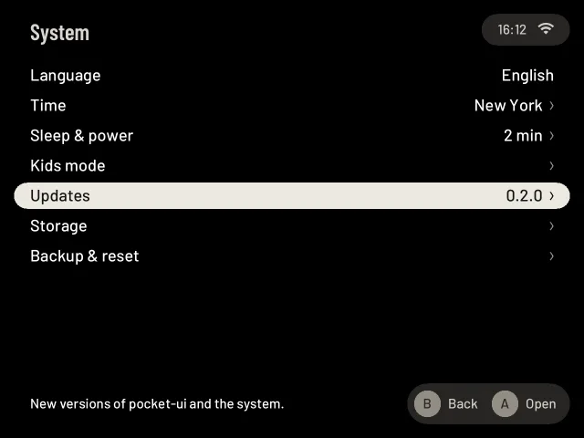

# Updates

Settings → System → **Updates** ("New versions of pocket-ui and the system."). It needs Wi-Fi.

New versions of pocket-ui come over Wi-Fi, with one press. Your games, saves and settings stay. On the TrimUI Brick, unchanged engine data stays in place when an update starts; changed files are prepared at a limited write speed before the menu opens.

1. Open Settings → System → **Updates**. The page checks by itself.
2. If a newer version is out, the pocket-ui row says so ("0.2.0, 0.2.1 available") and **Install pocket-ui …** appears. Press A on it.
3. It downloads, checks the file and restarts by itself ("Installed. Restarting…").

The updates are signed by us and every download is checked (see [What makes it safe](#what-makes-it-safe)); if the new
version doesn't start, the old one comes back. Without a network the page says "Couldn't reach the update server. Check
Wi-Fi.", and on a network that wants a sign-in first (a hotel, a train) "Connected, but this network wants a sign-in
first. Open Settings › Connections › Wi-Fi." ([Hotel and train Wi-Fi](hotel-wifi.md)). If the server has no update list
at all, a check ends with "No updates published yet. A new version installs like the first one; your games and settings
stay." You can also install a new version by running the installer again with the new download
([Getting started](getting-started.md)); it installs over the current version.

Downloads show when they are connecting, trying another server, checking the file or preparing
the update. If a server fails or sends no new data for 30 seconds, pocket-ui tries the next
source in the signed update list. If no source works, it shows an error and keeps your current
version. Choose **Check again** and retry once the connection works. **A / Cancel** stops all
sources. Each server gets five minutes plus the time a big file needs on a slow but steady
connection, so a download cannot wait forever; one that is slower still ends with "The download is
too slow on this network. Nothing was installed. Try again on a faster Wi-Fi."
Downloaded files are always checked before installation, including files from another server.

Before it downloads, pocket-ui checks that the SD card has room for the update and still some to
spare for your saves; if not, it says how much is missing ("The SD card is too full for this
update: it needs … MB more. Nothing was changed."). If the clock is far behind (after a flat
battery, before network time has set it), secure connections fail and the page says "The clock
looks wrong, so the update server can't be checked. Set it in Settings › System › Time, or wait
for network time over Wi-Fi."

## The hint on the shelf

When a newer pocket-ui is out, the shelf says so once, a little after the start and only with Wi-Fi: "pocket-ui 0.3.0
is ready. Your games and settings stay." **A** opens Settings → System → Updates, **B** only closes it. Each version is
said once, whatever you pressed; the next version says it again. It never comes over a game, over a page or the first
start, not in Kids Mode, and only on a released pocket-ui (a test build from the developers stays quiet). Until you
update, a small amber dot sits on System in Settings and on its Updates row.

pocket-ui looks quietly, at most once a day (and once after it starts), only with Wi-Fi, never during a game and only
when you are not pressing buttons. If the server does not answer it waits longer each time. It only asks the signed list
that the Updates page reads (no account, nothing about you or your games is sent). Nothing is ever installed by itself.
It stays quiet for the system (ROCKNIX) and for ports; those are only in Settings → System → Updates.

To switch it off, open Settings → System → Updates and set **Check for updates automatically** to Off (Left/Right or A).
Then pocket-ui asks nothing and says nothing; **Check again** still works when you want it.

## The Updates page

The first time you open the page, pocket-ui checks for updates by itself (unless you switched the automatic check off). The page shows:

- **pocket-ui**: the installed version, and a newer one if available ("0.2.0, 0.2.1 available").

Below that are the actions that apply right now:

| Action | What it does |
|---|---|
| **Install pocket-ui …** | Asks first: **Install now** downloads and installs the new pocket-ui and restarts it by itself ("Installed. Restarting…"), **Later** (or B) goes back. If the battery is under 20 % and not charging, the page says to plug in the charger first. |
| **Check again** | Checks for updates again. |

While something downloads, a progress bar shows how far it is, and **A** cancels the download
("Download cancelled."). A download that sends nothing new for 30 seconds goes on from the
next download server; slow Wi-Fi is fine as long as data keeps coming. When no server works, the page says why
("The download server stopped responding…" or "Download failed. Check Wi-Fi."). The release notes of the selected
update appear at the bottom. If everything is current, the page says "Everything is up to date."

Development builds show "Development build: install a release package to use app updates." Their internal version
number does not establish their order relative to published releases, so they offer no app OTA updates, including
future releases. Install the normal release package to return to release updates; your games and settings stay.
About identifies a development build with `-dev` and its commit; the TrimUI model stays visible in its own
Device row. Problem reports include the build type and commit.

Once a completed download is being committed to the card, cancellation can be too late: the update finishes and
restarts normally. Keep the device charged while installation finishes. A missing shelf notice can also mean that
this version was already announced; **Check again** on the Updates page still shows what is available.

## What makes it safe

**Only our updates are accepted.** The list of available updates is signed. If the signature does
not match, pocket-ui stops: "The update list isn't signed by us. Nothing was changed."

**Every download is checked** against the size and checksum in that signed list. A damaged or
changed download is deleted: "The download is damaged or was changed. Nothing was installed." pocket-ui only
downloads over secure connections (https).

**pocket-ui updates have an automatic way back:**

1. The new version is unpacked next to the current one, which stays untouched.
2. Before switching, pocket-ui checks that the new version actually starts on this device. If it
   does not: "… doesn't start on this device. Nothing was changed."
3. Then it switches to the new version in one step and restarts.
4. If the new version crashes, or does not show its first screen within 20 seconds, the previous
   version comes back by itself, and you see: "Version … didn't start properly, so the last version that worked is back."

The previous version is kept on the SD card until the next update replaces it. So is the last version that ran for two
minutes with its screen: if a later version keeps stopping, that one comes back, and if it stops too, pocket-ui opens
in [safe mode](safe-mode.md).

On ROCKNIX, the installer also writes the new programs to the card before switching to them. If power fails during
installation, a complete interface remains available at the next start. Installing a rebuilt copy of the same version
keeps the old programs in a separate folder, too. Run the installer again to finish an interrupted installation.

## Android

On Android, open the existing Updates row in Settings. The page uses a separate signed APK
channel and the same version, check, install confirmation and automatic-check actions. Downloads
use Wi-Fi only, with progress and **B** to cancel. Android asks once to allow pocket-ui to install
unknown apps, then asks to confirm each installation. A successful update closes the app; open it
again to see the installed version. It keeps its data and saves. Automatic channel checks do not
interrupt Play; an update you have started must finish or be cancelled before starting a game. See [Android updates](android-mvp.md#updates-over-wi-fi).
